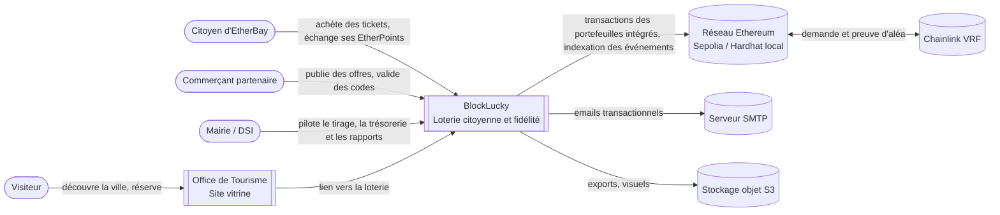
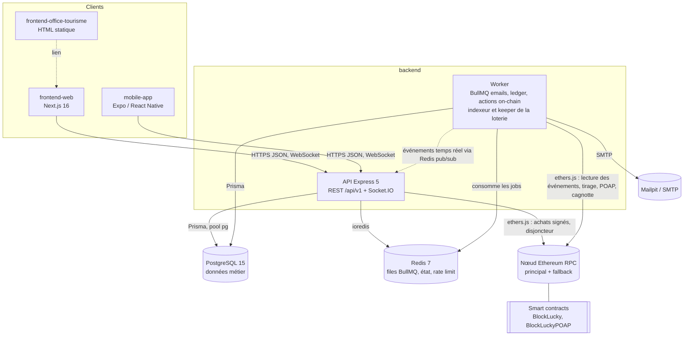

# Architecture

Diagrammes au format C4 (contexte, conteneurs), versionnés en Mermaid. Ils se mettent à jour dans la même pull request que le changement d'architecture.

## Niveau 1 : contexte

## Niveau 2 : conteneurs

## Organisation du backend

Le backend est un monolithe modulaire : un dossier par domaine dans `backend/src/api/` (`auth`, `lottery`, `marketplace`, `partners`, `user`, `analytics`, `admin`, `webhooks`, `system`), chacun découpé en `routes` → `controllers` → `services` → `repo`. Les routes restent fines, la logique métier vit dans les services et l'accès aux données dans les repositories.

| Préoccupation | Emplacement |
|---|---|
| Configuration validée au démarrage | `src/config/env.config.ts` |
| Pools PostgreSQL et Redis | `src/config/prisma.config.ts`, `src/config/redis.config.ts` |
| Contexte de requête, logs, métriques, arrêt propre | `src/observability/` |
| Middlewares transverses (auth, RBAC, validation, rate limit, idempotence, erreurs) | `src/middlewares/` |
| Files et workers asynchrones | `src/queues/`, `src/workers/`, `src/worker.ts` |
| Blockchain : portefeuilles intégrés, appels au contrat, indexeur, keeper, actions on-chain | `src/blockchain/` (voir l'[ADR 0004](adr/0004-smart-contract-ethereum-portefeuille-integre.md)) |

## Flux d'une requête

1. `requestContextMiddleware` attribue un `X-Request-Id` (repris de l'appelant ou de `traceparent` s'il est valide), propagé dans tous les logs via `AsyncLocalStorage`.
2. Les métriques Prometheus enregistrent la durée par route paramétrée.
3. Helmet, CORS (liste blanche `FRONTEND_URL` + `CORS_ORIGINS`), parsing JSON borné, mode maintenance, rate limit partagé dans Redis.
4. Routeur `/api/v1` (alias `/api`), authentification JWT, RBAC, validation Zod, idempotence sur les POST sensibles.
5. Le middleware d'erreur unique traduit les erreurs métier (`AppError`), JSON invalide, contraintes PostgreSQL (unicité, CHECK, timeouts) et masque les messages internes en production.
