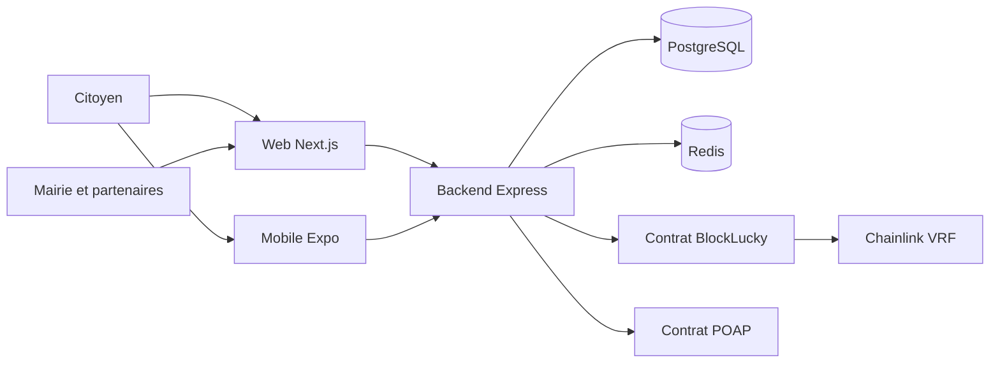

# Accueil

BlockLucky est la loterie citoyenne de fin d'année de la Ville d'EtherBay. C'est un projet de l'Epitech Digital School (rush « BlockLucky, création d'un smart contract », promotion DIGI3), conçu comme un pilote pédagogique : les tickets s'achètent en ethers fictifs, sans aucune valeur monétaire, sur un vrai smart contract Solidity.

Cette documentation s'adresse aux développeurs de la Ville qui reprennent le code source et au jury de l'école. Elle décrit ce que fait réellement le code, la manière de le lancer, de le modifier et de l'exploiter, ainsi que ce qui reste simulé ou à faire.

## Le projet en bref

Le cœur du projet est le contrat [`smart-contract/contracts/BlockLucky.sol`](src:smart-contract/contracts/BlockLucky.sol). Il encaisse les tickets, ferme le tour quand il est complet ou quand sa durée est écoulée, demande un nombre aléatoire à Chainlink VRF v2.5, désigne le gagnant et lui réserve la cagnotte. Un second contrat, [`smart-contract/contracts/BlockLuckyPOAP.sol`](src:smart-contract/contracts/BlockLuckyPOAP.sol), frappe un badge de participation ERC-721 non transférable par participant et par tour.

Autour du contrat, le dépôt contient une plateforme complète :

- un backend Express 5 en TypeScript ([`backend/src/app.ts`](src:backend/src/app.ts)) avec PostgreSQL, Redis, BullMQ et Socket.IO. Il crée pour chaque citoyen un portefeuille Ethereum intégré, chiffré en AES-256-GCM, lui verse une dotation de bienvenue en ethers fictifs, signe ses achats avec sa clé et projette les événements du contrat en base ;
- un frontend web Next.js 16 avec trois espaces : citoyen, commerçant partenaire et dashboard de la Mairie ;
- une application mobile Expo pour les citoyens ;
- un site vitrine statique de l'Office de Tourisme, livré en bonus ;
- une blockchain locale en conteneur (nœud Hardhat, contrats déployés à des adresses fixes, oracle VRF simulé), une CI GitHub Actions et des scénarios de charge k6.

Les citoyens gagnent aussi des EtherPoints en participant (achat, cadeau, parrainage, quêtes). Ces points, tenus en base de données et non sur la chaîne, s'échangent contre des offres des commerçants partenaires.

> [!IMPORTANT]
> Le projet n'est pas encore en production. Aucun déploiement sur Sepolia n'a été réalisé et l'application n'est pas en ligne sur etherbay.tech. Tout fonctionne en local sur une blockchain Hardhat. La page [Réel, simulé ou à venir](presentation/reel-ou-simule.md) fait l'inventaire exact.

## Par où commencer

Le tableau suivant propose un parcours de lecture par profil. Chaque ligne liste les pages à lire dans l'ordre.

| Profil | Objectif | Pages à lire |
|---|---|---|
| Nouveau développeur | Comprendre le projet et le lancer en local | [Contexte](presentation/contexte.md), [Prérequis](demarrage/prerequis.md), [Infrastructure locale](demarrage/infrastructure-locale.md), [Lancer les applications](demarrage/lancer-les-applications.md), [Comptes de démonstration](demarrage/comptes-et-connexion.md), [Vue d'ensemble de l'architecture](architecture/vue-ensemble.md), [Organisation du dépôt](architecture/organisation-depot.md) |
| Développeur backend | Modifier l'API, la base ou les workers | [Structure et cycle d'une requête](backend/structure.md), [Configuration](backend/configuration.md), [Modules métier](backend/modules/index.md), [Référence de l'API](backend/reference-api.md), [Modèle de données](base-de-donnees/modele.md), [Files et workers](backend/files-workers.md), [Ajouter un endpoint](guides/ajouter-endpoint.md) |
| Développeur front web | Faire évoluer les pages et les espaces | [Stack et structure](web/structure.md), [Pages et espaces](web/pages.md), [Authentification et routes protégées](web/authentification.md), [État et appels API](web/etat-api.md), [Design system](web/design-system.md), [Ajouter une page web](guides/ajouter-page-web.md) |
| Développeur mobile | Faire évoluer l'application Expo | [Stack et structure](mobile/structure.md), [Navigation et écrans](mobile/navigation-ecrans.md), [Tester sur un téléphone](mobile/telephone-physique.md), [Ajouter un écran mobile](guides/ajouter-ecran-mobile.md) |
| Développeur smart contract | Comprendre, tester et redéployer les contrats | [Vue d'ensemble des smart contracts](smart-contracts/index.md), [Contrat BlockLucky](smart-contracts/blocklucky.md), [Cycle de vie d'un tour](smart-contracts/cycle-tour.md), [Sécurité du contrat](smart-contracts/securite.md), [Tests](smart-contracts/tests.md), [Intégration blockchain du backend](integration-blockchain/index.md), [Modifier le contrat](guides/modifier-contrat.md) |
| Exploitation | Déployer, surveiller, réagir | [Stack complète en conteneurs](demarrage/stack-conteneurs.md), [Docker Compose](infrastructure/docker-compose.md), [Environnements](infrastructure/environnements.md), [Runbooks](infrastructure/runbooks.md), [Runbooks blockchain](infrastructure/runbooks-blockchain.md), [Observabilité](backend/observabilite.md), [Sauvegardes et reprise](infrastructure/sauvegardes.md) |
| Sécurité et conformité | Vérifier les protections et le RGPD | [Modèle de menaces](securite/menaces.md), [Clés et garde des portefeuilles](securite/cles-portefeuilles.md), [RGPD](juridique/rgpd.md), [Crypto-actifs et MiCA](juridique/crypto-actifs.md), [Registre des risques](juridique/registre-risques.md) |
| Jury | Évaluer la réponse au kickoff | [Contexte et kickoff](presentation/contexte.md), [Besoins des parties prenantes](presentation/besoins.md), [Objectifs et indicateurs](presentation/objectifs-indicateurs.md), [Réel, simulé ou à venir](presentation/reel-ou-simule.md), [Grille de compétences](presentation/competences.md), [Le projet en chiffres](accueil/projet-en-chiffres.md), [Préparer la soutenance](guides/soutenance.md) |

## Les questions les plus fréquentes

| Question | Réponse courte | Page détaillée |
|---|---|---|
| Faut-il MetaMask ou acheter de la crypto ? | Non. Le backend crée le portefeuille et la Mairie le dote en ethers fictifs. | [Portefeuilles intégrés](integration-blockchain/portefeuilles.md) |
| Qui choisit le gagnant ? | Chainlink VRF. Ni la Mairie ni le backend ne peuvent influencer le tirage. | [Tirage Chainlink VRF](smart-contracts/chainlink-vrf.md) |
| Que se passe-t-il si un tour est annulé ? | Chaque mise est remboursable sur le contrat et le backend réclame le remboursement pour le citoyen. | [Annulation et remboursement](architecture/flux/annulation.md) |
| Comment se connecter en local ? | Par un code à 6 chiffres reçu dans Mailpit, sans mot de passe. | [Comptes de démonstration et connexion](demarrage/comptes-et-connexion.md) |
| La blockchain locale a redémarré, plus rien ne marche | La chaîne a perdu son état : il faut réinitialiser la base. | [Dépannage](demarrage/depannage.md) |
| Qu'est-ce qui est encore fictif ? | Notifications push, Sentry, libellé multi-signatures, paliers de la jauge, notamment. | [Réel, simulé ou à venir](presentation/reel-ou-simule.md) |

## Adresses locales utiles

Une fois l'environnement lancé comme décrit dans [Lancer les applications](demarrage/lancer-les-applications.md) :

| Service | Adresse |
|---|---|
| API et documentation Swagger | `http://localhost:2053/api/docs` |
| Frontend web | `http://localhost:3000` |
| Site de l'Office de Tourisme | `http://localhost:4000` |
| Boîte mail de développement (Mailpit) | `http://localhost:8025` |
| Nœud Hardhat (JSON-RPC, chain ID 31337) | `http://127.0.0.1:8545` |

## Conventions de cette documentation

Les liens de la forme [`backend/src/app.ts`](src:backend/src/app.ts) ouvrent le fichier source sur GitHub. Certaines pages, comme la [référence de l'API](backend/reference-api.md) ou le [dictionnaire de données](base-de-donnees/dictionnaire.md), sont générées depuis le code à chaque construction du site. La page [Comment lire cette documentation](accueil/lire-la-documentation.md) détaille l'organisation en 16 parties, les encadrés et la recherche.
