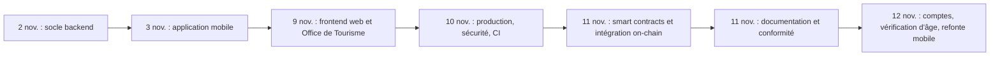

# Journal des versions

Le dépôt ne porte aucune étiquette Git de version et tous les `package.json` sont en version `1.0.0`. Ce journal est reconstitué depuis l'historique Git (`git log`) et regroupe les commits en grandes livraisons. Chaque changement a été intégré à `main` par une pull request depuis la branche `marceau` ; les numéros de pull request cités sont ceux des commits de fusion.

| Indicateur | Valeur |
| --- | --- |
| Période | du 2 au 11 novembre 2026 |
| Commits sur `marceau` | 331, dont 150 commits de fusion |
| Commits sur `main` | les 331 de `marceau`, plus 27 commits de fusion (pull requests #164 à #193) |
| Pull requests fusionnées | 177, numérotées de #1 à #193 ; les numéros absents (#50, #129 à #133, #135 à #139, #161, #162, #186, #188, #189) sont des pull requests qui n'ont pas été fusionnées |
| Dernier commit de `main` | fusion de la pull request #193, le 11 novembre 2026 |

Pour retrouver le détail d'une livraison :

```bash
git log --reverse --date=short --format="%ad %h %s" --since=2026-11-10 --until=2026-11-11
```

## Vue d'ensemble



## Livraison 1 : socle du backend (2 novembre 2026)

Pull requests #1 à #27.

- Infrastructure Docker locale : PostgreSQL, Redis, puis Mailpit.
- Initialisation de Prisma et première migration.
- Serveur Express, configuration centrale, adaptateur PrismaPg, Redis, Nodemailer et Swagger.
- Middlewares de sécurité : JWT, contrôle des rôles, rate limiting, validation Zod.
- Modèles d'emails transactionnels et service de double authentification TOTP.
- Services EtherPoints (ledger), blockchain et stockage S3.
- Files BullMQ et workers.
- Socket.IO pour la salle d'attente du tirage et le chat en direct.
- Domaines métier et leurs routes : authentification (connexion sociale Web3Auth, vérification de majorité, 2FA), loterie (achat dit « gasless », cadeau, tirage Chainlink VRF, POAP), boutique et fidélité (carte à gratter, QR codes), partenaires, utilisateur (parrainage, quêtes sociales, jeu responsable, RGPD), analytique (UTM, démographie), administration Mairie (disjoncteur, trésorerie, rapports, audit).
- Webhooks blockchain, seed, tests unitaires, d'API et d'intégration.

À ce stade, la blockchain est entièrement simulée par le backend : hachages de transaction et tirages aléatoires produits par `blockchain.service.ts`.

## Livraison 2 : application mobile (3 novembre 2026)

Pull requests #28 à #49.

- Harmonisation de la reconnexion sociale par email côté backend.
- Initialisation de l'application React Native avec Expo SDK 58.
- Design system, thème adaptatif, internationalisation français et anglais.
- Services techniques : stockage sécurisé, client HTTP, Socket.IO, rapport d'erreurs local nommé « Sentry ».
- Store Redux Toolkit, endpoints RTK Query.
- Hooks métier, dont le relais « gasless » et les notifications.
- Composants : interface générique, loterie (compte à rebours, roulette, ticket, badge), classement, chat, boutique (solde, récompense, carte à gratter).
- Écrans : onboarding et connexion, 2FA, accueil et billetterie, tirage en direct et historique, boutique, profil, parrainage, missions, jeu responsable, RGPD, charte de transparence.
- Navigation principale, tests Jest et documentation.

## Livraison 3 : frontend web (9 novembre 2026)

Pull requests #51 à #77.

- Initialisation de Next.js 16, types partagés avec le mobile.
- Design system aligné sur le mobile, utilitaires de formatage, validation et « wallet déterministe ».
- Store Redux, RTK Query, client Socket.IO, suivi analytique du parcours.
- Composants génériques, modales système globales, composants loterie et boutique, chat, charte de transparence.
- Coquille responsive, gardes de rôle, page municipale publique, pages légales.
- Espace citoyen : connexion, 2FA, accueil, billetterie, tirage en direct, historique, boutique, profil, sécurité, jeu responsable, RGPD, aide.
- Espace Mairie : pilotage, analytique et exports, partenaires, disjoncteur, trésorerie, journal d'audit.
- Espace partenaires : offres, import CSV de codes, validation en caisse.
- Tests Vitest et documentation.

## Livraison 4 : site de l'Office de Tourisme (9 novembre 2026)

Pull requests #78 à #100.

- Site vitrine statique : données de la destination, icônes, mise en page commune, composants, bandeau cookies.
- Pages : accueil, Découvrir, Sortir (agenda filtrable), Manger, Dormir, fiches détaillées, magazine, favoris, infos pratiques, mentions légales, 404, page « Bientôt disponible ».
- Billetterie, panier, tunnel de commande simulé, billets électroniques avec QR code, export agenda.

## Livraison 5 : préparation à la production (9 et 10 novembre 2026)

Pull requests #101 à #128 et #134.

- Backend : validation de la configuration au démarrage, journaux JSON et identifiant de corrélation, CORS restreint et prise en compte du proxy, gestionnaire d'erreurs unique, délais SMTP, S3 et RPC, pool PostgreSQL, préfixe et délais Redis, sondes de santé séparées, métriques Prometheus et compteurs métier, rate limiting partagé dans Redis, idempotence, secret obligatoire du webhook, réglages des files, arrêt propre et worker séparé, préfixe `/api/v1`, ESLint 10, typage renforcé, build de production et contrôle de `.env.example`.
- Base : index, dates `timestamptz`, contraintes `CHECK`.
- Conteneurs : Dockerfile multi-étapes du backend, images du web et de l'Office de Tourisme, sondes, persistance Redis, stack complète dans Compose.
- Mobile : port de l'API, reprises réseau, lint, canaux EAS.
- Web : pages d'erreur.
- CI GitHub Actions, Dependabot, CODEOWNERS, modèle de pull request.
- Scénarios de charge k6.

## Livraison 6 : sécurité (10 et 11 novembre 2026)

Pull requests #140 à #160 et #163.

- Documentation d'architecture, ADR, runbooks, README racine et guide de contribution.
- Chiffrement AES-256-GCM, durcissement de la 2FA TOTP, échappement des emails, alertes de sécurité.
- JWT vérifiés strictement et révocation des sessions ; codes de secours hachés ; connexion par code email et refonte de la 2FA ; jetons RGPD hachés.
- Rôles contrôlés en base, 2FA obligatoire pour les administrateurs, appartenance des entreprises partenaires.
- Signature HMAC du webhook, bornes de validation, neutralisation des formules dans l'export CSV, sondes et métriques sans fuite d'information.
- Déconnexion côté serveur sur le web et le mobile, stockage sécurisé mobile.
- Content-Security-Policy du web ; polices auto-hébergées, CSP stricte et image nginx à jour pour l'Office de Tourisme.
- Durcissement des conteneurs Compose, analyses de sécurité dans la CI (gitleaks, Trivy, CodeQL).
- Politique de sécurité, registre RGPD, plan de réponse aux incidents.

## Livraison 7 : smart contracts et intégration on-chain (11 novembre 2026)

Pull requests #164 à #185. C'est la livraison qui remplace la blockchain simulée par un vrai contrat.

- Projet Hardhat 3.
- Contrat `BlockLucky` : tickets, tirage Chainlink VRF, cagnotte ; badge `BlockLuckyPOAP` non transférable.
- Fuzzing, couverture à 100 %, analyse Slither.
- Déploiement local avec oracle VRF simulé, image Docker de la blockchain locale, script de déploiement Sepolia, export des ABI.
- Backend : configuration blockchain et schéma des données on-chain, portefeuille Ethereum intégré pour chaque citoyen, indexeur d'événements, keeper du tirage, file d'actions on-chain, loterie branchée sur le contrat, disjoncteur et commission sur le contrat, tests sur une vraie chaîne, effacement de la clé du portefeuille à la suppression RGPD.
- Blockchain locale dans Docker Compose.
- Web et mobile : portefeuille intégré et achat signé par le citoyen, tirage en attente et annonce du gagnant en direct, retrait des gains sur mobile.
- CI : jobs `contracts` et `chain`.

## Livraison 8 : documentation et conformité (11 novembre 2026)

Pull requests #187 à #193.

- Documentation des smart contracts, du déploiement Sepolia et du backend on-chain.
- ADR 0004 (smart contract, Chainlink VRF et portefeuille intégré), mise à jour de l'architecture.
- Veille juridique, reformulation des besoins, registre des risques.
- README mis à jour : smart contracts, blockchain locale, documents de conformité.

## Après le dernier commit

Cette documentation officielle (`documentation-officielle/`) reprend et remplace l'ancien dossier `docs/` et les README détaillés des projets, réduits à quelques lignes qui renvoient vers elle.

## Livraison 9 : comptes, vérification d'âge et refonte mobile (12 novembre 2026)

Pas encore de pull request à la rédaction de cette entrée. La date est celle de la migration `20261112090000_password_accounts_identity_verification`.

- Comptes avec mot de passe haché par bcrypt : inscription confirmée par un code email, connexion, mot de passe oublié et réinitialisation qui révoque toutes les sessions (`/auth/signup`, `/auth/signin`, `/auth/password/forgot`, `/auth/password/reset`). `/auth/login` reste la connexion du web.
- Connexion Google et Apple par jeton d'identité vérifié côté serveur (`/auth/oauth/google`, `/auth/oauth/apple`), qui répond 503 tant que `GOOGLE_CLIENT_IDS` ou `APPLE_CLIENT_IDS` est vide.
- Vérification d'âge : envoi du recto et du verso de la pièce d'identité (`/user/identity`), images chiffrées en AES-256-GCM, table `IdentityDocument`, page Mairie `/mairie/identites`, consultation et décision tracées dans l'audit, images effacées à la décision, email `identity-decision`. Achat, cadeau, échange et ticket à gratter refusés en 403 `AGE_VERIFICATION_REQUIRED` tant que l'âge n'est pas vérifié.
- Loterie : un seul ticket par participant et par grand tirage (`MAX_TICKETS_PER_PLAYER` à 1 au déploiement, 409 sinon), numéros de ticket à cinq chiffres, phases `OPEN`, `WAITING_ROOM`, `DRAWING`, `COMPLETED` et `CANCELLED`, délai de révélation `DRAW_REVEAL_DELAY_SECONDS` respecté par le keeper, paliers de la jauge à 5 000, 7 500, 9 000 et 10 000 participants.
- Boutique : ticket à gratter acheté en EtherPoints (`POST /marketplace/scratch`, 50 ou 100 points).
- Dotation de bienvenue portée à 0,5 ETH fictif ; seed avec le mot de passe de démonstration `EtherBay2026demo` et trois comptes à l'âge vérifié.
- Application mobile refaite sur la maquette Figma : police Inter, jetons de couleur, composants d'interface et icônes SVG, quatre onglets (Accueil, Mes tickets, Parrains, Profil), écrans poussés sur la pile racine, douze nouveaux écrans dont la salle d'attente, la roue du tirage et la vérification d'âge, ouverte d'elle-même après la connexion tant que l'âge n'est pas vérifié.
- Frontend web aligné sur la nouvelle charte du mobile : jetons de couleur recopiés (jaune `#FFDA38`, encre `#1D2637`, lavande, menthe, pêche), police Inter servie en local, jeu d'icônes SVG copié, logo « B » en favicon, composants d'interface, coquilles et pages restylés sur les écrans mobiles, roue du tirage à dix secteurs. Le favicon de la documentation est passé au même logo.

## Ce que l'historique révèle

- Plusieurs libellés de commits anciens ne décrivent plus le code : « Web3Auth », « achat gasless », « relayer gasless », « trésorerie multi-sig », « Sentry ». Ils correspondent à des choix remplacés lors des livraisons 6 et 7 et laissent des traces dans le code (voir [Dette technique et limites](dette-technique.md)).
- La blockchain réelle arrive en dernier : les interfaces ont été construites contre une simulation, puis rebranchées. Les chemins du mode simulé en sont l'héritage.
- Tout l'historique est porté par un seul auteur de commits. Les branches `Marie`, `Myriam` et `Rajeeva` existent sur le dépôt distant mais ne contiennent aucun commit propre : elles s'arrêtent sur le commit initial.
