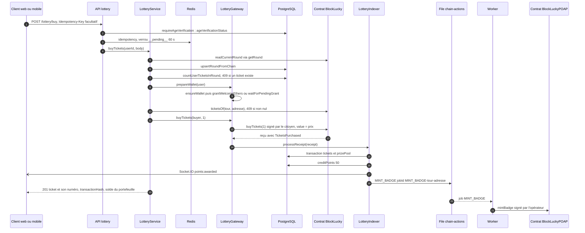
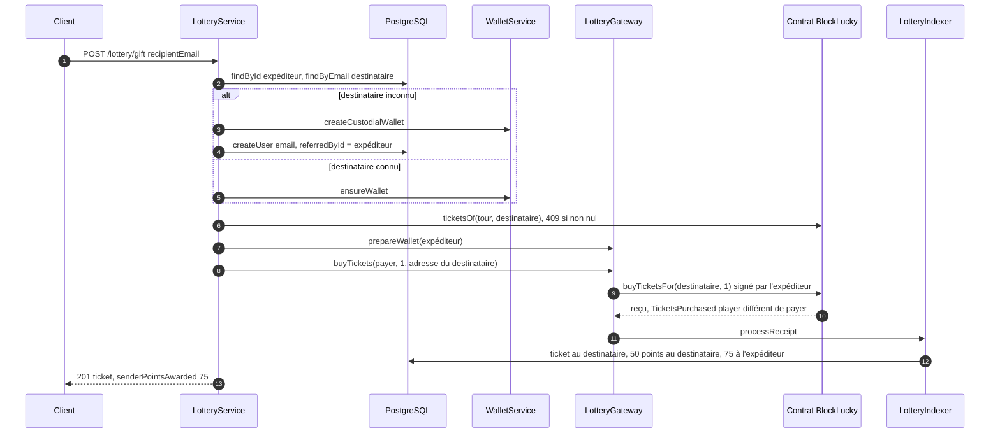

# Achat et cadeau de ticket

Un citoyen dont l'âge a été vérifié achète son ticket du tour en cours, ou offre un ticket à un proche par son adresse email. Chaque participant ne peut détenir qu'un ticket par grand tirage, qu'il l'ait acheté ou reçu. Dans les deux cas, la transaction est signée par le portefeuille intégré du citoyen qui paie, envoyée au contrat `BlockLucky`, puis indexée dès réception du reçu. Les EtherPoints sont crédités par l'indexeur, et un badge POAP est frappé en arrière-plan.

## Diagramme de séquence de l'achat

## Achat pas à pas

**Route.** `POST /api/v1/lottery/buy` dans [`backend/src/api/lottery/lottery.routes.ts`](src:backend/src/api/lottery/lottery.routes.ts) : `authenticate`, `requireAgeVerification`, `idempotency`, `validate(buyTicketSchema)`, puis `lotteryController.buyTicket` ([`backend/src/api/lottery/lottery.controllers.ts`](src:backend/src/api/lottery/lottery.controllers.ts)).

**Âge.** [`requireAgeVerification`](src:backend/src/middlewares/age-verification.middleware.ts) relit `ageVerificationStatus` en base et répond `403 AGE_VERIFICATION_REQUIRED` s'il ne vaut pas `VERIFIED`. Ce contrôle passe avant l'idempotence : un refus n'est pas mémorisé.

**Validation.** `buyTicketSchema` ([`backend/src/api/lottery/lottery.validators.ts`](src:backend/src/api/lottery/lottery.validators.ts)) : `quantity` vaut 1, valeur par défaut et seule admise (`Un seul ticket par participant et par grand tirage.`) ; `roundId` et `retryAttempt` sont acceptés mais ignorés en mode `onchain`.

**Service.** `lotteryService.buyTickets` ([`backend/src/api/lottery/lottery.services.ts`](src:backend/src/api/lottery/lottery.services.ts)) délègue à `buyOnchain` :

1. `authRepository.findById` : 404 si le compte n'existe plus.
2. `lotteryGateway.readCurrentRound` lit `currentRoundId` puis `getRound` dans le contrat. `syncRound` recopie l'état du tour dans `LotteryRound` par `lotteryRepository.upsertRoundFromChain` ([`backend/src/api/lottery/lottery.repo.ts`](src:backend/src/api/lottery/lottery.repo.ts)).
3. **Ticket unique.** Si le citoyen a déjà un ticket dans ce tour en base, la réponse est `409 Vous avez déjà votre ticket pour ce grand tirage.` avec `contractError: 'PlayerLimitReached'`.
4. `lotteryGateway.prepareWallet(user)` garantit un portefeuille et une dotation. Si la dotation lancée à l'inscription est encore en cours, `grantWelcomeEthers` trouve le verrou `wallet:grant-lock:<id>` et attend sa fin par `waitForPendingGrant` ([`backend/src/blockchain/wallet.service.ts`](src:backend/src/blockchain/wallet.service.ts)), jusqu'à 30 s.
5. `lotteryGateway.ticketsOf(tour, adresse)` relit sur le contrat le nombre de tickets du portefeuille. Un ticket acheté directement sur la chaîne et pas encore indexé donne la même réponse 409.
6. `lotteryGateway.buyTickets(buyer, quantity)` ([`backend/src/blockchain/lottery.gateway.ts`](src:backend/src/blockchain/lottery.gateway.ts)) relit le tour, refuse s'il n'est pas `OPEN` (409), déchiffre la clé du citoyen par `walletService.signerFor`, calcule `value = ticketPriceWei * quantity` et appelle `buyTickets(quantity)` sur le contrat.
7. `sendAndIndex` attend le reçu par `tx.wait()`, puis appelle `lotteryIndexer.processReceipt(receipt)`. Une erreur `NONCE_EXPIRED` à l'envoi provoque une seule nouvelle tentative.
8. Le service relit le ticket créé (`findTicketsByIds`), ajoute son numéro sur 5 chiffres (`ticketNumber`), le solde d'EtherPoints et le solde d'ethers du portefeuille (`walletService.balanceOf`), puis répond 201.

**Contrat.** `_buyTickets` ([`smart-contract/contracts/BlockLucky.sol`](src:smart-contract/contracts/BlockLucky.sol)) vérifie dans l'ordre : tour `Open`, `endTime` non atteint, quantité non nulle, tickets restants, limite par participant (`maxTicketsPerPlayer`, 1 avec la configuration de déploiement par défaut), montant exact. Il ajoute l'adresse du joueur à `ticketOwners` une fois par ticket, crédite `contributions[roundId][msg.sender]` et émet `TicketsPurchased(roundId, player, payer, quantity, firstTicketIndex, totalTickets, amount)`.

**Indexation.** `onTicketsPurchased` ([`backend/src/blockchain/lottery.indexer.ts`](src:backend/src/blockchain/lottery.indexer.ts)) :

1. `ensureRound` crée le tour en base s'il manque, `userForWallet` retrouve le compte du joueur par son adresse (ou crée un compte sans email pour une adresse inconnue).
2. Calcule les index `firstTicketIndex` à `firstTicketIndex + quantity - 1`. Si l'un d'eux existe déjà pour ce tour, l'événement a déjà été indexé : la fonction renvoie les tickets existants avec `created: false` et ne crédite rien.
3. Sinon, une transaction Prisma crée un `Ticket` par index (avec `transactionHash`, `blockNumber`, `payerWallet`, date du bloc) et incrémente `LotteryRound.prizePool` du montant en ETH.
4. `ledgerService.creditPoints` : 50 EtherPoints `TICKET_PURCHASE` par ticket au joueur. Si le payeur est un autre compte connu, 75 EtherPoints `GIFT_TICKET` par ticket au payeur.
5. `emitSocketEvent('points:awarded', ...)` ([`backend/src/socket/event-bridge.ts`](src:backend/src/socket/event-bridge.ts)) : émission directe quand l'indexation a lieu dans l'API, publication sur Redis quand elle a lieu dans le worker. Puis `enqueueChainAction({ type: 'MINT_BADGE', ... })`.

**Badge POAP.** La file `chain-actions` ([`backend/src/blockchain/chain-actions.ts`](src:backend/src/blockchain/chain-actions.ts)) exécute `mintBadge(player, roundId)` avec le compte opérateur. La réponse de l'achat indique `poapBadge.status: 'MINT_PENDING'` : le badge n'est pas encore frappé à ce moment. L'erreur `BadgeAlreadyMinted` (deuxième achat dans le même tour) est considérée comme une réussite.

## Cadeau de ticket

**Route.** `POST /api/v1/lottery/gift` avec `authenticate`, `requireAgeVerification`, `idempotency`, `validate(giftTicketSchema)`. Seul l'âge de l'expéditeur est contrôlé. Le corps contient `recipientEmail` ; `recipientWallet` et `personalMessage` sont validés mais ignorés en mode `onchain`.

`giftOnchain` ([`backend/src/api/lottery/lottery.services.ts`](src:backend/src/api/lottery/lottery.services.ts)) :

1. Refuse de s'offrir un ticket à soi-même (400).
2. Crée le destinataire s'il n'a pas de compte, avec un portefeuille intégré et `referredById` pointant vers l'expéditeur. Aucun email n'est envoyé au destinataire, aucune dotation ne lui est versée.
3. Relit le tour courant et refuse si le destinataire a déjà un ticket sur le contrat : `409 Cette personne a déjà son ticket pour ce grand tirage.`
4. Prépare le portefeuille de l'expéditeur, qui paie le ticket et les frais.
5. Appelle `lotteryGateway.buyTickets(payer, 1, recipient.walletAddress)`, qui utilise `buyTicketsFor`. Si le contrat répond `PlayerLimitReached`, le message est remplacé par celui du point 3.

Le contrat enregistre la contribution au nom de l'expéditeur : en cas d'annulation du tour, c'est lui qui est remboursé. `maxTicketsPerPlayer` s'applique au destinataire. L'expéditeur peut donc avoir son propre ticket et en offrir d'autres, à des destinataires différents.

## Erreurs possibles

| Code | Cause | Origine |
|---|---|---|
| 400 | `quantity` différent de 1, email du destinataire invalide | `validate` |
| 400 | Cadeau à soi-même | `giftOnchain` |
| 400 | `InvalidQuantity`, `IncorrectPayment` | Contrat |
| 403 | Âge non vérifié (`AGE_VERIFICATION_REQUIRED`) | `requireAgeVerification` |
| 402 | Solde d'ethers insuffisant (`INSUFFICIENT_FUNDS`), par exemple si la dotation a échoué ou est épuisée | ethers |
| 404 | Compte introuvable | Service |
| 409 | Ticket déjà détenu par l'acheteur ou par le destinataire (`PlayerLimitReached`) | Service et contrat |
| 409 | Tour non ouvert (tirage en cours), `RoundExpired`, `RoundSoldOut` | Passerelle et contrat |
| 409 | Une requête avec la même `Idempotency-Key` est en cours (`Retry-After: 1`) | `idempotency` |
| 502 | Reçu absent, aucun ticket émis, ou erreur non reconnue, avec `canRetry: true` | Passerelle |
| 503 | Contrat en pause (`EnforcedPause`, `circuitBreaker: true`) ou réseau injoignable (`canRetry: true`) | Passerelle |

## Idempotence

- **Côté HTTP.** Avec un en-tête `Idempotency-Key` (8 à 128 caractères `A-Za-z0-9_-`), la clé `idempotency:<userId>:POST:/api/v1/lottery/buy:<clé>` est posée pour 60 s pendant le traitement, puis remplacée par la réponse pour 24 h. Les réponses 5xx libèrent la clé pour permettre une nouvelle tentative. Ni le web ni le mobile n'envoient cet en-tête.
- **Côté indexation.** L'API indexe le reçu immédiatement, et l'indexeur périodique du worker relit le même événement plus tard. L'unicité `(lotteryId, ticketIndex)` et le contrôle préalable font que les tickets et les EtherPoints ne sont créés qu'une fois. Une violation d'unicité pendant la transaction (les deux process en même temps) est rattrapée par `isUniqueViolation` et traitée comme un événement déjà indexé.
- **Côté badge.** L'identifiant de job `MINT_BADGE-<tour>-<adresse>` empêche une seconde mise en file pour le même joueur et le même tour tant que le job est conservé, et `BadgeAlreadyMinted` est ignorée.
- **Réponse.** `pointsAwarded` vaut toujours 50 dans la réponse, y compris si c'est le worker qui a indexé l'achat le premier et crédité les points.

## En mode simulé

`buyTickets` refuse un achat après les 48 heures du tour (409) ou un second ticket (409), puis appelle `blockchainService.relayTicketPurchase` ([`backend/src/services/blockchain.service.ts`](src:backend/src/services/blockchain.service.ts)), qui renvoie un hash et un numéro de bloc aléatoires. Le ticket est créé directement par `createTicketWithPrizeIncrement`, avec un indice égal au nombre de tickets déjà enregistrés sur le tour, les points crédités dans la requête et le badge renvoyé par `mintPoapBadge` est fictif. Le disjoncteur est lu dans Redis. Aucun ether ne circule.
