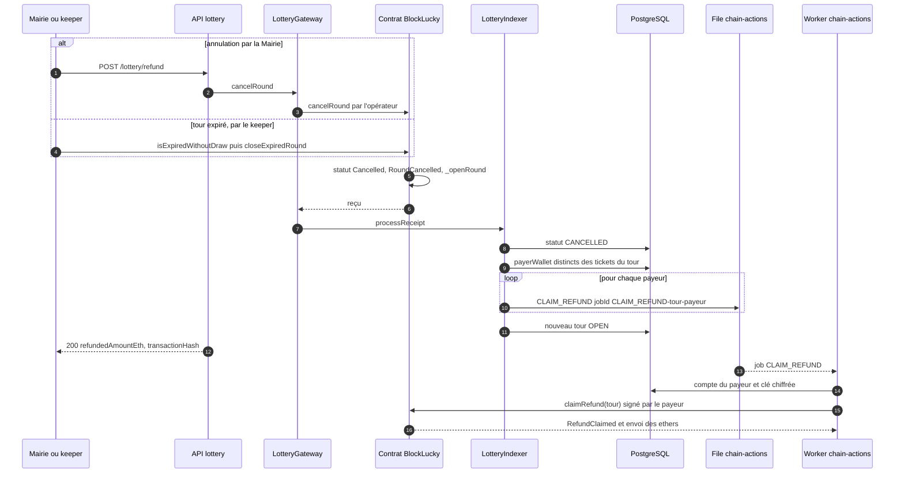

# Annulation et remboursement

Un tour est annulé dans deux cas : sa durée est écoulée sans avoir atteint `minTicketsToDraw` tickets, ou la Mairie l'annule. Dans les deux cas, le contrat marque le tour `Cancelled` et chaque mise devient remboursable par retrait (`claimRefund`). La Mairie ne peut conserver aucun fonds d'un tour annulé. Le backend réclame ensuite automatiquement chaque remboursement pour le compte des payeurs.

## Diagramme de séquence

## Déclenchement

### Tour expiré, par le keeper

`runKeeperOnce` ([`backend/src/blockchain/lottery.keeper.ts`](src:backend/src/blockchain/lottery.keeper.ts)) teste d'abord `isDrawReady`, puis `isExpiredWithoutDraw`. Cette seconde fonction du contrat est vraie quand le tour est `Open`, que `endTime` est atteint et que `ticketCount < minTicketsToDraw`. Le keeper appelle alors `closeExpiredRound()` avec le compte opérateur, attend le reçu et l'indexe. `closeExpiredRound` n'exige aucun rôle : n'importe quel compte, ou Chainlink Automation, peut clôturer un tour expiré.

Le keeper ne fait rien quand le contrat est en pause : un tour qui expire pendant une pause n'est clôturé qu'à la reprise, ou par un appel direct à `closeExpiredRound`, qui n'est pas bloqué par la pause.

### Par la Mairie

`POST /api/v1/lottery/refund` dans [`backend/src/api/lottery/lottery.routes.ts`](src:backend/src/api/lottery/lottery.routes.ts) : `authenticate`, `requireRoles('ADMIN')`, sans validation de corps ni idempotence. `lotteryController.cancelAndRefund` appelle `lotteryService.CancelAndAutoRefundRound`, qui délègue à `cancelOnchain` ([`backend/src/api/lottery/lottery.services.ts`](src:backend/src/api/lottery/lottery.services.ts)) :

1. Lecture du tour courant (`readCurrentRound`) pour connaître le montant collecté.
2. `lotteryGateway.cancelRound()` ([`backend/src/blockchain/lottery.gateway.ts`](src:backend/src/blockchain/lottery.gateway.ts)) envoie `cancelRound()` avec le compte opérateur, attend le reçu et l'indexe.
3. Relecture du tour en base, déjà passé à `CANCELLED` par l'indexation du reçu.
4. Réponse 200 avec `autoRefundExecuted: true`, `refundedAmountEth` (total collecté), le hash et le lien vers l'explorateur.

Le `roundId` éventuellement envoyé est ignoré : seul le tour courant peut être annulé.

> [!NOTE]
> `autoRefundExecuted: true` signifie que les remboursements sont mis en file, pas qu'ils ont été versés. Les ethers arrivent dans les portefeuilles quand le worker a traité chaque job `CLAIM_REFUND`.

### Dans le contrat

`cancelRound` ([`smart-contract/contracts/BlockLucky.sol`](src:smart-contract/contracts/BlockLucky.sol)) est réservée à `OPERATOR_ROLE`. Elle ne vérifie ni l'état du tour ni la pause : elle annule le tour courant, qu'il soit `Open` ou `Drawing`. `_cancelRound` supprime l'association avec une éventuelle requête VRF en cours (une réponse tardive sera ignorée), passe le tour à `Cancelled`, émet `RoundCancelled(roundId, ticketCount, totalCollected)` et ouvre le tour suivant.

## Remboursements

`onRoundCancelled` ([`backend/src/blockchain/lottery.indexer.ts`](src:backend/src/blockchain/lottery.indexer.ts)) passe le tour à `CANCELLED`, sélectionne les valeurs distinctes de `payerWallet` parmi les tickets du tour, et met en file un job `CLAIM_REFUND` par payeur.

`executeChainAction` ([`backend/src/blockchain/chain-actions.ts`](src:backend/src/blockchain/chain-actions.ts)) retrouve le compte du payeur par son adresse et signe `claimRefund(contractRoundId)` avec son portefeuille. Le contrat vérifie que le tour est `Cancelled` et que la contribution de l'appelant est non nulle, la remet à zéro, émet `RefundClaimed` et envoie le montant.

Le remboursement est calculé sur `contributions[roundId][msg.sender]`, c'est-à-dire sur le payeur. Pour un ticket offert, c'est l'expéditeur qui est remboursé, pas le destinataire. Les frais de la transaction de remboursement sont payés par le payeur sur son solde d'ethers fictifs.

L'événement `RefundClaimed` n'est pas indexé : la base ne garde pas trace des remboursements effectués. Pour savoir si un payeur a été remboursé, lire `contributionOf(roundId, payeur)` dans le contrat (0 après remboursement).

## Erreurs possibles

| Point | Code ou effet | Cause |
|---|---|---|
| `POST /lottery/refund` | 403 | Rôle `ADMIN` absent ou 2FA non activée ; `AccessControlUnauthorizedAccount` si le compte opérateur n'a pas `OPERATOR_ROLE` |
| `POST /lottery/refund` | 503 | Réseau injoignable |
| `POST /lottery/refund` | 502 | « L'annulation du tour a échoué. » pour toute erreur non reconnue |
| Keeper | Ignoré silencieusement | `RoundNotCancellable` : le tour n'est plus expiré sans tirage |
| Job `CLAIM_REFUND` | Terminé sans erreur | `NothingToRefund` : déjà remboursé |
| Job `CLAIM_REFUND` | Terminé sans rien faire | Payeur sans compte ou sans clé chiffrée (compte supprimé, adresse externe) |
| Job `CLAIM_REFUND` | Échec définitif | `RoundNotCancelled` (`UnrecoverableError`) |
| Job `CLAIM_REFUND` | Jusqu'à 5 tentatives | Réseau, solde insuffisant pour les frais |

## Idempotence

- Un second `POST /lottery/refund` annule le tour suivant, qui vient d'être ouvert : l'appel n'est pas idempotent. Il n'est pas protégé par `Idempotency-Key`. La console Mairie doit éviter le double envoi.
- `closeExpiredRound` ne réussit qu'une fois par tour : ensuite `isExpiredWithoutDraw` est fausse pour le nouveau tour.
- L'identifiant `CLAIM_REFUND-<tour>-<adresse>` déduplique les jobs, et la contribution remise à zéro empêche un second remboursement (`NothingToRefund`, traité comme une réussite).
- Les payeurs dont les tickets n'ont pas été indexés (indexeur en retard ou en panne) ne reçoivent pas de job. Ils peuvent toujours appeler `claimRefund` eux-mêmes : le contrat garde leur contribution sans limite de durée.

## En mode simulé

`CancelAndAutoRefundRound` passe seulement le tour à `CANCELLED` en base et répond `autoRefundExecuted: true` avec le message « Tous les participants ont été remboursés automatiquement via le Smart Contract ». Aucun remboursement n'a lieu : ce message est trompeur en mode simulé.
