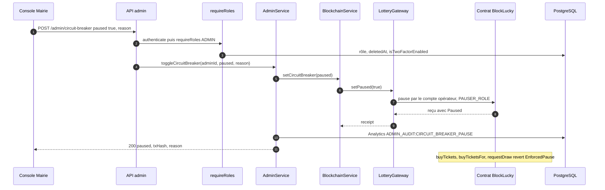

# Disjoncteur

Le disjoncteur est l'arrêt d'urgence de la loterie. Un administrateur de la Mairie le déclenche depuis la page sécurité de la console : le backend appelle `pause()` sur le contrat `BlockLucky`, ce qui bloque immédiatement les achats et les demandes de tirage, pour tous les clients, y compris ceux qui appelleraient le contrat sans passer par BlockLucky. La reprise passe par `unpause()`. Chaque action est inscrite au journal d'audit.

## Diagramme de séquence

## Pas à pas

**Interface.** La page [`frontend-web/src/app/mairie/securite/page.tsx`](src:frontend-web/src/app/mairie/securite/page.tsx) appelle la mutation `toggleCircuitBreaker` de [`frontend-web/src/store/api/adminApi.ts`](src:frontend-web/src/store/api/adminApi.ts).

**Route.** `POST /api/v1/admin/circuit-breaker` dans [`backend/src/api/admin/admin.routes.ts`](src:backend/src/api/admin/admin.routes.ts). Tout le routeur `admin` est protégé par `router.use(authenticate, requireRoles('ADMIN'))`. Puis `validate(circuitBreakerSchema)` ([`backend/src/api/admin/admin.validators.ts`](src:backend/src/api/admin/admin.validators.ts)) : `paused` booléen obligatoire, `reason` facultatif d'au moins 5 caractères.

**Contrôle des droits.** `requireRoles` ([`backend/src/middlewares/rbac.middleware.ts`](src:backend/src/middlewares/rbac.middleware.ts)) ne se fie pas seulement au rôle du jeton : il relit en base le rôle, `deletedAt` et `isTwoFactorEnabled`. Un compte rétrogradé ou supprimé depuis sa connexion est refusé, et un administrateur sans 2FA est refusé tant que `ADMIN_MFA_REQUIRED=true` (valeur imposée en production).

**Service.** `adminController.toggleCircuitBreaker` appelle `adminService.toggleCircuitBreaker` ([`backend/src/api/admin/admin.services.ts`](src:backend/src/api/admin/admin.services.ts)), qui :

1. Appelle `blockchainService.setCircuitBreaker(paused)` ([`backend/src/services/blockchain.service.ts`](src:backend/src/services/blockchain.service.ts)).
2. En mode `onchain`, celui-ci appelle `lotteryGateway.setPaused(paused)` ([`backend/src/blockchain/lottery.gateway.ts`](src:backend/src/blockchain/lottery.gateway.ts)), qui envoie `pause()` ou `unpause()` avec le compte opérateur et attend le reçu par `sendAndIndex`. Le changement est journalisé en avertissement avec le hash.
3. Enregistre l'action par `adminRepository.recordAdminAuditLog` ([`backend/src/api/admin/admin.repo.ts`](src:backend/src/api/admin/admin.repo.ts)) : une ligne `Analytics` d'`eventType` `ADMIN_AUDIT:CIRCUIT_BREAKER_PAUSE` ou `ADMIN_AUDIT:CIRCUIT_BREAKER_RESUME`, avec `paused`, `reason` (« Action manuelle de sécurité Mairie / DSI » par défaut) et `txHash`.
4. Répond 200 avec `paused`, `txHash`, `timestamp` et `reason`. Le journal est consultable par `GET /api/v1/admin/audit-logs`.

**Contrat.** `pause()` et `unpause()` ([`smart-contract/contracts/BlockLucky.sol`](src:smart-contract/contracts/BlockLucky.sol)) exigent `PAUSER_ROLE`, accordé au compte opérateur au déploiement. Elles émettent les événements `Paused` et `Unpaused` d'OpenZeppelin, qui ne sont pas indexés par le backend.

## Effets de la pause

| Fonction du contrat | Pendant la pause |
|---|---|
| `buyTickets`, `buyTicketsFor` | Refusées (`EnforcedPause`) |
| `requestDraw`, et donc `performUpkeep` pour un tirage | Refusées |
| `checkUpkeep` | Renvoie `false` |
| `fulfillRandomWords` | Autorisée : un tirage déjà demandé se termine et désigne un gagnant |
| `claimPrize`, `claimRefund` | Autorisées : les gagnants et les participants d'un tour annulé récupèrent leurs fonds |
| `cancelRound`, `closeExpiredRound`, `retryDraw`, `withdrawFees` | Autorisées |

Côté backend :

- Le keeper ne fait rien tant que `paused()` est vrai ([`backend/src/blockchain/lottery.keeper.ts`](src:backend/src/blockchain/lottery.keeper.ts)), y compris pour clôturer un tour expiré.
- Un achat renvoie 503 avec `errors.contractError: 'EnforcedPause'` et `errors.circuitBreaker: true`. Le frontend reconnaît ce drapeau (`isCircuitBreakerError` dans [`frontend-web/src/hooks/useBlockLuckyWallet.ts`](src:frontend-web/src/hooks/useBlockLuckyWallet.ts)).
- `GET /api/v1/lottery/status` renvoie `guarantees.paused` et `network.isPaused`, lus dans le contrat.
- L'indexeur et la file `chain-actions` continuent : les cagnottes et remboursements en attente sont versés.

## Erreurs possibles

| Code | Cause |
|---|---|
| 400 | `paused` absent ou non booléen, `reason` de moins de 5 caractères |
| 401 | Jeton absent ou invalide |
| 403 | Rôle `ADMIN` absent, droits modifiés, administrateur sans 2FA ; ou `AccessControlUnauthorizedAccount` si le compte opérateur n'a pas `PAUSER_ROLE` |
| 503 | `pause` demandée alors que le contrat est déjà en pause : le contrat répond `EnforcedPause`, traduit par le message générique « Le Smart Contract est temporairement en pause de sécurité » ; ou réseau injoignable |
| 502 | `unpause` demandée alors que le contrat n'est pas en pause : `ExpectedPause` n'est pas dans la table de traduction, d'où le message de repli « Le changement d'état du disjoncteur a échoué » |
| 503 | Vérification des droits impossible (base indisponible) |

## Idempotence

La route n'a pas de middleware `idempotency`. Le contrat rend l'opération idempotente dans les faits : une seconde pause ou une seconde reprise échoue sans rien changer, avec les codes ci-dessus. Le journal d'audit n'est écrit qu'après une transaction réussie : une tentative refusée n'y figure pas.

> [!CAUTION]
> `isCircuitBreakerPaused` renvoie `false` si la lecture de `paused()` échoue (nœud injoignable). Pendant une panne RPC, le tableau de bord de la Mairie (`GET /admin/dashboard`, champ `network.isPaused`) peut donc afficher le contrat comme actif alors qu'il est en pause. Le contrat, lui, reste en pause. `GET /lottery/status` lit `paused()` sans ce repli et échoue dans la même situation.

## En mode simulé

`setCircuitBreaker` écrit `true` ou `false` dans la clé Redis `blockchain:circuit_breaker` et dans une variable du process, puis renvoie un hash aléatoire. `relayTicketPurchase` lit cet état et refuse l'achat avec un 503 `circuitBreaker: true`. Le tirage simulé, lui, ne consulte pas le disjoncteur.

## Voir aussi

- [Sécurité du contrat](../../smart-contracts/securite.md) : rôles et pause côté Solidity.
- [Réponse aux incidents](../../infrastructure/incidents.md) : quand déclencher le disjoncteur.
- [Administration Mairie](../../backend/modules/administration.md) : les autres actions de la console.
