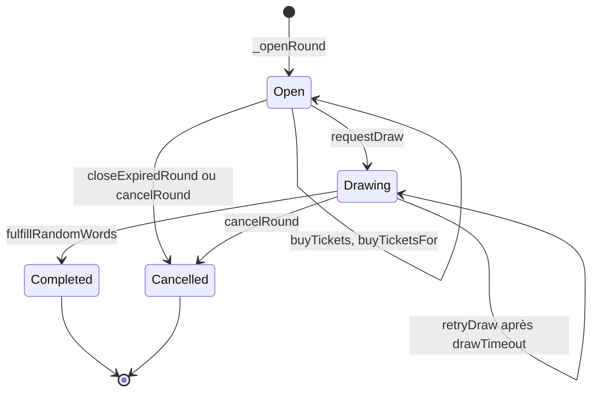

# Flux métier

Cette section suit les sept parcours principaux de BlockLucky à travers le code, du clic dans l'application jusqu'à la base de données et à la blockchain. Chaque page contient un diagramme de séquence, puis une explication pas à pas qui cite les fichiers et les fonctions réellement appelés, les erreurs possibles avec leur code HTTP et la manière dont le flux résiste aux doublons.

Toutes les pages décrivent le mode `BLOCKCHAIN_MODE=onchain`, celui de la production et de Docker Compose. Les différences du mode `simulated` sont signalées à la fin de chaque page concernée.

## Carte des flux

| Flux | Déclencheur | Point d'entrée | Synchrone | Asynchrone | Page |
|---|---|---|---|---|---|
| Inscription et portefeuille | Citoyen | `POST /api/v1/auth/login` puis `POST /api/v1/auth/2fa/verify` | Défi OTP, création du compte et du portefeuille, EtherPoints de bienvenue, JWT | Email du code, dotation de bienvenue, email de bienvenue | [Inscription et portefeuille](inscription.md) |
| Achat et cadeau | Citoyen | `POST /api/v1/lottery/buy`, `POST /api/v1/lottery/gift` | Transaction signée par le citoyen, attente du reçu, indexation, EtherPoints | Frappe du badge POAP, événement `points:awarded` | [Achat et cadeau de ticket](achat-cadeau.md) |
| Tirage et cagnotte | Keeper ou Mairie | `runKeeperOnce`, `POST /api/v1/lottery/draw` | Demande VRF | Réponse VRF, indexation de `WinnerPicked`, annonce `draw:winner`, retrait de la cagnotte | [Tirage et versement de la cagnotte](tirage.md) |
| Annulation et remboursement | Keeper ou Mairie | `runKeeperOnce`, `POST /api/v1/lottery/refund` | Annulation dans le contrat | Retrait des remboursements pour chaque payeur | [Annulation et remboursement](annulation.md) |
| Disjoncteur | Mairie | `POST /api/v1/admin/circuit-breaker` | `pause()` ou `unpause()`, journal d'audit | - | [Disjoncteur](disjoncteur.md) |
| Échange de récompense | Citoyen, puis commerçant | `POST /api/v1/marketplace/claim`, `POST /api/v1/marketplace/redeem` | Débit des points, code promo, décrément du stock | Email du code promo | [Échange de récompense](recompense.md) |
| Suppression RGPD | Citoyen | `POST /api/v1/user/gdpr/delete-request` puis `POST /api/v1/user/gdpr/confirm-delete` | Jeton, anonymisation, révocation des sessions | Email de confirmation | [Suppression RGPD](suppression-rgpd.md) |

## Vue d'ensemble de la loterie

Les quatre flux de la loterie s'enchaînent autour du cycle de vie d'un tour dans le contrat :



Chaque passage à `Completed` ou `Cancelled` ouvre immédiatement le tour suivant (`_openRound`) dans la même transaction. La base suit ces états avec l'énumération `Status` : `OPEN`, `LOCKED` (pour `Drawing`), `COMPLETED`, `CANCELLED`. Le détail du contrat est dans [Cycle de vie d'un tour](../../smart-contracts/cycle-tour.md).

## Principes communs

### Chaîne d'une requête

Toutes les requêtes HTTP traversent la même chaîne, montée dans [`backend/src/app.ts`](src:backend/src/app.ts) : contexte de requête, métriques, Helmet, CORS, parsing JSON, mode maintenance, rate limit global (300 requêtes par 15 minutes et par IP), puis le routeur du module. Dans le routeur, l'ordre est toujours :

```text
authenticate -> requireRoles -> idempotency -> validate -> controller -> service -> repo ou passerelle
```

Le controller appelle un service, puis répond avec `sendSuccess`. Toute exception remonte par `next(error)` jusqu'à `errorHandler` ([`backend/src/middlewares/error.middleware.ts`](src:backend/src/middlewares/error.middleware.ts)). Voir [Réponses et erreurs](../../backend/reponses-erreurs.md).

### Erreurs communes à tous les flux

| Code | Cause | Origine |
|---|---|---|
| 400 | Corps invalide selon le schéma Zod (`errors` liste les champs), JSON mal formé | `validate`, `errorHandler` |
| 401 | Jeton absent, expiré, révoqué ou invalide | `authenticate` dans [`backend/src/middlewares/auth.middleware.ts`](src:backend/src/middlewares/auth.middleware.ts) |
| 403 | Rôle insuffisant, rôle modifié depuis la connexion, compte supprimé, ou administrateur sans 2FA alors que `ADMIN_MFA_REQUIRED=true` | `requireRoles` dans [`backend/src/middlewares/rbac.middleware.ts`](src:backend/src/middlewares/rbac.middleware.ts) |
| 409 | Unicité ou contrainte CHECK violée en base, conflit de transaction | `errorHandler` |
| 413 | Corps supérieur à 1 Mo | `errorHandler` |
| 429 | Rate limit global ou d'authentification dépassé | [`backend/src/middlewares/rateLimiter.middleware.ts`](src:backend/src/middlewares/rateLimiter.middleware.ts) |
| 503 | Mode maintenance, délai de requête PostgreSQL dépassé, vérification des droits impossible | `app.ts`, `errorHandler`, `requireRoles` |

### Erreurs du contrat

La passerelle [`backend/src/blockchain/lottery.gateway.ts`](src:backend/src/blockchain/lottery.gateway.ts) décode l'erreur personnalisée renvoyée par le contrat (`decodeContractError`) et la traduit par `toAppError` :

| Erreur | Code HTTP | Message renvoyé |
|---|---|---|
| `EnforcedPause` | 503 | Contrat en pause de sécurité, avec `circuitBreaker: true` |
| `RoundNotOpen`, `RoundExpired`, `RoundSoldOut` | 409 | Tirage en cours, tour terminé, ou tickets épuisés |
| `PlayerLimitReached`, `InvalidQuantity`, `IncorrectPayment` | 400 | Limite par participant, quantité ou montant invalide |
| `DrawNotReady`, `RoundNotCancellable` | 409 | Conditions de tirage ou d'annulation non remplies |
| `NotWinner` | 403 | Le compte n'a pas gagné ce tour |
| `PrizeAlreadyClaimed`, `RoundNotCompleted`, `NothingToWithdraw` | 409 | Cagnotte déjà versée, tirage non terminé, aucune commission |
| `AccessControlUnauthorizedAccount` | 403 | Le compte opérateur n'a pas le rôle requis |
| Code ethers `INSUFFICIENT_FUNDS` | 402 | Solde d'ethers fictifs insuffisant |
| Codes ethers `NETWORK_ERROR`, `TIMEOUT`, `SERVER_ERROR` | 503 | Réseau injoignable, avec `canRetry: true` |
| Toute autre erreur | 502 | Message de repli propre à l'opération, avec `canRetry: true` |

Les détails (`contractError`, `canRetry`, `circuitBreaker`) sont renvoyés dans le champ `errors` de la réponse. Les clients web et mobile s'en servent pour proposer de réessayer ou afficher le disjoncteur.

### Idempotence

Trois mécanismes complémentaires protègent contre les doublons :

| Mécanisme | Portée | Fichier |
|---|---|---|
| En-tête `Idempotency-Key` | `POST /lottery/buy`, `/lottery/gift`, `/lottery/claim-prize`, `/marketplace/claim`. La première réponse de statut inférieur à 500 est conservée 24 h et rejouée avec `Idempotent-Replayed: true` ; une requête identique en cours reçoit 409 | [`backend/src/middlewares/idempotency.middleware.ts`](src:backend/src/middlewares/idempotency.middleware.ts) |
| Unicité en base | Tickets uniques par `(lotteryId, ticketIndex)`, codes promo uniques, email et adresse de portefeuille uniques | [`backend/prisma/schema.prisma`](src:backend/prisma/schema.prisma) |
| Identifiant de job BullMQ | `<type>-<tour>-<adresse>` pour la file `chain-actions` : un même retrait n'est mis en file qu'une fois | [`backend/src/blockchain/chain-actions.ts`](src:backend/src/blockchain/chain-actions.ts) |

> [!WARNING]
> L'en-tête `Idempotency-Key` est facultatif : sans lui, le middleware laisse passer. Ni le frontend web ni l'application mobile ne l'envoient aujourd'hui. Un double clic sur « Acheter » envoie donc deux transactions. Le contrat accepte les deux tant que la limite par participant n'est pas atteinte.

### Temps réel

Deux événements produits par ces flux sont relayés du worker vers l'API par Redis pub/sub : `points:awarded` (achat) et `draw:winner` (tirage). Ils sont diffusés à tous les clients connectés, invités compris. Voir [Relais temps réel](../../integration-blockchain/relais-temps-reel.md).

## Tests qui couvrent ces flux

| Test | Ce qu'il exerce |
|---|---|
| [`backend/__tests__/chain/onchain-lottery.chain.ts`](src:backend/__tests__/chain/onchain-lottery.chain.ts) | Achat, cadeau, tirage VRF, versement de la cagnotte et disjoncteur sur un vrai nœud Hardhat (`npm run test:chain`) |
| [`backend/__tests__/integration/full-draw-flow.test.ts`](src:backend/__tests__/integration/full-draw-flow.test.ts) | Parcours complet avec mocks Prisma et Redis |
| [`backend/__tests__/integration/blockchain-indexer.test.ts`](src:backend/__tests__/integration/blockchain-indexer.test.ts) | Indexation des événements |
| [`backend/__tests__/api/idempotency.test.ts`](src:backend/__tests__/api/idempotency.test.ts) | Rejeu et conflit de l'en-tête `Idempotency-Key` |
