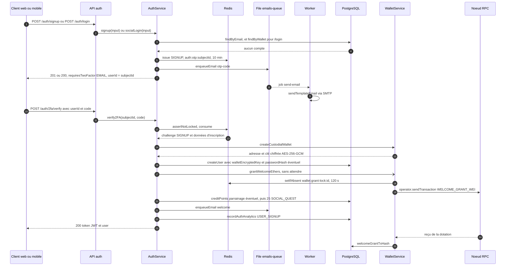

# Inscription et portefeuille

Un citoyen crée son compte en deux requêtes : il envoie son email et reçoit un code à 6 chiffres, puis il saisit ce code. À la validation, le backend crée le compte, génère un portefeuille Ethereum chiffré, crédite les EtherPoints de bienvenue et lance la dotation d'ethers fictifs. Le compte n'est pas encore autorisé à jouer : il doit ensuite faire vérifier son âge par la Mairie.

La première requête dépend du client :

| Client | Première requête | Contenu |
|---|---|---|
| Application mobile | `POST /auth/signup` | email, mot de passe, acceptation des conditions, parrainage facultatif |
| Frontend web | `POST /auth/login` | email, adresse de portefeuille factice, déclaration de majorité, tranche d'âge, parrainage facultatif |

La seconde est toujours `POST /auth/2fa/verify`. Une inscription par Google ou Apple se fait en une seule requête, décrite plus bas. Le parcours par `/auth/login` sert aussi à la connexion d'un citoyen existant ; le mobile connecte un compte existant par `/auth/signin`.

Ce flux décrit le comportement par défaut : `LOGIN_EMAIL_CODE_REQUIRED=true`, obligatoire en production. `/auth/signup` envoie un code quelle que soit cette valeur.

## Diagramme de séquence

## Étape 1 : demande du code

### Par mot de passe, depuis le mobile

**Route.** `POST /api/v1/auth/signup` avec `authRateLimiter` puis `validate(signupSchema)`.

**Validation.** `signupSchema` ([`backend/src/api/auth/auth.validators.ts`](src:backend/src/api/auth/auth.validators.ts)) exige un email, un mot de passe de 10 à 128 caractères avec au moins une lettre et un chiffre, et `acceptTerms` strictement égal à `true`. Il accepte `referralCode`, `utmSource` et `ageGroup`. Le mobile n'envoie ni tranche d'âge ni déclaration de majorité.

**Service.** `authService.signup` refuse en 409 une adresse déjà vérifiée ou anonymisée, hache le mot de passe par bcrypt (`hashValue`), résout le parrain, tire un identifiant temporaire par `newSubjectId()` et appelle `issue(subjectId, 'SIGNUP', signup)` avec l'empreinte du mot de passe dans les données d'inscription. Le mot de passe en clair n'est jamais stocké, ni en base ni dans Redis. L'email `otp-code` part avec le sujet « Vérifiez votre adresse email ». La réponse est un 201 de même forme que celle de `/auth/login`.

### Sans mot de passe, depuis le web

**Route.** `POST /api/v1/auth/login`, déclarée dans [`backend/src/api/auth/auth.routes.ts`](src:backend/src/api/auth/auth.routes.ts) avec `authRateLimiter` (30 requêtes par 10 minutes et par IP) puis `validate(socialLoginSchema)`.

**Validation.** `socialLoginSchema` ([`backend/src/api/auth/auth.validators.ts`](src:backend/src/api/auth/auth.validators.ts)) exige une adresse `walletAddress` au format `0x` suivi de 40 caractères hexadécimaux (convertie en minuscules), un email facultatif, `isAdultConfirmed` strictement égal à `true`, et accepte `provider`, `ageGroup`, `referralCode`, `utmSource`.

> [!NOTE]
> L'adresse `walletAddress` envoyée par le web n'est pas un vrai portefeuille : [`frontend-web/src/lib/wallet.ts`](src:frontend-web/src/lib/wallet.ts) la dérive de l'email par `generateDeterministicWallet`. Le backend ne s'en sert que pour retrouver un compte existant. Le portefeuille réel du citoyen est celui que le backend génère à l'étape 2.

**Service.** `authController.socialLogin` appelle `authService.socialLogin` ([`backend/src/api/auth/auth.services.ts`](src:backend/src/api/auth/auth.services.ts)) :

1. Recherche du compte par adresse (`authRepository.findByWallet`), puis par email (`findByEmail`).
2. Si le compte existe et a une 2FA par application (`twoFactorMethod === 'APP'`), la réponse demande un code TOTP sans envoyer d'email.
3. Sinon, comme `LOGIN_EMAIL_CODE_REQUIRED` est vrai :
   - pour un compte existant, `otpChallengeService.assertNotLocked` puis `issue(user.id, 'LOGIN')` ;
   - pour un nouveau citoyen, le parrain est cherché par `findByReferralCode`, un identifiant temporaire est tiré par `newSubjectId()` (UUID), puis `issue(subjectId, 'SIGNUP', signup)` stocke les données d'inscription avec le défi.
4. `sendCodeEmail` met en file l'email `otp-code`.
5. La réponse contient `requiresTwoFactor: true`, `twoFactorMethod: 'EMAIL'` et `userId`. En développement uniquement, `devOtpPreview` contient le code.

**Défi OTP.** `OtpChallengeService` ([`backend/src/services/otp-challenge.service.ts`](src:backend/src/services/otp-challenge.service.ts)) génère 6 chiffres par `crypto.randomInt`, stocke sous `auth:otp:<subjectId>` un HMAC-SHA256 de `<subjectId>:<code>` (jamais le code en clair), le nombre d'essais et l'échéance, avec une expiration Redis de 10 minutes.

**Email.** `enqueueEmail` ([`backend/src/queues/emails.queue.ts`](src:backend/src/queues/emails.queue.ts)) ajoute un job `send-email` à `emails-queue`. Le worker ([`backend/src/workers/email.worker.ts`](src:backend/src/workers/email.worker.ts)) rend le gabarit [`backend/src/templates/emails/otp-code.html`](src:backend/src/templates/emails/otp-code.html) et l'envoie. Si la file est indisponible, l'email part directement dans la requête.

## Étape 2 : validation du code et création du compte

**Route.** `POST /api/v1/auth/2fa/verify` avec `authRateLimiter`, `optionalAuthenticate` et `validate(verify2FASchema)`. Le controller prend l'identifiant du jeton s'il y en a un, sinon `req.body.userId` ; sans l'un ni l'autre, il renvoie 400.

**Vérification.** `authService.verify2FA` :

1. `assertNotLocked(subjectId)` : 429 si 10 échecs ont été enregistrés dans l'heure.
2. `hasPending(subjectId)` est vrai : `consume(subjectId, code)` compare le HMAC en temps constant (`safeEqual`). Un code faux incrémente le compteur d'essais ; au cinquième, le défi est supprimé. Un code juste supprime le défi.
3. En cas d'échec, `recordFailure` incrémente `auth:otp-failures:<subjectId>` pour une heure et la réponse est 401. En cas de succès, `clearFailures`.
4. Le défi est de type `SIGNUP`. Sans empreinte de mot de passe, `createVerifiedUser(challenge.signup)`. Avec une empreinte, `registerVerifiedEmail` : création du compte si l'adresse est inconnue, 409 si elle a été vérifiée entre-temps, activation si elle appartient à un compte non vérifié, par exemple créé par un ticket offert.

**Création du compte.** `createVerifiedUser` :

1. Revérifie qu'aucun compte n'existe avec cette adresse ou cet email. S'il en existe un, il est renvoyé tel quel, sans rien créer.
2. `walletService.createCustodialWallet()` ([`backend/src/blockchain/wallet.service.ts`](src:backend/src/blockchain/wallet.service.ts)) : `Wallet.createRandom()` d'ethers, adresse en minuscules, clé privée chiffrée par `encryptText` ([`backend/src/utils/crypto.util.ts`](src:backend/src/utils/crypto.util.ts)) en AES-256-GCM avec `ENCRYPTION_KEY`.
3. `authRepository.createUser` ([`backend/src/api/auth/auth.repo.ts`](src:backend/src/api/auth/auth.repo.ts)) avec l'adresse générée, `walletEncryptedKey`, l'email, `isEmailVerified: true`, l'empreinte du mot de passe et le parrain éventuels. `ageVerificationStatus` prend sa valeur par défaut, `NONE`.
4. `walletService.grantWelcomeEthers(user)` est lancé sans être attendu. Une erreur est seulement journalisée.
5. Avec un parrain, `ledgerService.creditPoints` verse 100 EtherPoints `REFERRAL` au parrain et 50 `REFERRAL` au filleul.
6. `welcomeNewAccount` crédite 25 EtherPoints `SOCIAL_QUEST`, met en file l'email `welcome` avec l'adresse du portefeuille et le code de parrainage, et enregistre un événement `USER_SIGNUP` dans `Analytics`.

L'activation d'un compte existant non vérifié (`activateExistingAccount`) pose le mot de passe et `isEmailVerified`, crée le portefeuille s'il manque, lance la dotation, puis appelle `welcomeNewAccount`. Elle ne verse pas de bonus de parrainage.

**Session.** `issueSession` signe un JWT HS256 par `sessionService.sign` ([`backend/src/services/session.service.ts`](src:backend/src/services/session.service.ts)) avec `userId`, `walletAddress`, `role`, `twoFactorVerified: true` et un `jti` aléatoire, valable `JWT_EXPIRES_IN` (12 h par défaut). La réponse contient `token`, `user` (sans aucune donnée de portefeuille sensible, avec `hasPassword` et `ageVerificationStatus`) et `isNewUser: true`.

## Étape 3 : vérification de l'âge

Le compte créé peut consulter le tour, ses points et la boutique, mais l'achat, le cadeau, l'échange de récompense et le ticket à gratter lui renvoient `403 AGE_VERIFICATION_REQUIRED`. Sur le mobile, l'écran de vérification d'âge s'ouvre dès la connexion (voir [Navigation et écrans](../../mobile/navigation-ecrans.md#ouverture-automatique-de-la-verification-d-age)). Sur le web, la billetterie affiche un avertissement qui mène à `/profil/identite`, page aussi accessible depuis `/profil` :

1. le citoyen photographie ou choisit le recto et le verso de sa pièce d'identité, envoyés par `POST /user/identity` et chiffrés au repos ;
2. son statut passe à `PENDING` ;
3. un agent de la Mairie examine la pièce sur la page Identités de l'espace Mairie et l'approuve ou la refuse ; les images sont effacées dans les deux cas et le citoyen reçoit l'email `identity-decision` ;
4. après une approbation, le statut vaut `VERIFIED` et les routes de jeu s'ouvrent.

Le détail est dans [Utilisateur](../../backend/modules/utilisateur.md#verification-d-age) et [Administration](../../backend/modules/administration.md#verification-des-pieces-d-identite). Côté web, la page d'envoi est décrite dans [Portefeuille et loterie](../../web/portefeuille-loterie.md#verification-d-identite).

## La dotation de bienvenue

`grantWelcomeEthers` ([`backend/src/blockchain/wallet.service.ts`](src:backend/src/blockchain/wallet.service.ts)) :

1. Ne fait rien en mode `simulated`, si `welcomeGrantTxHash` est déjà renseigné ou si `WELCOME_GRANT_WEI` vaut 0.
2. Pose le verrou `wallet:grant-lock:<userId>` pour 120 s par `redis.setIfAbsent`. Si le verrou existe déjà, une dotation est en cours : la fonction attend sa fin par `waitForPendingGrant`.
3. Envoie `WELCOME_GRANT_WEI` (0,5 ETH par défaut) depuis le compte opérateur `chainClient.operator` ([`backend/src/blockchain/chain.client.ts`](src:backend/src/blockchain/chain.client.ts)), attend le reçu, puis enregistre `welcomeGrantTxHash`.
4. En cas d'échec, supprime le verrou, journalise l'erreur et renvoie `null`. Le verrou n'est pas supprimé après un succès : il expire seul, et `welcomeGrantTxHash` empêche toute nouvelle dotation.

`waitForPendingGrant` interroge la base toutes les 500 ms pendant 30 s au plus. Elle renvoie le hash dès qu'il apparaît, ou `null` si le verrou a disparu (échec) ou si le délai est écoulé.

La dotation est rejouée à la première utilisation du portefeuille : `lotteryGateway.prepareWallet` ([`backend/src/blockchain/lottery.gateway.ts`](src:backend/src/blockchain/lottery.gateway.ts)), appelé par l'achat, le cadeau et `GET /lottery/wallet`, appelle `ensureWallet` (crée un portefeuille pour un compte qui n'en a pas) puis `grantWelcomeEthers` tant que `welcomeGrantTxHash` est vide. C'est ce qui permet à un achat lancé juste après l'inscription d'attendre la dotation au lieu d'échouer faute de fonds. Voir [Achat et cadeau de ticket](achat-cadeau.md).

## Erreurs possibles

| Étape | Code | Cause |
|---|---|---|
| Signup | 400 | Email invalide, mot de passe trop faible, `acceptTerms` absent ou faux |
| Signup | 409 | Un compte vérifié existe déjà avec cette adresse |
| Login | 400 | Adresse au mauvais format, email invalide, `isAdultConfirmed` absent ou faux (le refus de Zod intervient avant le 403 du service) |
| Login | 400 | Aucun email fourni pour un nouveau compte : « Une adresse email est requise pour recevoir le code de connexion » |
| Login | 429 | Plus de 30 requêtes en 10 minutes depuis la même IP, ou compte bloqué après 10 codes faux |
| Verify | 400 | Ni jeton ni `userId` |
| Verify | 401 | Code faux, expiré, ou défi supprimé après 5 essais : « Code de vérification invalide ou expiré » |
| Verify | 429 | 10 échecs dans l'heure pour cet identifiant |
| Verify | 409 | Création concurrente du même email ou de la même adresse (unicité `P2002` ou `23505`), ou adresse vérifiée entre l'inscription par mot de passe et la saisie du code |

## Idempotence et concurrence

- Un code ne sert qu'une fois : `consume` supprime le défi dès qu'il est validé. Rejouer la même requête de vérification renvoie 401.
- `consume` n'est pas atomique : elle lit le défi, puis le supprime. Deux validations strictement simultanées du même code peuvent donc toutes deux réussir. `createVerifiedUser` revérifie alors l'existence du compte, et si les deux créations passent quand même, l'unicité de `email` en base fait échouer la seconde en 409.
- La création du compte, les EtherPoints et les emails ne sont pas dans une même transaction. Un échec au milieu (par exemple de `creditPoints`) laisse un compte créé sans ses points de bienvenue, et la requête répond en erreur. Une nouvelle connexion avec le même email retrouve ce compte.
- La dotation est protégée deux fois : par le verrou Redis contre les envois concurrents, et par `welcomeGrantTxHash` contre un second envoi. Si Redis est indisponible, le verrou passe par la mémoire du process et ne protège plus contre un envoi depuis un autre process.

## Inscription par Google ou Apple

`POST /auth/oauth/google` ou `/auth/oauth/apple` reçoit un jeton d'identité du fournisseur, le vérifie dans [`oauth-verifier.service.ts`](src:backend/src/services/oauth-verifier.service.ts) et retrouve le compte par l'adresse email du jeton. Pour une adresse inconnue, `createVerifiedUser` crée directement le compte, sans code email, sans mot de passe et sans parrain, et la session est délivrée dans la même réponse. Ces routes répondent 503 tant que `GOOGLE_CLIENT_IDS` ou `APPLE_CLIENT_IDS` est vide. Voir [Authentification](../../backend/modules/auth.md#post-auth-oauth-google-et-auth-oauth-apple).

## Connexion d'un citoyen existant

Sur le mobile, `POST /auth/signin` compare le mot de passe et délivre la session tout de suite, sauf si la 2FA est active. Sur le web, le parcours est le même que l'inscription, avec un défi `LOGIN` au lieu de `SIGNUP` stocké sous l'identifiant du compte. À la validation, `verify2FA` marque l'email vérifié si besoin, enregistre un `USER_LOGIN` et émet un nouveau jeton. Si le compte a une 2FA par application, `/auth/login` renvoie `twoFactorMethod: 'APP'` et `/auth/2fa/verify` attend un code TOTP ou un code de secours. Voir [Authentification et 2FA](../../securite/authentification.md).

## En mode simulé

`grantWelcomeEthers` ne fait rien. Le portefeuille est créé et chiffré de la même manière, mais aucun ether n'est envoyé.
