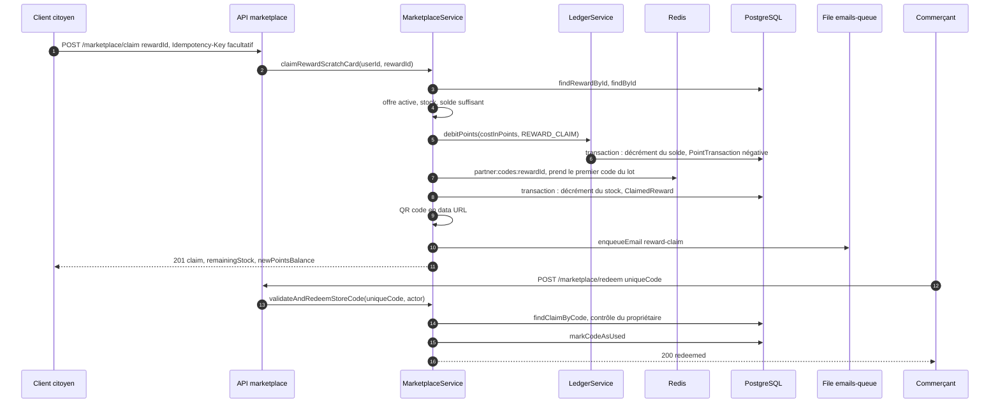

# Échange de récompense

Les EtherPoints gagnés en jouant (50 par ticket, 75 par ticket offert, bonus d'inscription, de parrainage et de quêtes) s'échangent contre des offres de commerçants partenaires. Le flux a deux temps : le citoyen échange ses points contre un code promo unique, présenté sous forme de carte à gratter et de QR code ; plus tard, le commerçant valide ce code en caisse. Ce flux est entièrement hors chaîne : les EtherPoints et les codes vivent dans PostgreSQL.

## Diagramme de séquence

## Échange par le citoyen

**Interface.** Le citoyen choisit une offre dans la boutique ([`frontend-web/src/app/(citoyen)/boutique/[rewardId]/page.tsx`](src:frontend-web/src/app/(citoyen)/boutique/[rewardId]/page.tsx)) et gratte la carte ([`frontend-web/src/components/marketplace/ScratchCanvas.tsx`](src:frontend-web/src/components/marketplace/ScratchCanvas.tsx)). Sur mobile, les écrans équivalents sont dans [`mobile-app/src/screens/marketplace/`](src:mobile-app/src/screens/marketplace/).

**Route.** `POST /api/v1/marketplace/claim` dans [`backend/src/api/marketplace/marketplace.routes.ts`](src:backend/src/api/marketplace/marketplace.routes.ts) : `authenticate`, `idempotency`, `validate(claimRewardSchema)` (`rewardId` doit être un UUID), puis `marketplaceController.claimReward`.

**Service.** `marketplaceService.claimRewardScratchCard` ([`backend/src/api/marketplace/marketplace.services.ts`](src:backend/src/api/marketplace/marketplace.services.ts)) :

1. `marketplaceRepository.findRewardById` ([`backend/src/api/marketplace/marketplace.repo.ts`](src:backend/src/api/marketplace/marketplace.repo.ts)) : 404 si l'offre n'existe pas ou n'est plus active.
2. 400 si `remainingStock` vaut 0.
3. `authRepository.findById`, puis 400 si `pointsBalance` est inférieur à `costInPoints`.
4. `ledgerService.debitPoints` ([`backend/src/services/ledger.service.ts`](src:backend/src/services/ledger.service.ts)) : relit le solde, puis dans une même transaction décrémente `User.pointsBalance` et crée un `PointTransaction` de montant négatif, de type `REWARD_CLAIM`.
5. **Choix du code.** Si le partenaire a déposé un lot de codes (`POST /api/v1/partners/codes/upload`, stocké sous `partner:codes:<rewardId>` par [`backend/src/api/partners/partners.services.ts`](src:backend/src/api/partners/partners.services.ts)), le premier code est retiré du lot et le lot réécrit. Sinon, `generatePromoCode` ([`backend/src/utils/crypto.util.ts`](src:backend/src/utils/crypto.util.ts)) produit un code `<préfixe>-<12 caractères hexadécimaux>`, le préfixe étant tiré des quatre premières lettres du nom du partenaire.
6. `decrementStockAndCreateClaim` : dans une même transaction, décrémente `remainingStock` et crée le `ClaimedReward` avec le code.
7. Génère un QR code (`qrcode.toDataURL`) qui contient l'identifiant de l'échange, le code et le nom du partenaire.
8. Met en file l'email `reward-claim` si le citoyen a un email.
9. Répond 201 avec `claim` (code, QR code, `scratchCardReady: true`), `remainingStock` et `newPointsBalance`.

## Validation en caisse

**Interface.** La page [`frontend-web/src/app/partenaire/validation/page.tsx`](src:frontend-web/src/app/partenaire/validation/page.tsx) envoie le code saisi ou scanné par la mutation `redeemCode` de [`frontend-web/src/store/api/marketplaceApi.ts`](src:frontend-web/src/store/api/marketplaceApi.ts).

**Route.** `POST /api/v1/marketplace/redeem` : `authenticate`, `requireRoles('PARTNER', 'ADMIN')`, `validate(usePromoCodeSchema)` (code de 4 à 64 caractères).

**Service.** `validateAndRedeemStoreCode` :

1. `findClaimByCode` : 404 si le code n'existe pas.
2. `assertPartnerAccess` : un administrateur passe toujours ; un partenaire doit être le propriétaire (`ownerId`) de l'entreprise qui a émis l'offre. En cas de refus, la réponse est aussi 404, pour ne pas révéler l'existence d'un code d'un autre commerce.
3. 400 si le code a déjà servi.
4. `markCodeAsUsed` passe `isUsed` à vrai.

## Erreurs possibles

| Étape | Code | Cause |
|---|---|---|
| Échange | 400 | `rewardId` invalide, stock épuisé, EtherPoints insuffisants |
| Échange | 404 | Offre introuvable ou désactivée, compte introuvable |
| Échange | 409 | Contrainte `User_pointsBalance_non_negative` ou `RewardCatalog_remainingStock_non_negative` violée par une requête concurrente, ou code déjà attribué (unicité de `uniqueCode`) |
| Échange | 409 | Requête identique en cours avec la même `Idempotency-Key` |
| Validation | 403 | Rôle `USER` |
| Validation | 404 | Code inconnu ou appartenant à un autre partenaire |
| Validation | 400 | Code déjà utilisé |

## Idempotence et cohérence

- Avec `Idempotency-Key`, un double clic rejoue la première réponse. Sans en-tête, ce que font les clients actuels, deux requêtes produisent deux échanges si le solde et le stock le permettent.
- Les contraintes CHECK en base empêchent un solde ou un stock négatif, même sous forte concurrence. Voir l'[ADR 0003](../adr/0003-migrations-expand-contract.md).

> [!WARNING]
> Le débit des points et la création du code sont deux transactions distinctes. Si la seconde échoue (stock tombé à 0 entre-temps, code du lot déjà attribué, panne de la base), les EtherPoints sont débités sans qu'aucun code ne soit créé, et aucune compensation n'est faite. Le retrait d'un code du lot Redis n'est pas atomique non plus : deux échanges simultanés peuvent lire le même code, et le second échoue sur l'unicité de `uniqueCode` après avoir débité les points.

> [!WARNING]
> La validation en caisse lit puis met à jour le code sans condition sur `isUsed`. Deux validations simultanées du même code peuvent toutes deux répondre 200.

Points également constatés dans le code :

- La date d'expiration d'une offre (`partner:offer_expiry:<offerId>` dans Redis) n'est pas vérifiée au moment de l'échange.
- `findRewardById` ne vérifie pas que le partenaire est actif. Le catalogue (`getCatalogWithPartners`) masque les offres d'un partenaire suspendu, mais un `rewardId` connu reste échangeable.
- La file `ledger-queue` n'est pas utilisée : le débit est synchrone dans la requête.

## Voir aussi

- [Boutique et récompenses](../../backend/modules/boutique.md) et [Partenaires](../../backend/modules/partenaires.md) : les autres routes de ces modules.
- [Ajouter un commerçant partenaire](../../guides/ajouter-partenaire.md).
