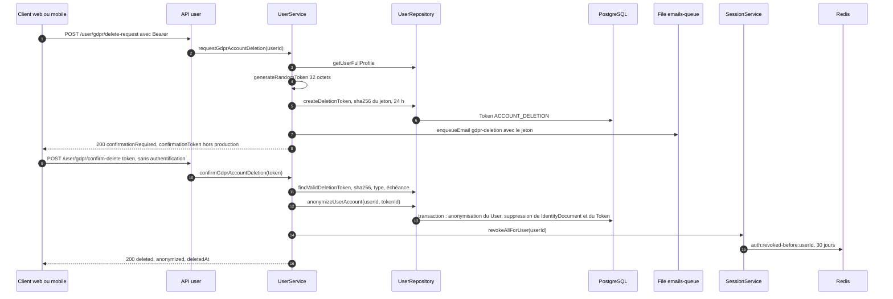

# Suppression RGPD

Un citoyen peut demander l'effacement de son compte au titre de l'article 17 du RGPD. La suppression se fait en deux temps pour éviter une suppression accidentelle ou malveillante : une demande authentifiée produit un jeton à usage unique envoyé par email, puis la confirmation avec ce jeton anonymise le compte et révoque toutes ses sessions. Le compte n'est pas supprimé physiquement : ses identifiants personnels sont effacés et la ligne est marquée `deletedAt`.

## Diagramme de séquence

## Étape 1 : demande

**Interface.** La page [`frontend-web/src/app/(citoyen)/profil/rgpd/page.tsx`](src:frontend-web/src/app/(citoyen)/profil/rgpd/page.tsx) et l'écran Données personnelles du mobile ([`mobile-app/src/screens/settings/PersonalDataScreen.tsx`](src:mobile-app/src/screens/settings/PersonalDataScreen.tsx)) appellent `/user/gdpr/delete-request` puis proposent de coller le jeton. Hors production, la page web préremplit le jeton renvoyé par l'API.

**Route.** `POST /api/v1/user/gdpr/delete-request` dans [`backend/src/api/user/user.routes.ts`](src:backend/src/api/user/user.routes.ts), protégée par `authenticate` seulement : pas de schéma de corps, pas d'idempotence.

**Service.** `userService.requestGdprAccountDeletion` ([`backend/src/api/user/user.services.ts`](src:backend/src/api/user/user.services.ts)) :

1. `userRepository.getUserFullProfile` : 404 si le compte n'existe pas.
2. `generateRandomToken(32)` ([`backend/src/utils/crypto.util.ts`](src:backend/src/utils/crypto.util.ts)) tire 32 octets aléatoires encodés en base64url.
3. `userRepository.createDeletionToken` ([`backend/src/api/user/user.repo.ts`](src:backend/src/api/user/user.repo.ts)) enregistre dans `Token` l'empreinte SHA-256 du jeton (jamais le jeton en clair), le type `ACCOUNT_DELETION` et une échéance de 24 h.
4. Si le compte a un email, l'email `gdpr-deletion` ([`backend/src/templates/emails/gdpr-deletion.html`](src:backend/src/templates/emails/gdpr-deletion.html)) est mis en file avec le jeton et un lien `CONFIRM_URL`.
5. La réponse contient `confirmationRequired: true`, `emailSent` et, quand `NODE_ENV` n'est pas `production`, `confirmationToken` en clair pour faciliter les tests.

> [!WARNING]
> Le lien de l'email pointe vers `${FRONTEND_URL}/gdpr/confirm-delete?token=...`. Cette route n'existe pas dans le frontend web, qui affiche alors sa page 404. La confirmation ne fonctionne qu'en collant le jeton dans la page `profil/rgpd` ou dans l'écran mobile.

## Étape 2 : confirmation

**Route.** `POST /api/v1/user/gdpr/confirm-delete` avec `validate(confirmGdprDeletionSchema)` : `token` de 10 à 128 caractères. Cette route n'exige pas d'être connecté : la possession du jeton suffit, ce qui permet de confirmer depuis un autre appareil.

**Service.** `userService.confirmGdprAccountDeletion` :

1. `findValidDeletionToken` cherche un `Token` dont l'empreinte SHA-256 correspond, de type `ACCOUNT_DELETION` et non expiré. Sinon : 400 « Jeton de suppression RGPD invalide ou expiré ».
2. `anonymizeUserAccount(userId, tokenId)` exécute une transaction qui met à jour le compte, supprime sa pièce d'identité et supprime le jeton utilisé.
3. `sessionService.revokeAllForUser` ([`backend/src/services/session.service.ts`](src:backend/src/services/session.service.ts)) écrit `auth:revoked-before:<userId>` pour 30 jours : tout jeton émis avant cet instant est refusé par `authenticate`.
4. Réponse 200 avec `deleted: true`, `anonymized: true`, `userId` et `deletedAt`.

## Ce qui est effacé et ce qui reste

| Donnée | Après confirmation |
|---|---|
| `User.email` | `null` |
| `User.walletAddress` | Remplacée par `0xdeleted_gdpr_` suivi des 8 premiers caractères de l'identifiant |
| `User.walletEncryptedKey`, `welcomeGrantTxHash` | `null` : la clé privée du portefeuille intégré est détruite |
| `twoFactorSecret`, `twoFactorMethod`, `twoFactorBackupCodes`, `isTwoFactorEnabled` | Effacés ou désactivés |
| `User.passwordHash`, `firstName`, `lastName`, `ageVerificationNote` | `null` |
| `IdentityDocument` du compte | Supprimé, avec les images si la Mairie n'avait pas encore statué |
| `ageVerificationStatus`, `ageVerifiedAt` | Conservés |
| `User.deletedAt` | Date de la suppression ; `getProfile` répond alors 404 et `requireRoles` refuse le compte |
| Jeton de suppression utilisé | Supprimé |
| `role`, `pointsBalance`, `referralCode`, `referredById`, dates | Conservés |
| `Ticket`, `PointTransaction`, `ClaimedReward`, `Analytics` | Conservés, toujours rattachés à l'identifiant du compte ; les entrées d'audit de la Mairie sur la pièce d'identité, motif de refus compris, restent aussi |
| Clés Redis `user:prefs:<id>`, `user:quests:<id>`, `user:ticket_limit:<id>` | Conservées |
| Données on-chain : adresse du portefeuille dans les événements, tickets, badges POAP | Conservées : la blockchain est immuable |

Les tickets gardent dans `payerWallet` l'adresse d'origine du portefeuille, et la chaîne relie cette adresse à tous les achats. L'anonymisation est donc partielle : c'est une pseudonymisation du compte, la portée juridique est discutée dans [Blockchain et données personnelles](../../juridique/blockchain-donnees.md).

> [!CAUTION]
> Les ethers fictifs restant sur le portefeuille intégré deviennent irrécupérables, puisque la clé est détruite. Si le citoyen gagne un tour encore en cours ou attend un remboursement, le job `CLAIM_PRIZE` ou `CLAIM_REFUND` ne trouve plus de compte pour son adresse et se termine sans rien faire : les fonds restent bloqués dans le contrat. Sur un réseau principal, il faudrait proposer au citoyen de vider son portefeuille vers une adresse de son choix avant la suppression.

## Erreurs possibles

| Étape | Code | Cause |
|---|---|---|
| Demande | 401 | Jeton de session absent ou révoqué |
| Demande | 404 | Compte introuvable |
| Confirmation | 400 | Jeton de moins de 10 caractères, inconnu, expiré ou déjà utilisé |
| Confirmation | 409 | Adresse anonymisée déjà prise par un autre compte supprimé (voir ci-dessous) |
| Les deux | 429 | Rate limit global : 300 requêtes par 15 minutes et par IP |

> [!WARNING]
> L'adresse anonymisée n'est pas unique en pratique. Les identifiants sont des UUID version 7 (`@default(uuid(7))` dans [`backend/prisma/schema.prisma`](src:backend/prisma/schema.prisma)), dont les 8 premiers caractères hexadécimaux codent l'horodatage de création et ne changent que toutes les 65 secondes environ. Deux comptes créés dans la même minute, ce qui est le cas de tous les comptes du seed, reçoivent la même adresse anonymisée. La suppression du second échoue alors sur l'unicité de `walletAddress` et répond 409, sans rien effacer.

## Idempotence

- Chaque demande crée un nouveau jeton sans invalider les précédents : plusieurs jetons peuvent être valides en même temps pendant 24 h.
- Un jeton ne sert qu'une fois : il est supprimé dans la même transaction que l'anonymisation. Rejouer la confirmation renvoie 400.
- Un autre jeton encore valide du même compte relance l'anonymisation, qui réécrit les mêmes valeurs et réussit.
- La demande n'est pas protégée par `Idempotency-Key` : un double envoi produit deux jetons et deux emails.

## Export avant suppression

Le droit à la portabilité est servi par `GET /api/v1/user/gdpr/export`, qui renvoie en JSON le profil (sans la clé chiffrée ni le secret 2FA), les tickets avec leur tour, le journal des EtherPoints, les récompenses échangées et les événements analytiques. Voir [Utilisateur et RGPD](../../backend/modules/utilisateur.md) et [RGPD](../../juridique/rgpd.md).
