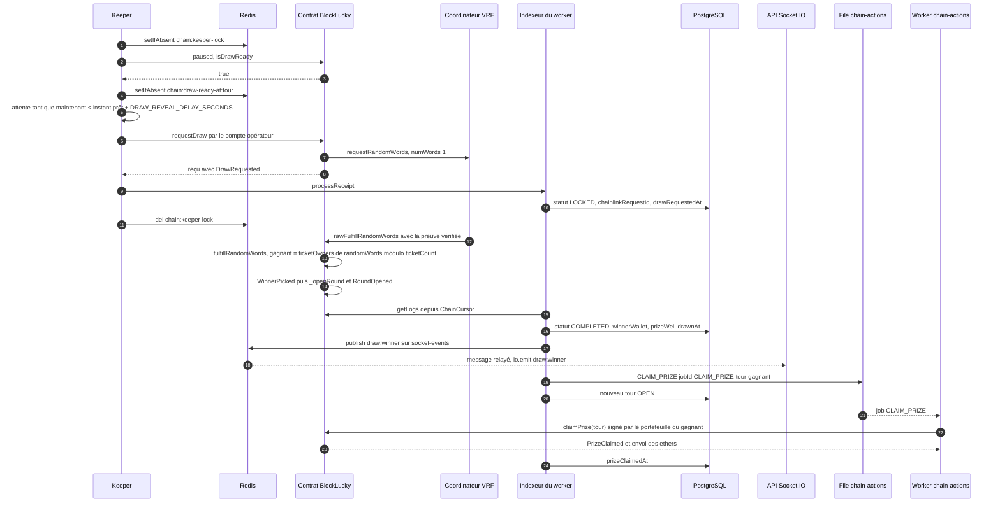

# Tirage et versement de la cagnotte

Le tirage se fait en deux transactions séparées par l'oracle Chainlink VRF. Il est précédé d'une salle d'attente : quand les achats se ferment, le keeper attend `DRAW_REVEAL_DELAY_SECONDS` (600 s par défaut) avant de demander le tirage, pour que les participants suivent la roue en direct. La première transaction, envoyée par le keeper du backend ou par un administrateur, demande un nombre aléatoire et fige le tour. La seconde, envoyée par le coordinateur VRF, apporte ce nombre : le contrat désigne alors lui-même le gagnant dans `fulfillRandomWords`, calcule la cagnotte et ouvre le tour suivant. Le backend découvre le résultat en lisant les événements, l'annonce en direct, puis réclame la cagnotte pour le compte du gagnant.

## Diagramme de séquence

## Étape 1 : demande du tirage

### Par le keeper

`startChainServices` ([`backend/src/blockchain/lottery.keeper.ts`](src:backend/src/blockchain/lottery.keeper.ts)) lance `runKeeperOnce` toutes les `KEEPER_INTERVAL_MS` (10 s par défaut), dans le worker ou dans l'API si `RUN_WORKERS=true`. À chaque passage :

1. Rien en mode `simulated`.
2. Verrou `chain:keeper-lock` posé par `redis.setIfAbsent`, pour une durée égale à l'intervalle avec un minimum de 5 s. Si une autre instance le détient, le passage s'arrête.
3. Si le contrat est en pause (`paused()`), rien.
4. Si `isDrawReady()` : le keeper lit le tour courant, enregistre l'instant où il est devenu prêt dans `chain:draw-ready-at:<tour>` s'il ne l'est pas déjà (le plus petit de maintenant et de `endTime`), puis compare l'heure à cet instant plus `DRAW_REVEAL_DELAY_SECONDS`. Avant cette heure, la passe renvoie `waiting-room` sans rien envoyer. Après, appel de `requestDraw()` avec le compte opérateur `chainClient.operator`, attente du reçu, puis `lotteryIndexer.processReceipt(receipt)`.
5. Sinon, si `isExpiredWithoutDraw()` : annulation du tour. Voir [Annulation et remboursement](annulation.md).
6. Le verrou est supprimé dans le bloc `finally`. Les erreurs `DrawNotReady` et `RoundNotCancellable` (un autre acteur a été plus rapide) ne sont pas journalisées ; les autres le sont en avertissement.

`isDrawReady` ([`smart-contract/contracts/BlockLucky.sol`](src:smart-contract/contracts/BlockLucky.sol)) est vraie quand le tour est `Open`, compte au moins `minTicketsToDraw` tickets, et est complet ou a atteint `endTime`. Le keeper demande donc le tirage `DRAW_REVEAL_DELAY_SECONDS` après le dernier ticket vendu ou la fin du temps, à `KEEPER_INTERVAL_MS` près. `GET /lottery/status` lit le même instant pour publier `phase: 'WAITING_ROOM'` et `revealAt`, ce qui aligne le compte à rebours des clients sur le keeper (voir [Loterie](../../backend/modules/loterie.md#phases-du-tour)).

### Par un administrateur

`POST /api/v1/lottery/draw` dans [`backend/src/api/lottery/lottery.routes.ts`](src:backend/src/api/lottery/lottery.routes.ts) : `authenticate`, `requireRoles('ADMIN')`, `validate(triggerDrawSchema)`. `lotteryController.triggerDraw` appelle `lotteryService.executeChainlinkDraw`, qui délègue à `drawOnchain` ([`backend/src/api/lottery/lottery.services.ts`](src:backend/src/api/lottery/lottery.services.ts)) :

1. `lotteryGateway.requestDraw()` ([`backend/src/blockchain/lottery.gateway.ts`](src:backend/src/blockchain/lottery.gateway.ts)) envoie `requestDraw` avec le compte opérateur et indexe le reçu.
2. Le tour courant est relu et recopié en base.
3. La réponse 200 contient `vrfProof.status: 'PENDING'`, l'identifiant de requête VRF et le hash de la transaction. Le gagnant n'est pas encore connu.

Le champ `roundId` du corps est ignoré : on ne peut tirer que le tour courant. Cette route n'attend pas le délai de révélation : elle tire dès que `isDrawReady` est vrai, même si la salle d'attente des clients affiche encore un compte à rebours. `requestDraw` n'exige aucun rôle dans le contrat : n'importe quel compte peut la déclencher dès que les conditions sont remplies, ce que fait aussi Chainlink Automation par `performUpkeep` s'il est configuré. Le délai de révélation n'existe que dans le backend : le contrat ne le connaît pas. Voir [Chainlink Automation](../../smart-contracts/automation.md).

### Dans le contrat

`requestDraw` (`whenNotPaused`, `nonReentrant`) vérifie `isDrawReady`, puis `_requestRandomness` passe le tour à `Drawing`, note `drawRequestedAt`, appelle `s_vrfCoordinator.requestRandomWords` avec la configuration `vrfConfig` (key hash, abonnement, confirmations, limite de gaz du rappel, paiement natif ou LINK), mémorise `roundByRequestId[requestId]` et émet `DrawRequested(roundId, requestId, ticketCount)`.

`onDrawRequested` ([`backend/src/blockchain/lottery.indexer.ts`](src:backend/src/blockchain/lottery.indexer.ts)) passe le tour à `LOCKED` en base avec `chainlinkRequestId` et `drawRequestedAt`. À partir de ce moment, les achats sont refusés par le contrat (`RoundNotOpen`) et par la passerelle (409).

## Étape 2 : réponse de l'oracle

Le coordinateur VRF vérifie la preuve cryptographique, puis appelle `rawFulfillRandomWords` sur le contrat, qui n'accepte que l'adresse du coordinateur et transmet à `fulfillRandomWords` :

1. Retrouve le tour par `roundByRequestId`. Si la requête est inconnue, si le tour n'est plus `Drawing` ou si l'identifiant ne correspond pas à la dernière requête, la réponse est ignorée sans erreur.
2. `winningTicket = randomWords[0] % ticketCount`, `winner = ticketOwners[roundId][winningTicket]`.
3. `fee = totalCollected * feeBps / 10000`, `prize = totalCollected - fee`, `accruedFees += fee`.
4. Statut `Completed`, émission de `WinnerPicked(roundId, winner, winningTicket, prize, fee, requestId)`.
5. `_openRound()` ouvre le tour suivant avec la configuration courante et émet `RoundOpened`.

En local, le coordinateur est `VRFCoordinatorV2_5Mock`. Le script [`smart-contract/scripts/local-vrf-responder.ts`](src:smart-contract/scripts/local-vrf-responder.ts), lancé dans le conteneur `blockchain`, interroge les événements `RandomWordsRequested` toutes les 2 s (`VRF_POLL_INTERVAL_MS`) et appelle `fulfillRandomWords` sur le coordinateur simulé. Sur Sepolia, c'est le réseau d'oracles Chainlink qui répond. Voir [Tirage Chainlink VRF](../../smart-contracts/chainlink-vrf.md).

## Étape 3 : indexation et annonce

La transaction de l'oracle n'est pas envoyée par le backend : seul l'indexeur périodique la voit. `lotteryIndexer.syncOnce` tourne toutes les `INDEXER_INTERVAL_MS` (3 s par défaut). Il lit le curseur `ChainCursor`, demande les journaux du contrat de `lastBlock + 1` à la tête de chaîne moins `CHAIN_CONFIRMATIONS` (plages de 2 000 blocs au plus), les traite dans l'ordre (bloc, puis index du journal) et avance le curseur.

`onWinnerPicked` :

1. Met à jour `LotteryRound` : `COMPLETED`, `winnerWallet`, `winningTicket`, `prizeWei`, `chainlinkRequestId`, `drawnAt` (date du bloc).
2. `emitSocketEvent('draw:winner', ...)` avec `contractRoundId`, `winnerWallet`, `prizePool` (en ETH, cagnotte nette) et `vrfProofHash`, qui contient le hash de la transaction de l'oracle. Dans le worker, l'événement est publié sur le canal Redis `<REDIS_KEY_PREFIX>:<NODE_ENV>:socket-events`. L'API, abonnée par `startSocketEventBridge` ([`backend/src/socket/event-bridge.ts`](src:backend/src/socket/event-bridge.ts)), le réémet à tous les clients connectés. Les clients l'écoutent dans `useSocket` ([`frontend-web/src/hooks/useSocket.ts`](src:frontend-web/src/hooks/useSocket.ts)).
3. `enqueueChainAction({ type: 'CLAIM_PRIZE', contractRoundId, walletAddress: winner })`.

`onRoundOpened` crée ensuite le tour suivant en base.

## Étape 4 : versement de la cagnotte

`executeChainAction` ([`backend/src/blockchain/chain-actions.ts`](src:backend/src/blockchain/chain-actions.ts)), exécuté par le worker `chain-actions` (concurrence 1) :

1. Retrouve le compte du gagnant par son adresse. Sans compte ou sans clé chiffrée, le job se termine sans rien faire.
2. Signe `claimPrize(contractRoundId)` avec le portefeuille du gagnant (`walletService.signerFor`). Les frais de réseau sont payés par le gagnant, sur son solde d'ethers fictifs.
3. Le contrat vérifie l'état `Completed`, que l'appelant est le gagnant et que la cagnotte n'a pas été versée, passe `prizeClaimed` à vrai, émet `PrizeClaimed`, puis envoie `prize` au gagnant.
4. L'indexeur traite `PrizeClaimed` et renseigne `prizeClaimedAt`.

Le gagnant peut aussi réclamer lui-même : `POST /api/v1/lottery/claim-prize` avec `contractRoundId` (`authenticate`, `idempotency`, `validate(claimPrizeSchema)`) appelle `lotteryService.claimPrize`, puis `lotteryGateway.claimPrize`. Le frontend web le propose dans [`frontend-web/src/components/lottery/WinnerClaimCard.tsx`](src:frontend-web/src/components/lottery/WinnerClaimCard.tsx).

## Erreurs possibles

| Point | Code ou effet | Cause |
|---|---|---|
| `POST /lottery/draw` | 403 | Rôle `ADMIN` absent, ou 2FA non activée avec `ADMIN_MFA_REQUIRED=true` |
| `POST /lottery/draw` | 409 | `DrawNotReady` : pas assez de tickets, durée non écoulée, ou tirage déjà demandé |
| `POST /lottery/draw` | 503 | Contrat en pause, ou réseau injoignable |
| `POST /lottery/draw` | 502 | Échec non reconnu, par exemple abonnement VRF non financé ou consommateur non enregistré |
| `POST /lottery/claim-prize` | 409 | Mode `simulated`, `RoundNotCompleted`, `PrizeAlreadyClaimed` |
| `POST /lottery/claim-prize` | 403 | `NotWinner` |
| `POST /lottery/claim-prize` | 402 | Solde insuffisant pour payer les frais |
| Job `CLAIM_PRIZE` | Terminé sans erreur | `PrizeAlreadyClaimed` (déjà réclamée, par exemple à la main) |
| Job `CLAIM_PRIZE` | Échec définitif | `NotWinner`, `RoundNotCompleted` (`UnrecoverableError`) |
| Job `CLAIM_PRIZE` | Jusqu'à 5 tentatives | Erreur réseau, solde insuffisant pour les frais, autre erreur |
| Oracle | Tour bloqué en `Drawing` | Aucune réponse VRF : seul `retryDraw` (rôle opérateur, après `drawTimeout`) relance une requête |

> [!WARNING]
> Le backend n'appelle jamais `retryDraw`. Si l'oracle ne répond pas, un opérateur doit l'appeler à la main après `drawTimeout`. Voir [Runbooks blockchain](../../infrastructure/runbooks-blockchain.md).

> [!NOTE]
> Si le gagnant a supprimé son compte (voir [Suppression RGPD](suppression-rgpd.md)), son adresse n'est plus en base et sa clé est effacée : le job `CLAIM_PRIZE` se termine sans rien faire et la cagnotte reste dans le contrat, réclamable seulement par l'adresse gagnante.

## Idempotence

- **Demande de tirage.** Le contrat refuse une seconde demande pour le même tour (`DrawNotReady`, car le tour n'est plus `Open`). Le verrou du keeper évite que plusieurs instances envoient la transaction en même temps. `POST /lottery/draw` n'a pas de middleware `idempotency` : un double appel renvoie 409 au second.
- **Réponse VRF.** `fulfillRandomWords` ignore une réponse inconnue, en retard ou en double, sans annuler la transaction de l'oracle.
- **Indexation.** `onWinnerPicked` et `onDrawRequested` sont des mises à jour qui donnent le même résultat si elles sont rejouées. En revanche, si `syncOnce` échoue après avoir traité une partie des journaux, le curseur n'avance pas et la plage est relue : `draw:winner` peut être émis une seconde fois, et la mise en file de `CLAIM_PRIZE` est absorbée par l'identifiant de job.
- **Versement.** L'identifiant `CLAIM_PRIZE-<tour>-<adresse>` empêche deux jobs identiques, et `prizeClaimed` dans le contrat empêche deux versements.

## En mode simulé

`executeChainlinkDraw` passe le tour à `LOCKED`, choisit un gagnant parmi les tickets par `crypto.randomInt` dans `blockchainService.requestChainlinkVrfDraw` ([`backend/src/services/blockchain.service.ts`](src:backend/src/services/blockchain.service.ts)), passe le tour à `COMPLETED` et diffuse `draw:winner` par `broadcastWinnerEvent`. L'identifiant de requête et la « preuve » sont des chaînes aléatoires, la réponse indique `verifiedFair: false` et `simulated: true`, et aucune cagnotte n'est versée.
