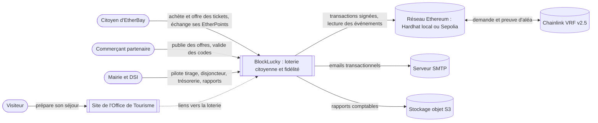
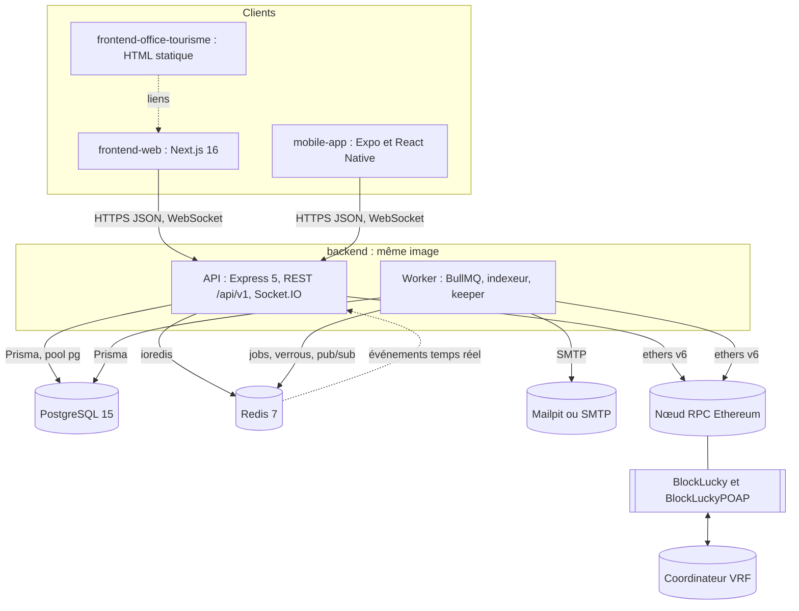
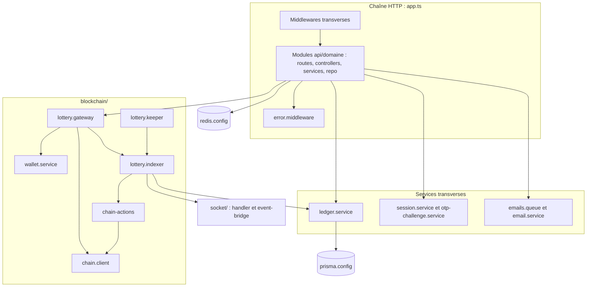

# Vue d'ensemble

Cette page décrit l'architecture de BlockLucky selon le modèle C4, du plus large au plus détaillé : le contexte (qui utilise le système et avec quels systèmes externes il échange), les conteneurs (les applications et les stockages qui tournent), puis les composants du backend. Les diagrammes sont écrits en Mermaid dans les sources de la documentation : ils se modifient dans la même pull request que le changement d'architecture qu'ils décrivent.

Trois idées structurent l'ensemble :

- **La blockchain est la source de vérité de la loterie.** Les tickets, le tirage, la cagnotte et les remboursements vivent dans le contrat `BlockLucky`. La base PostgreSQL en est une projection, reconstruite par un indexeur d'événements.
- **Le citoyen n'installe aucun portefeuille.** Le backend crée et chiffre un portefeuille Ethereum par citoyen, signe ses transactions et lui verse une dotation d'ethers fictifs (voir l'[ADR 0004](adr/0004-smart-contract-portefeuille-integre.md)).
- **Un seul backend, deux process.** L'API HTTP et le worker sont construits depuis la même image et le même code (voir l'[ADR 0001](adr/0001-monolithe-modulaire.md)).

## Niveau 1 : contexte

### Acteurs

| Acteur | Rôle applicatif | Ce qu'il fait | Interface |
|---|---|---|---|
| Citoyen | `USER` | Se connecte avec un code reçu par email, achète des tickets, en offre à un proche, suit le tirage en direct, échange ses EtherPoints contre des codes promo, exporte ou supprime ses données | Frontend web, application mobile |
| Commerçant partenaire | `PARTNER` | Gère son entreprise et ses offres, alimente un lot de codes, valide en caisse les codes présentés par les citoyens | Espace `/partenaire` du frontend web |
| Mairie et DSI | `ADMIN` | Consulte le tableau de bord, déclenche le tirage ou l'annulation, actionne le disjoncteur, reverse la commission, approuve les partenaires, exporte les rapports | Espace `/mairie` du frontend web |
| Visiteur | aucun compte | Consulte les sorties, restaurants et hébergements, remplit un panier de billetterie simulé | Site de l'Office de Tourisme |

Les rôles sont l'énumération `Role` de [`backend/prisma/schema.prisma`](src:backend/prisma/schema.prisma), contrôlés par `requireRoles` dans [`backend/src/middlewares/rbac.middleware.ts`](src:backend/src/middlewares/rbac.middleware.ts). Le détail des droits est dans la [matrice des autorisations](../securite/autorisations.md).

### Systèmes externes

| Système | Usage | Point d'intégration |
|---|---|---|
| Réseau Ethereum | Héberge `BlockLucky` et `BlockLuckyPOAP`. En local, nœud Hardhat (service `blockchain` de Docker Compose, chain id 31337). En démonstration publique, Sepolia | [`backend/src/blockchain/chain.client.ts`](src:backend/src/blockchain/chain.client.ts), RPC principal `RPC_URL` et de secours `FALLBACK_RPC_URL` |
| Chainlink VRF v2.5 | Fournit le nombre aléatoire prouvé qui désigne le gagnant. En local, `VRFCoordinatorV2_5Mock` et un oracle de développement | [`smart-contract/contracts/BlockLucky.sol`](src:smart-contract/contracts/BlockLucky.sol), [`smart-contract/scripts/local-vrf-responder.ts`](src:smart-contract/scripts/local-vrf-responder.ts) |
| SMTP | Codes de connexion, bienvenue, alertes de sécurité, codes promo, confirmation RGPD. En local, Mailpit | [`backend/src/config/mailer.config.ts`](src:backend/src/config/mailer.config.ts), [`backend/src/services/email.service.ts`](src:backend/src/services/email.service.ts) |
| Stockage S3 | Dépôt des rapports CSV et « PDF » de la Mairie | [`backend/src/services/s3.service.ts`](src:backend/src/services/s3.service.ts) |

> [!NOTE]
> Aucun service S3 n'est déclaré dans `docker-compose.yml`. En local, l'envoi échoue, l'erreur est journalisée et l'URL renvoyée pointe vers `AWS_S3_ENDPOINT` sans que le fichier existe. Le rapport « PDF » est un résumé JSON enregistré avec le type `application/pdf` : aucun PDF n'est réellement produit.

## Niveau 2 : conteneurs

| Conteneur | Technologie | Responsabilité | Port local | Point d'entrée |
|---|---|---|---|---|
| `frontend-web` | Next.js 16, React 19, Tailwind 4, RTK Query | Espaces citoyen, partenaire et Mairie, pages publiques | 3000 | [`frontend-web/src/app/layout.tsx`](src:frontend-web/src/app/layout.tsx) |
| `mobile-app` | Expo SDK 58, React Native 0.88, RTK Query | Application citoyenne iOS et Android | 8081 (Metro) | [`mobile-app/src/App.tsx`](src:mobile-app/src/App.tsx) |
| `frontend-office-tourisme` | HTML, CSS, modules ES, nginx | Site vitrine sans backend, renvoie vers la loterie | 4000 | [`frontend-office-tourisme/index.html`](src:frontend-office-tourisme/index.html) |
| API | Express 5, Socket.IO 4, TypeScript | REST sous `/api/v1` (alias `/api`), WebSocket, Swagger sur `/api/docs`, sondes `/health/*`, `/metrics` | 2053 | [`backend/src/server.ts`](src:backend/src/server.ts) |
| Worker | BullMQ 6, ethers v6 | Files `emails-queue`, `ledger-queue`, `chain-actions`, indexeur et keeper de la loterie, sondes sur `PORT + 1` | 2054 | [`backend/src/worker.ts`](src:backend/src/worker.ts) |
| PostgreSQL | PostgreSQL 15 (`postgres:15-alpine`), extension `pg_stat_statements` | Comptes, projection des tours et tickets, EtherPoints, offres, codes, analytique, audit | 5434 | [`backend/prisma/schema.prisma`](src:backend/prisma/schema.prisma) |
| Redis | Redis 7.4, AOF `everysec`, `noeviction` | Files BullMQ, défis OTP, révocation de sessions, idempotence, rate limit, verrous du keeper et de la dotation, préférences, relais Socket.IO | 6380 | [`backend/src/config/redis.config.ts`](src:backend/src/config/redis.config.ts) |
| Nœud RPC | Hardhat 3 en local, fournisseur Sepolia sinon | Exécution et lecture des contrats | 8545 | [`smart-contract/docker/start-local-chain.sh`](src:smart-contract/docker/start-local-chain.sh) |
| Smart contracts | Solidity, OpenZeppelin 5, Chainlink VRF v2.5 | Tours, tickets, tirage, cagnotte, remboursements, commission, badges POAP | - | [`smart-contract/contracts/BlockLucky.sol`](src:smart-contract/contracts/BlockLucky.sol) |

### Répartition entre l'API et le worker

Le process API ([`backend/src/server.ts`](src:backend/src/server.ts)) démarre Express, Socket.IO et le pont d'événements Redis. Il ne démarre les workers BullMQ et les services de chaîne (indexeur et keeper) que si `RUN_WORKERS=true`, la valeur par défaut du schéma de configuration. Docker Compose fixe `RUN_WORKERS: "false"` pour le service `backend` et lance un service `worker` séparé.

Le process worker ([`backend/src/worker.ts`](src:backend/src/worker.ts)) démarre toujours `startWorkers()` et `startChainServices()`. Il s'arrête avec un code d'erreur si aucun worker n'a pu être créé, et expose `/health/live` et `/metrics` sur le port `PORT + 1`.

| Traitement | Process API (`RUN_WORKERS=false`) | Process worker | Process API seul (`RUN_WORKERS=true`) |
|---|---|---|---|
| Requêtes REST et Socket.IO | oui | non | oui |
| Workers `emails-queue`, `ledger-queue`, `chain-actions` | non | oui | oui |
| Indexeur (`lotteryIndexer.syncOnce`, toutes les `INDEXER_INTERVAL_MS`) | non | oui (mode `onchain`) | oui (mode `onchain`) |
| Keeper (`runKeeperOnce`, toutes les `KEEPER_INTERVAL_MS`) | non | oui (mode `onchain`) | oui (mode `onchain`) |
| Indexation immédiate du reçu d'une transaction envoyée par l'API | oui | - | oui |

L'indexeur et le keeper sont démarrés par `startChainServices` dans [`backend/src/blockchain/lottery.keeper.ts`](src:backend/src/blockchain/lottery.keeper.ts). Ils ne font rien en mode `simulated`. Le détail est dans [Indexeur d'événements](../integration-blockchain/indexeur.md) et [Keeper du tirage](../integration-blockchain/keeper.md).

### Relais des événements temps réel

Les événements `draw:winner` et `points:awarded` sont produits par l'indexeur, donc souvent dans le worker, qui n'a pas de serveur Socket.IO. `emitSocketEvent` ([`backend/src/socket/event-bridge.ts`](src:backend/src/socket/event-bridge.ts)) émet directement si le process possède un serveur Socket.IO, sinon publie le message sur le canal Redis `<REDIS_KEY_PREFIX>:<NODE_ENV>:socket-events`. L'API s'y abonne au démarrage (`startSocketEventBridge`) et réémet vers tous les clients connectés, en ne laissant passer que ces deux événements. Voir [Relais temps réel](../integration-blockchain/relais-temps-reel.md).

> [!WARNING]
> Socket.IO n'utilise pas d'adaptateur Redis. Les événements émis directement par une instance d'API (salle d'attente, chat) n'atteignent que les clients de cette instance. Le passage à plusieurs instances d'API demande l'ajout de `@socket.io/redis-adapter` ou équivalent.

### Modes de fonctionnement

`BLOCKCHAIN_MODE` ([`backend/src/config/env.config.ts`](src:backend/src/config/env.config.ts)) vaut `onchain` par défaut et est imposé en production par le schéma Zod. En mode `simulated`, les services de [`backend/src/services/blockchain.service.ts`](src:backend/src/services/blockchain.service.ts) génèrent des hash aléatoires, tirent le gagnant avec `crypto.randomInt` et ne versent aucune cagnotte. Ce mode sert aux tests unitaires et au développement sans nœud. Voir [Mode onchain ou simulé](../integration-blockchain/modes.md).

## Niveau 3 : composants du backend

### Chaîne HTTP

[`backend/src/app.ts`](src:backend/src/app.ts) monte les middlewares dans cet ordre :

1. `requestContextMiddleware` : identifiant `X-Request-Id` propagé dans les logs par `AsyncLocalStorage` ([`backend/src/observability/request-context.ts`](src:backend/src/observability/request-context.ts)).
2. `httpMetricsMiddleware` : histogrammes Prometheus par route ([`backend/src/observability/metrics.ts`](src:backend/src/observability/metrics.ts)).
3. Helmet, CORS limité à `FRONTEND_URL` et `CORS_ORIGINS`, `express.json` limité à 1 Mo (corps brut conservé pour `/api/webhooks/*`), `express.urlencoded`.
4. Routes système (`/health`, `/health/live`, `/health/ready`, `/health/deep`, `/api/config`) et `/metrics`, avant le mode maintenance et le rate limit.
5. Mode maintenance : `MAINTENANCE_MODE=true` renvoie 503 avec `Retry-After: 300` sur `/api/*` sauf `/api/admin`.
6. `globalRateLimiter` : 300 requêtes par 15 minutes et par IP, compteurs dans Redis.
7. Swagger sur `/api/docs`, puis le routeur des modules monté sur `/api/v1` et `/api`.
8. `notFoundHandler` et `errorHandler`.

Dans chaque route, les middlewares spécifiques suivent l'ordre `authenticate`, `requireRoles`, `idempotency`, `validate`, puis le controller. Le détail est dans [Structure et cycle d'une requête](../backend/structure.md).

### Modules métier

| Module | Préfixe | Contenu | Page |
|---|---|---|---|
| `auth` | `/auth` | Connexion par code email, 2FA par application ou email, déconnexion, onboarding | [Authentification](../backend/modules/auth.md) |
| `lottery` | `/lottery` | Statut du tour, achat, cadeau, portefeuille, retrait de cagnotte, tirage et annulation (Mairie), métadonnées POAP, classement, charte | [Loterie](../backend/modules/loterie.md) |
| `marketplace` | `/marketplace` | Catalogue, solde d'EtherPoints, échange contre un code, codes du citoyen, validation en caisse | [Boutique et récompenses](../backend/modules/boutique.md) |
| `partners` | `/partners` | Entreprises partenaires, offres, lots de codes | [Partenaires](../backend/modules/partenaires.md) |
| `user` | `/user` | Profil, parrainage, quêtes sociales, préférences, notifications, export et suppression RGPD | [Utilisateur et RGPD](../backend/modules/utilisateur.md) |
| `analytics` | `/analytics` | Événements d'acquisition et tableau analytique | [Analytique](../backend/modules/analytique.md) |
| `admin` | `/admin` | Tableau de bord, disjoncteur, trésorerie, approbation des partenaires, comptes Mairie et partenaires, pièces d'identité, rapports, journal d'audit | [Administration Mairie](../backend/modules/administration.md) |
| `webhooks` | `/webhooks` | Webhook signé d'indexation, désactivé en mode `onchain` | [Webhooks et système](../backend/modules/webhooks-systeme.md) |
| `system` | racine | Sondes de santé et configuration client | [Webhooks et système](../backend/modules/webhooks-systeme.md) |

### Composants transverses

| Composant | Fichier | Rôle |
|---|---|---|
| Configuration | [`backend/src/config/env.config.ts`](src:backend/src/config/env.config.ts) | Schéma Zod de toutes les variables, arrêt au démarrage si invalide, garde-fous de production |
| PostgreSQL | [`backend/src/config/prisma.config.ts`](src:backend/src/config/prisma.config.ts) | `PrismaClient` avec l'adaptateur `@prisma/adapter-pg`, pool borné, `statement_timeout`, `lock_timeout` de 5 s |
| Redis | [`backend/src/config/redis.config.ts`](src:backend/src/config/redis.config.ts) | `RedisManager` : préfixe de clés, timeout de 500 ms par commande, repli en mémoire |
| Ledger | [`backend/src/services/ledger.service.ts`](src:backend/src/services/ledger.service.ts) | Crédit et débit d'EtherPoints dans une transaction avec écriture d'un `PointTransaction` |
| Sessions | [`backend/src/services/session.service.ts`](src:backend/src/services/session.service.ts) | JWT HS256 avec `jti`, révocation unitaire et globale dans Redis |
| Défis OTP | [`backend/src/services/otp-challenge.service.ts`](src:backend/src/services/otp-challenge.service.ts) | Codes à 6 chiffres hachés en HMAC, 10 minutes, 5 essais par code, blocage après 10 échecs par heure |
| Emails | [`backend/src/queues/emails.queue.ts`](src:backend/src/queues/emails.queue.ts), [`backend/src/workers/email.worker.ts`](src:backend/src/workers/email.worker.ts) | Mise en file, ou envoi direct si la file est indisponible |
| Arrêt propre | [`backend/src/observability/shutdown.ts`](src:backend/src/observability/shutdown.ts) | Fermeture ordonnée sur `SIGTERM` et `SIGINT`, arrêt forcé après `SHUTDOWN_TIMEOUT_MS` |

### Composants blockchain

| Composant | Fichier | Rôle |
|---|---|---|
| Client RPC | [`backend/src/blockchain/chain.client.ts`](src:backend/src/blockchain/chain.client.ts) | Fournisseurs principal et de secours (timeout 15 s), signataire opérateur `NonceManager`, instances des contrats, URL d'explorateur |
| Portefeuilles | [`backend/src/blockchain/wallet.service.ts`](src:backend/src/blockchain/wallet.service.ts) | Création et chiffrement des portefeuilles, signataire du citoyen, dotation de bienvenue sous verrou Redis |
| Passerelle | [`backend/src/blockchain/lottery.gateway.ts`](src:backend/src/blockchain/lottery.gateway.ts) | Lecture des tours, envoi des transactions puis indexation du reçu, traduction des erreurs du contrat en `AppError` |
| Indexeur | [`backend/src/blockchain/lottery.indexer.ts`](src:backend/src/blockchain/lottery.indexer.ts) | Lecture des événements depuis le curseur `ChainCursor`, projection idempotente en base, EtherPoints, événements temps réel, mise en file des actions |
| Keeper | [`backend/src/blockchain/lottery.keeper.ts`](src:backend/src/blockchain/lottery.keeper.ts) | Demande du tirage ou clôture des tours expirés, sous verrou Redis |
| Actions on-chain | [`backend/src/blockchain/chain-actions.ts`](src:backend/src/blockchain/chain-actions.ts) | File BullMQ `chain-actions` : frappe des POAP, retrait de la cagnotte et des remboursements pour le compte des citoyens |
| Métadonnées POAP | [`backend/src/blockchain/poap.metadata.ts`](src:backend/src/blockchain/poap.metadata.ts) | JSON ERC-721 et visuel SVG servis par `/lottery/poap/:file` |

## Où trouver la suite

- Le rôle de chaque dossier : [Organisation du dépôt](organisation-depot.md).
- Les raisons des choix de briques : [Choix techniques](choix-techniques.md) et les [décisions d'architecture](adr/index.md).
- Le déroulé précis des cas d'usage : [Flux métier](flux/index.md).
- Le déploiement des conteneurs : [Docker Compose](../infrastructure/docker-compose.md).
