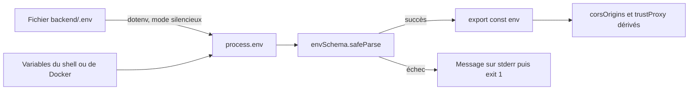

# Configuration

Toute la configuration du backend passe par des variables d'environnement. Elles sont lues une seule fois, au chargement du module [`backend/src/config/env.config.ts`](src:backend/src/config/env.config.ts), validées par un schéma Zod, puis exposées sous forme d'un objet typé `env`. Aucun autre fichier ne lit `process.env` directement, à l'exception des fichiers de préparation des tests. La liste complète des variables est sur la page [Variables d'environnement](variables-environnement.md).

## Chargement



1. `dotenv.config({ quiet: true })` charge `backend/.env` s'il existe. Une variable déjà présente dans l'environnement du process n'est pas écrasée : les valeurs de Docker Compose ou du shell priment sur le fichier.
2. `envSchema.safeParse(process.env)` applique les types, valeurs par défaut et contraintes.
3. En cas d'échec, le process écrit la liste des erreurs et s'arrête avant d'ouvrir le moindre port :

```text
Configuration invalide, démarrage interrompu :
  - JWT_SECRET : JWT_SECRET utilise la valeur de développement, interdite en production
  - METRICS_TOKEN : METRICS_TOKEN est obligatoire en production pour protéger /metrics
```

Comme `env.config.ts` est importé par presque tous les modules, l'erreur survient aussi bien au démarrage de `server.ts`, de `worker.ts` que des tests.

## Types et conversions

Le schéma utilise quelques assistants pour convertir les chaînes de l'environnement.

| Forme | Construction Zod | Valeurs acceptées |
|---|---|---|
| Entier | `z.coerce.number().int()` avec `.positive()` ou `.min()` | `"2053"` devient `2053` ; `"abc"` est refusé |
| Booléen | `booleanFromEnv(défaut)` | `true`, `false`, `1`, `0` uniquement ; `yes` ou `TRUE` sont refusés |
| Liste | `csvList(défaut)` | Valeurs séparées par des virgules, espaces retirés, éléments vides ignorés |
| URL | `z.string().url()` | URL absolue (`http://`, `https://`, `postgresql://`, `redis://`) |
| Énumération | `z.enum([...])` | Liste fermée, sensible à la casse |
| Motif | `.regex(...)` | Adresses Ethereum `0x` + 40 hexadécimaux, clé privée `0x` + 64 hexadécimaux, `ENCRYPTION_KEY` en 64 hexadécimaux, durée JWT `12h` |

> [!IMPORTANT]
> Une variable définie mais vide n'est pas absente. `JWT_SECRET=""` est validé comme une chaîne vide et refusé par `.min(16)` : la valeur par défaut ne s'applique que si la variable n'existe pas. C'est le cas dans la stack Docker, où `JWT_SECRET: ${JWT_SECRET:-}` transmet une chaîne vide quand le fichier `.env` racine ne la définit pas.

Deux valeurs dérivées sont calculées après validation :

| Export | Calcul |
|---|---|
| `corsOrigins` | `FRONTEND_URL` suivi de `CORS_ORIGINS`, sans doublon. Utilisé par Express et par Socket.IO. |
| `trustProxy` | `true` ou `false` pour ces chaînes, un nombre de proxys si la valeur est un entier, sinon la chaîne telle quelle (liste d'adresses ou de sous-réseaux). |

## Règles de production

Quand `NODE_ENV=production`, un `superRefine` ajoute des contrôles qui ne s'appliquent dans aucun autre environnement.

| Règle | Message renvoyé |
|---|---|
| `LOGIN_EMAIL_CODE_REQUIRED`, `ADMIN_MFA_REQUIRED` et `AGE_VERIFICATION_REQUIRED` doivent valoir `true` | `<variable> ne peut pas être désactivé en production` |
| `BLOCKCHAIN_MODE` doit valoir `onchain` | `BLOCKCHAIN_MODE doit valoir onchain en production : la simulation est réservée au développement` |
| Si `METRICS_ENABLED=true`, `METRICS_TOKEN` doit être non vide | `METRICS_TOKEN est obligatoire en production pour protéger /metrics` |
| `JWT_SECRET`, `ENCRYPTION_KEY`, `RELAYER_PRIVATE_KEY` et `WEBHOOK_SECRET` doivent différer des valeurs de développement | `<variable> utilise la valeur de développement, interdite en production` |

Les valeurs de développement refusées sont celles de l'objet `DEV_DEFAULTS` du schéma, identiques à celles de `.env.example`. `RELAYER_PRIVATE_KEY` par défaut est le compte 0 public de Hardhat : une clé connue de tous, à ne jamais utiliser hors d'une chaîne locale.

> [!WARNING]
> Ces règles ne vérifient pas la qualité des secrets, seulement qu'ils diffèrent des valeurs publiques. Elles ne contrôlent pas non plus `DATABASE_URL`, `SMTP_*` ou `AWS_*` : les identifiants par défaut (`etherbay_password`, `minioadmin`) sont acceptés en production. Voir [Cryptographie et secrets](../securite/cryptographie-secrets.md).

## Comportements selon NODE_ENV

`NODE_ENV` modifie aussi le comportement du code, en dehors du schéma.

| Comportement | development | test | production |
|---|---|---|---|
| Format des logs | texte coloré | silencieux | JSON |
| Niveau de log par défaut | `debug` | `info` (silencieux) | `info` |
| Client Redis | créé | non créé, repli mémoire | créé |
| Envoi SMTP et dépôt S3 | réels | ignorés | réels |
| `devOtpPreview` dans les réponses de connexion et de 2FA | présent | absent | absent |
| `confirmationToken` dans la demande de suppression RGPD | présent | présent | absent |
| Message des erreurs 500 | message d'origine | message d'origine | `Erreur interne du serveur` |
| Détail de `/health/deep` sans `METRICS_TOKEN` | visible | visible | masqué |
| Arrêt sur promesse rejetée non gérée | non | non | oui |
| Rate limiting | 300 et 30 requêtes | 10 000 requêtes | 300 et 30 requêtes |

## Fichier .env.example

[`backend/.env.example`](src:backend/.env.example) contient une ligne par variable du schéma, avec les valeurs du développement local. Pour démarrer :

```bash
cd backend
cp .env.example .env
```

Ces valeurs supposent l'infrastructure locale de `docker compose up -d --wait` : PostgreSQL sur le port 5434, Redis sur 6380, Mailpit sur 1025 et le nœud Hardhat sur 8545 avec les contrats déjà déployés aux adresses par défaut. Voir [Infrastructure locale](../demarrage/infrastructure-locale.md).

Le fichier `backend/.env` est ignoré par Git. Il ne doit contenir aucun secret de production : en production, les variables sont injectées par l'environnement du conteneur.

## Vérifier la synchronisation

```bash
npm run env:check
```

Le script [`backend/scripts/check-env-example.mjs`](src:backend/scripts/check-env-example.mjs) extrait les noms de variables du schéma (lignes indentées de quatre espaces dans `env.config.ts`) et les compare aux lignes `NOM=` de `.env.example`. Il échoue si une variable manque d'un côté ou de l'autre :

```text
Variables absentes de .env.example : NOUVELLE_VARIABLE
```

En cas de succès, il affiche `.env.example synchronisé avec le schéma (53 variables)`. La CI l'exécute dans le job backend, avant le typage et le lint. Le script ne vérifie que les noms, pas les valeurs.

## Ajouter une variable

1. Ajouter la clé dans `envSchema`, avec un type, une valeur par défaut sûre pour le développement et, si besoin, une règle de production dans `superRefine`.
2. Ajouter la ligne dans `backend/.env.example`.
3. Lire la valeur par `env.NOM` dans le code, jamais par `process.env`.
4. Décrire la variable dans `documentation-officielle/content/_data/variables.json`.
5. Si la stack Docker en a besoin, l'ajouter à l'ancre `x-backend-env` de `docker-compose.yml`.

Le pas à pas complet est dans le guide [Ajouter une variable d'environnement](../guides/ajouter-variable.md).
