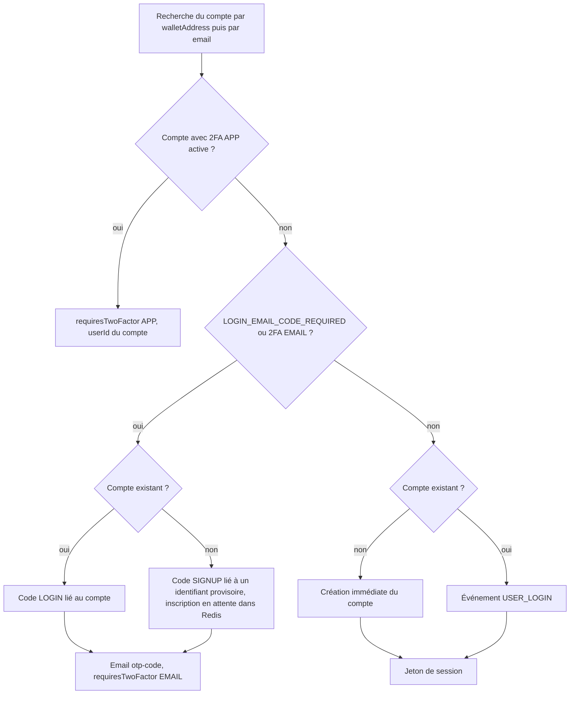

# Authentification

Le module `auth` ouvre les sessions des citoyens, des partenaires et des administrateurs. Il propose trois façons d'entrer, et un second facteur facultatif :

| Parcours | Routes | Client qui l'utilise |
|---|---|---|
| Email et mot de passe | `/signup`, `/signin`, `/password/forgot`, `/password/reset` | Application mobile |
| Google ou Apple | `/oauth/google`, `/oauth/apple` | Application mobile, si les identifiants client sont configurés |
| Code à 6 chiffres reçu par email, sans mot de passe | `/login` | Frontend web |
| Second facteur : code TOTP d'application ou code email | `/2fa/verify` | Web et mobile, pour les comptes qui l'ont activé |
| Compte connecté : changement d'adresse email ou de mot de passe | `/email/change`, `/email/confirm`, `/password/change` | Application mobile (Paramètres, puis Sécurité) |

Le module crée aussi le compte et le portefeuille Ethereum intégré lors de la première connexion vérifiée, et gère la double authentification, le changement d'adresse email et de mot de passe d'un compte connecté, et la déconnexion. Il ne vérifie pas l'âge : la majorité est contrôlée à l'achat grâce à la pièce d'identité validée par la Mairie (voir [Utilisateur](utilisateur.md#verification-d-age)).

| Fichier | Contenu |
|---|---|
| [`backend/src/api/auth/auth.routes.ts`](src:backend/src/api/auth/auth.routes.ts) | 15 routes et leurs middlewares |
| [`backend/src/api/auth/auth.validators.ts`](src:backend/src/api/auth/auth.validators.ts) | Schémas Zod |
| [`backend/src/api/auth/auth.services.ts`](src:backend/src/api/auth/auth.services.ts) | Connexion, inscription, mot de passe, OAuth, 2FA, déconnexion |
| [`backend/src/services/oauth-verifier.service.ts`](src:backend/src/services/oauth-verifier.service.ts) | Vérification des jetons d'identité Google et Apple |
| [`backend/src/api/auth/auth.repo.ts`](src:backend/src/api/auth/auth.repo.ts) | Lecture et écriture de `User`, événements `Analytics` |
| [`backend/src/services/session.service.ts`](src:backend/src/services/session.service.ts) | Signature, vérification et révocation des JWT |
| [`backend/src/services/otp-challenge.service.ts`](src:backend/src/services/otp-challenge.service.ts) | Codes email (connexion, inscription, activation, réinitialisation, changement d'email), compteur d'échecs, anti-rejeu TOTP |
| [`backend/src/utils/crypto.util.ts`](src:backend/src/utils/crypto.util.ts) | `hashValue` et `compareHash` (bcrypt), HMAC, chiffrement |
| [`backend/src/services/totp.service.ts`](src:backend/src/services/totp.service.ts) | Secrets TOTP, QR code, codes de secours |

Le parcours vu du citoyen est décrit dans [Inscription et portefeuille](../../architecture/flux/inscription.md) ; les choix de sécurité dans [Authentification et 2FA](../../securite/authentification.md) et [Sessions](../../securite/sessions.md).

## Routes

| Méthode et chemin | Accès | Middlewares | Rôle |
|---|---|---|---|
| `POST /api/v1/auth/signup` | public | `authRateLimiter`, `validate(signupSchema)` | Inscription par email et mot de passe, envoi d'un code |
| `POST /api/v1/auth/signin` | public | `authRateLimiter`, `validate(signinSchema)` | Connexion par email et mot de passe |
| `POST /api/v1/auth/password/forgot` | public | `authRateLimiter`, `validate(forgotPasswordSchema)` | Envoi d'un code de réinitialisation |
| `POST /api/v1/auth/password/reset` | public | `authRateLimiter`, `validate(resetPasswordSchema)` | Nouveau mot de passe avec le code reçu |
| `POST /api/v1/auth/password/change` | connecté | `authRateLimiter`, `authenticate`, `validate(changePasswordSchema)` | Création ou modification du mot de passe, nouvelle session |
| `POST /api/v1/auth/email/change` | connecté | `authRateLimiter`, `authenticate`, `validate(emailChangeRequestSchema)` | Envoi d'un code à la nouvelle adresse |
| `POST /api/v1/auth/email/confirm` | connecté | `authRateLimiter`, `authenticate`, `validate(emailChangeConfirmSchema)` | Confirmation de la nouvelle adresse |
| `POST /api/v1/auth/oauth/google` | public | `authRateLimiter`, `validate(googleOAuthSchema)` | Connexion ou inscription avec un jeton Google |
| `POST /api/v1/auth/oauth/apple` | public | `authRateLimiter`, `validate(appleOAuthSchema)` | Connexion ou inscription avec un jeton Apple |
| `GET /api/v1/auth/onboarding` | public | aucun | Écrans d'accueil statiques |
| `POST /api/v1/auth/login` | public | `authRateLimiter`, `validate(socialLoginSchema)` | Connexion ou inscription sans mot de passe, par code email |
| `POST /api/v1/auth/2fa/verify` | public, jeton facultatif | `authRateLimiter`, `optionalAuthenticate`, `validate(verify2FASchema)` | Vérifie un code et délivre la session |
| `POST /api/v1/auth/2fa/setup` | connecté | `authenticate`, `validate(setup2FASchema)` | Prépare la 2FA par application ou par email |
| `POST /api/v1/auth/2fa/disable` | connecté | `authRateLimiter`, `authenticate`, `validate(disable2FASchema)` | Désactive la 2FA |
| `POST /api/v1/auth/logout` | connecté | `authenticate`, `validate(logoutSchema)` | Révoque la session courante ou toutes les sessions |

`authRateLimiter` limite chaque IP à 30 requêtes par fenêtre de 10 minutes, avec un seul compteur pour les neuf routes qui l'utilisent, stocké dans Redis. Au-delà : `429 Trop de tentatives de connexion/2FA, veuillez patienter quelques minutes.`

## Jeton de session

Toute session réussie renvoie un JWT signé par [`session.service.ts`](src:backend/src/services/session.service.ts).

| Propriété | Valeur |
|---|---|
| Algorithme | HS256 avec `JWT_SECRET`, seul algorithme accepté à la vérification |
| Émetteur et audience | `iss = blocklucky-api`, `aud = blocklucky-clients`, tous deux vérifiés |
| Identifiant | `jti` UUID aléatoire, utilisé pour la révocation |
| Durée | `JWT_EXPIRES_IN`, 12 heures par défaut, tolérance d'horloge de 30 secondes |
| Contenu | `userId`, `walletAddress`, `role`, `twoFactorVerified` |

`twoFactorVerified` vaut toujours `true` dans les jetons émis par ce module, y compris après une connexion par mot de passe, Google ou Apple sur un compte sans 2FA. Le champ n'est lu par aucun middleware.

À chaque requête authentifiée, le jeton est vérifié puis comparé à deux clés Redis : `auth:revoked:<jti>` (session révoquée) et `auth:revoked-before:<userId>` (toutes les sessions émises avant cet instant). Le rôle n'est relu en base que par `requireRoles`.

## POST /auth/signup

Inscription par email et mot de passe. Aucun compte n'est créé à cette étape : le backend envoie un code à 6 chiffres et le compte naît à la vérification de ce code par [`/2fa/verify`](#post-auth-2fa-verify). Le code est toujours exigé, quelle que soit la valeur de `LOGIN_EMAIL_CODE_REQUIRED`.

### Corps

| Champ | Type | Règles |
|---|---|---|
| `email` | chaîne | email valide, 254 caractères au plus, passé en minuscules |
| `password` | chaîne | 10 à 128 caractères, au moins une lettre (toutes écritures, `\p{L}`) et un chiffre |
| `acceptTerms` | booléen | doit valoir `true`, sinon `400 Vous devez accepter les conditions d'utilisation pour créer un compte.` |
| `referralCode` | chaîne | facultatif, 64 caractères au plus |
| `utmSource` | chaîne | facultatif, 100 caractères au plus |
| `ageGroup` | énumération | facultatif : `18-25`, `26-35`, `36-50`, `50+` |

### Règles

1. Un compte existant dont l'email est vérifié, ou un compte anonymisé, bloque l'inscription : `409 Un compte existe déjà avec cette adresse email.`
2. Le mot de passe est haché tout de suite par `hashValue` (bcrypt, coût 12). Seule l'empreinte est conservée, avec l'email, le parrain résolu, la tranche d'âge et la source, dans le défi `SIGNUP` de Redis pendant 10 minutes. Un code de parrainage inconnu est ignoré.
3. L'email `otp-code` part avec le sujet `Vérifiez votre adresse email - BlockLucky`.
4. La réponse, en 201, a la même forme que celle de `/login` : `requiresTwoFactor: true`, `twoFactorMethod: "EMAIL"`, un `userId` provisoire et `devOtpPreview` en développement.

À la vérification du code :

| Situation | Effet |
|---|---|
| Aucun compte pour cet email | [Création du compte](#creation-du-compte) avec l'empreinte du mot de passe |
| Compte existant non vérifié, par exemple créé par un [ticket offert](loterie.md) | Le mot de passe est posé, `isEmailVerified` passe à `true`, le portefeuille est créé s'il manque et la dotation versée ; le compte reçoit ensuite le bonus de bienvenue, l'email `welcome` et l'événement `USER_SIGNUP`, mais pas de bonus de parrainage |
| Compte vérifié entre-temps par une autre voie | `409 Un compte existe déjà avec cette adresse email.` |

## POST /auth/signin

Connexion par email et mot de passe.

| Champ | Type | Règles |
|---|---|---|
| `email` | chaîne | email valide, passé en minuscules |
| `password` | chaîne | 1 à 128 caractères |

1. Le sujet du blocage est l'identifiant du compte, ou, pour une adresse inconnue, `signin:` suivi du HMAC de l'adresse. Après 10 échecs : `429 Trop de codes erronés...`, comme pour les codes.
2. Le mot de passe est comparé par bcrypt à l'empreinte du compte. Si le compte n'existe pas ou n'a pas de mot de passe, la comparaison se fait contre une empreinte factice, pour que la durée de la réponse ne révèle pas l'existence du compte.
3. Tout échec renvoie `401 Email ou mot de passe incorrect.` et compte un échec.
4. Si la 2FA par application est active, la réponse demande le code TOTP (`requiresTwoFactor: true`, `twoFactorMethod: "APP"`, `userId` du compte). Si la 2FA par email est active, un code `LOGIN` est envoyé. Sinon, la session est délivrée tout de suite, avec l'événement `USER_LOGIN` (fournisseur `PASSWORD`).

> [!NOTE]
> `LOGIN_EMAIL_CODE_REQUIRED` ne concerne que `/login`. Une connexion par mot de passe sur un compte sans 2FA ne passe par aucun code email.

## POST /auth/password/forgot

| Champ | Type | Règles |
|---|---|---|
| `email` | chaîne | email valide |

La réponse est toujours `200 { "sent": true }`, avec le message `Si un compte existe pour cette adresse, un code de réinitialisation a été envoyé`, que le compte existe ou non. Pour un compte actif, un code `PASSWORD_RESET` est émis sur le sujet `password-reset:<userId>` (10 minutes, 5 essais) et envoyé par l'email `otp-code` (sujet `Réinitialisation de votre mot de passe - BlockLucky`) sans attendre la mise en file. En développement, `devOtpPreview` n'apparaît que pour un compte existant.

Un compte sans mot de passe, inscrit par `/login`, Google ou Apple, peut suivre ce parcours pour en définir un.

## POST /auth/password/reset

| Champ | Type | Règles |
|---|---|---|
| `email` | chaîne | email valide |
| `code` | chaîne | exactement 6 chiffres |
| `newPassword` | chaîne | même politique que `/signup` |

1. Le blocage après 10 échecs porte sur `password-reset:<userId>`, ou sur le HMAC de l'adresse si le compte n'existe pas.
2. Un code faux, expiré, épuisé ou d'une autre finalité renvoie `400 Code invalide ou expiré.`
3. En cas de succès : nouvelle empreinte, `isEmailVerified` à `true`, révocation de toutes les sessions du compte (`auth:revoked-before:<userId>`) et alerte `security-alert` (« Mot de passe réinitialisé », ou « Mot de passe défini sur votre compte » pour un compte qui n'en avait pas). La réponse vaut `{ "reset": true }` ; il faut ensuite se reconnecter.

## POST /auth/password/change

Création ou modification du mot de passe du compte connecté. Le parcours mobile est décrit dans [Authentification et stockage sécurisé](../../mobile/authentification.md#email-et-mot-de-passe-du-compte).

| Champ | Type | Règles |
|---|---|---|
| `currentPassword` | chaîne | facultatif, 1 à 128 caractères ; exigé si le compte a déjà un mot de passe |
| `newPassword` | chaîne | même politique que `/signup` |

1. Un compte absent ou supprimé renvoie `404 Utilisateur introuvable`.
2. Si le compte a un mot de passe : blocage après 10 échecs sur le sujet `<userId>` (le même que `/signin`), puis comparaison bcrypt. Un mot de passe actuel absent ou faux renvoie `401 Mot de passe actuel incorrect.` et compte un échec ; un succès remet le compteur à zéro.
3. Un compte sans mot de passe (inscrit par `/login`, Google ou Apple) en définit un sans fournir `currentPassword`.
4. Nouvelle empreinte bcrypt, révocation de toutes les sessions du compte (`auth:revoked-before:<userId>`) et alerte `security-alert` à l'adresse du compte (« Mot de passe modifié », ou « Mot de passe défini sur votre compte »).
5. Une nouvelle session est délivrée aussitôt, avec la même forme que `/signin` : `{ "requiresTwoFactor": false, "isNewUser": false, "token": "...", "user": {...} }`, message `Mot de passe mis à jour, vos autres sessions ont été déconnectées`. Le jeton est émis avec `twoFactorVerified: true`, sans nouveau code 2FA : l'appelant a déjà une session valide. L'appareil qui a fait la demande remplace son jeton ; tous les autres sont déconnectés.

## POST /auth/email/change

Première étape du changement d'adresse email du compte connecté.

| Champ | Type | Règles |
|---|---|---|
| `newEmail` | chaîne | email valide, 254 caractères au plus, passé en minuscules |
| `password` | chaîne | facultatif, 1 à 128 caractères ; exigé si le compte a un mot de passe |

1. Une adresse identique à l'actuelle renvoie `400 La nouvelle adresse email est identique à l'adresse actuelle.`
2. Une adresse déjà portée par un autre compte renvoie `409 Cette adresse email est déjà utilisée par un autre compte.`
3. Si le compte a un mot de passe : blocage après 10 échecs sur `<userId>`, puis comparaison bcrypt. Un mot de passe absent ou faux renvoie `401 Mot de passe incorrect.` et compte un échec.
4. Un code `EMAIL_CHANGE` est émis sur le sujet `email-change:<userId>` (10 minutes, 5 essais), la nouvelle adresse est gardée dans Redis sous `auth:email-change:<userId>` pendant 10 minutes, et le code part à la nouvelle adresse par l'email `otp-code` (sujet `Confirmez votre nouvelle adresse email - BlockLucky`).

La réponse vaut `{ "message": "Un code à 6 chiffres a été envoyé à <adresse>" }`, avec `devOtpPreview` en développement. L'adresse du compte ne change pas à cette étape.

## POST /auth/email/confirm

| Champ | Type | Règles |
|---|---|---|
| `code` | chaîne | exactement 6 chiffres |

1. Blocage après 10 échecs sur `email-change:<userId>`.
2. Un code faux, expiré, épuisé, d'une autre finalité, ou une adresse en attente absente de Redis, renvoie `400 Code invalide ou expiré.` et compte un échec.
3. En cas de succès, le compteur et la clé Redis sont effacés, la disponibilité de l'adresse est vérifiée une seconde fois (409 si un autre compte l'a prise entre-temps), puis `email` est remplacé et `isEmailVerified` passe à `true`.
4. L'ancienne adresse reçoit l'alerte `security-alert` « Adresse email du compte remplacée par » suivie de la nouvelle adresse masquée.

La réponse vaut `{ "profile": { "email": "nouvelle@etherbay.fr" } }`, message `Adresse email mise à jour`. Les sessions ne sont pas révoquées.

## POST /auth/oauth/google et /auth/oauth/apple

| Route | Corps | Vérification dans [`oauth-verifier.service.ts`](src:backend/src/services/oauth-verifier.service.ts) |
|---|---|---|
| `/oauth/google` | `idToken`, 20 à 8 192 caractères | `OAuth2Client.verifyIdToken` de `google-auth-library`, audience parmi `GOOGLE_CLIENT_IDS` ; `email` et `sub` obligatoires, `email_verified` doit être vrai |
| `/oauth/apple` | `identityToken`, 20 à 8 192 caractères ; `fullName` facultatif, 200 caractères au plus | `jwtVerify` de `jose` contre les clés publiques `https://appleid.apple.com/auth/keys`, émetteur `https://appleid.apple.com`, audience parmi `APPLE_CLIENT_IDS`, algorithme RS256 ; `email` et `sub` obligatoires, `email_verified` refusé s'il est présent et faux |

Si la liste d'identifiants client du fournisseur est vide, ce qui est le cas par défaut, la route répond `503 Connexion Google non configurée.` ou `503 Connexion Apple non configurée.`. Un jeton invalide, expiré ou sans email vérifié renvoie 401.

Le compte est retrouvé par l'adresse email du jeton :

| Situation | Effet |
|---|---|
| Aucun compte | [Création du compte](#creation-du-compte) sans mot de passe ni parrain, session avec `isNewUser: true` |
| Compte non vérifié | Activation comme pour `/signup`, session délivrée sans 2FA |
| Compte vérifié | Même suite que `/signin` : code TOTP ou code email si la 2FA est active, sinon session et `USER_LOGIN` (fournisseur `GOOGLE` ou `APPLE`) |

L'identifiant `sub` du fournisseur et le `fullName` d'Apple ne sont pas enregistrés. Les risques de ce rattachement par adresse sont analysés dans [Authentification et 2FA](../../securite/authentification.md#rattachement-par-adresse-email).

## POST /auth/login

Connexion sans mot de passe, utilisée par le frontend web. Le client envoie l'email du citoyen, une déclaration de majorité et une adresse de portefeuille. Le web dérive cette adresse de l'email (`generateDeterministicWallet` dans `frontend-web/src/app/connexion/page.tsx`) : elle ne sert qu'à retrouver un compte existant. Le portefeuille réel d'un nouveau compte est toujours créé par le backend. La route reste ouverte à tous les comptes, y compris ceux qui ont un mot de passe.

### Corps

| Champ | Type | Règles |
|---|---|---|
| `walletAddress` | chaîne | obligatoire, `0x` + 40 hexadécimaux, passée en minuscules |
| `email` | chaîne | facultatif, email valide, 254 caractères au plus ; obligatoire en pratique pour un nouveau compte |
| `provider` | énumération | `GOOGLE`, `APPLE`, `EMAIL` ou `WALLET`, défaut `GOOGLE` ; seulement enregistré dans les métadonnées analytiques |
| `isAdultConfirmed` | booléen | doit valoir `true`, sinon `400` avec le message `Vous devez certifier avoir 18 ans ou plus pour participer à la loterie (Légal 18+).` Cette déclaration ne dispense pas de la vérification d'âge exigée à l'achat |
| `ageGroup` | énumération | facultatif : `18-25`, `26-35`, `36-50`, `50+` |
| `referralCode` | chaîne | facultatif, 64 caractères au plus, code de parrainage d'un autre citoyen |
| `utmSource` | chaîne | facultatif, 100 caractères au plus |

### Règles



1. Le compte est cherché par adresse, puis par email.
2. Un compte dont la 2FA par application est active ne reçoit aucun code email : la réponse demande directement le code TOTP, avec l'identifiant du compte dans `userId`.
3. Dans le cas normal (production et développement), un code est émis. L'email utilisé est celui du compte s'il existe, sinon celui du corps. Sans email : `400 Une adresse email est requise pour recevoir le code de connexion`.
4. Pour un compte existant, le blocage par compte est vérifié avant l'émission (`429`, voir plus bas). Pour un nouvel inscrit, `userId` est un UUID provisoire et les données d'inscription (email, code de parrainage résolu, tranche d'âge, source) sont conservées avec le code dans Redis pendant 10 minutes. Aucun compte n'est créé à cette étape.
5. Si `LOGIN_EMAIL_CODE_REQUIRED=false` (tests uniquement), le compte est créé ou connecté immédiatement et la réponse contient le jeton.

Un code de parrainage inconnu est ignoré sans erreur.

### Réponses

Code envoyé par email, en développement :

```json
{
  "success": true,
  "message": "Authentification réussie",
  "data": {
    "requiresTwoFactor": true,
    "twoFactorMethod": "EMAIL",
    "userId": "3f6c2a7e-1b0d-4c55-9a8e-2f1d7c9b4e10",
    "devOtpPreview": "482913"
  }
}
```

`devOtpPreview` n'existe qu'en `NODE_ENV=development`. Pour un compte avec 2FA par application, la réponse vaut `{ "requiresTwoFactor": true, "twoFactorMethod": "APP", "userId": "<id du compte>" }`.

### Effets de bord

- Email `otp-code` (sujet `Votre code de connexion - BlockLucky`, validité annoncée de 10 minutes), mis en file `emails-queue`.
- Clé Redis `auth:otp:<userId>` contenant le HMAC du code, sa finalité (`LOGIN`, `SIGNUP`, `SETUP` ou `PASSWORD_RESET`), le nombre d'essais et l'inscription en attente.

## POST /auth/2fa/verify

Seconde étape des connexions par code et des connexions avec 2FA. Elle confirme aussi une inscription par mot de passe et l'activation d'une 2FA.

### Corps

| Champ | Type | Règles |
|---|---|---|
| `userId` | UUID | facultatif ; obligatoire sans jeton. Valeur `userId` reçue de `/login`, `/signup`, `/signin` ou d'une route OAuth. |
| `code` | chaîne | 6 à 16 caractères `[0-9A-Za-z-]`, espaces retirés : code email, code TOTP ou code de secours `XXXXX-XXXXX` |

Si un jeton valide accompagne la requête, son `userId` prime sur celui du corps. Sans l'un ni l'autre : `400 Identifiant utilisateur requis pour vérifier le code 2FA`.

### Règles

1. Si le sujet a accumulé 10 échecs, la vérification est refusée : `429 Trop de codes erronés. La vérification est bloquée pendant une heure pour ce compte.` Le compteur `auth:otp-failures:<id>` expire une heure après le dernier échec.
2. Si un code email est en attente pour ce sujet, il est comparé en temps constant à son HMAC. Un code reste valable 10 minutes et 5 essais ; au cinquième essai erroné il est supprimé, même s'il n'a pas expiré.
   - Finalité `SIGNUP` : le compte est créé (voir [Création du compte](#creation-du-compte)), ou activé pour une inscription par mot de passe sur un compte non vérifié, et la session est délivrée avec `isNewUser: true`.
   - Finalité `LOGIN` : `isEmailVerified` passe à `true` si besoin, un événement `USER_LOGIN` (fournisseur `EMAIL_CODE`) est enregistré.
   - Finalité `SETUP` : la 2FA par email est activée, toutes les sessions antérieures sont révoquées et une alerte de sécurité est envoyée.
3. Sinon, le compte doit avoir `twoFactorMethod = APP`. Le code est accepté s'il correspond au TOTP courant, précédent ou suivant (pas de 30 secondes) et n'a pas déjà servi (clé `auth:totp-used:<userId>:<compteur>` pendant 120 secondes), ou s'il correspond à un code de secours non utilisé. Un code de secours est consommé et déclenche une alerte email indiquant le nombre restant.
4. Si la 2FA par application n'était pas encore active, cette vérification l'active, révoque les sessions antérieures et envoie une alerte. Sinon, un événement `USER_LOGIN` (fournisseur `TOTP`) est enregistré.

Tout échec incrémente le compteur et renvoie `401 Code de vérification invalide ou expiré`, sans distinguer code faux, code expiré et compte inconnu. Un succès remet le compteur à zéro.

### Réponse

```json
{
  "success": true,
  "message": "Double authentification (2FA) vérifiée avec succès",
  "data": {
    "verified": true,
    "isNewUser": true,
    "token": "eyJhbGciOiJIUzI1NiIsInR5cCI6IkpXVCJ9...",
    "user": {
      "id": "019a7c3e-5d2b-7f41-9c0e-6a8b2d4f1e37",
      "walletAddress": "0x8b3f0e5c2d9a71b46e0f3c8d2a5b7e9f1c4d6a08",
      "email": "citoyen@etherbay.fr",
      "role": "USER",
      "pointsBalance": 25,
      "referralCode": "6f1d2c3b-4a5e-4f60-8b7c-9d0e1f2a3b4c",
      "isTwoFactorEnabled": false,
      "twoFactorMethod": null,
      "hasPassword": true,
      "ageVerificationStatus": "NONE"
    }
  }
}
```

Le `user.id` d'un nouvel inscrit diffère du `userId` provisoire envoyé par `/login` ou `/signup`. `hasPassword` indique si le compte a un mot de passe, sans exposer l'empreinte ; `ageVerificationStatus` vaut `NONE` tant qu'aucune pièce d'identité n'a été envoyée. `walletAddress` est l'adresse du portefeuille intégré créé par le backend, pas celle envoyée par le client.

### Création du compte

`createVerifiedUser` est appelée à la vérification d'un code `SIGNUP`, par une route OAuth pour une adresse inconnue, ou directement par `/login` quand le code email est désactivé. Si un compte existe déjà pour l'adresse ou l'email (deux inscriptions concurrentes), il est réutilisé et `isNewUser` vaut `false`.

| Étape | Détail |
|---|---|
| Portefeuille | `walletService.createCustodialWallet()` : `Wallet.createRandom()` d'ethers, clé privée chiffrée en AES-256-GCM dans `walletEncryptedKey` |
| Compte | `User` avec `isEmailVerified = true`, `passwordHash` pour une inscription par mot de passe, `referredById` si le code de parrainage était valide, `ageVerificationStatus = NONE` |
| Dotation de bienvenue | `grantWelcomeEthers` lancé sans attendre : en mode onchain, le compte opérateur envoie `WELCOME_GRANT_WEI` ; un échec est journalisé et retenté au premier achat |
| Parrainage | +100 `REFERRAL` au parrain, puis +50 `REFERRAL` au filleul |
| Points | +25 `SOCIAL_QUEST` (« Bonus de bienvenue Onboarding EtherBay ») |
| Email | `welcome` avec l'adresse du portefeuille et le code de parrainage |
| Analytique | `USER_SIGNUP` avec `provider` (`PASSWORD`, `GOOGLE`, `APPLE` ou celui envoyé à `/login`), `ageGroup` et `isAdultConfirmed`, toujours enregistré à `true` |

Le détail du portefeuille et de la dotation est dans [Portefeuilles intégrés](../../integration-blockchain/portefeuilles.md).

> [!NOTE]
> Sans tranche d'âge, l'événement est enregistré avec `ageGroup: "18-35"`. Cette valeur n'appartient pas aux quatre tranches du schéma : elle est ignorée par le calcul démographique du [tableau de bord analytique](analytique.md).

## POST /auth/2fa/setup

Prépare la 2FA. Elle n'est active qu'après la vérification d'un premier code par `/2fa/verify`.

| Champ | Type | Règles |
|---|---|---|
| `method` | énumération | `APP` ou `EMAIL` |

| Cas | Statut et message |
|---|---|
| Compte introuvable | `404 Utilisateur introuvable` |
| 2FA déjà active | `409 La double authentification est déjà active. Désactivez-la avant de la reconfigurer.` |
| `EMAIL` sans adresse email sur le compte | `400 Une adresse email est requise pour activer la 2FA par Email` |

Méthode `APP` : un secret Base32 de 32 caractères (160 bits) est généré, chiffré et stocké, avec 10 codes de secours hachés en SHA-256. La réponse est le seul moment où le secret et les codes de secours sont visibles.

La méthode `APP` efface aussi un code email encore en attente pour ce compte, par exemple après un premier choix de `EMAIL`. Sans cela, `/2fa/verify` comparerait le code de l'application à ce code email et le refuserait.

```json
{
  "success": true,
  "message": "Configuration 2FA initialisée",
  "data": {
    "method": "APP",
    "secret": "JBSWY3DPEHPK3PXPJBSWY3DPEHPK3PXP",
    "otpAuthUrl": "otpauth://totp/BlockLucky%20EtherBay:citoyen%40etherbay.fr?secret=JBSWY3DPEHPK3PXPJBSWY3DPEHPK3PXP&issuer=BlockLucky%20EtherBay&algorithm=SHA1&digits=6&period=30",
    "qrCodeDataUrl": "data:image/png;base64,iVBORw0KGgo...",
    "backupCodes": ["K7M2Q-ZP4XN", "B8R3T-WY6HC"]
  }
}
```

La liste réelle contient 10 codes. Méthode `EMAIL` : un code de finalité `SETUP` est envoyé (sujet `Activation 2FA - Votre code OTP BlockLucky`) et la réponse vaut `{ "method": "EMAIL", "message": "Un code à 6 chiffres a été envoyé à <email>" }`, avec `devOtpPreview` en développement.

Relancer `setup` avant vérification remplace la configuration en attente : un nouveau secret invalide l'ancien QR code.

## POST /auth/2fa/disable

| Champ | Type | Règles |
|---|---|---|
| `code` | chaîne | facultatif, même format que pour `verify` |

Si la 2FA est active, l'appelant doit prouver sa présence : soit un code TOTP ou de secours valide, soit une session ouverte depuis moins de 15 minutes (`iat` du jeton). Pour une 2FA par email, seul le second moyen fonctionne, car le code est vérifié comme un code d'application. Échec : `401 Pour désactiver la double authentification, saisissez un code 2FA valide ou reconnectez-vous (connexion de moins de 15 minutes).`, compté dans les échecs du compte.

La désactivation efface méthode, secret et codes de secours, envoie l'alerte « Double authentification désactivée » et renvoie `{ "isTwoFactorEnabled": false }`. Les sessions existantes ne sont pas révoquées.

> [!WARNING]
> Un administrateur qui désactive sa 2FA perd immédiatement l'accès à toutes les routes réservées à l'ADMIN tant que `ADMIN_MFA_REQUIRED=true`.

## POST /auth/logout

| Champ | Type | Règles |
|---|---|---|
| `allDevices` | booléen | facultatif, défaut `false` ; corps entier facultatif |

Sans `allDevices`, le `jti` du jeton est inscrit dans `auth:revoked:<jti>` jusqu'à son expiration (durée restante multipliée par 1,2, plus 30 secondes). Avec `allDevices: true`, `auth:revoked-before:<userId>` reçoit l'instant courant moins une seconde pour 30 jours : tout jeton émis avant est refusé.

La réponse porte l'en-tête `Clear-Site-Data: "cache", "cookies", "storage"` :

```json
{ "success": true, "message": "Déconnexion effectuée", "data": { "loggedOut": true, "allDevices": false } }
```

> [!IMPORTANT]
> La révocation vit dans Redis. Si Redis est indisponible, elle tombe dans la mémoire du process : elle n'est pas partagée entre instances et disparaît au redémarrage. Voir [Données Redis](../../base-de-donnees/redis.md).

## GET /auth/onboarding

Renvoie `{ "slides": [...] }` : quatre écrans codés en dur dans `getOnboardingSlides` (`step`, `title`, `description`), présentant la loterie, le portefeuille intégré, les EtherPoints et le tirage Chainlink VRF.

## Erreurs du module

| Statut | Message | Origine |
|---|---|---|
| 400 | `Erreur de validation des données` | Schéma Zod, dont `isAdultConfirmed` ou `acceptTerms` différent de `true` et mot de passe trop faible |
| 400 | `Code invalide ou expiré.` | `/password/reset`, `/email/confirm` |
| 400 | `La nouvelle adresse email est identique à l'adresse actuelle.` | `/email/change` |
| 400 | `Une adresse email est requise pour recevoir le code de connexion` | `/login` sans email connu |
| 400 | `Une adresse email est requise pour créer un compte` | `/login` sans code email ni email |
| 400 | `Identifiant utilisateur requis pour vérifier le code 2FA` | `/2fa/verify` sans jeton ni `userId` |
| 401 | `Code de vérification invalide ou expiré` | Code faux, expiré, épuisé ou sujet inconnu |
| 401 | `Email ou mot de passe incorrect.` | `/signin` |
| 401 | `Mot de passe incorrect.` | `/email/change` |
| 401 | `Mot de passe actuel incorrect.` | `/password/change` |
| 401 | `Jeton Google invalide ou expiré.`, `Jeton Apple invalide ou expiré.`, email non vérifié | Routes OAuth |
| 401 | `Pour désactiver la double authentification, ...` | Preuve manquante sur `/2fa/disable` |
| 404 | `Utilisateur introuvable` | `/2fa/setup`, `/2fa/disable`, `/password/change`, `/email/change` ou `/email/confirm` sur un compte supprimé |
| 409 | `La double authentification est déjà active. ...` | `/2fa/setup` |
| 409 | `Un compte existe déjà avec cette adresse email.` | `/signup`, ou la vérification de son code |
| 409 | `Cette adresse email est déjà utilisée par un autre compte.` | `/email/change`, `/email/confirm` |
| 429 | `Trop de codes erronés. ...` | 10 échecs pour le même sujet, codes et mots de passe confondus |
| 429 | `Trop de tentatives de connexion/2FA, ...` | `authRateLimiter` |
| 503 | `Connexion Google non configurée.`, `Connexion Apple non configurée.` | `GOOGLE_CLIENT_IDS` ou `APPLE_CLIENT_IDS` vide |

Le contrôle `403 Vous devez confirmer avoir plus de 18 ans` du service n'est jamais atteint : la validation Zod rejette la requête avant.

## Exemples

Connexion d'un compte de démonstration par mot de passe :

```bash
curl -s -X POST http://localhost:2053/api/v1/auth/signin \
  -H "Content-Type: application/json" \
  -d '{"email":"citoyen@etherbay.fr","password":"EtherBay2026demo"}'
```

Connexion sans mot de passe, comme le web :

```bash
curl -s -X POST http://localhost:2053/api/v1/auth/login \
  -H "Content-Type: application/json" \
  -d '{"walletAddress":"0x1234567890123456789012345678901234567890","email":"citoyen@etherbay.fr","isAdultConfirmed":true,"ageGroup":"26-35"}'

curl -s -X POST http://localhost:2053/api/v1/auth/2fa/verify \
  -H "Content-Type: application/json" \
  -d '{"userId":"<userId reçu>","code":"<code reçu par email>"}'
```

Le code se lit dans Mailpit (`http://localhost:8025`) ou dans `devOtpPreview`. Les comptes de démonstration sont listés dans [Comptes de démonstration et connexion](../../demarrage/comptes-et-connexion.md).
