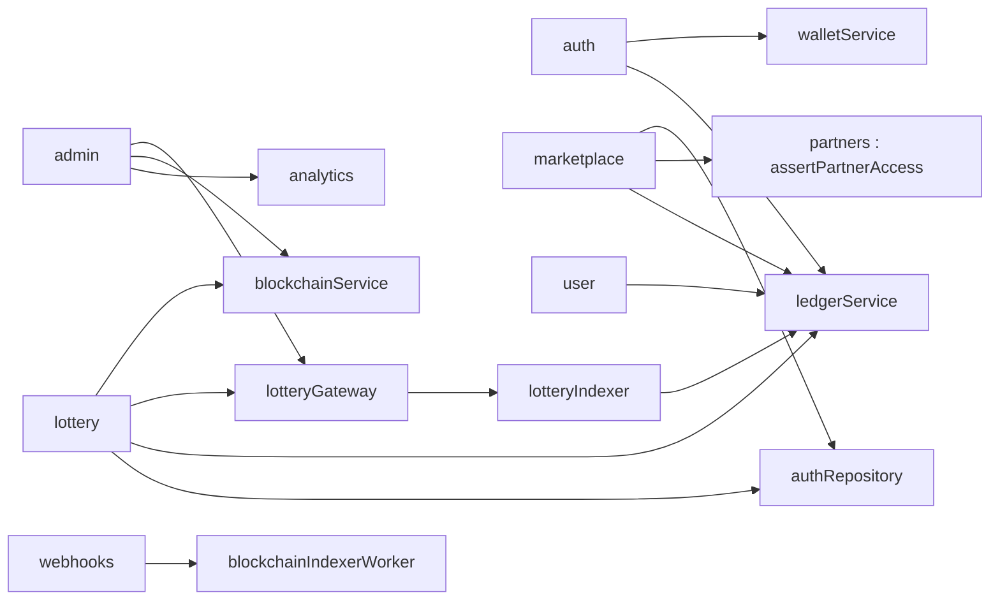

# Modules métier

Le dossier `backend/src/api` contient neuf modules. Chacun est un routeur Express monté par [`backend/src/app.ts`](src:backend/src/app.ts) sous `/api/v1/<module>` et, pour compatibilité, sous `/api/<module>`. Le module système fait exception : ses routes sont montées à la racine du serveur. Les pages de cette section décrivent chaque route avec ses règles métier, sa validation, ses autorisations, ses erreurs et ses effets de bord. La liste brute des 52 routes est générée sur la page [Référence de l'API](../reference-api.md).

## Vue d'ensemble

| Module | Préfixe | Routes | Responsabilité | Page |
|---|---|---|---|---|
| `system` | racine | 5 (+ `/metrics`) | Sondes de santé, configuration des clients | [Webhooks et système](webhooks-systeme.md) |
| `auth` | `/api/v1/auth` | 6 | Connexion par code email, création de compte et de portefeuille, 2FA, déconnexion | [Authentification](auth.md) |
| `lottery` | `/api/v1/lottery` | 11 | État du tour, achat et cadeau de tickets, tirage, annulation, portefeuille, POAP | [Loterie](loterie.md) |
| `marketplace` | `/api/v1/marketplace` | 6 | Catalogue, solde d'EtherPoints, échange de récompenses, validation en magasin | [Boutique et récompenses](boutique.md) |
| `partners` | `/api/v1/partners` | 5 | Entreprises partenaires, offres, lots de codes promo, statistiques | [Partenaires](partenaires.md) |
| `user` | `/api/v1/user` | 10 | Profil, parrainage, quêtes, jeu responsable, préférences, RGPD | [Utilisateur et RGPD](utilisateur.md) |
| `analytics` | `/api/v1/analytics` | 2 | Collecte d'événements, tableau de bord démographique | [Analytique](analytique.md) |
| `admin` | `/api/v1/admin` | 6 | Tableau de bord Mairie, disjoncteur, trésorerie, partenaires, rapports, audit | [Administration Mairie](administration.md) |
| `webhooks` | `/api/v1/webhooks` | 1 | Indexation simulée signée HMAC | [Webhooks et système](webhooks-systeme.md) |

## Dépendances entre modules

Les modules ne s'appellent pas par HTTP. Ils importent directement les services et repositories les uns des autres, ainsi que les services transverses.

## Conventions communes

Toutes les pages de module s'appuient sur les mêmes conventions, détaillées dans [Réponses et erreurs](../reponses-erreurs.md).

| Sujet | Règle |
|---|---|
| Format de réponse | `{ "success": true, "message": "...", "data": {...} }`, ou `{ "success": false, "message": "...", "errors": ... }` |
| Authentification | `Authorization: Bearer <jeton>`. Sans jeton : `401 Authentification requise (Token JWT manquant)`. Jeton invalide, expiré ou révoqué : `401 Session expirée ou token JWT invalide`. |
| Rôles | `requireRoles` renvoie `403 Accès refusé (RBAC) : Rôle ADMIN requis pour cette ressource` si le rôle du jeton ne convient pas, `403 Droits révoqués ou modifiés : reconnectez-vous` si le compte a changé de rôle ou a été supprimé, et `403` sur la 2FA manquante d'un administrateur. |
| Validation | `400 Erreur de validation des données` avec `errors: [{ "path": "body.champ", "message": "..." }]` |
| Idempotence | En-tête `Idempotency-Key` sur `buy`, `gift`, `claim-prize` et `marketplace/claim` |
| Exemples | Les identifiants sont des UUID v7 (`@default(uuid(7))`) ; les adresses sont stockées en minuscules |

Le chemin d'une erreur de validation commence par `body.`, `query.` ou `params.` car le schéma valide l'objet `{ body, query, params }`.

## Matrice des droits

Résumé des accès par rôle. Les règles fines (propriété d'une entreprise partenaire, 2FA des administrateurs) sont décrites sur chaque page et dans [Autorisations et matrice des droits](../../securite/autorisations.md).

| Routes | Anonyme | USER | PARTNER | ADMIN |
|---|---|---|---|---|
| Système, `GET /auth/onboarding`, `POST /auth/login`, `POST /auth/2fa/verify` | oui | oui | oui | oui |
| `POST /auth/2fa/setup`, `/2fa/disable`, `/logout` | non | oui | oui | oui |
| `GET /lottery/status`, `/transparency-charter`, `/leaderboard`, `/poap/:file` | oui | oui | oui | oui |
| `POST /lottery/buy`, `/gift`, `/claim-prize`, `GET /my-tickets`, `/wallet` | non | oui | oui | oui |
| `POST /lottery/draw`, `/refund` | non | non | non | oui |
| `GET /marketplace/catalog`, `/rewards/:id`, `GET /partners` | oui | oui | oui | oui |
| `GET /marketplace/points`, `/my-codes`, `POST /marketplace/claim` | non | oui | oui | oui |
| `POST /marketplace/redeem`, `POST /partners`, `/offers`, `/codes/upload`, `GET /partners/:id/consumption` | non | non | ses entreprises | oui |
| `/user/*` sauf `confirm-delete` | non | son compte | son compte | son compte |
| `POST /user/gdpr/confirm-delete` | jeton reçu par email | idem | idem | idem |
| `POST /analytics/track` | oui | oui | oui | oui |
| `GET /analytics/dashboard`, `/admin/*` | non | non | non | oui, 2FA active |
| `POST /webhooks/blockchain` | signature HMAC | idem | idem | idem |

## Deux modes d'exécution

Plusieurs modules se comportent différemment selon `BLOCKCHAIN_MODE`. Le test est fait par `chainClient.isOnchain` dans chaque service.

| Fonction | `onchain` | `simulated` |
|---|---|---|
| Achat et cadeau | transaction signée par le portefeuille intégré, tickets créés par l'indexeur | ticket inséré en base avec un hachage aléatoire |
| Points d'achat | crédités par l'indexeur à la lecture de `TicketsPurchased` | crédités par le service loterie |
| Tirage | `requestDraw` puis réponse de Chainlink VRF | gagnant choisi par `crypto.randomInt` |
| Annulation | `cancelRound`, remboursements réclamés par la file `chain-actions` | statut `CANCELLED` en base, aucun remboursement réel |
| Disjoncteur | `pause` et `unpause` du contrat | clé Redis `blockchain:circuit_breaker` |
| Trésorerie | `withdrawFees` du contrat | hachage aléatoire, rien n'est versé |
| Webhook blockchain | désactivé (409) | indexe les événements reçus |

La page [Mode onchain ou simulé](../../integration-blockchain/modes.md) décrit ces deux modes du point de vue de l'intégration blockchain.
