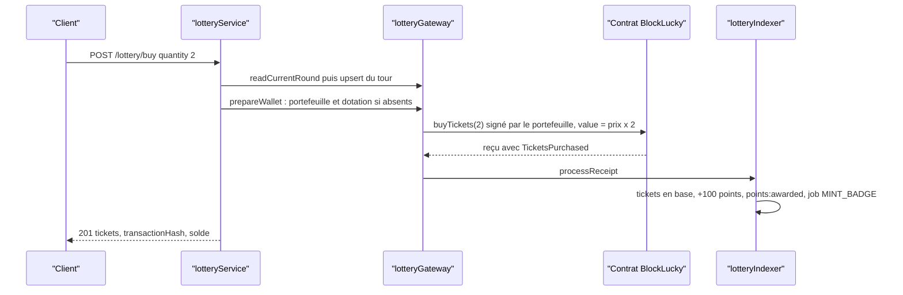

# Loterie

Le module `lottery` expose l'état du tour en cours, l'achat et le cadeau de tickets, le portefeuille intégré du citoyen, la galerie POAP, le retrait de la cagnotte et les deux actions d'administration du tour : le tirage et l'annulation. C'est le module où la différence entre les modes `onchain` et `simulated` est la plus forte. En mode `onchain`, le service délègue tous les appels au contrat à la passerelle [`backend/src/blockchain/lottery.gateway.ts`](src:backend/src/blockchain/lottery.gateway.ts) et laisse l'indexeur projeter les événements en base.

| Fichier | Contenu |
|---|---|
| [`backend/src/api/lottery/lottery.routes.ts`](src:backend/src/api/lottery/lottery.routes.ts) | 11 routes |
| [`backend/src/api/lottery/lottery.validators.ts`](src:backend/src/api/lottery/lottery.validators.ts) | 4 schémas Zod |
| [`backend/src/api/lottery/lottery.controllers.ts`](src:backend/src/api/lottery/lottery.controllers.ts) | Contrôleurs, dont la route POAP qui ne suit pas le format `sendSuccess` |
| [`backend/src/api/lottery/lottery.services.ts`](src:backend/src/api/lottery/lottery.services.ts) | Règles métier des deux modes |
| [`backend/src/api/lottery/lottery.repo.ts`](src:backend/src/api/lottery/lottery.repo.ts) | Tours, tickets, classement |
| [`backend/src/blockchain/poap.metadata.ts`](src:backend/src/blockchain/poap.metadata.ts) | Métadonnées et visuel SVG des badges |

Les parcours complets sont décrits dans [Achat et cadeau de ticket](../../architecture/flux/achat-cadeau.md), [Tirage et versement de la cagnotte](../../architecture/flux/tirage.md) et [Annulation et remboursement](../../architecture/flux/annulation.md).

## Routes

| Méthode et chemin | Accès | Middlewares | Rôle |
|---|---|---|---|
| `GET /api/v1/lottery/status` | public | aucun | État du tour, progression, garanties, réseau |
| `GET /api/v1/lottery/transparency-charter` | public | aucun | Charte de transparence statique |
| `GET /api/v1/lottery/leaderboard` | public | aucun | Classement anonymisé par EtherPoints |
| `GET /api/v1/lottery/poap/:file` | public | aucun | Métadonnées ERC-721 `<tour>.json` ou visuel `<tour>.svg` |
| `POST /api/v1/lottery/buy` | connecté | `authenticate`, `idempotency`, `validate(buyTicketSchema)` | Achat de 1 à 10 tickets |
| `POST /api/v1/lottery/gift` | connecté | `authenticate`, `idempotency`, `validate(giftTicketSchema)` | Cadeau d'un ticket à un email |
| `GET /api/v1/lottery/my-tickets` | connecté | `authenticate` | Tickets paginés et badges POAP |
| `GET /api/v1/lottery/wallet` | connecté | `authenticate` | Portefeuille intégré et solde |
| `POST /api/v1/lottery/claim-prize` | connecté | `authenticate`, `idempotency`, `validate(claimPrizeSchema)` | Retrait manuel de la cagnotte par le gagnant |
| `POST /api/v1/lottery/draw` | ADMIN | `authenticate`, `requireRoles('ADMIN')`, `validate(triggerDrawSchema)` | Demande du tirage |
| `POST /api/v1/lottery/refund` | ADMIN | `authenticate`, `requireRoles('ADMIN')` | Annulation du tour et remboursements |

## Constantes métier

| Constante | Valeur | Où |
|---|---|---|
| Prix d'un ticket en mode simulé | 0,01 ETH | `TICKET_PRICE_ETH` du service |
| Objectif de participants en mode simulé | 10 000 | `TARGET_PARTICIPANTS` |
| Durée d'un tour simulé | 48 heures après `startedAt` | `getCurrentLotteryStatus` |
| EtherPoints par ticket acheté | 50 | `POINTS_PER_TICKET` du service et de l'indexeur |
| EtherPoints par ticket offert, pour l'acheteur | 75 | `POINTS_PER_GIFT` et `POINTS_PER_GIFTED_TICKET` |
| Limite de jeu responsable par défaut | 50 tickets par tour | clé Redis `user:ticket_limit:<userId>`, réglable par [`PUT /user/responsible-limit`](utilisateur.md#put-user-responsible-limit) |
| Salle d'attente | 600 secondes avant la fin du tour | `inWaitingRoom` |

En mode `onchain`, le prix, le nombre maximal de tickets et la limite par joueur viennent du contrat (`getRound`). Le déploiement local fixe 0,01 ETH, 10 000 tickets, 100 tickets par joueur et une commission de 10 % (`smart-contract/deployments/localhost.json`). Voir [Cycle de vie d'un tour](../../smart-contracts/cycle-tour.md).

## GET /lottery/status

Renvoie le tour courant. Les deux modes écrivent en base pendant cette lecture : le mode simulé crée le tour 1 (ou le suivant) si aucun tour `OPEN` ou `LOCKED` n'existe, le mode onchain fait un `upsert` du tour lu sur la chaîne.

```json
{
  "success": true,
  "message": "Statut de la loterie récupéré avec succès",
  "data": {
    "round": {
      "id": "019a7c41-0b6e-7d2a-8f13-5c9e2a7b4d60",
      "contractRoundId": 1,
      "status": "OPEN",
      "prizePool": 0.04,
      "ticketPriceEth": 0.01,
      "winnerWallet": null,
      "chainlinkRequestId": null,
      "startedAt": "2026-11-11T13:23:16.000Z",
      "drawnAt": null,
      "drawTargetTime": "2026-11-11T13:53:16.000Z",
      "remainingSeconds": 412,
      "inWaitingRoom": true,
      "maxTicketsPerPlayer": 100
    },
    "progression": {
      "ticketsSold": 4,
      "distinctParticipants": 2,
      "targetParticipants": 10000,
      "percentage": 0.04,
      "milestones": [
        { "target": 1000, "title": "Palier Quartier Innovant (1 000 participants)", "rewardDescription": "+10% de cagnotte bonus abondée par la Mairie d'EtherBay", "unlocked": false }
      ]
    },
    "guarantees": {
      "autoRefundEnabled": true,
      "autoRefundPolicy": "Si le tour est annulé, chaque mise est remboursable dans le Smart Contract ; la plateforme réclame automatiquement le remboursement pour vous.",
      "gaslessSponsored": false,
      "vrfCertified": true,
      "simulated": false,
      "paused": false
    },
    "network": { "mode": "onchain", "chainId": 31337, "isFallback": false, "rpcUrl": "http://127.0.0.1:8545", "isPaused": false, "contractAddress": "0xcf7ed3acca5a467e9e704c703e8d87f634fb0fc9", "poapContractAddress": "0x5fc8d32690cc91d4c39d9d3abcbd16989f875707" },
    "blockchain": { "mode": "onchain", "chainId": 31337, "lotteryContract": "0xCf7Ed3AccA5a467e9e704C703E8D87F634fB0Fc9", "poapContract": "0x5FC8d32690cc91D4c39d9d3abcBD16989F875707", "lotteryExplorerUrl": null }
  }
}
```

La liste `milestones` contient trois paliers (1 000, 5 000 et 10 000 tickets). Ils sont uniquement affichés : aucun code n'abonde la cagnotte ni ne débloque d'offre quand un palier est atteint. `ticketsSold` compte des tickets, pas des participants distincts, malgré les libellés.

| Champ | Mode onchain | Mode simulé |
|---|---|---|
| `prizePool` | `totalCollected` du contrat en ETH | somme des prix en base |
| `drawTargetTime` | `endTime` du contrat | `startedAt` + 48 h |
| `targetParticipants` | `maxTickets` du contrat | 10 000 |
| `maxTicketsPerPlayer`, `guarantees.paused` | présents | absents |
| `vrfCertified`, `simulated` | `true`, `false` | `false`, `true` |

## POST /lottery/buy

### Corps

| Champ | Type | Règles |
|---|---|---|
| `quantity` | entier | 1 à 10, défaut 1, converti depuis une chaîne |
| `roundId` | UUID | facultatif, ignoré par les deux modes : l'achat porte toujours sur le tour courant |
| `retryAttempt` | entier | 0 à 5, défaut 0 ; renvoyé incrémenté dans les détails d'une erreur réseau en mode simulé |

### Règles communes

1. Le nombre de tickets du citoyen sur le tour courant, compté en base, plus `quantity` ne doit pas dépasser sa limite de jeu responsable (50 par défaut). Sinon : `400 Jeu Responsable : Limite d'achat atteinte (48/50 tickets autorisés sur ce tirage).`
2. La requête accepte `Idempotency-Key` : un double clic avec la même clé rejoue la première réponse au lieu d'acheter deux fois (voir [Référence de l'API](../reference-api.md#idempotence)).

### Mode onchain



1. `prepareWallet` crée le portefeuille intégré s'il manque (comptes créés avant l'ADR 0004 ou par l'indexeur) et verse la dotation de bienvenue si elle n'a jamais été versée.
2. Le tour doit être `OPEN` sur la chaîne, sinon `409 Le tirage de ce tour est en cours, les achats reprendront au tour suivant.`
3. La transaction `buyTickets(quantity)` est signée par la clé déchiffrée du citoyen. Le gaz est payé par son portefeuille : il n'y a pas de transaction sponsorisée.
4. Le reçu est indexé immédiatement, sans attendre la boucle de l'indexeur. Si l'événement a déjà été indexé, aucun point n'est recrédité.

Erreurs du contrat traduites par la passerelle :

| Erreur du contrat | Statut | Message |
|---|---|---|
| `EnforcedPause` | 503 | `Le Smart Contract est temporairement en pause de sécurité par la Mairie.`, avec `errors: { contractError, canRetry: false, circuitBreaker: true }` |
| `RoundNotOpen` | 409 | `Le tirage de ce tour est en cours, les achats reprendront au tour suivant.` |
| `RoundExpired` | 409 | `Ce tour est terminé, le tirage va être lancé.` |
| `RoundSoldOut` | 409 | `Tous les tickets de ce tour ont été vendus.` |
| `PlayerLimitReached` | 400 | `Limite de tickets par participant atteinte pour ce tour.` |
| `InvalidQuantity` | 400 | `Quantité de tickets invalide.` |
| `IncorrectPayment` | 400 | `Montant incorrect pour cet achat.` |
| fonds insuffisants | 402 | `Solde d'ethers fictifs insuffisant sur votre portefeuille BlockLucky.` |
| nœud injoignable | 503 | `Réseau blockchain injoignable. Veuillez réessayer dans un instant.`, `canRetry: true` |
| autre | 502 | `L'achat n'a pas pu être enregistré sur la blockchain.`, `canRetry: true` |

La table complète est décrite dans [Passerelle du contrat et erreurs](../../integration-blockchain/passerelle.md).

```json
{
  "success": true,
  "message": "Ticket acheté avec succès",
  "data": {
    "tickets": [
      { "id": "019a7c45-2e1f-7a09-b3d4-8e6f0a1c2b37", "transactionHash": "0x5d1c...e9a4", "blockNumber": 42, "ticketIndex": 2, "payerWallet": "0x8b3f0e5c2d9a71b46e0f3c8d2a5b7e9f1c4d6a08", "userId": "019a7c3e-5d2b-7f41-9c0e-6a8b2d4f1e37", "lotteryId": "019a7c41-0b6e-7d2a-8f13-5c9e2a7b4d60", "purchasedAt": "2026-11-11T13:41:02.000Z", "etherscanUrl": null }
    ],
    "pointsAwarded": 100,
    "newPointsBalance": 125,
    "poapBadge": { "status": "MINT_PENDING", "contractAddress": "0x5FC8d32690cc91D4c39d9d3abcBD16989F875707", "roundId": 1 },
    "gaslessSponsored": false,
    "transactionHash": "0x5d1c...e9a4",
    "etherscanUrl": null,
    "walletAddress": "0x8b3f0e5c2d9a71b46e0f3c8d2a5b7e9f1c4d6a08",
    "walletBalanceEth": 0.0799
  }
}
```

Le tableau `tickets` contient un élément par ticket. `etherscanUrl` est `null` tant que `EXPLORER_URL` est vide.

### Mode simulé

Le tour en base doit être `OPEN` (`400 Cette session de loterie n'est plus ouverte aux achats de tickets.`). Pour chaque ticket, `blockchainService.relayTicketPurchase` vérifie le disjoncteur Redis puis fabrique un hachage et un numéro de bloc aléatoires ; le ticket est inséré et la cagnotte augmentée de 0,01 ETH dans la même transaction. Disjoncteur actif : `503 CIRCUIT_BREAKER_ACTIVE: Le Smart Contract est temporairement en pause de sécurité.` avec `circuitBreaker: true`. Le service crédite ensuite `50 x quantity` points, émet `points:awarded` et renvoie un faux badge POAP (`tokenId` aléatoire, `metadataUri` en `ipfs://QmEtherBayPOAP2026/...`) avec `gaslessSponsored: true`.

### Effets de bord

| Effet | Onchain | Simulé |
|---|---|---|
| Lignes `Ticket` | créées par l'indexeur (`ticketIndex`, `payerWallet`) | créées par le service |
| `LotteryRound.prizePool` | augmenté du montant de l'événement | augmenté de 0,01 par ticket |
| EtherPoints | +50 par ticket, `TICKET_PURCHASE` | idem |
| Socket.IO | `points:awarded` diffusé | idem |
| POAP | job `MINT_BADGE` dans la file `chain-actions` | aucun |
| Métrique | `business_events_total{event="ticket_purchased"}` et `ticket_indexed` | `ticket_purchased` |

## POST /lottery/gift

Offre un ticket à une personne identifiée par son email.

| Champ | Type | Règles |
|---|---|---|
| `recipientEmail` | chaîne | obligatoire, email valide, 254 caractères au plus, passé en minuscules |
| `recipientWallet` | chaîne | facultatif, `0x` + 40 hexadécimaux ; utilisé seulement en mode simulé pour un bénéficiaire inconnu |
| `personalMessage` | chaîne | facultatif, 250 caractères au plus ; validé mais jamais utilisé |

Règles en mode onchain :

1. S'offrir un ticket est refusé : `400 Vous ne pouvez pas vous offrir un ticket à vous-même.`
2. Si aucun compte n'a cet email, un compte est créé avec un portefeuille intégré, `referredById` égal à l'expéditeur et `isEmailVerified = false`. Un compte existant sans portefeuille en reçoit un.
3. L'expéditeur paie : `buyTicketsFor(destinataire, 1)` est signé par son portefeuille. Les erreurs sont celles de l'achat.
4. L'indexeur attribue le ticket au destinataire, crédite +50 points au destinataire et +75 points `GIFT_TICKET` à l'expéditeur, et met en file la frappe du POAP du destinataire.

En mode simulé, il n'y a pas de contrôle d'auto-cadeau ; un destinataire inconnu est créé avec `recipientWallet` ou une adresse aléatoire sans clé, et seul l'expéditeur reçoit ses 75 points.

```json
{
  "success": true,
  "message": "Ticket offert avec succès à votre proche !",
  "data": {
    "ticket": { "id": "019a7c47-...", "ticketIndex": 4, "userId": "019a7c46-...", "recipientEmail": "voisine@etherbay.fr", "recipientWallet": "0x2c4e...91ab", "etherscanUrl": null },
    "senderPointsAwarded": 75,
    "senderNewBalance": 200
  }
}
```

> [!NOTE]
> Aucun email n'est envoyé au destinataire et la limite de jeu responsable n'est pas appliquée aux cadeaux. Un destinataire créé par un cadeau qui se connecte ensuite passe par le parcours `LOGIN`, pas `SIGNUP` : il ne reçoit pas les 25 points de bienvenue.

## GET /lottery/my-tickets

| Paramètre | Règles |
|---|---|
| `page` | entier, défaut 1, minimum 1 |
| `limit` | entier, défaut 20, entre 1 et 100 |

Renvoie `walletAddress`, `tickets` (identifiant, hachage, bloc, date, tour, statut du tour, `etherscanUrl`) triés du plus récent au plus ancien, `poapBadges` et `meta` (`page`, `limit`, `total`, `totalPages`). En mode onchain, les badges sont lus sur le contrat POAP (`badgeOf`, `tokenURI`) pour au plus 20 tours distincts de la page courante ; seuls les badges frappés apparaissent, `mintedAt` vaut `null`. En mode simulé, chaque ticket de la page produit un badge fictif.

## GET /lottery/wallet

```json
{
  "success": true,
  "message": "Portefeuille BlockLucky récupéré",
  "data": {
    "mode": "onchain",
    "walletAddress": "0x8b3f0e5c2d9a71b46e0f3c8d2a5b7e9f1c4d6a08",
    "custodial": true,
    "balanceEth": 0.1,
    "welcomeGrantTxHash": "0x9a2f...c41e",
    "explorerUrl": null
  }
}
```

En mode onchain, cette lecture appelle `prepareWallet` : elle peut créer le portefeuille et envoyer la dotation de bienvenue. En mode simulé, `balanceEth` et `explorerUrl` valent `null`.

## POST /lottery/claim-prize

| Champ | Type | Règles |
|---|---|---|
| `contractRoundId` | entier | 1 à 1 000 000 |

Le versement de la cagnotte est normalement automatique : l'indexeur met en file un job `CLAIM_PRIZE` dès l'événement `WinnerPicked`. Cette route sert de recours manuel. Elle signe `claimPrize(contractRoundId)` avec le portefeuille du citoyen.

| Cas | Statut et message |
|---|---|
| Mode simulé | `409 Le retrait de la cagnotte nécessite le mode blockchain réel (BLOCKCHAIN_MODE=onchain).` |
| Compte sans portefeuille intégré | `409 Ce compte n'a pas encore de portefeuille BlockLucky` |
| `NotWinner` | `403 Ce compte n'est pas le gagnant de ce tour.` |
| `PrizeAlreadyClaimed` | `409 La cagnotte de ce tour a déjà été versée.` |
| `RoundNotCompleted` | `409 Le tirage de ce tour n'est pas terminé.` |

Succès : `{ "contractRoundId": 1, "transactionHash": "0x...", "etherscanUrl": null, "walletBalanceEth": 0.136 }`.

## POST /lottery/draw

| Champ | Type | Règles |
|---|---|---|
| `roundId` | UUID | facultatif ; utilisé seulement en mode simulé |

Mode onchain : le compte opérateur appelle `requestDraw()` sur le tour courant. La réponse est immédiate, le gagnant n'est pas encore connu :

```json
{
  "success": true,
  "message": "Tirage au sort Chainlink VRF demandé",
  "data": {
    "round": { "contractRoundId": 1, "status": "LOCKED" },
    "vrfProof": { "chainlinkRequestId": "7146...", "transactionHash": "0x...", "etherscanUrl": null, "status": "PENDING", "verifiedFair": true, "simulated": false },
    "message": "Tirage demandé à Chainlink VRF. Le gagnant sera désigné par l'oracle dans les prochains blocs et annoncé en direct."
  }
}
```

L'indexeur passe le tour en `LOCKED` à l'événement `DrawRequested`. À l'événement `WinnerPicked`, il enregistre le gagnant, diffuse `draw:winner` et met en file le versement. Le keeper déclenche le même tirage sans intervention dès que `isDrawReady()` est vrai (voir [Keeper du tirage](../../integration-blockchain/keeper.md)). Erreurs : `409 Le tirage ne peut pas encore être lancé (participants ou durée insuffisants).` (`DrawNotReady`), `503` si le contrat est en pause.

Mode simulé : le tour visé (ou le tour courant) doit exister (`404 Session de loterie introuvable`), ne pas être `COMPLETED` (`400 Le tirage de cette session a déjà été effectué`) et compter au moins un ticket (`400 Aucun ticket vendu sur cette session pour effectuer un tirage`). Le gagnant est tiré par `crypto.randomInt` parmi les tickets, ce qui pondère par le nombre de tickets. Le tour passe `LOCKED` puis `COMPLETED`, `draw:winner` est diffusé et la réponse porte `verifiedFair: false, simulated: true`.

## POST /lottery/refund

Aucun schéma de validation. En mode simulé, `roundId` est lu dans le corps s'il est fourni.

Mode onchain : le compte opérateur appelle `cancelRound()` sur le tour courant (`409 Ce tour ne peut pas être annulé.` sinon). L'indexeur passe le tour en `CANCELLED` et met en file un job `CLAIM_REFUND` par portefeuille payeur distinct ; chaque job signe `claimRefund` avec le portefeuille intégré du payeur. La réponse renvoie `refundedAmountEth` (total collecté avant annulation) et le hachage.

Mode simulé : le statut passe à `CANCELLED` et la réponse annonce `autoRefundExecuted: true` alors qu'aucun ethers n'est rendu. Les EtherPoints gagnés à l'achat ne sont repris dans aucun des deux modes.

## Routes publiques de lecture

### GET /lottery/leaderboard

`limit` est lu dans la query, défaut 20, sans borne supérieure. Les comptes non supprimés sont triés par `pointsBalance` décroissant.

```json
{ "success": true, "message": "Classement des ambassadeurs récupéré", "data": { "leaderboard": [ { "rank": 1, "anonymizedWallet": "0x8b3f...6a08", "pointsBalance": 425, "referralsCount": 2, "ticketsBought": 6 } ] } }
```

### GET /lottery/transparency-charter

Texte statique : titre, version `2026.1` et quatre sections (blockchain, Chainlink VRF, remboursement, portefeuille intégré et ethers fictifs).

### GET /lottery/poap/:file

`file` doit valoir `<n>.json` ou `<n>.svg`, `n` entier de 1 à 9 chiffres strictement positif. Le JSON n'est pas enveloppé dans `sendSuccess` : c'est le document ERC-721 lu par les portefeuilles et les explorateurs.

```json
{
  "name": "POAP BlockLucky EtherBay, tour n°1",
  "description": "Badge de participation non transférable délivré par la Ville d'EtherBay à chaque citoyen ayant participé à ce tour de la loterie solidaire BlockLucky.",
  "image": "http://localhost:2053/api/v1/lottery/poap/1.svg",
  "external_url": "http://localhost:3000",
  "attributes": [
    { "trait_type": "Tour", "value": 1, "display_type": "number" },
    { "trait_type": "Émetteur", "value": "Mairie d'EtherBay" },
    { "trait_type": "Transférable", "value": "Non" }
  ]
}
```

L'URL de l'image est construite à partir du protocole et de l'hôte de la requête : derrière un proxy, `TRUST_PROXY` doit être réglé pour obtenir `https`. Les réponses portent `Cache-Control: public, max-age=86400, immutable`, y compris la réponse `404 Badge POAP introuvable`. L'existence du tour n'est pas vérifiée. Voir [Métadonnées POAP](../../integration-blockchain/metadonnees-poap.md).
