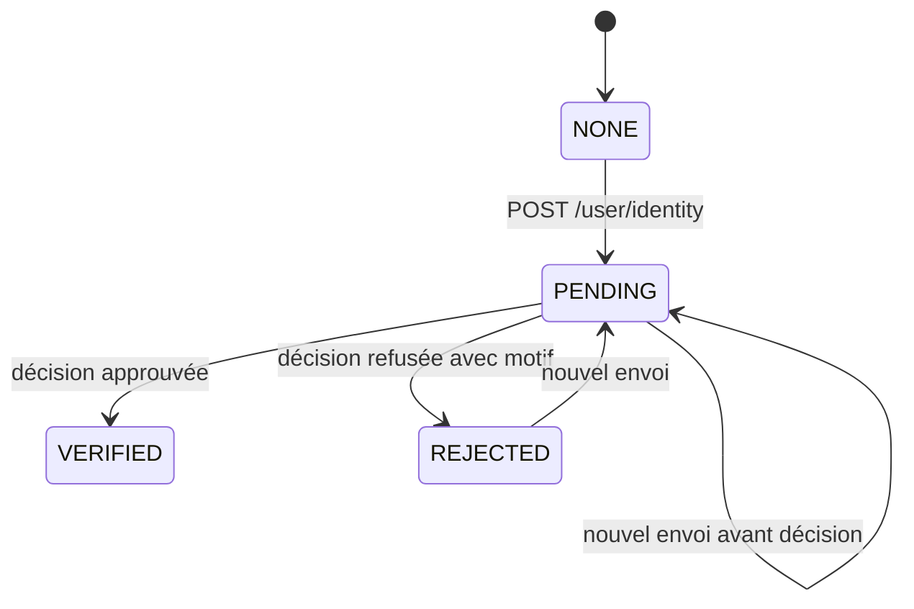
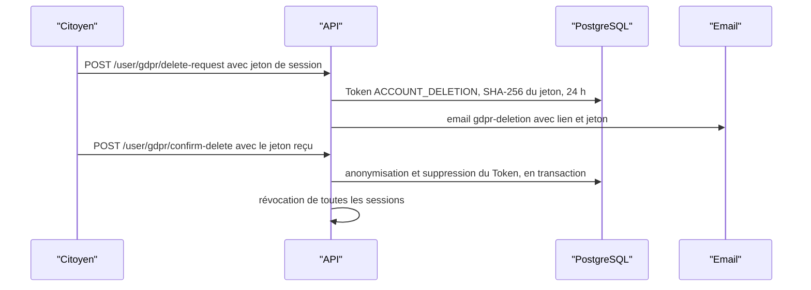

# Utilisateur et RGPD

Le module `user` regroupe tout ce qui concerne le compte du citoyen connecté : profil, vérification d'âge par pièce d'identité, parrainage, quêtes sociales, limite de jeu responsable, préférences d'affichage, notifications et exercice des droits RGPD (export et suppression). Toutes les routes portent sur le compte du jeton : aucune ne prend d'identifiant d'utilisateur en paramètre. Une partie des données de ce module vit dans Redis et non en base.

| Fichier | Contenu |
|---|---|
| [`backend/src/api/user/user.routes.ts`](src:backend/src/api/user/user.routes.ts) | 12 routes |
| [`backend/src/api/user/user.validators.ts`](src:backend/src/api/user/user.validators.ts) | 5 schémas Zod |
| [`backend/src/api/user/user.services.ts`](src:backend/src/api/user/user.services.ts) | Règles métier, catalogue des quêtes |
| [`backend/src/api/user/user.repo.ts`](src:backend/src/api/user/user.repo.ts) | Profil, pièce d'identité, export, jetons de suppression, anonymisation |
| [`backend/src/utils/identity-image.util.ts`](src:backend/src/utils/identity-image.util.ts) | Décodage et contrôle des images de la pièce d'identité |
| [`backend/src/middlewares/age-verification.middleware.ts`](src:backend/src/middlewares/age-verification.middleware.ts) | `requireAgeVerification`, utilisé par les modules loterie et boutique |

Les obligations juridiques couvertes par ces routes sont analysées dans [RGPD](../../juridique/rgpd.md) et le parcours de suppression dans [Suppression RGPD](../../architecture/flux/suppression-rgpd.md).

## Routes

| Méthode et chemin | Accès | Middlewares | Rôle |
|---|---|---|---|
| `GET /api/v1/user/profile` | connecté | `authenticate` | Profil, statistiques, limite et préférences |
| `POST /api/v1/user/identity` | connecté | `identityUploadRateLimiter`, `authenticate`, `identityUploadJsonParser`, `validate(submitIdentitySchema)` | Envoi du recto et du verso de la pièce d'identité |
| `GET /api/v1/user/identity` | connecté | `authenticate` | Statut de la vérification d'âge |
| `GET /api/v1/user/referrals` | connecté | `authenticate` | Code et lien de parrainage, filleuls |
| `GET /api/v1/user/quests` | connecté | `authenticate` | Quêtes et leur état |
| `POST /api/v1/user/quests/complete` | connecté | `authenticate`, `validate(completeSocialQuestSchema)` | Validation d'une quête |
| `PUT /api/v1/user/responsible-limit` | connecté | `authenticate`, `validate(setResponsibleGamingLimitSchema)` | Limite de tickets par tour |
| `PUT /api/v1/user/preferences` | connecté | `authenticate`, `validate(updatePreferencesSchema)` | Thème, langue, notifications |
| `GET /api/v1/user/notifications` | connecté | `authenticate` | Centre de notifications |
| `GET /api/v1/user/gdpr/export` | connecté | `authenticate` | Export JSON des données personnelles |
| `POST /api/v1/user/gdpr/delete-request` | connecté | `authenticate` | Demande de suppression |
| `POST /api/v1/user/gdpr/confirm-delete` | public | `validate(confirmGdprDeletionSchema)` | Confirmation par jeton |

## Données stockées dans Redis

| Clé | Contenu | Valeur par défaut si absente |
|---|---|---|
| `user:prefs:<userId>` | JSON `{ theme, language, pushNotificationsEnabled }` | `{ "theme": "DARK", "language": "FR", "pushNotificationsEnabled": true }` |
| `user:ticket_limit:<userId>` | entier | 50 |
| `user:quests:<userId>` | tableau JSON des identifiants de quêtes validées | `[]` |

Ces clés n'ont pas d'expiration et ne sont pas sauvegardées avec PostgreSQL. Si Redis est vidé, les préférences et les limites reviennent aux valeurs par défaut et les quêtes redeviennent validables, ce qui permet de recréditer leurs points. Elles ne sont pas supprimées lors de l'anonymisation RGPD. Voir [Données Redis](../../base-de-donnees/redis.md).

## GET /user/profile

Un compte supprimé (`deletedAt` renseigné) renvoie `404 Profil utilisateur introuvable ou supprimé`.

```json
{
  "success": true,
  "message": "Profil utilisateur récupéré",
  "data": {
    "profile": {
      "id": "019a7c3e-5d2b-7f41-9c0e-6a8b2d4f1e37",
      "walletAddress": "0x8b3f0e5c2d9a71b46e0f3c8d2a5b7e9f1c4d6a08",
      "email": "citoyen@etherbay.fr",
      "role": "USER",
      "pointsBalance": 125,
      "referralCode": "6f1d2c3b-4a5e-4f60-8b7c-9d0e1f2a3b4c",
      "referralLink": "http://localhost:3000/invite/6f1d2c3b-4a5e-4f60-8b7c-9d0e1f2a3b4c",
      "isTwoFactorEnabled": false,
      "twoFactorMethod": null,
      "hasPassword": true,
      "ageVerificationStatus": "VERIFIED",
      "stats": { "ticketsCount": 3, "claimedRewardsCount": 1, "referralsCount": 0 },
      "responsibleGaming": { "maxTicketsPerRound": 50 },
      "preferences": { "theme": "DARK", "language": "FR", "pushNotificationsEnabled": true },
      "createdAt": "2026-11-11T13:30:11.198Z"
    }
  }
}
```

## Vérification d'âge

Le citoyen prouve sa majorité en envoyant une photo du recto et du verso de sa pièce d'identité. Un agent de la Mairie l'examine dans l'espace d'administration et l'approuve ou la refuse (voir [Administration](administration.md#verification-des-pieces-d-identite)). Tant que le statut n'est pas `VERIFIED`, le middleware `requireAgeVerification` refuse l'achat et le cadeau de tickets, l'échange d'une récompense et le ticket à gratter.



### POST /user/identity

| Champ | Type | Règles |
|---|---|---|
| `front` | chaîne | recto, image JPEG ou PNG en base64, avec ou sans préfixe `data:image/...;base64,` |
| `back` | chaîne | verso, mêmes règles |

La route lit son corps avec une limite propre de 12 Mo (`identityUploadJsonParser` de [`body-parser.middleware.ts`](src:backend/src/middlewares/body-parser.middleware.ts)) ; toutes les autres routes gardent la limite de 1 Mo. `identityUploadRateLimiter` limite chaque IP à 10 envois par heure, avec un compteur Redis à part.

Chaque image est contrôlée par `decodeIdentityImage` :

| Contrôle | Refus |
|---|---|
| Base64 valide, longueur multiple de 4 | `400 Image recto invalide : une photo JPEG ou PNG encodée en base64 est attendue.` |
| Taille de 1 Ko à 4 Mo | au-delà, `400` du schéma Zod sur la longueur de la chaîne, ou `413 Image recto trop volumineuse : 4 Mo au plus.` après décodage ; en deçà, 400 |
| Premiers octets d'un JPEG (`FF D8 FF`) ou d'un PNG | 400, même si le préfixe annonce un autre type |

Le message cite le recto ou le verso. Un compte déjà vérifié reçoit `409 Votre âge est déjà vérifié.`

Les deux images sont chiffrées par `encryptBuffer` (AES-256-GCM avec `ENCRYPTION_KEY`, vecteur d'initialisation aléatoire) et enregistrées dans `IdentityDocument`, avec le type détecté du recto. Un nouvel envoi remplace le précédent. Dans la même transaction, le compte passe à `PENDING`, son motif de refus et sa date de vérification sont effacés. Les images ne sont pas réencodées : les métadonnées éventuelles d'un JPEG sont conservées telles qu'envoyées.

```json
{ "success": true, "message": "Pièce d'identité transmise à la Mairie pour vérification", "data": { "status": "PENDING", "submittedAt": "2026-11-12T09:15:00.000Z" } }
```

### GET /user/identity

```json
{
  "success": true,
  "message": "Statut de la vérification d'âge récupéré",
  "data": { "status": "REJECTED", "submittedAt": "2026-11-12T09:15:00.000Z", "reviewedAt": "2026-11-12T10:02:41.000Z", "note": "Photo floue" }
}
```

`status` vaut `NONE`, `PENDING`, `VERIFIED` ou `REJECTED`. `note` est le motif du dernier refus, `null` sinon. Les images ne sont jamais renvoyées au citoyen.

### Contrôle à l'achat

[`requireAgeVerification`](src:backend/src/middlewares/age-verification.middleware.ts) est placé après `authenticate` sur quatre routes : `POST /lottery/buy`, `POST /lottery/gift`, `POST /marketplace/claim` et `POST /marketplace/scratch`. Il relit le statut en base à chaque requête.

| Cas | Réponse |
|---|---|
| `AGE_VERIFICATION_REQUIRED=false` | aucun contrôle ; valeur refusée en production par le schéma d'environnement |
| Statut différent de `VERIFIED` | `403 Vérifiez votre âge pour jouer.`, avec `errors: { "code": "AGE_VERIFICATION_REQUIRED", "status": "<statut>" }` |
| Base indisponible | `503 Vérification de l'âge impossible pour le moment` |

Pour un cadeau, seul l'expéditeur est contrôlé : le destinataire reçoit son ticket sans vérification.

## GET /user/referrals

Le code de parrainage est l'UUID `User.referralCode`, généré à la création du compte. La réponse contient `referralCode`, `referralLink` (`FRONTEND_URL/invite/<code>`), `referralsCount`, la liste `referrals` des filleuls (identifiant, adresse tronquée `0x2c4e...91ab`, date d'inscription) et trois liens de partage préremplis :

```json
{
  "quickShareLinks": {
    "whatsapp": "https://wa.me/?text=Rejoins-moi%20sur%20BlockLucky...",
    "twitter": "https://twitter.com/intent/tweet?text=Rejoins-moi%20sur%20BlockLucky...",
    "sms": "sms:?&body=Rejoins-moi%20sur%20BlockLucky..."
  }
}
```

Le texte promet « +50 EtherPoints offerts », ce qui correspond au bonus du filleul. Les destinataires d'un cadeau créés par `POST /lottery/gift` apparaissent aussi comme filleuls de l'expéditeur, sans que celui-ci ait reçu de bonus de parrainage.

## Quêtes sociales

Le catalogue est codé en dur dans `QUESTS_CATALOG`.

| Identifiant | Intitulé | Points |
|---|---|---|
| `FOLLOW_TWITTER_ETHERBAY` | Suivre la Mairie d'EtherBay sur X (Twitter) | 30 |
| `JOIN_DISCORD_ETHERBAY` | Rejoindre la communauté citoyenne EtherBay sur Discord | 40 |
| `SHARE_LOTTERY_LINK` | Partager la Grande Loterie sur WhatsApp ou SMS | 25 |
| `READ_TRANSPARENCY_CHARTER` | Lire la Charte de Transparence du Smart Contract | 20 |

`GET /user/quests` renvoie `{ "quests": [...] }` avec, pour chaque quête, `id`, `title`, `rewardPoints` et `completed`.

`POST /user/quests/complete` attend `{ "questId": "<identifiant>" }`, limité par Zod aux quatre valeurs du tableau. Une quête déjà validée renvoie `400 Vous avez déjà complété cette quête sociale`. Sinon l'identifiant est ajouté à la clé Redis et les points sont crédités en `SOCIAL_QUEST` :

```json
{
  "success": true,
  "message": "Quête sociale validée ! EtherPoints bonus crédités.",
  "data": {
    "quest": { "id": "JOIN_DISCORD_ETHERBAY", "title": "Rejoindre la communauté citoyenne EtherBay sur Discord", "rewardPoints": 40, "completed": true },
    "pointsAwarded": 40,
    "newPointsBalance": 165
  }
}
```

> [!NOTE]
> La validation est déclarative : le backend ne vérifie ni l'abonnement, ni le partage, ni la lecture. La lecture puis l'écriture de la clé Redis ne sont pas atomiques : deux appels simultanés pour la même quête peuvent créditer deux fois.

## PUT /user/responsible-limit

| Champ | Type | Règles |
|---|---|---|
| `maxTicketsPerRound` | entier | 1 à 500, messages `La limite doit être d'au moins 1 ticket` et `La limite maximale autorisée est de 500 tickets` |

La valeur est écrite dans `user:ticket_limit:<userId>` et lue par [`POST /lottery/buy`](loterie.md#post-lottery-buy). Elle s'applique immédiatement dans les deux sens : une hausse ne comporte ni délai de réflexion ni confirmation.

> [!NOTE]
> Depuis le passage à un ticket par participant et par grand tirage, cette limite n'a plus d'effet pratique : `/lottery/buy` refuse un second ticket (409) avant même de la comparer, et la plus petite valeur admise est 1. La route et la clé Redis sont conservées, mais l'application mobile ne propose plus de la régler.

```json
{ "success": true, "message": "Limite d'achat Jeu Responsable enregistrée", "data": { "userId": "019a7c3e-...", "maxTicketsPerRound": 10, "updatedAt": "2026-11-11T16:00:00.000Z" } }
```

## PUT /user/preferences

| Champ | Type | Règles |
|---|---|---|
| `theme` | énumération | facultatif, `LIGHT`, `DARK` ou `SYSTEM` |
| `language` | énumération | facultatif, `FR` ou `EN` |
| `pushNotificationsEnabled` | booléen | facultatif |

Les champs fournis sont fusionnés avec les préférences existantes ; la réponse renvoie `{ "preferences": {...} }` complet.

## GET /user/notifications

Renvoie `{ "notifications": [...] }` : trois notifications codées en dur dans le service, datées relativement à l'heure de l'appel (une heure, un jour et deux jours avant). Il n'existe ni table de notifications ni envoi de notifications push côté backend.

## GET /user/gdpr/export

Renvoie l'export des données du compte :

| Champ | Contenu |
|---|---|
| `exportedAt`, `gdprCompliant`, `controller` | métadonnées ; le responsable de traitement est « Mairie d'EtherBay — Direction des Systèmes d'Information (DSI) » |
| `personalData` | identifiant, adresse, email, rôle, solde, code de parrainage, état de la 2FA, statut et date de la vérification d'âge, dates |
| `ticketsHistory` | tous les tickets avec leur tour |
| `pointsLedger` | tous les mouvements d'EtherPoints |
| `claimedRewards` | toutes les récompenses avec offre et partenaire |
| `analyticsEvents` | tous les événements analytiques rattachés au compte |

L'export ne contient pas les données Redis du compte (préférences, limite, quêtes) ni les images de la pièce d'identité. Les secrets (empreinte du mot de passe, clé de portefeuille chiffrée, secret TOTP, codes de secours) sont exclus.

## Suppression du compte

La suppression se fait en deux temps pour éviter qu'un jeton volé suffise à effacer un compte.



### POST /user/gdpr/delete-request

Pas de corps. Un jeton aléatoire de 32 octets en base64url est créé, stocké haché en SHA-256 avec une validité de 24 heures, et envoyé par email (gabarit `gdpr-deletion`). La réponse :

```json
{
  "success": true,
  "message": "Email de confirmation de suppression RGPD envoyé",
  "data": {
    "confirmationRequired": true,
    "emailSent": true,
    "message": "Une demande de suppression RGPD a été initiée. Veuillez confirmer avec le jeton envoyé par email.",
    "confirmationToken": "Qm9u2...x7Q"
  }
}
```

`confirmationToken` n'est renvoyé que hors production. Chaque appel crée un nouveau jeton sans invalider les précédents.

> [!WARNING]
> Le lien de l'email pointe vers `FRONTEND_URL/gdpr/confirm-delete?token=...`, page qui n'existe pas dans `frontend-web`. La confirmation passe par l'écran RGPD du profil, qui appelle l'API avec le jeton. Un compte sans email ne reçoit aucun jeton en production et ne peut donc pas confirmer sa suppression.

### POST /user/gdpr/confirm-delete

| Champ | Type | Règles |
|---|---|---|
| `token` | chaîne | 10 à 128 caractères, message `Jeton de confirmation RGPD requis` |

Route publique : le jeton suffit. Un jeton inconnu ou expiré renvoie `400 Jeton de suppression RGPD invalide ou expiré`. Sinon, dans une transaction :

| Champ de `User` | Nouvelle valeur |
|---|---|
| `walletAddress` | `0xdeleted_gdpr_` suivi des 8 premiers caractères de l'identifiant |
| `walletEncryptedKey`, `welcomeGrantTxHash`, `email`, `passwordHash`, `ageVerificationNote` | `null` |
| `twoFactorSecret`, `twoFactorMethod` | `null` |
| `twoFactorBackupCodes`, `isTwoFactorEnabled` | `[]`, `false` |
| `deletedAt` | date courante |

La ligne `IdentityDocument` du compte, images comprises si elles n'avaient pas encore été effacées, est supprimée dans la même transaction. Le jeton utilisé est supprimé, puis toutes les sessions du compte sont révoquées. `ageVerificationStatus` et `ageVerifiedAt` ne sont pas modifiés.

```json
{ "success": true, "message": "Compte anonymisé et supprimé conformément au RGPD", "data": { "deleted": true, "anonymized": true, "userId": "019a7c3e-...", "deletedAt": "2026-11-12T08:00:00.000Z" } }
```

Ce qui reste après l'anonymisation : la ligne `User` (identifiant, rôle, solde, code de parrainage), les tickets, les mouvements de points, les récompenses obtenues et les événements analytiques, rattachés à l'identifiant. Sur la chaîne, l'ancienne adresse du portefeuille reste visible dans les événements du contrat ; la clé privée étant effacée, les ethers fictifs et un éventuel gain non versé deviennent inaccessibles. Ces limites sont discutées dans [Blockchain et données personnelles](../../juridique/blockchain-donnees.md).

## Erreurs du module

| Statut | Message | Route |
|---|---|---|
| 400 | `Erreur de validation des données` | quêtes, limite, préférences, confirmation, image manquante |
| 400 | `Image recto invalide : ...`, `Image verso invalide : ...` | `identity` |
| 403 | `Vérifiez votre âge pour jouer.` | routes protégées par `requireAgeVerification` |
| 409 | `Votre âge est déjà vérifié.` | `identity` |
| 413 | `Image recto trop volumineuse : 4 Mo au plus.` | `identity` |
| 400 | `Vous avez déjà complété cette quête sociale` | `quests/complete` |
| 400 | `Jeton de suppression RGPD invalide ou expiré` | `gdpr/confirm-delete` |
| 404 | `Profil utilisateur introuvable ou supprimé` | `profile` |
| 404 | `Utilisateur introuvable` | `identity`, `referrals`, `gdpr/export`, `gdpr/delete-request` |
| 404 | `Quête sociale introuvable` | `quests/complete`, inatteignable car Zod filtre avant |
