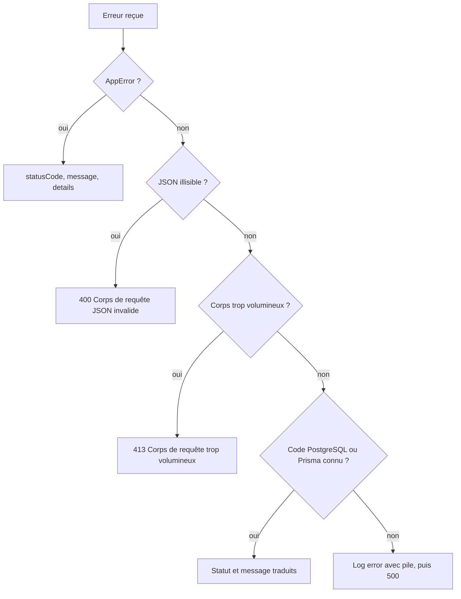

# Réponses et erreurs

Toutes les routes métier répondent avec la même enveloppe JSON, produite par deux fonctions de [`backend/src/utils/response.util.ts`](src:backend/src/utils/response.util.ts). Les erreurs suivent un chemin unique : elles sont levées sous forme d'`AppError` dans les services, transmises par `next(error)` dans les contrôleurs et traduites par le gestionnaire d'erreurs de [`backend/src/middlewares/error.middleware.ts`](src:backend/src/middlewares/error.middleware.ts). Cette page décrit ce format, les codes HTTP employés et l'identifiant de requête qui permet de relier une réponse aux logs.

## Enveloppe de réponse

Le type `ApiResponse<T>` de [`backend/src/types/api.types.ts`](src:backend/src/types/api.types.ts) définit l'enveloppe :

| Champ | Présent | Contenu |
|---|---|---|
| `success` | toujours | `true` pour un succès, `false` pour une erreur |
| `message` | toujours | phrase en français destinée à l'utilisateur ou au développeur |
| `data` | succès, si le contrôleur fournit des données | objet propre à la route |
| `meta` | succès paginé | `page`, `limit`, `total`, `totalPages` |
| `errors` | erreur, si des détails existent | tableau d'erreurs de validation ou objet de détails |

### sendSuccess

```typescript
sendSuccess(res, data, message = 'Opération réussie', statusCode = 200, meta)
```

Les contrôleurs passent toujours un message explicite. Le statut est 200 pour une lecture ou une action, 201 pour une création (achat, cadeau, échange, création de partenaire, d'offre ou de lot, événement analytique).

```json
{
  "success": true,
  "message": "Limite d'achat Jeu Responsable enregistrée",
  "data": { "userId": "019a7c3e-5d2b-7f41-9c0e-6a8b2d4f1e37", "maxTicketsPerRound": 10, "updatedAt": "2026-11-11T16:00:00.000Z" }
}
```

### sendError

```typescript
sendError(res, message = 'Une erreur est survenue', statusCode = 500, errors)
```

Les middlewares l'appellent directement (authentification, rôles, validation, idempotence, maintenance, signature du webhook). Les services n'y ont pas accès : ils lèvent une `AppError`.

```json
{
  "success": false,
  "message": "Erreur de validation des données",
  "errors": [
    { "path": "body.quantity", "message": "Too big: expected number to be <=10" },
    { "path": "body.roundId", "message": "Invalid UUID" }
  ]
}
```

Les messages des règles Zod sans message personnalisé sont ceux de Zod 4, en anglais. Les règles qui portent un message (adresses, email, âge, limites) répondent en français.

### Exceptions à l'enveloppe

| Route | Format |
|---|---|
| `/health`, `/health/live`, `/health/ready`, `/health/deep` | objet `{ status, ... }` sans `success` |
| `GET /lottery/poap/<n>.json` | document de métadonnées ERC-721 brut ; `.svg` renvoie une image |
| `/metrics` | texte Prometheus ; 401 sans corps si le jeton est faux |
| `/api/docs` | page HTML Swagger UI |

`GET /api/config` suit l'enveloppe mais sans `message`.

## AppError

```typescript
throw new AppError("Stock épuisé pour cette récompense partenaire", 400);
throw new AppError(mapped.message, 503, { contractError: 'EnforcedPause', canRetry: false, circuitBreaker: true });
```

| Propriété | Défaut | Rôle |
|---|---|---|
| `message` | obligatoire | devient `message` de la réponse |
| `statusCode` | 400 | statut HTTP |
| `details` | aucun | devient `errors` de la réponse |
| `isOperational` | `true` | réservé, lu par aucun code |

Les détails servent surtout aux erreurs blockchain : `contractError` (nom de l'erreur Solidity décodée), `canRetry` (le client peut proposer de réessayer) et `circuitBreaker` (le contrat est en pause). Les clients web et mobile s'appuient sur `canRetry` pour afficher un bouton de nouvelle tentative.

```json
{
  "success": false,
  "message": "Le Smart Contract est temporairement en pause de sécurité par la Mairie.",
  "errors": { "contractError": "EnforcedPause", "canRetry": false, "circuitBreaker": true }
}
```

## Gestionnaire d'erreurs

`errorHandler` est le dernier middleware de l'application. Il applique ces règles dans l'ordre :



### Traduction des erreurs de base de données

Le code PostgreSQL d'origine est lu dans `meta.driverAdapterError.cause.originalCode` (erreurs remontées par l'adaptateur `@prisma/adapter-pg`), sinon le code Prisma `code`.

| Code | Origine | Statut | Message |
|---|---|---|---|
| `23505`, `P2002` | violation d'unicité | 409 | `Cette ressource existe déjà` |
| `23514`, `P2004` | violation d'une contrainte `CHECK` (solde ou stock négatif) | 409 | `L'opération viole une règle d'intégrité des données (solde ou stock insuffisant)` |
| `40001`, `40P01`, `P2034` | conflit de sérialisation ou interblocage | 409 | `Conflit de transaction, veuillez réessayer` |
| `57014` | `statement_timeout` dépassé | 503 | `La requête a dépassé le délai autorisé` |
| `P2025` | enregistrement introuvable pour une mise à jour | 404 | `Ressource introuvable` |

Une violation de clé étrangère (`23503`, `P2003`) n'est pas traduite et produit un 500. Les contraintes `CHECK` sont décrites dans [Index et contraintes](../base-de-donnees/index-contraintes.md).

### Erreurs non prévues

Toute autre erreur est journalisée en niveau `error` avec la méthode, l'URL, la pile et le code, puis renvoyée en 500. En production, le message est remplacé par `Erreur interne du serveur` ; ailleurs, le message d'origine est conservé pour le débogage. L'identifiant de requête est ajouté dans `errors` :

```json
{ "success": false, "message": "Erreur interne du serveur", "errors": { "requestId": "c2b6f1a0-8e3d-4f57-9a1b-2d4c6e8f0a13" } }
```

### Route inconnue

`notFoundHandler` répond `404 Route introuvable : GET /api/v1/lottery/inconnue`. Sous `/admin`, le contrôle d'accès du routeur passe avant : un USER reçoit 403 sur un chemin d'administration inexistant.

## Pagination

[`backend/src/utils/pagination.util.ts`](src:backend/src/utils/pagination.util.ts) fournit deux fonctions. `getPaginationParams(query, defaultLimit = 20, maxLimit = 100)` lit `page` et `limit` dans la query, remplace les valeurs absentes ou non numériques par 1 et 20, borne `page` à 1 au minimum et `limit` entre 1 et 100, et calcule `skip`. `buildPaginationMeta(total, page, limit)` produit `meta`, avec `totalPages` au moins égal à 1.

```json
{
  "success": true,
  "message": "Historique de transparence et galerie POAP récupérés",
  "data": { "walletAddress": "0x8b3f...", "tickets": [], "poapBadges": [] },
  "meta": { "page": 2, "limit": 20, "total": 37, "totalPages": 2 }
}
```

Seule `GET /lottery/my-tickets` est paginée de cette façon. Les autres listes sont soit bornées en dur (50 mouvements de points, 500 événements analytiques), soit limitées par un `limit` de query sans maximum (`/lottery/leaderboard`, `/admin/audit-logs`), soit complètes (`/partners`, `/marketplace/catalog`, `/marketplace/my-codes`).

## Codes HTTP utilisés

| Code | Usage |
|---|---|
| 200 | lecture, action réussie, rejeu idempotent d'un 200, webhook déjà reçu |
| 201 | création : tickets, cadeau, récompense, partenaire, offre, lot de codes, événement analytique |
| 400 | validation Zod, JSON illisible, règle métier non respectée, en-tête `Idempotency-Key` mal formé |
| 401 | jeton absent, invalide, expiré ou révoqué ; code 2FA faux ; signature de webhook invalide ; jeton `/metrics` faux |
| 402 | solde d'ethers fictifs insuffisant pour une transaction |
| 403 | rôle insuffisant, droits modifiés, 2FA administrateur manquante, entreprise d'un autre partenaire, non-gagnant, rôle manquant du compte opérateur sur le contrat |
| 404 | route, ressource, offre, code, badge introuvables |
| 409 | conflit : état du tour, double 2FA, contrainte d'unicité ou d'intégrité, requête idempotente en cours, mode blockchain incompatible |
| 413 | corps de plus de 1 Mo |
| 429 | rate limiting ou blocage du compte après 10 codes erronés |
| 500 | erreur non prévue |
| 502 | transaction blockchain échouée sans cause reconnue |
| 503 | maintenance, contrat en pause, nœud injoignable, base injoignable pour les rôles, requête SQL trop longue, sonde non prête |

## Identifiant de requête

Chaque réponse porte l'en-tête `X-Request-Id`, exposé aux navigateurs par CORS. Le middleware [`backend/src/middlewares/request-context.middleware.ts`](src:backend/src/middlewares/request-context.middleware.ts) le choisit ainsi :

1. l'en-tête `X-Request-Id` du client, s'il fait 8 à 128 caractères `[A-Za-z0-9._-]` ;
2. sinon l'identifiant de trace (32 hexadécimaux) d'un en-tête W3C `traceparent` valide ;
3. sinon un UUID aléatoire.

L'identifiant est placé dans `res.locals.requestId` et dans le contexte `AsyncLocalStorage`. Toutes les lignes de log écrites pendant la requête, y compris dans les services, portent donc `requestId` et, après authentification, `userId`. Pour diagnostiquer une erreur signalée par un utilisateur, il suffit de récupérer cet identifiant (en-tête ou champ `errors.requestId` d'un 500) et de filtrer les logs dessus. Voir [Observabilité](observabilite.md#contexte-de-requete).

```bash
curl -si http://localhost:2053/api/v1/lottery/status -H "X-Request-Id: support-ticket-4242" | grep -i x-request-id
```
