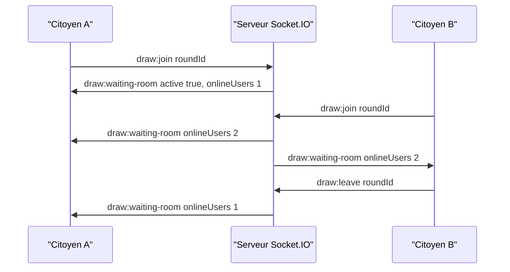
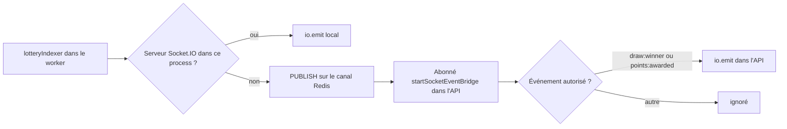

# Temps réel Socket.IO

Le backend embarque un serveur Socket.IO 4 attaché au même serveur HTTP que l'API, donc sur le même port (`PORT`, 2053 par défaut). Il diffuse l'annonce du gagnant et les crédits d'EtherPoints, compte les personnes présentes dans la salle d'attente du tirage et relaie le chat en direct. Les événements sont typés dans [`backend/src/types/socket.types.ts`](src:backend/src/types/socket.types.ts). Côté clients, la connexion est gérée par le hook `useSocket` du web et du mobile (voir [Temps réel](../web/temps-reel.md) et [Temps réel et notifications](../mobile/temps-reel-notifications.md)).

| Fichier | Rôle |
|---|---|
| [`backend/src/socket/socket.handler.ts`](src:backend/src/socket/socket.handler.ts) | création du serveur, CORS, enregistrement des gestionnaires, accès global `getSocketIo()` |
| [`backend/src/socket/socket.middleware.ts`](src:backend/src/socket/socket.middleware.ts) | authentification à la connexion |
| [`backend/src/socket/events/live-draw.events.ts`](src:backend/src/socket/events/live-draw.events.ts) | salle d'attente et diffusion du gagnant |
| [`backend/src/socket/events/chat.events.ts`](src:backend/src/socket/events/chat.events.ts) | chat et réactions |
| [`backend/src/socket/event-bridge.ts`](src:backend/src/socket/event-bridge.ts) | relais Redis des événements émis hors du process de l'API |

## Connexion et authentification

Le serveur accepte les origines de `corsOrigins` (`FRONTEND_URL` et `CORS_ORIGINS`), avec les méthodes `GET` et `POST` et les identifiants. Le chemin est celui par défaut de Socket.IO, `/socket.io/`. Le web s'y connecte avec `NEXT_PUBLIC_WS_URL` (`http://localhost:2053` dans la stack Docker).

Le middleware `socketAuthMiddleware` cherche un jeton dans `handshake.auth.token`, puis dans l'en-tête `Authorization: Bearer ...` de la poignée de main.

| Situation | Résultat |
|---|---|
| Aucun jeton | connexion acceptée en invité : `userId = guest-<socketId>`, adresse `0xGuest00000000000000000000000000000000`, rôle `USER` |
| Jeton valide et non révoqué | connexion acceptée, `socket.user` reprend `userId`, `walletAddress`, `role` et `twoFactorVerified` du jeton |
| Jeton invalide, expiré ou révoqué | connexion refusée avec l'erreur `Invalid authentication token for Socket.IO` |

```javascript
import { io } from 'socket.io-client';

const socket = io('http://localhost:2053', { auth: { token: sessionToken } });
socket.on('connect', () => socket.emit('draw:join', currentRoundId));
socket.on('draw:winner', (winner) => console.log(winner.winnerWallet));
```

La vérification est faite une seule fois, à la connexion. Un jeton révoqué ou expiré pendant la session ne déconnecte pas le socket. Le rôle n'est utilisé par aucun gestionnaire : un invité et un administrateur ont exactement les mêmes possibilités.

> [!IMPORTANT]
> Un client dont le jeton a expiré voit sa connexion refusée au lieu d'être rétrogradé en invité. Le client doit se reconnecter sans jeton ou rafraîchir sa session pour retrouver le temps réel.

## Salles

Socket.IO met chaque socket dans une salle à son nom. Le backend n'utilise qu'un type de salle supplémentaire : `draw:<roundId>`, la salle d'attente d'un tour.



| Événement reçu | Effet |
|---|---|
| `draw:join(roundId)` | `socket.join('draw:<roundId>')`, puis `draw:waiting-room` envoyé à toute la salle avec le nombre de sockets présents |
| `draw:leave(roundId)` | `socket.leave(...)`, puis `draw:waiting-room` envoyé aux membres restants |
| déconnexion | Socket.IO retire le socket de ses salles, sans nouvel envoi du compteur |

Le web et le mobile rejoignent la salle avec l'identifiant `round.id` (UUID en base) renvoyé par `GET /lottery/status`. `roundId` n'est pas validé : n'importe quelle chaîne crée une salle. Le compteur est celui du process : avec plusieurs instances de l'API, chacune compte ses propres sockets.

## Salle d'attente du tirage

La salle d'attente combine deux sources. Le calcul de la fenêtre est fait par l'API REST : `GET /lottery/status` renvoie `remainingSeconds` et `inWaitingRoom`, vrai pendant les 600 dernières secondes d'un tour `OPEN`. Le temps réel ne fournit que la présence (`draw:waiting-room`) et le résultat (`draw:winner`). L'événement `draw:countdown`, déclaré dans les types, n'est jamais émis : les clients calculent le compte à rebours eux-mêmes à partir de `remainingSeconds`.

À la fin du tour, en mode onchain, le keeper demande le tirage ; l'indexeur reçoit ensuite `WinnerPicked` et diffuse `draw:winner`. Les clients affichent l'annonce et invalident leurs caches (`Lottery`, `Wallet`, `Admin` sur le web). Voir [Tirage et versement de la cagnotte](../architecture/flux/tirage.md).

## Chat en direct

| Événement reçu | Traitement | Diffusion |
|---|---|---|
| `chat:send({ message, emoji? })` | ignoré si `message` est vide ; espaces retirés, tronqué à 280 caractères ; identifiant UUID, adresse tronquée par `anonymizeWallet`, horodatage | `chat:message` à tous les sockets connectés |
| `chat:react(emoji)` | tronqué à 8 caractères | `chat:reaction` à tous les sockets connectés |

```json
{ "id": "6a1f0c2e-7b3d-4e58-9f60-1a2b3c4d5e6f", "senderWallet": "0x8b3f...6a08", "message": "Bonne chance à tous !", "timestamp": "2026-11-11T19:59:12.004Z" }
```

Un invité apparaît sous l'adresse `0xGues...0000`. L'adresse affichée est celle du jeton au moment de la connexion.

> [!WARNING]
> Le chat n'est ni persisté, ni modéré, ni limité en débit, et il est accessible aux invités. Les messages vont à tous les sockets connectés, pas seulement à la salle du tirage. Le champ `emoji` de `chat:send` n'est pas borné en longueur. `chat:react` appelle `emoji.slice` sans vérifier le type : une valeur non textuelle lève une exception dans le gestionnaire. Avant une ouverture au public, il faut ajouter au minimum une limite par socket, une validation des types et un filtrage du contenu.

## Relais depuis le worker

Les événements produits par l'indexeur doivent atteindre les navigateurs, même quand l'indexeur tourne dans le process worker, qui n'a pas de serveur Socket.IO. `emitSocketEvent(event, payload)` résout ce cas.



| Élément | Valeur |
|---|---|
| Canal | `<REDIS_KEY_PREFIX>:<NODE_ENV>:socket-events`, par exemple `blocklucky:production:socket-events` |
| Message | JSON `{ "event": "...", "payload": {...} }` |
| Événements relayés | `draw:winner` et `points:awarded` uniquement |
| Abonné | connexion Redis dupliquée `blocklucky-socket-bridge`, démarrée par `server.ts`, fermée à l'arrêt |

Si Redis est absent, l'événement émis par le worker est perdu (journalisé en `warn`). Quand l'API tourne avec `RUN_WORKERS=true`, l'indexeur est dans le même process et émet directement. Le service loterie en mode simulé et le tirage simulé appellent `io.emit` sans passer par ce relais.

Le serveur n'utilise pas d'adaptateur Redis de Socket.IO : avec plusieurs instances de l'API, un `io.emit` n'atteint que les clients de l'instance émettrice. Le relais Redis contourne ce problème pour les événements venant du worker, puisque chaque instance de l'API est abonnée et réémet ; il ne le fait pas pour les messages du chat ni pour les compteurs de salle.

> [!NOTE]
> `points:awarded` est diffusé à tous les sockets avec le `userId` du bénéficiaire et le montant. Chaque client filtre sur son propre identifiant, mais tous les clients connectés reçoivent les crédits de tous les citoyens.

## Référence des événements

{{generated:evenements-socket}}

Le guide [Ajouter un événement temps réel](../guides/ajouter-evenement-socket.md) décrit les étapes pour en déclarer un nouveau, y compris son ajout à la liste des événements relayés.
