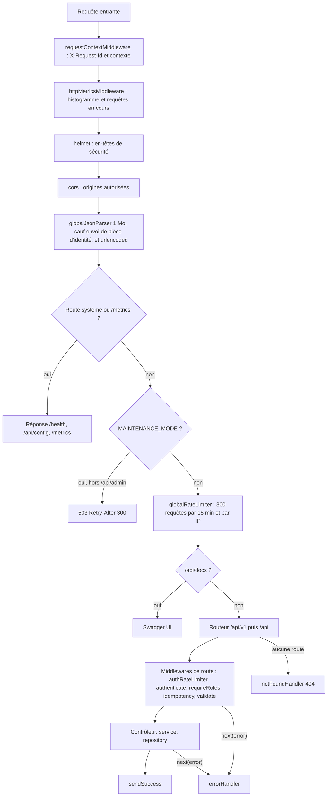
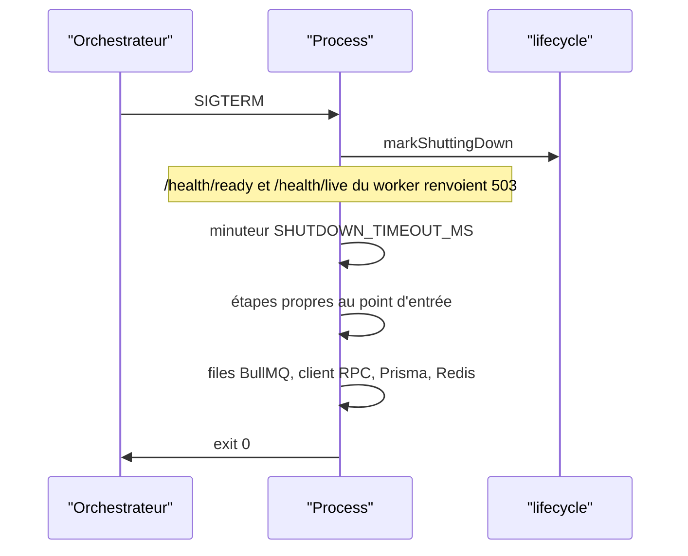

# Structure et cycle d'une requête

Le backend est un monolithe modulaire Express 5 écrit en TypeScript. Il expose une API REST, un serveur Socket.IO et, selon la configuration, des workers BullMQ et les services de lecture de la blockchain. Cette page décrit l'organisation du dossier `backend/src`, l'ordre exact des middlewares appliqués à chaque requête et la façon dont les deux points d'entrée démarrent et s'arrêtent. Le choix du monolithe est justifié dans l'[ADR 0001](../architecture/adr/0001-monolithe-modulaire.md).

## Arborescence de backend/src

```text
backend/src/
├── app.ts                  application Express : middlewares et montage des routeurs
├── server.ts               point d'entrée de l'API (HTTP + Socket.IO + workers optionnels)
├── worker.ts               point d'entrée du process worker (BullMQ + indexeur + keeper)
├── api/                    un dossier par module métier
│   ├── system/             sondes de santé et configuration client
│   ├── auth/  lottery/  marketplace/  partners/  user/  analytics/  admin/
│   └── webhooks/           webhook blockchain signé (mode simulé)
├── blockchain/             client RPC, passerelle du contrat, indexeur, keeper, file d'actions, ABI
├── config/                 env, Prisma, Redis, Nodemailer, Swagger
├── middlewares/            auth, RBAC, âge, validation Zod, idempotence, rate limiting, corps JSON, erreurs, contexte
├── observability/          métriques Prometheus, contexte de requête, arrêt propre
├── queues/                 producteurs BullMQ (emails, ledger) et options communes
├── workers/                consommateurs BullMQ et indexeur du webhook simulé
├── services/               services transverses (sessions, OTP, TOTP, ledger, email, S3, blockchain)
├── socket/                 serveur Socket.IO, authentification, événements, relais Redis
├── templates/emails/       5 gabarits HTML des emails transactionnels
├── types/                  types partagés (réponses API, JWT, événements Socket.IO)
└── utils/                  chiffrement, logger, pagination, format des réponses
```

Chaque module de `api/` suit le même découpage en cinq fichiers. Seuls `system` (un seul fichier de routes) et `webhooks` (signature et contrôleur séparés) s'en écartent.

| Fichier | Rôle | Exemple |
|---|---|---|
| `*.routes.ts` | Déclare les routes, leurs middlewares et le bloc OpenAPI `@openapi` | [`backend/src/api/lottery/lottery.routes.ts`](src:backend/src/api/lottery/lottery.routes.ts) |
| `*.validators.ts` | Schémas Zod `{ body, query, params }` | [`backend/src/api/lottery/lottery.validators.ts`](src:backend/src/api/lottery/lottery.validators.ts) |
| `*.controllers.ts` | Lit `req.user` et `req.body`, appelle le service, répond avec `sendSuccess` ou transmet l'erreur à `next` | [`backend/src/api/lottery/lottery.controllers.ts`](src:backend/src/api/lottery/lottery.controllers.ts) |
| `*.services.ts` | Règles métier, lève des `AppError` | [`backend/src/api/lottery/lottery.services.ts`](src:backend/src/api/lottery/lottery.services.ts) |
| `*.repo.ts` | Accès Prisma, transactions | [`backend/src/api/lottery/lottery.repo.ts`](src:backend/src/api/lottery/lottery.repo.ts) |

Les services et repositories sont des classes instanciées une seule fois et exportées par défaut (`export const lotteryService = new LotteryService()`). Les tests remplacent les modules `prisma.config` et `redis.config` par des doublures en mémoire (voir [Tests](tests.md)).

## Cycle d'une requête

L'ordre ci-dessous est celui de [`backend/src/app.ts`](src:backend/src/app.ts). Il détermine ce qui est journalisé, mesuré, limité ou court-circuité.



### Middlewares globaux

| Ordre | Middleware | Effet |
|---|---|---|
| 1 | `requestContextMiddleware` | Reprend `X-Request-Id` s'il respecte `[A-Za-z0-9._-]{8,128}`, sinon l'identifiant de trace de `traceparent`, sinon un UUID. Renvoie l'en-tête, ouvre un contexte `AsyncLocalStorage` et écrit une ligne de log à la fin de la réponse (sauf `/health*` et `/metrics`). |
| 2 | `httpMetricsMiddleware` | Démarre le chronomètre de `http_request_duration_seconds` et incrémente `http_requests_in_flight`. Inactif si `METRICS_ENABLED=false`. |
| 3 | `helmet()` | En-têtes de sécurité par défaut (CSP, HSTS, `X-Content-Type-Options`, etc.). |
| 4 | `cors` | Accepte les requêtes sans en-tête `Origin` (mobile, curl) et les origines de `FRONTEND_URL` et `CORS_ORIGINS`. Une origine inconnue ne reçoit pas d'en-tête `Access-Control-Allow-Origin`. Expose `X-Request-Id`, `RateLimit`, `RateLimit-Policy` et `Retry-After`. |
| 5 | `globalJsonParser` | `express.json` avec un corps limité à 1 Mo, défini dans [`body-parser.middleware.ts`](src:backend/src/middlewares/body-parser.middleware.ts). Pour les URL `/api/webhooks/` et `/api/v1/webhooks/`, le corps brut est conservé dans `req.rawBody` pour vérifier la signature HMAC. La requête `POST /api/user/identity` (ou `/api/v1/user/identity`) n'est pas lue ici : son corps est lu plus loin par `identityUploadJsonParser`, limité à 12 Mo, après le rate limiting et l'authentification. |
| 6 | `globalUrlencodedParser` | Formulaires, même limite de 1 Mo. |
| 7 | `systemRoutes` | `/health`, `/health/live`, `/health/ready`, `/health/deep` et `/api/config`. Montées avant la maintenance et le rate limiting : elles répondent toujours. |
| 8 | `GET /metrics` | Exposition Prometheus, protégée par `METRICS_TOKEN` s'il est défini. |
| 9 | Maintenance | Si `MAINTENANCE_MODE=true`, toute route `/api/*` dont le chemin ne commence pas par `/api/admin` reçoit un 503. |
| 10 | `globalRateLimiter` | Limite par IP stockée dans Redis (préfixe `ratelimit:global:`), en-têtes `RateLimit` au format draft-7. |
| 11 | `/api/docs` | Swagger UI généré par `swagger-jsdoc` depuis les blocs `@openapi`. |
| 12 | `apiRouter` | Monté deux fois : sous `/api/v1` (préfixe recommandé) puis sous `/api` (compatibilité). |
| 13 | `notFoundHandler` | `404 Route introuvable : <méthode> <url>`. |
| 14 | `errorHandler` | Traduit `AppError`, erreurs de parsing et erreurs Prisma ou PostgreSQL. Détails dans [Réponses et erreurs](reponses-erreurs.md). |

> [!WARNING]
> Le test de maintenance porte sur `req.path.startsWith('/api/admin')`. Les routes d'administration appelées par le préfixe versionné `/api/v1/admin` sont donc bloquées pendant une maintenance. Les clients d'administration doivent utiliser `/api/admin` dans ce cas.

### Middlewares de route

Ils sont déclarés route par route dans les fichiers `*.routes.ts`, toujours dans cet ordre quand ils sont présents.

| Middleware | Fichier | Rôle |
|---|---|---|
| `authRateLimiter`, `identityUploadRateLimiter` | [`backend/src/middlewares/rateLimiter.middleware.ts`](src:backend/src/middlewares/rateLimiter.middleware.ts) | 30 requêtes par 10 minutes et par IP sur les routes de connexion, d'inscription, de mot de passe, OAuth et 2FA ; 10 envois par heure et par IP sur `POST /user/identity`. |
| `authenticate` | [`backend/src/middlewares/auth.middleware.ts`](src:backend/src/middlewares/auth.middleware.ts) | Exige `Authorization: Bearer <jeton>`, vérifie signature, émetteur, audience, expiration et révocation, remplit `req.user` et `req.session`. |
| `optionalAuthenticate` | même fichier | Remplit `req.user` si un jeton valide est présent, laisse passer sinon. |
| `requireRoles(...)` | [`backend/src/middlewares/rbac.middleware.ts`](src:backend/src/middlewares/rbac.middleware.ts) | Compare le rôle du jeton à la liste, puis relit le compte en base (rôle inchangé, compte non supprimé, 2FA active pour un ADMIN). |
| `requireAgeVerification` | [`backend/src/middlewares/age-verification.middleware.ts`](src:backend/src/middlewares/age-verification.middleware.ts) | Relit `ageVerificationStatus` en base et répond 403 `AGE_VERIFICATION_REQUIRED` s'il ne vaut pas `VERIFIED`. Inactif si `AGE_VERIFICATION_REQUIRED=false`. |
| `idempotency` | [`backend/src/middlewares/idempotency.middleware.ts`](src:backend/src/middlewares/idempotency.middleware.ts) | Rejoue la réponse d'une requête déjà traitée avec le même en-tête `Idempotency-Key`. |
| `identityUploadJsonParser` | [`backend/src/middlewares/body-parser.middleware.ts`](src:backend/src/middlewares/body-parser.middleware.ts) | Lit le corps JSON de l'envoi de pièce d'identité, jusqu'à 12 Mo. |
| `validate(schema)` | [`backend/src/middlewares/validate.middleware.ts`](src:backend/src/middlewares/validate.middleware.ts) | Valide `body`, `query` et `params` avec Zod. Seul `req.body` est remplacé par la valeur transformée (valeurs par défaut, minuscules, conversions). |

> [!NOTE]
> `validate` ne réécrit ni `req.query` ni `req.params`. Les contrôleurs relisent la query brute : `limit` du classement et des journaux d'audit, `page` et `limit` de `my-tickets`, `format` de l'export. Aucun schéma Zod ne porte sur ces paramètres, sauf pour la liste des vérifications d'identité, dont le schéma rejette un statut ou une pagination invalides avant que le contrôleur ne relise la query brute.

`idempotency` est placé avant `validate` : une réponse 400 de validation est mémorisée comme les autres réponses inférieures à 500. Une nouvelle tentative avec la même clé et un corps corrigé rejoue donc le 400 pendant 24 heures. Il faut générer une nouvelle clé après une erreur de validation.

## Points d'entrée

### server.ts

[`backend/src/server.ts`](src:backend/src/server.ts) démarre l'API :

1. crée le serveur HTTP Node autour de `app`, avec `keepAliveTimeout = HTTP_KEEP_ALIVE_TIMEOUT_MS`, `headersTimeout = HTTP_KEEP_ALIVE_TIMEOUT_MS + 1000` et `requestTimeout = HTTP_REQUEST_TIMEOUT_MS` ;
2. attache Socket.IO (`initSocketServer`) et démarre l'abonnement au relais Redis des événements temps réel (`startSocketEventBridge`) ;
3. si `RUN_WORKERS=true`, démarre les workers BullMQ (`startWorkers`) et, en mode `onchain`, l'indexeur et le keeper (`startChainServices`) ;
4. enregistre les étapes d'arrêt, puis écoute sur `PORT`.

En développement, `npm run dev` lance `tsx watch src/server.ts`. En production, `npm run compile` produit `dist/` et `npm start` exécute `node dist/src/server.js`.

### worker.ts

[`backend/src/worker.ts`](src:backend/src/worker.ts) démarre uniquement les traitements de fond : workers BullMQ (emails, ledger, chain-actions) et services de chaîne. Il ne sert aucune route de l'API. Il ouvre un petit serveur HTTP sur `PORT + 1` qui répond à `/health/live` (200, ou 503 pendant l'arrêt) et `/metrics`. Si aucun worker n'a pu être créé, le process s'arrête avec le code 1.

| Commande | Usage |
|---|---|
| `npm run dev:worker` | `tsx watch src/worker.ts`, développement |
| `npm run start:worker` | `node dist/src/worker.js`, après `npm run compile` |

Dans la stack Docker, le service `backend` tourne avec `RUN_WORKERS=false` et le service `worker` exécute `dist/src/worker.js` avec une sonde sur le port 2054. La répartition des traitements est détaillée dans [Files et workers](files-workers.md).

> [!CAUTION]
> Ne lancez jamais l'API avec `RUN_WORKERS=true` en même temps qu'un process worker séparé : l'indexeur et le keeper tourneraient deux fois. Le keeper est protégé par un verrou Redis, l'indexeur seulement par l'unicité `(lotteryId, ticketIndex)` en base.

## Arrêt propre

[`backend/src/observability/shutdown.ts`](src:backend/src/observability/shutdown.ts) enregistre les gestionnaires de `SIGTERM`, `SIGINT`, `unhandledRejection` et `uncaughtException`.



Les étapes sont exécutées l'une après l'autre. Une étape en erreur est journalisée en `warn` et n'interrompt pas les suivantes.

| Process | Étapes, dans l'ordre |
|---|---|
| API (`server.ts`) | `http` (fin des requêtes en cours, fermeture des connexions inactives), `socket-bridge`, `socket.io`, `chain` (arrêt des minuteurs de l'indexeur et du keeper), `workers`, puis `queues`, `blockchain`, `prisma`, `redis` |
| Worker (`worker.ts`) | `chain`, `workers`, `probe`, puis `queues`, `blockchain`, `prisma`, `redis` |

Si l'ensemble dépasse `SHUTDOWN_TIMEOUT_MS` (25 secondes par défaut), le process sort avec le code 1. Le `stop_grace_period` de 30 secondes des services Docker laisse cette marge. Une promesse rejetée non gérée est journalisée et ne provoque l'arrêt qu'en production ; une exception non capturée arrête toujours le process avec le code 1.

## Pour aller plus loin

- [Configuration](configuration.md) : chargement et validation de l'environnement.
- [Modules métier](modules/index.md) : routes, règles et effets de bord.
- [Ajouter un endpoint](../guides/ajouter-endpoint.md) : mise en pratique du découpage en cinq fichiers.
