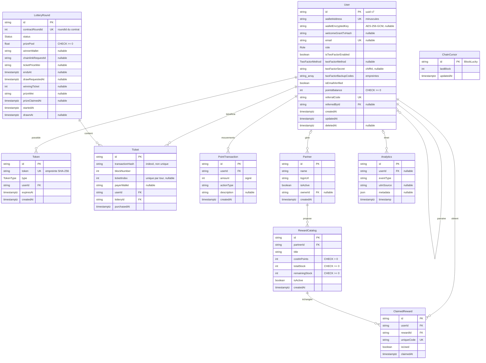

# Modèle de données

La base PostgreSQL 15 du backend est décrite par un seul fichier, [`backend/prisma/schema.prisma`](src:backend/prisma/schema.prisma), et créée par les migrations de [`backend/prisma/migrations/`](src:backend/prisma/migrations/migration_lock.toml). Le client est Prisma 7 avec l'adaptateur `@prisma/adapter-pg`, configuré dans [`backend/src/config/prisma.config.ts`](src:backend/src/config/prisma.config.ts). L'URL de connexion est lue par [`backend/prisma.config.ts`](src:backend/prisma.config.ts) pour les commandes Prisma, et par `DATABASE_URL` pour l'application.

Le schéma compte **10 modèles** et **4 énumérations**. Le détail de chaque colonne est dans le [dictionnaire de données](dictionnaire.md), les index et contraintes dans [Index et contraintes](index-contraintes.md).

## Diagramme

`ChainCursor` n'a aucune relation : c'est une table technique de l'indexeur.

## Domaines

Les modèles se répartissent en quatre domaines.

| Domaine | Modèles | Source de vérité |
|---|---|---|
| Comptes et sécurité | `User`, `Token` | PostgreSQL |
| Loterie | `LotteryRound`, `Ticket`, `ChainCursor` | Le contrat `BlockLucky` en mode onchain ; PostgreSQL en mode simulé |
| EtherPoints et récompenses | `PointTransaction`, `Partner`, `RewardCatalog`, `ClaimedReward` | PostgreSQL |
| Analytique et audit | `Analytics` | PostgreSQL |

En mode onchain, les tables de la loterie sont une **projection** : elles peuvent être reconstruites en relisant les événements du contrat (voir [Reconstruire depuis la chaîne](reconstruction.md)). Les autres tables n'existent qu'en base et doivent être sauvegardées (voir [Performance et sauvegardes](performance-sauvegardes.md)).

## Relations

Toutes les clés primaires sont des chaînes. Sauf `ChainCursor`, elles sont générées par Prisma avec `uuid(7)` : des UUID version 7, dont le début encode l'heure de création. Ils restent uniques sans coordination et s'insèrent dans l'ordre dans les index B-tree, contrairement aux UUID v4 aléatoires.

Les comportements à la suppression (`ON DELETE`) sont ceux des clés étrangères créées par les migrations. Prisma applique `RESTRICT` par défaut à une relation obligatoire et `SET NULL` à une relation facultative.

### User et User : parrainage

| Propriété | Valeur |
|---|---|
| Champs | `User.referredById` vers `User.id` |
| Cardinalité | Un parrain pour zéro ou plusieurs filleuls ; un filleul a au plus un parrain |
| Nom de la relation Prisma | `Referrals` (`referredBy` d'un côté, `referrals` de l'autre) |
| Suppression du parrain | `SET NULL` |

Le parrain est fixé à l'inscription par un code de parrainage, ou à la création d'un compte destinataire lors d'un cadeau de ticket (l'expéditeur devient le parrain). Le parrainage rapporte 100 EtherPoints au parrain.

### User et Token

| Propriété | Valeur |
|---|---|
| Champs | `Token.userId` vers `User.id` |
| Cardinalité | Un compte, zéro ou plusieurs jetons |
| Suppression du compte | `CASCADE` : les jetons sont supprimés avec le compte |

C'est la seule relation en cascade : un jeton n'a aucun sens sans son compte.

### User, LotteryRound et Ticket

| Propriété | `Ticket.userId` | `Ticket.lotteryId` |
|---|---|---|
| Cible | `User.id` | `LotteryRound.id` |
| Cardinalité | Un compte, zéro ou plusieurs tickets | Un tour, zéro ou plusieurs tickets |
| Suppression | `RESTRICT` | `RESTRICT` |

`Ticket` relie un compte à un tour. Le compte est le **bénéficiaire** du ticket (`player` de l'événement), pas forcément celui qui a payé : l'adresse du payeur est conservée à part dans `payerWallet`, sans clé étrangère, car le payeur peut ne pas avoir de compte.

`RESTRICT` empêche de supprimer un compte ou un tour qui a des tickets. C'est voulu : un ticket est une trace d'un achat réel sur la chaîne. La suppression RGPD n'efface donc pas la ligne `User` ; elle l'anonymise.

Le tour est rattaché par son identifiant interne `id`, mais retrouvé depuis la chaîne par `contractRoundId`, unique.

### User et PointTransaction

| Propriété | Valeur |
|---|---|
| Champs | `PointTransaction.userId` vers `User.id` |
| Cardinalité | Un compte, zéro ou plusieurs mouvements |
| Suppression | `RESTRICT` |

Le solde `User.pointsBalance` est une valeur dénormalisée : il doit toujours être égal à la somme des `amount` du compte. Le service [`backend/src/services/ledger.service.ts`](src:backend/src/services/ledger.service.ts) écrit le mouvement et modifie le solde dans une même transaction. Aucune contrainte de base ne vérifie l'égalité ; seule la positivité du solde est garantie par CHECK.

### User et Partner : gestion d'un commerce

| Propriété | Valeur |
|---|---|
| Champs | `Partner.ownerId` vers `User.id` |
| Nom de la relation Prisma | `PartnerOwner` (`owner` et `ownedPartners`) |
| Cardinalité | Un compte gère zéro ou plusieurs commerces ; un commerce a zéro ou un gestionnaire |
| Suppression du compte | `SET NULL` |

Ajoutée par la migration `20261110004931_security_backup_codes_partner_owner` pour qu'un commerçant ne puisse agir que sur ses propres commerces.

### Partner, RewardCatalog et ClaimedReward

| Relation | Champs | Suppression |
|---|---|---|
| Commerce et offres | `RewardCatalog.partnerId` vers `Partner.id` | `RESTRICT` |
| Offre et échanges | `ClaimedReward.rewardId` vers `RewardCatalog.id` | `RESTRICT` |
| Compte et échanges | `ClaimedReward.userId` vers `User.id` | `RESTRICT` |

Un commerce propose plusieurs offres. Un échange relie un citoyen à une offre et porte un code promo unique. `RESTRICT` empêche de supprimer une offre déjà échangée : pour retirer une offre ou un commerce, on passe `isActive` à faux.

### User et Analytics

| Propriété | Valeur |
|---|---|
| Champs | `Analytics.userId` vers `User.id` |
| Cardinalité | Zéro ou un compte par événement |
| Suppression | `SET NULL` |

La relation est facultative : un visiteur non connecté peut produire des événements. La même table sert de journal d'audit d'administration, avec un `eventType` préfixé `ADMIN_AUDIT:`.

## Types et conventions

| Convention | Règle | Raison |
|---|---|---|
| Dates | `TIMESTAMPTZ(3)` partout, millisecondes | Une date sans fuseau est ambiguë ; la migration `20261109213843` a converti les colonnes d'origine en les interprétant comme UTC |
| Montants en wei | `String` (`ticketPriceWei`, `prizeWei`) | Un montant en wei dépasse la capacité d'un entier 64 bits et d'un flottant ; la chaîne décimale garde la valeur exacte |
| Cagnotte affichée | `Float` (`prizePool`), en ETH | Valeur d'affichage historique ; le montant exact est sur la chaîne |
| Adresses Ethereum | `String`, en minuscules | Comparaison simple sans tenir compte de la casse de la somme de contrôle EIP-55 |
| Énumérations | Types PostgreSQL natifs (`CREATE TYPE … AS ENUM`) | Valeurs contrôlées par la base |
| `actionType` | `String` libre en base, contrôlé par le type TypeScript `LedgerActionType` | Ajouter un type de mouvement ne demande pas de migration |

## Ce qui n'est pas en base

- Le solde en ethers fictifs des portefeuilles : il est lu sur la chaîne à chaque demande.
- Les remboursements (`RefundClaimed`), la commission accumulée et la configuration des tours : seulement sur la chaîne.
- Les badges POAP : seulement sur la chaîne, lus par `badgeOf` et `tokenURI`.
- Les préférences, quêtes réalisées, limites de jeu responsable et lots de codes promo des partenaires : dans Redis, sans persistance en base (voir [Données Redis](redis.md)).
