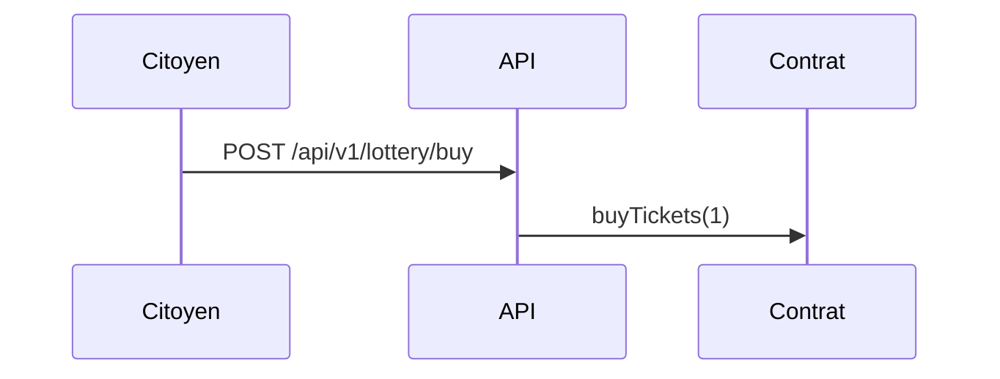

# Écrire la documentation

La documentation officielle vit dans le dépôt, à côté du code qu'elle décrit, dans le dossier [`documentation-officielle/`](src:documentation-officielle/). Elle s'écrit en Markdown. Un générateur écrit en Node.js, sans framework, la transforme en site HTML statique de type GitBook. Le site est commité dans `site/` et publié sur `docs.etherbay.tech`.

Toute modification du code qui change un comportement documenté doit mettre à jour la documentation dans la même pull request. La CI le vérifie en partie : le job « Documentation officielle » échoue si une page générée depuis le code n'est plus à jour.

## Organisation du dossier

| Chemin | Rôle |
| --- | --- |
| [`content/SUMMARY.md`](src:documentation-officielle/content/SUMMARY.md) | Sommaire du site : ordre des pages, titres du menu, regroupement en parties. Une page absente du sommaire fait échouer la construction. |
| `content/**/*.md` | Pages de la documentation, une par fichier. `README.md` devient la page d'accueil `index.html`. |
| [`content/_data/`](src:documentation-officielle/content/_data/) | Descriptions humaines des tableaux générés : variables d'environnement, modèle de données, contrats, événements temps réel, services Docker, migrations. |
| `content/images/` | Images référencées par les pages (facultatif). |
| [`theme/`](src:documentation-officielle/theme/) | Gabarit HTML, feuille de style, scripts du site (thème, navigation, recherche, diagrammes), polices et logo. |
| [`scripts/build.mjs`](src:documentation-officielle/scripts/build.mjs) | Génère le site dans `site/`. |
| [`scripts/lib/`](src:documentation-officielle/scripts/lib/) | Lecture du sommaire, rendu Markdown, générateurs de pages depuis le code. |
| [`scripts/check.mjs`](src:documentation-officielle/scripts/check.mjs) | Vérification utilisée par la CI. |
| [`scripts/serve.mjs`](src:documentation-officielle/scripts/serve.mjs) | Serveur local de prévisualisation. |
| [`scripts/publish.mjs`](src:documentation-officielle/scripts/publish.mjs) | Publication sur le serveur de démonstration. |
| [`deploiement/Caddyfile`](src:documentation-officielle/deploiement/Caddyfile) | Bloc Caddy qui sert `docs.etherbay.tech`. |
| `site/` | Site généré, commité, prêt à être servi tel quel. Ne jamais le modifier à la main. |

## Commandes

Depuis `documentation-officielle/`, après `npm ci` :

| Commande | Effet |
| --- | --- |
| `npm run build` | Régénère `site/`. Échoue sur une erreur bloquante (fichier du dépôt introuvable, page absente du sommaire, titre manquant). Signale sans échouer les liens vers des pages pas encore ajoutées au sommaire et les descriptions à compléter, ce qui permet d'écrire une partie à la fois. |
| `npm run serve` | Sert `site/` sur `http://localhost:4040` avec les mêmes en-têtes de sécurité qu'en production. La recherche a besoin d'un serveur : ouvrir `index.html` directement depuis le disque ne la fait pas fonctionner. |
| `npm run check` | Construction stricte dans un dossier temporaire : les avertissements de `npm run build` deviennent bloquants. Compare ensuite le résultat avec `site/` et contrôle tous les liens internes et toutes les ancres. C'est la commande de la CI. |
| `npm run publish` | Vérifie puis publie le site, voir [Publier la documentation](../infrastructure/publier-documentation.md). |

Le cycle normal est donc : modifier les pages, `npm run build`, relire avec `npm run serve`, `npm run check`, puis commiter les pages **et** le dossier `site/` régénéré.

## Écrire une page

### Ajouter ou déplacer une page

1. Créer le fichier Markdown dans le dossier de la partie concernée, avec des noms en minuscules séparés par des tirets.
2. L'ajouter dans `content/SUMMARY.md` à l'endroit voulu. Une ligne `## Titre` ouvre une partie ; une puce `- [Titre](chemin.md)` ajoute une page ; une puce indentée de deux espaces crée une sous-page.
3. Lancer `npm run build`.

Le premier titre de niveau 1 de la page devient son titre dans l'onglet du navigateur, le fil d'Ariane et les liens précédent et suivant. Il doit être unique dans la page.

### Syntaxe disponible

Le rendu suit le Markdown de GitHub (GFM) : tableaux, listes, blocs de code, liens. Les extensions propres au site sont les suivantes.

**Liens vers le code.** Un lien dont la cible commence par `src:` pointe vers le fichier sur GitHub, sur la branche `main`. La construction échoue si le fichier n'existe pas dans le dépôt, ou s'il existe sur le poste sans être versionné (fichier généré ou ignoré par Git), ce qui protège la documentation contre les renommages et les liens cassés sur GitHub.

```text
[`backend/src/app.ts`](src:backend/src/app.ts)
[le dossier des contrats](src:smart-contract/contracts/)
```

**Liens entre pages.** Ils visent le fichier `.md` par un chemin relatif, avec une ancre facultative. L'ancre d'un titre est son texte en minuscules, sans accents, chaque suite de caractères non alphanumériques étant remplacée par un tiret.

```text
[le keeper](../integration-blockchain/keeper.md)
[le cycle d'un tour](../smart-contracts/cycle-tour.md#transitions)
```

**Encadrés.** Une citation dont la première ligne est `[!NOTE]`, `[!TIP]`, `[!IMPORTANT]`, `[!WARNING]` ou `[!CAUTION]` devient un encadré coloré, intitulé « À savoir », « Astuce », « Important », « Attention » ou « Danger ».

```text
> [!WARNING]
> Après un redémarrage de la blockchain locale, réinitialiser aussi la base.
```

**Diagrammes.** Un bloc de code de langage `mermaid` est rendu en diagramme par Mermaid, hébergé dans le site. Les diagrammes suivent le thème clair ou sombre.

````text

````

**Coloration syntaxique.** Elle est appliquée à la construction, sans script dans le navigateur, pour les langages déclarés après les trois accents graves : `bash`, `typescript`, `javascript`, `json`, `yaml`, `sql`, `ini`, `dockerfile`, `powershell`, `http`, `css`, `diff`. Les autres langages, comme `solidity`, `prisma` ou `caddyfile`, sont affichés sans coloration mais avec leur libellé.

### Règles de rédaction

- Vérifier chaque affirmation dans le code avant de l'écrire, et citer le fichier source.
- Écrire en français, avec des phrases courtes et sans formules marketing.
- Ne mettre ni émoji, ni commentaire dans les blocs de code : les explications vont dans le texte.
- Préférer un tableau à une longue liste de propriétés, et un diagramme à un long paragraphe sur un flux.
- Dire clairement ce qui est simulé, partiel ou non implémenté.

## Pages générées depuis le code

Une ligne seule de la forme `{{generated:nom}}` est remplacée, à la construction, par un contenu calculé à partir du code. Ces pages sont donc toujours exactes, et la CI échoue si `site/` n'a pas été régénéré après un changement du code.

| Générateur | Source lue | Page |
| --- | --- | --- |
| `variables-environnement` | [`backend/src/config/env.config.ts`](src:backend/src/config/env.config.ts) : type, valeur par défaut, contraintes et règles de production de chaque variable | [Variables d'environnement](../backend/variables-environnement.md) |
| `dictionnaire-donnees` | [`backend/prisma/schema.prisma`](src:backend/prisma/schema.prisma) et les contraintes CHECK des migrations | [Dictionnaire de données](../base-de-donnees/dictionnaire.md) |
| `migrations` | [`backend/prisma/migrations/`](src:backend/prisma/migrations/) | [Migrations](../base-de-donnees/migrations.md) |
| `reference-api` | [`backend/src/app.ts`](src:backend/src/app.ts) et les fichiers `*.routes.ts` : méthode, chemin, accès, contrôles, résumé OpenAPI | [Référence de l'API](../backend/reference-api.md) |
| `evenements-socket` | [`backend/src/types/socket.types.ts`](src:backend/src/types/socket.types.ts) | [Temps réel Socket.IO](../backend/socket-io.md) |
| `contrat-blocklucky`, `contrat-poap` | ABI de [`backend/src/blockchain/abi/`](src:backend/src/blockchain/abi/) et modificateurs lus dans les sources Solidity | [Référence de BlockLucky](../smart-contracts/reference-blocklucky.md), [Référence de BlockLuckyPOAP](../smart-contracts/reference-poap.md) |
| `versions-stack`, `scripts-npm` | Les `package.json` de chaque projet | [Versions de la stack](../architecture/versions.md), [Scripts npm](../annexes/scripts-npm.md) |
| `services-compose` | [`docker-compose.yml`](src:docker-compose.yml) | [Docker Compose](../infrastructure/docker-compose.md) |
| `jobs-ci` | [`.github/workflows/`](src:.github/workflows/) | [Intégration continue](../infrastructure/ci.md) |

Le code ne contient pas de commentaires : le rôle de chaque élément des tableaux vient donc des fichiers JSON de `content/_data/`. Quand une variable, un champ, une fonction de contrat, un événement ou un service apparaît dans le code sans description, `npm run build` le signale et `npm run check` échoue. Par exemple, ajouter une variable d'environnement demande d'ajouter son entrée dans [`content/_data/variables.json`](src:documentation-officielle/content/_data/variables.json) :

```json
{
  "NOUVELLE_VARIABLE": {
    "categorie": "Blockchain",
    "description": "Rôle de la variable, valeur conseillée et effet d'une mauvaise valeur."
  }
}
```

## Ce que vérifie la CI

Le job `documentation` de [`.github/workflows/ci.yml`](src:.github/workflows/ci.yml) lance `npm run check` à chaque push et sur chaque pull request. Il échoue dans ces cas :

- une page est absente du sommaire, ou le sommaire cite une page qui n'existe pas ;
- un lien `src:` vise un fichier qui n'existe plus ;
- un lien interne ou une ancre ne mène nulle part ;
- une description de `content/_data/` manque ;
- le dossier `site/` commité diffère du site que la construction produit, par exemple parce que le code a changé sans que la documentation soit régénérée.

> [!TIP]
> Si le job échoue sur un code qui n'a rien à voir avec la documentation, c'est en général le dernier cas : lancer `npm run build` dans `documentation-officielle/`, puis commiter le dossier `site/` mis à jour.

## Fonctionnement du site

Le site ne charge rien depuis l'extérieur : polices, scripts et Mermaid sont servis par le même domaine. Il respecte donc une politique de sécurité de contenu stricte (`script-src 'self'`, aucun script en ligne).

| Fonction | Mise en œuvre |
| --- | --- |
| Menu de gauche repliable | Généré depuis `SUMMARY.md`, la page courante et ses parents sont ouverts. |
| Sommaire de droite | Titres de niveau 2 et 3 de la page, avec suivi de la lecture. |
| Recherche | Index `search-index.json` produit à la construction, une entrée par section. Recherche sans accents, ouverte par `Ctrl K` ou `/`. |
| Thème clair et sombre | Bouton de la barre du haut, préférence du système par défaut, choix mémorisé dans le navigateur. |
| Copie des blocs de code | Bouton « Copier » ajouté à chaque bloc. |
| Diagrammes | Mermaid chargé seulement sur les pages qui en contiennent. |
| Lien d'édition | Chaque page renvoie vers son fichier source sur GitHub. |
