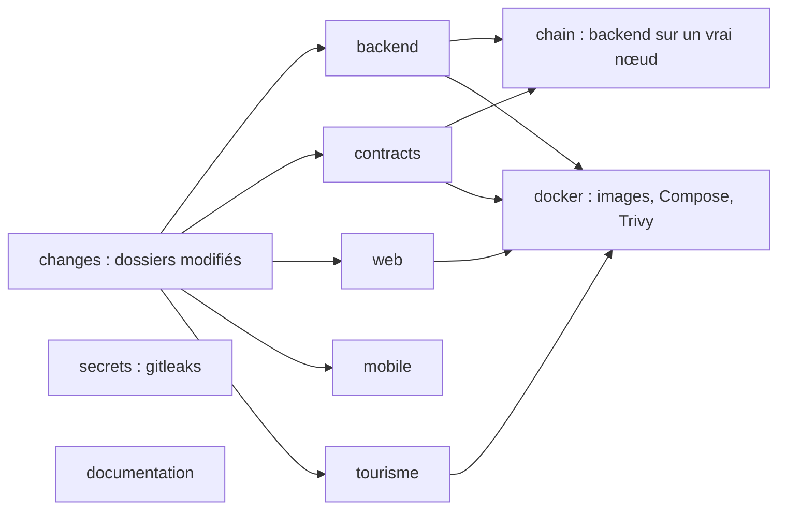

# Tests et qualité

Chaque projet du monorepo a ses propres commandes de vérification. La CI ([`.github/workflows/ci.yml`](src:.github/workflows/ci.yml)) les rejoue sur chaque pull request, en ne lançant que les jobs des projets modifiés. Cette page donne, projet par projet, ce qu'il faut lancer avant de pousser et ce que la CI exige pour qu'une pull request soit fusionnable.

## Avant d'ouvrir une pull request

Une commande par projet modifié, les mêmes que dans [`CONTRIBUTING.md`](src:CONTRIBUTING.md). Elles rejouent en local l'essentiel des contrôles de la CI.

```bash
cd backend && npm run typecheck && npm run lint && npm run env:check && npm test
```

```bash
cd frontend-web && npm run lint && npm run typecheck && npm test
```

```bash
cd mobile-app && npm run typecheck && npm run lint
```

```bash
cd smart-contract && npm run lint && npm run test:coverage && npm run coverage:check
```

```bash
cd documentation-officielle && npm run check
```

Pour l'Office de Tourisme, depuis `frontend-office-tourisme/` :

```bash
node ../.github/scripts/check-static-links.mjs .
```

## Vue d'ensemble de la CI



| Job | Se lance si | Durée maximale |
| --- | --- | --- |
| `changes` | toujours | 5 min |
| `secrets` | toujours | 10 min |
| `documentation` | toujours | 10 min |
| `backend` | `backend/**` modifié | 15 min |
| `contracts` | `smart-contract/**` ou `backend/**` modifié | 20 min |
| `chain` | contrats ou backend modifiés, et `contracts` et `backend` sans échec | 20 min |
| `web` | `frontend-web/**` modifié | 15 min |
| `mobile` | `mobile-app/**` modifié | 15 min |
| `tourisme` | `frontend-office-tourisme/**` modifié | 5 min |
| `docker` | infrastructure, backend, contrats, web ou tourisme modifiés, et les jobs précédents sans échec | 20 min |

Une modification de `.github/workflows/ci.yml` déclenche tous les jobs. Le job `contracts` tourne aussi quand seul le backend change, parce que le backend embarque les ABI des contrats. Toutes les actions GitHub sont épinglées par empreinte de commit (`actions/checkout@11d5960a...`) et non par étiquette, ce qui empêche une étiquette déplacée d'injecter du code dans la CI.

La liste générée des jobs est dans [Intégration continue](../infrastructure/ci.md).

## Smart contracts

| Commande | Ce qu'elle fait | Exigé en CI |
| --- | --- | --- |
| `npm run build` | Compile les contrats (Hardhat 3, Solidity 0.8.34) | indirectement |
| `npm run typecheck` | Compile puis vérifie le TypeScript des tests et scripts | oui |
| `npm run lint` | solhint avec `--max-warnings 0` sur `contracts/*.sol` | oui, zéro avertissement |
| `npm test` | 43 tests TypeScript (mocha et ethers) et 4 tests de fuzzing Solidity | via `test:coverage` |
| `npm run test:coverage` | Mêmes tests avec mesure de couverture, rapport dans `coverage/lcov.info` | oui |
| `npm run coverage:check` | Échoue si un contrat de production a moins de 100 % de lignes couvertes ; seuil réglable par `COVERAGE_MIN_LINES` | oui, 100 % |
| `node scripts/export-abi.mjs --check` | Compare les ABI compilées à celles de `backend/src/blockchain/abi/` | oui |
| `npm run slither` | Slither 0.11.6 dans Docker, échec dès un constat de niveau Medium non consigné dans `slither.db.json` | oui |
| `npm run test:gas` | Coût en gaz de chaque fonction | non |
| `npm audit --omit=dev --audit-level=critical` | Vulnérabilités critiques des dépendances de production | oui, seuil critique (voir [Dépendances](dependances.md#exception-pour-smart-contract)) |

Les tests sont décrits dans [Tests, fuzzing et couverture](../smart-contracts/tests.md).

## Backend

| Commande | Ce qu'elle fait | Exigé en CI |
| --- | --- | --- |
| `npm audit --omit=dev --audit-level=high` | Vulnérabilités hautes et critiques des dépendances de production | oui |
| `npx prisma generate` | Génère le client Prisma | oui |
| `npm run env:check` | Compare les clés du schéma de [`env.config.ts`](src:backend/src/config/env.config.ts) et de [`.env.example`](src:backend/.env.example) | oui |
| `npm run typecheck` | `tsc --noEmit` | oui |
| `npm run lint` | ESLint, dont `no-floating-promises` | oui |
| `npx prisma migrate deploy` | Applique toutes les migrations sur une base PostgreSQL 15 vierge | oui |
| `npx prisma migrate diff --from-config-datasource --to-schema prisma/schema.prisma --exit-code` | Échoue si `schema.prisma` décrit un état que les migrations ne produisent pas | oui |
| `npm test` | Jest en série (`--runInBand`), avec Prisma et Redis simulés en mémoire | oui, avec `--ci` |
| `npm run test:coverage` | Mêmes tests avec couverture | non |
| `npm run compile` | Compile vers `dist/` et copie les gabarits d'emails | oui |
| `npm run test:chain` | Tests de bout en bout sur un nœud Hardhat réel | job `chain` |

### Tests unitaires et d'API

Les tests de [`backend/__tests__/`](src:backend/__tests__/) appellent l'application Express avec Supertest. Prisma et Redis y sont remplacés par des doublures en mémoire ([`prisma.mock.ts`](src:backend/__tests__/__mocks__/prisma.mock.ts), [`redis.mock.ts`](src:backend/__tests__/__mocks__/redis.mock.ts)) ; [`setup-env.ts`](src:backend/__tests__/setup-env.ts) force `BLOCKCHAIN_MODE=simulated` et désactive le code de connexion par email, la double authentification des administrateurs et la vérification d'âge (`AGE_VERIFICATION_REQUIRED=false`). Les tests du refus 403 des comptes non vérifiés, dans [`lottery.test.ts`](src:backend/__tests__/api/lottery.test.ts) et [`marketplace.test.ts`](src:backend/__tests__/api/marketplace.test.ts), réactivent le contrôle en modifiant `env.AGE_VERIFICATION_REQUIRED` le temps du test ; [`identity.test.ts`](src:backend/__tests__/api/identity.test.ts) couvre l'envoi des pièces et la décision de la Mairie. Ces tests n'ont donc besoin ni de base, ni de Redis, ni de blockchain.

> [!WARNING]
> La doublure Prisma est écrite à la main : elle ne connaît que les modèles et les méthodes déjà utilisés. Un nouveau modèle ou une nouvelle méthode Prisma (`groupBy`, `aggregate`...) appelés dans une route testée demandent d'étendre [`prisma.mock.ts`](src:backend/__tests__/__mocks__/prisma.mock.ts), sinon le test échoue sur une fonction indéfinie.

### Tests sur une vraie blockchain

Le job `chain` construit l'image de [`smart-contract/`](src:smart-contract/), qui démarre un nœud Hardhat, déploie les contrats et lance un oracle VRF local, puis exécute `npm run test:chain` avec PostgreSQL et Redis réels. Le scénario de [`onchain-lottery.chain.ts`](src:backend/__tests__/chain/onchain-lottery.chain.ts) couvre l'achat, le cadeau, l'avance du temps (`evm_increaseTime`), le tirage par le keeper, le versement de la cagnotte, le POAP et le disjoncteur. En local :

```bash
docker compose up -d --wait
cd backend && npm run test:chain
```

Voir [Tests sur une vraie chaîne](../integration-blockchain/tests.md).

## Frontend web

| Commande | Ce qu'elle fait | Exigé en CI |
| --- | --- | --- |
| `npm audit --omit=dev --audit-level=high` | Vulnérabilités des dépendances de production | oui |
| `npm run lint` | ESLint de Next.js | oui |
| `npm run typecheck` | `tsc --noEmit` | oui |
| `npm test` | Vitest en environnement jsdom, fichiers `__tests__/**/*.test.{ts,tsx}` | oui |
| `npm run build` | Build de production Next.js, télémétrie désactivée | oui |
| Contrôle du bundle | Échoue si `.next/static` contient une clé `sk_live_`, une clé AWS, une clé privée PEM ou la clé du compte Hardhat n° 0, ou un fichier `.map` | oui |

Voir [Tests et build](../web/tests-build.md).

## Application mobile

| Commande | Ce qu'elle fait | Exigé en CI |
| --- | --- | --- |
| `npm audit --omit=dev --audit-level=high` | Vulnérabilités des dépendances de production | oui |
| `npm run typecheck` | `tsc --noEmit` | oui |
| `npm run lint` | ESLint `universe` | oui |
| `npx expo config --type public` | Valide la configuration Expo publique | oui |

> [!CAUTION]
> Le dossier [`mobile-app/__tests__/`](src:mobile-app/__tests__/) contient trois fichiers de tests (compte à rebours, écran d'achat, formateurs), mais le projet n'a ni script `test`, ni Jest dans ses dépendances. Ces tests ne sont exécutés nulle part. Les rendre exécutables demande d'ajouter `jest`, `jest-expo` et `@testing-library/react-native`, un script `test` et l'étape correspondante dans le job `mobile`.

## Office de Tourisme

| Commande | Ce qu'elle fait | Exigé en CI |
| --- | --- | --- |
| `find assets/js \( -name '*.js' -o -name '*.mjs' \) -exec node --check {} \;` | Syntaxe de chaque module | oui |
| `node ../.github/scripts/check-static-links.mjs .` | Existence de chaque ressource locale citée dans les pages HTML | oui |

Il n'y a pas de test fonctionnel : les parcours (filtres, panier, commande) se vérifient à la main. Voir [Servir et déployer](../office-tourisme/deploiement.md#verifications-de-la-ci).

## Documentation

`npm run check`, depuis [`documentation-officielle/`](src:documentation-officielle/), construit le site dans un dossier temporaire, le compare à `site/`, vérifie les liens, les ancres et les descriptions des tableaux générés. Le job tourne sur chaque pull request, même sans modification de la documentation, parce qu'un changement du code peut rendre une page générée obsolète. Voir [Écrire la documentation](documentation.md).

## Contrôles transverses

| Contrôle | Outil | Seuil |
| --- | --- | --- |
| Secrets dans tout l'historique Git | gitleaks 8.30.1, configuration [`.gitleaks.toml`](src:.gitleaks.toml) | tout secret détecté hors liste blanche |
| Validité de `docker-compose.yml` | `docker compose --profile app config -q` | erreur de syntaxe ou de référence |
| Construction des images | backend (cible `runtime`), frontend web, blockchain locale, Office de Tourisme | échec de construction |
| Vulnérabilités des images | Trivy 0.76.2 sur les images backend, web et tourisme, `--ignore-unfixed` | toute vulnérabilité `HIGH` ou `CRITICAL` corrigeable |
| Analyse statique de sécurité | CodeQL, requêtes `security-extended` | alerte de sécurité |

La liste blanche de gitleaks ne contient que deux valeurs publiques de développement, refusées par le backend en production : la clé `ENCRYPTION_KEY` de démonstration et la clé privée du compte Hardhat n° 0. L'image de la blockchain locale n'est pas analysée par Trivy : elle sert au développement et à la CI, jamais en production.

## Tests de charge

Les scénarios k6 de [`load-tests/`](src:load-tests/) ne sont pas lancés par la CI. Ils servent avant un événement à fort trafic (ouverture des ventes, tirage public) :

```bash
docker run --rm -i -e BASE_URL=http://host.docker.internal:2053 grafana/k6 run - < load-tests/smoke.js
```

Voir [Tests de charge](../infrastructure/tests-charge.md).

## Quand la CI échoue

| Symptôme | Cause habituelle | Correction |
| --- | --- | --- |
| `Variables absentes de .env.example` | Variable ajoutée au schéma seulement | L'ajouter à `backend/.env.example` |
| `prisma migrate diff` en échec | `schema.prisma` modifié sans migration | `npx prisma migrate dev --create-only --name <nom>` puis relire le SQL |
| `ABI du backend différente du contrat compilé` | Contrat modifié sans export | `npm run export:abi` dans `smart-contract/` |
| `KO contracts/BlockLucky.sol` | Ligne non couverte par un test | Ajouter le test manquant |
| Slither en échec | Nouveau constat Medium ou plus | Corriger, ou consigner un faux positif justifié dans `slither.db.json` |
| `documentation` en échec | Page générée obsolète ou lien cassé | `npm run build` dans `documentation-officielle/`, commiter `site/` |
| Trivy en échec | Correctif publié pour l'image de base | Mettre à jour l'image, souvent via la pull request Dependabot |
| `Secret détecté dans .next/static` | Secret exposé par une variable `NEXT_PUBLIC_*` | Retirer la variable, révoquer le secret |
