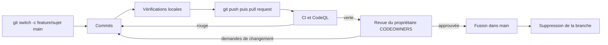

# Workflow Git

Le dépôt `MarceauTDML/BlockLucky` est un monorepo : contrats, backend, frontend web, application mobile, site de l'Office de Tourisme, infrastructure et documentation évoluent ensemble, dans les mêmes pull requests. Cette page est la référence des règles de contribution ; [`CONTRIBUTING.md`](src:CONTRIBUTING.md), à la racine, en résume l'essentiel et y renvoie. Elle relie aussi ces règles aux fichiers de [`.github/`](src:.github/) qui les outillent.

## Branches

| Branche | Rôle | Règle |
| --- | --- | --- |
| `main` | Branche de référence, toujours déployable | Aucun push direct : tout passe par une pull request dont la CI est verte |
| Branche de sujet | Un changement cohérent | Durée de vie de deux jours au plus, nom préfixé par le type de changement |
| `dependabot/...` | Mises à jour proposées par Dependabot | Créées et rebasées par Dependabot, à ne pas modifier à la main (voir [Dépendances](dependances.md)) |

Préfixes des branches de sujet :

| Préfixe | Usage | Exemple |
| --- | --- | --- |
| `feature/` | Nouvelle fonctionnalité | `feature/achat-ticket-cadeau` |
| `fix/` | Correction de bogue | `fix/solde-negatif` |
| `chore/` | Maintenance, dépendances, outillage | `chore/maj-dependances` |

> [!NOTE]
> L'historique réel ne suit pas encore cette règle. Pendant le projet, chaque membre de l'équipe a travaillé sur une branche personnelle durable (`marceau`, `Marie`, `Myriam`, `Rajeeva`), fusionnée régulièrement dans `main` par pull request (« Merge pull request #163 from MarceauTDML/marceau »). Pour la reprise du code par la DSI d'EtherBay, la convention de branches de sujet courtes est celle à appliquer.

### Cycle d'un changement



Les commandes de départ :

```bash
git switch main
git pull
git switch -c feature/historique-des-tours
```

Une branche qui vit plus de deux jours dérive de `main`. La remettre à jour avant de demander une revue :

```bash
git fetch origin
git rebase origin/main
git push --force-with-lease
```

`--force-with-lease` refuse d'écraser la branche distante si quelqu'un d'autre y a poussé entre-temps, contrairement à `--force`.

## Messages de commit

Un titre court en français, à l'impératif ou sous forme nominale, puis, si nécessaire, une description qui explique le pourquoi plutôt que le comment. Le titre commence souvent par le projet concerné quand le changement ne touche qu'un dossier.

| Bon titre (tiré de l'historique) | Pourquoi |
| --- | --- |
| « Ajout du tunnel de commande simulé » | Dit ce qui change, en une ligne |
| « Mobile : annonce du gagnant et retrait des gains » | Préfixe du projet, puis le comportement ajouté |
| « Disjoncteur et reversement de la commission sur le contrat » | Regroupe deux changements liés, pas deux sujets distincts |
| « RGPD : effacement de la clé du portefeuille » | Le contexte métier d'abord |

À éviter : « fix », « wip », « maj », un titre qui décrit un fichier plutôt qu'un comportement, ou un commit qui mélange une correction et un reformatage.

## Pull requests

### Taille

Une pull request modifie 400 lignes au plus, hors fichiers générés et fichiers de verrouillage (`package-lock.json`, `documentation-officielle/site/`). Un chantier plus gros se découpe en plusieurs pull requests successives, chacune déployable seule. Par exemple, ajouter une colonne et l'utiliser se fait en deux temps : migration d'expansion d'abord, code qui la remplit ensuite (voir [Ajouter une migration](../guides/ajouter-migration.md)).

### Modèle

GitHub pré-remplit la description avec [`.github/pull_request_template.md`](src:.github/pull_request_template.md) :

| Rubrique | Contenu attendu |
| --- | --- |
| Contexte | Pourquoi ce changement, lien vers le ticket ou la tâche |
| Changements | Liste des modifications visibles |
| Projets concernés | Cases `smart-contract`, `backend`, `frontend-web`, `mobile-app`, `frontend-office-tourisme`, `infrastructure (Docker, CI)`, `documentation-officielle` |
| Vérifications | Typecheck, lint et tests passés en local ; migration compatible avec la version précédente du code ; `.env.example` et descriptions des variables mis à jour ; contrat testé, couvert à 100 %, analysé par Slither et ABI exportées ; documentation régénérée ; captures d'écran pour un changement visuel |
| Plan de retour arrière | Comment annuler le changement après déploiement |

Un changement du contrat doit en plus décrire, dans le plan de retour arrière, ce qui se passe pour le contrat déjà déployé, puisqu'un contrat ne se met pas à jour (voir [Modifier le contrat](../guides/modifier-contrat.md)).

### Exemple de description

```text
## Contexte

Le jury veut voir l'historique des tirages passés sans se connecter.

## Changements

- Route publique GET /api/v1/lottery/rounds (tours terminés, paginés)
- Page /transparence/tours du frontend web

## Projets concernés

- [x] backend
- [x] frontend-web

## Vérifications

- [x] Typecheck, lint et tests passent en local
- [ ] Migration Prisma compatible avec la version précédente du code (expand/contract) : sans objet
- [ ] .env.example mis à jour si une variable a été ajoutée : sans objet
- [x] Captures d'écran jointes pour un changement visuel (web, mobile)

## Plan de retour arrière

Revert de la pull request : la route et la page sont nouvelles, aucune donnée n'est modifiée.
```

## Revue

### Propriétaires du code

[`.github/CODEOWNERS`](src:.github/CODEOWNERS) désigne qui doit relire chaque dossier. GitHub demande automatiquement la revue du propriétaire des fichiers modifiés.

| Chemin | Propriétaire |
| --- | --- |
| `*` (tout le dépôt) | `MarceauTDML` |
| `/backend/`, `/backend/prisma/migrations/` | `MarceauTDML` |
| `/smart-contract/` | `MarceauTDML` |
| `/frontend-web/`, `/mobile-app/`, `/frontend-office-tourisme/` | `MarceauTDML` |
| `/documentation-officielle/` | `MarceauTDML` |
| `/docker-compose.yml`, `/.github/` | `MarceauTDML` |

Toutes les lignes désignent aujourd'hui le même compte. Le fichier est découpé par dossier pour qu'une équipe de la DSI puisse reprendre un périmètre en changeant une seule ligne, par exemple confier `/backend/prisma/migrations/` à un administrateur de bases de données. La dernière règle qui correspond à un fichier l'emporte : une ligne spécifique doit donc venir après la ligne `*`.


### Délai et attentes

La première revue arrive sous 4 heures ouvrées. Le relecteur vérifie en priorité :

| Domaine | Question |
| --- | --- |
| Sécurité | Une route nouvelle a-t-elle `authenticate`, `requireRoles` et `validate` ? Une valeur venant du client est-elle validée par Zod ? |
| Données | La migration respecte-t-elle l'ADR 0003 (expand/contract, `lock_timeout`, `NOT VALID` puis `VALIDATE`) ? |
| Contrat | Les ABI du backend sont-elles régénérées ? L'indexeur traite-t-il les nouveaux événements ? |
| Configuration | Une nouvelle variable est-elle dans le schéma, dans `.env.example` et dans la documentation ? |
| Documentation | Les pages concernées de `documentation-officielle/` sont-elles à jour dans la même pull request ? |

Les règles détaillées sont dans [Standards de code](standards.md) et [Tests et qualité](tests-qualite.md).

## Ce que la CI exige avant la fusion

Le workflow [`.github/workflows/ci.yml`](src:.github/workflows/ci.yml) se déclenche sur chaque pull request, sur chaque push sur `main` et à la demande (`workflow_dispatch`). Un nouveau push sur la même branche annule l'exécution précédente (`concurrency` avec `cancel-in-progress: true`). Un premier job détecte les dossiers modifiés (`dorny/paths-filter`) : seuls les jobs des projets touchés s'exécutent, mais toute modification du workflow lui-même relance tout.

Le workflow [`.github/workflows/codeql.yml`](src:.github/workflows/codeql.yml) analyse en plus le JavaScript et le TypeScript sur chaque pull request, chaque push sur `main` et chaque lundi à 3 h 17 (UTC).

Le détail de chaque job, des commandes et des seuils est dans [Tests et qualité](tests-qualite.md).

> [!IMPORTANT]
> La protection de la branche `main` (pull request obligatoire, jobs requis, revue obligatoire) se configure dans les réglages du dépôt GitHub, pas dans un fichier versionné. Le dépôt ne permet donc pas de vérifier qu'elle est activée : à contrôler dans Settings, Branches, lors de la reprise du projet.

## Fusion

L'historique de `main` montre des fusions par commit de fusion (« Merge pull request #... »), qui conservent les commits de la branche. Après la fusion, supprimer la branche de sujet sur GitHub et en local :

```bash
git switch main
git pull
git branch -d feature/historique-des-tours
```

## Décisions d'architecture

Une décision structurante (nouvelle dépendance d'infrastructure, découpage, changement de contrat d'API) est consignée dans un ADR avant ou avec la pull request qui l'implémente. Les ADR font partie de cette documentation, dans [Décisions d'architecture](../architecture/adr/index.md).

## Dette technique

Les dettes connues sont suivies en tickets avec le libellé `tech-debt`, une estimation de l'impact et du coût. Il est recommandé de leur réserver une part fixe de chaque sprint. La liste actuelle est dans [Dette technique et limites](../annexes/dette-technique.md).
