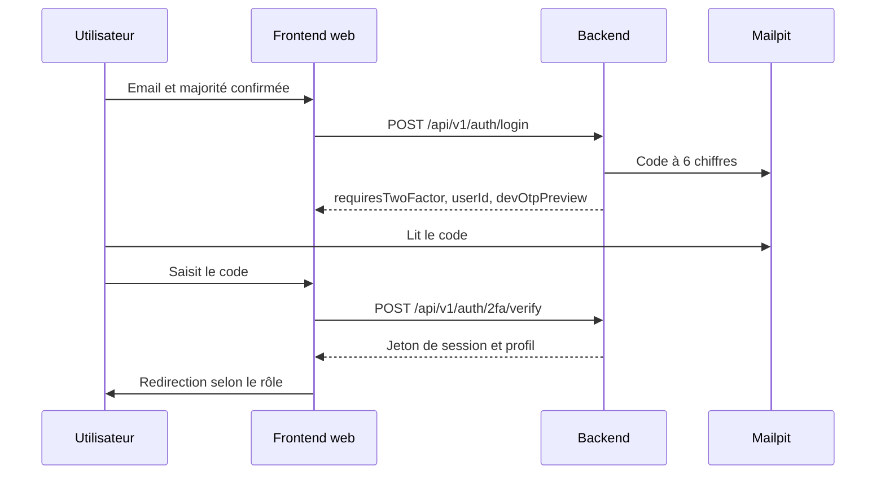

# Comptes de démonstration et connexion

BlockLucky n'utilise aucun mot de passe. On se connecte avec une adresse email et un code à 6 chiffres reçu par email. Cette page décrit les comptes créés par le seed, le déroulement de la connexion en local et les particularités des comptes partenaire et administrateur.

## Les comptes du seed

Le script [`backend/prisma/seed.ts`](src:backend/prisma/seed.ts), lancé par `npm run prisma:seed`, crée trois comptes, un tour et deux commerces.

| Email | Rôle | EtherPoints | Particularité | Espace après connexion |
|---|---|---|---|---|
| `citoyen@etherbay.fr` | `USER` | 250 | Parrainé par le compte de la Mairie | `/accueil` |
| `boulangerie@etherbay.fr` | `PARTNER` | 500 | Propriétaire des deux commerces | `/partenaire` |
| `maire@etherbay.fr` | `ADMIN` | 1 000 | Doit activer la 2FA avant d'accéder au dashboard | `/mairie` |

Les trois comptes ont l'email marqué comme vérifié. Ces adresses sont fictives : les emails n'arrivent que dans Mailpit.

| Donnée | Contenu |
|---|---|
| Tour | `contractRoundId` 1, statut `OPEN` |
| La Boulangerie du Port d'EtherBay | « -15% sur les viennoiseries et pains spéciaux » (100 points, 95 sur 100 en stock) ; « Une Galette des Rois offerte pour 2 achetées » (200 points, 50 sur 50) |
| Cinéma Le Phare EtherBay | « 1 Place de Cinéma achetée = 1 Place offerte » (150 points, 180 sur 200) |

### Le portefeuille des comptes du seed

Le seed n'écrit pas de vrai portefeuille : il enregistre des adresses factices (`0xadmin0000...etherbay`, `0xcitizen000...etherbay`) qui servent seulement de clé unique, et aucune clé chiffrée. Le vrai portefeuille est créé à la première opération qui en a besoin, par `ensureWallet` de [`backend/src/blockchain/wallet.service.ts`](src:backend/src/blockchain/wallet.service.ts) :

- à l'affichage du portefeuille (`GET /api/v1/lottery/wallet`, appelé par la page d'accueil) ;
- ou au premier achat ou cadeau.

À ce moment, le backend remplace l'adresse factice par une adresse Ethereum réelle, chiffre la clé, puis verse la dotation de bienvenue (0,1 ETH fictif par défaut). Un nouveau compte inscrit par l'interface reçoit, lui, son portefeuille dès l'inscription.

> [!NOTE]
> Le tour n° 1 du seed porte une cagnotte de 12,5 qui ne correspond à rien sur la chaîne. Elle est remplacée par la vraie valeur, lue sur le contrat, au premier appel de `GET /api/v1/lottery/status`.

## Se connecter en local

### Depuis le web

1. Ouvrir `http://localhost:3000/connexion` pour un citoyen, ou `http://localhost:3000/connexion?espace=pro` pour un partenaire ou la Mairie (sans les écrans d'onboarding).
2. Confirmer avoir 18 ans ou plus, saisir l'email du compte et valider.
3. Ouvrir Mailpit sur `http://localhost:8025` : l'email « Votre code de connexion - BlockLucky » contient le code à 6 chiffres, valable 10 minutes.
4. Saisir le code sur la page `/connexion/verification`.



Un email inconnu crée un compte citoyen au moment de la vérification du code : portefeuille, dotation de bienvenue, 25 EtherPoints de bienvenue et email de bienvenue. N'importe quelle adresse fictive fonctionne en local, par exemple `test1@etherbay.fr`.

### Le code dans la réponse de l'API

Quand `NODE_ENV=development` (valeur de `.env.example`), la réponse de `POST /api/v1/auth/login` contient aussi le code dans le champ `devOtpPreview`. Il est visible dans l'onglet Réseau des outils de développement du navigateur, ou directement avec curl :

```bash
curl -s -X POST http://localhost:2053/api/v1/auth/login -H "content-type: application/json" -d '{"walletAddress":"0x0000000000000000000000000000000000000001","email":"citoyen@etherbay.fr","provider":"EMAIL","isAdultConfirmed":true}'
```

```json
{
  "success": true,
  "message": "Authentification réussie",
  "data": {
    "requiresTwoFactor": true,
    "twoFactorMethod": "EMAIL",
    "userId": "019a...",
    "devOtpPreview": "123456"
  }
}
```

Le code se valide ensuite avec l'identifiant renvoyé :

```bash
curl -s -X POST http://localhost:2053/api/v1/auth/2fa/verify -H "content-type: application/json" -d '{"userId":"019a...","code":"123456"}'
```

La réponse contient `token`, à passer dans l'en-tête `Authorization: Bearer <token>` des appels suivants. Le champ `walletAddress` du corps de connexion est obligatoire et doit avoir le format d'une adresse Ethereum, mais il ne sert qu'à retrouver un compte existant : le web et le mobile y envoient une valeur dérivée de l'email (`generateDeterministicWallet`). Le vrai portefeuille est toujours créé par le backend.

> [!CAUTION]
> `devOtpPreview` n'existe qu'en `NODE_ENV=development`. Il n'apparaît ni en test ni en production.

### Depuis l'application mobile

Le parcours est le même : écran de connexion, déclaration de majorité, email, puis code saisi sur `Verify2FAScreen`. Le code arrive dans Mailpit, sur le poste de développement.

## Compte Mairie : activer la double authentification

Avec `ADMIN_MFA_REQUIRED=true` (valeur par défaut, obligatoire en production), toute route réservée au rôle `ADMIN` répond 403 avec le message « La double authentification est obligatoire pour les comptes d'administration. Activez-la depuis votre profil. » tant que la 2FA n'est pas active. Le dashboard `/mairie` est donc inutilisable à la première connexion.

1. Se connecter avec `maire@etherbay.fr` depuis `/connexion?espace=pro`.
2. Ouvrir `/profil/securite/2fa`.
3. Choisir l'une des deux méthodes :
   - **Application (TOTP)** : scanner le QR code avec une application d'authentification, noter les codes de secours affichés une seule fois, puis saisir un code de l'application ;
   - **Email** : saisir le code reçu dans Mailpit (prérempli en développement grâce à `devOtpPreview`).
4. L'activation révoque toutes les sessions existantes, puis délivre une nouvelle session à l'appareil courant. Les autres appareils doivent se reconnecter.

| Méthode activée | Connexion suivante |
|---|---|
| Email | Code envoyé par email, comme avant |
| Application TOTP | Plus d'email : le backend demande directement un code de l'application ou un code de secours |

Pour désactiver la 2FA, il faut un code valide ou une connexion de moins de 15 minutes. La sécurité de ces mécanismes est détaillée dans [Authentification et 2FA](../securite/authentification.md).

## Compte partenaire

`boulangerie@etherbay.fr` arrive sur `/partenaire`, qui propose de choisir l'un de ses deux établissements. Il peut créer des offres, importer des codes et valider en caisse les codes présentés par les citoyens. La 2FA n'est pas obligatoire pour ce rôle.

## Scénario de démonstration

Ce scénario couvre le parcours complet en local avec deux citoyens, le minimum pour qu'un tour puisse être tiré (`minTicketsToDraw` vaut 2).

1. Se connecter avec `citoyen@etherbay.fr`, attendre l'affichage du solde sur l'accueil, puis acheter un ticket sur `/billetterie`.
2. Dans une fenêtre de navigation privée, se connecter avec une nouvelle adresse (par exemple `voisin@etherbay.fr`) et acheter un ticket.
3. Attendre la fin du tour : 30 minutes après son ouverture en local (le compte à rebours de l'accueil l'indique). Un tour expiré avec moins de deux tickets est annulé par le keeper et un nouveau tour s'ouvre. Avec deux tickets ou plus, le tour se tire automatiquement : `DrawRequested`, puis réponse de l'oracle local en quelques secondes, puis `WinnerPicked`.
4. Suivre l'annonce sur `/tirage` ; la cagnotte est versée automatiquement au gagnant.
5. Avec `maire@etherbay.fr`, consulter `/mairie`, mettre le contrat en pause depuis `/mairie/securite`, constater que l'achat est refusé, puis le réactiver.

Le test automatisé `npm run test:chain` du backend joue un scénario équivalent sans attendre, en avançant l'horloge du nœud.

## Désactiver les protections en développement

`LOGIN_EMAIL_CODE_REQUIRED` et `ADMIN_MFA_REQUIRED` peuvent être passées à `false` dans `backend/.env` pour accélérer certains essais : la connexion délivre alors directement une session, et un administrateur sans 2FA accède au dashboard. La suite de tests le fait dans [`backend/__tests__/setup-env.ts`](src:backend/__tests__/setup-env.ts).

> [!WARNING]
> Ces deux variables ne peuvent pas être désactivées en production : le backend refuse de démarrer. Ne pas prendre l'habitude de les désactiver, au risque de ne plus tester le vrai parcours.

## Créer d'autres comptes partenaire ou administrateur

Aucune route ni aucun écran ne permet d'attribuer un rôle. Un compte créé par l'interface est toujours `USER`. Pour promouvoir un compte en local, après sa première connexion :

```sql
UPDATE "User" SET role = 'PARTNER' WHERE email = 'nouveau@etherbay.fr';
```

Le backend relit le rôle en base à chaque requête protégée : si le rôle ne correspond plus à celui de la session, il répond « Droits révoqués ou modifiés : reconnectez-vous ». Il suffit alors de se reconnecter.
