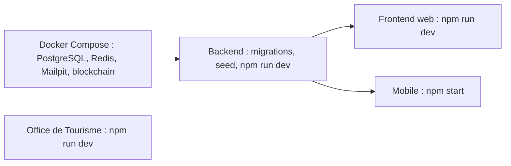

# Lancer les applications

Cette page lance, dans l'ordre, le backend, le frontend web, l'application mobile et le site de l'Office de Tourisme sur un poste de développement. Elle suppose que l'[infrastructure locale](infrastructure-locale.md) tourne (`docker compose up -d --wait`). Chaque application se lance dans son propre terminal.



Le site de l'Office de Tourisme est indépendant : il ne dépend ni du backend ni de l'infrastructure.

## Backend

Depuis `backend/` :

```bash
cp .env.example .env
npm ci
npx prisma generate
npm run prisma:deploy
npm run prisma:seed
npm run dev
```

| Étape | Script | Effet |
|---|---|---|
| `cp .env.example .env` | - | Copie la configuration de développement. Les valeurs pointent vers l'infrastructure Docker et les adresses déterministes des contrats |
| `npm ci` | - | Installe les dépendances exactes du `package-lock.json` |
| `npx prisma generate` | équivalent à `npm run prisma:generate` | Génère le client Prisma dans `node_modules`. Aucun script `postinstall` ne le fait automatiquement |
| `npm run prisma:deploy` | `prisma migrate deploy` | Applique les 4 migrations de `prisma/migrations/` |
| `npm run prisma:seed` | `tsx prisma/seed.ts` | Crée les comptes de démonstration, le tour n° 1 et deux commerces partenaires |
| `npm run dev` | `tsx watch src/server.ts` | Démarre l'API avec rechargement à chaud |

Au démarrage, la configuration est validée par [`backend/src/config/env.config.ts`](src:backend/src/config/env.config.ts). Une valeur invalide arrête le processus avec la liste des erreurs, sous la forme « Configuration invalide, démarrage interrompu ». Le serveur écoute ensuite sur le port 2053 et journalise :

- « Serveur BlockLucky démarré sur http://localhost:2053 » ;
- « Documentation Swagger disponible sur http://localhost:2053/api/docs » ;
- « Indexation blockchain et automate du tirage démarrés », qui confirme le mode `onchain`.

> [!NOTE]
> `prisma.config.ts` et `env.config.ts` ont les mêmes valeurs par défaut que `.env.example`. Le backend démarre donc même sans fichier `.env`, mais il est préférable de le créer pour pouvoir modifier la configuration.

> [!WARNING]
> Le seed n'est pas idempotent pour les commerces : les comptes et le tour sont créés par `upsert`, mais les deux établissements par `create`. Relancer `npm run prisma:seed` sur une base déjà peuplée duplique la boulangerie et le cinéma. Pour repartir proprement, réinitialiser la base (`npm run prisma:reset`).

### Workers

Par défaut (`RUN_WORKERS=true`), le processus de l'API exécute aussi les workers BullMQ (emails, ledger, actions on-chain), l'indexeur et le keeper. Pour les séparer, comme en production :

```bash
RUN_WORKERS=false npm run dev
```

```bash
npm run dev:worker
```

Le worker expose ses sondes sur le port `PORT + 1`, soit 2054 (`/health/live`, `/metrics`).

### Vérifier le backend

| Adresse | Attendu |
|---|---|
| `http://localhost:2053/health` | État du serveur et indicateur de nœud RPC de secours |
| `http://localhost:2053/health/ready` | 200 quand PostgreSQL répond |
| `http://localhost:2053/health/deep` | Diagnostic de chaque dépendance avec sa latence |
| `http://localhost:2053/api/v1/lottery/status` | Tour courant lu sur le contrat, `guarantees.simulated` à `false` |
| `http://localhost:2053/api/docs` | Documentation Swagger interactive |
| `http://localhost:2053/metrics` | Métriques Prometheus (`METRICS_TOKEN` vide en développement, donc accès libre) |

```bash
curl -s http://localhost:2053/api/v1/lottery/status
```

## Frontend web

Depuis `frontend-web/` :

```bash
cp .env.example .env
npm ci
npm run dev
```

Le site est servi sur `http://localhost:3000`. Le fichier [`frontend-web/.env.example`](src:frontend-web/.env.example) contient deux variables :

| Variable | Valeur locale | Rôle |
|---|---|---|
| `NEXT_PUBLIC_API_URL` | `http://localhost:2053/api` | Base des appels REST |
| `NEXT_PUBLIC_WS_URL` | `http://localhost:2053` | Serveur Socket.IO |

Ces variables sont lues au moment de la compilation par Next.js et servent aussi à construire la Content-Security-Policy dans [`frontend-web/next.config.mjs`](src:frontend-web/next.config.mjs). Après une modification, redémarrer `npm run dev`. Sans fichier `.env`, les mêmes valeurs par défaut s'appliquent ([`frontend-web/src/lib/config.ts`](src:frontend-web/src/lib/config.ts)).

Autres scripts utiles :

| Commande | Effet |
|---|---|
| `npm run build` puis `npm run start` | Version de production sur le port 3000 |
| `npm test` | Tests Vitest |
| `npm run lint`, `npm run typecheck` | Contrôles statiques |

## Application mobile

Depuis `mobile-app/` :

```bash
cp .env.example .env
npm ci
npm start
```

`npm start` lance `expo start` : le serveur Metro écoute sur le port 8081 et affiche un QR code. Le scanner avec Expo Go, ou taper `a` pour un émulateur Android et `i` pour un simulateur iOS (macOS). Les scripts `npm run android` et `npm run ios` lancent directement la plateforme voulue.

| Variable | Valeur locale | Rôle |
|---|---|---|
| `EXPO_PUBLIC_API_URL` | `http://localhost:2053/api` | Base des appels REST |
| `EXPO_PUBLIC_WS_URL` | `http://localhost:2053` | Serveur Socket.IO |
| `EXPO_PUBLIC_SENTRY_DSN` | vide | Sans effet réel ([Réel, simulé ou à venir](../presentation/reel-ou-simule.md)) |
| `EXPO_PUBLIC_WEB3AUTH_CLIENT_ID` | `blocklucky-etherbay-client` | Non lue par le code, à retirer |

> [!IMPORTANT]
> Sur un téléphone physique, `localhost` désigne le téléphone lui-même. Remplacer `localhost` par l'adresse IP du poste sur le réseau local dans `mobile-app/.env`, par exemple `http://192.168.1.20:2053/api`, puis relancer Expo avec `npx expo start -c` pour vider le cache. Le détail est dans [Tester sur un téléphone](../mobile/telephone-physique.md).

L'application mobile n'a pas de script `test` : ses tests ne s'exécutent pas aujourd'hui. Les contrôles disponibles sont `npm run typecheck` et `npm run lint`.

## Office de Tourisme

Depuis `frontend-office-tourisme/` :

```bash
npm run dev
```

Le script télécharge au besoin `serve` 14.2.7 et sert le dossier sur `http://localhost:4000`, avec la configuration de [`frontend-office-tourisme/serve.json`](src:frontend-office-tourisme/serve.json). Aucune installation préalable n'est nécessaire.

## Smart contracts

La blockchain locale en conteneur suffit pour utiliser l'application. Pour travailler sur les contrats, depuis `smart-contract/` :

```bash
npm ci
npm test
```

Les autres commandes (couverture, gaz, Slither, export des ABI) sont dans [Tests, fuzzing et couverture](../smart-contracts/tests.md). Après une modification d'un contrat, il faut exporter les ABI vers le backend (`npm run export:abi`) et reconstruire l'image de la blockchain locale.

## Récapitulatif des adresses

| Service | Adresse |
|---|---|
| API | `http://localhost:2053/api/v1` |
| Documentation Swagger | `http://localhost:2053/api/docs` |
| Frontend web | `http://localhost:3000` |
| Espace partenaire et Mairie | `http://localhost:3000/connexion?espace=pro` |
| Office de Tourisme | `http://localhost:4000` |
| Mailpit | `http://localhost:8025` |
| Nœud Hardhat | `http://127.0.0.1:8545` |

## Tests du backend

| Commande | Préalable | Contenu |
|---|---|---|
| `npm test` | `BLOCKCHAIN_MODE=simulated` imposé par [`backend/__tests__/setup-env.ts`](src:backend/__tests__/setup-env.ts) ; Prisma et Redis sont remplacés par des mocks dans 12 des 13 fichiers (la CI fournit tout de même PostgreSQL et Redis) | 41 tests unitaires et d'intégration |
| `npm run test:chain` | PostgreSQL, Redis et blockchain locale démarrés, base migrée et vierge | Achat, cadeau, tirage VRF, versement de la cagnotte, POAP et disjoncteur sur la vraie chaîne locale |
| `npm run typecheck`, `npm run lint`, `npm run env:check` | - | Typage, lint, synchronisation de `.env.example` avec le schéma |

Voir [Tests du backend](../backend/tests.md).

La suite se passe dans [Comptes de démonstration et connexion](comptes-et-connexion.md).
