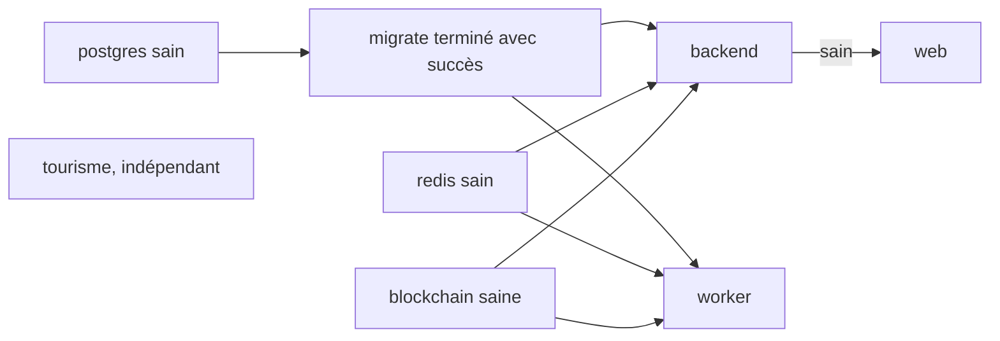

# Stack complète en conteneurs

Le profil `app` de [`docker-compose.yml`](src:docker-compose.yml) construit et lance toute la plateforme dans des conteneurs : migrations, API, worker, frontend web et site de l'Office de Tourisme, en plus des quatre services d'infrastructure. Il sert à vérifier les images de production sur un poste, et de base au déploiement sur un serveur. Pour développer, préférer le lancement des applications hors conteneur ([Lancer les applications](lancer-les-applications.md)), qui offre le rechargement à chaud et le code de connexion dans la réponse de l'API.

## Les services du profil

| Service | Construit depuis | Rôle | Port sur le poste |
|---|---|---|---|
| `migrate` | [`backend/Dockerfile`](src:backend/Dockerfile), cible `migrator` | Lance `npx prisma migrate deploy` une fois, puis s'arrête | - |
| `backend` | `backend/Dockerfile`, cible `runtime` | API REST et Socket.IO, avec `RUN_WORKERS=false` | 2053 |
| `worker` | même image que `backend` | `node dist/src/worker.js` : workers BullMQ, indexeur et keeper | - (sondes sur 2054 dans le conteneur) |
| `web` | [`frontend-web/Dockerfile`](src:frontend-web/Dockerfile) | Next.js compilé en mode `standalone` | 3000 |
| `tourisme` | [`frontend-office-tourisme/Dockerfile`](src:frontend-office-tourisme/Dockerfile) | nginx non privilégié qui sert le site statique sur le port 8080 | 4000 |

L'ordre de démarrage est imposé par les conditions `depends_on` :



## Les secrets obligatoires

Les services `backend` et `worker` tournent avec `NODE_ENV=production`. Dans ce mode, [`backend/src/config/env.config.ts`](src:backend/src/config/env.config.ts) refuse de démarrer si un secret manque ou garde sa valeur de développement.

| Variable | Format exigé | Contrôle en production |
|---|---|---|
| `JWT_SECRET` | Au moins 16 caractères | Valeur de développement interdite |
| `ENCRYPTION_KEY` | 64 caractères hexadécimaux | Valeur de développement interdite |
| `RELAYER_PRIVATE_KEY` | `0x` suivi de 64 caractères hexadécimaux | Valeur de développement (compte Hardhat n° 0) interdite |
| `WEBHOOK_SECRET` | Au moins 8 caractères | Valeur de développement interdite |
| `METRICS_TOKEN` | Chaîne non vide | Obligatoire tant que `METRICS_ENABLED` vaut `true` |

Le fichier Compose transmet ces variables depuis l'environnement du shell avec une valeur vide par défaut (`${JWT_SECRET:-}`). Une variable oubliée fait donc échouer la validation, et le conteneur s'arrête avec « Configuration invalide, démarrage interrompu ».

### Générer les secrets

Une valeur de 32 octets aléatoires en hexadécimal convient pour chacun. Pour `RELAYER_PRIVATE_KEY`, ajouter le préfixe `0x`.

```bash
node -e "console.log(require('crypto').randomBytes(32).toString('hex'))"
```

## Lancer la stack

Avec Bash, depuis la racine du dépôt :

```bash
export JWT_SECRET=$(node -e "console.log(require('crypto').randomBytes(32).toString('hex'))")
export ENCRYPTION_KEY=$(node -e "console.log(require('crypto').randomBytes(32).toString('hex'))")
export RELAYER_PRIVATE_KEY=0x$(node -e "console.log(require('crypto').randomBytes(32).toString('hex'))")
export WEBHOOK_SECRET=$(node -e "console.log(require('crypto').randomBytes(32).toString('hex'))")
export METRICS_TOKEN=$(node -e "console.log(require('crypto').randomBytes(32).toString('hex'))")
docker compose --profile app up -d --build --wait
```

Avec PowerShell :

```powershell
$env:JWT_SECRET = node -e "console.log(require('crypto').randomBytes(32).toString('hex'))"
$env:ENCRYPTION_KEY = node -e "console.log(require('crypto').randomBytes(32).toString('hex'))"
$env:RELAYER_PRIVATE_KEY = "0x" + (node -e "console.log(require('crypto').randomBytes(32).toString('hex'))")
$env:WEBHOOK_SECRET = node -e "console.log(require('crypto').randomBytes(32).toString('hex'))"
$env:METRICS_TOKEN = node -e "console.log(require('crypto').randomBytes(32).toString('hex'))"
docker compose --profile app up -d --build --wait
```

Docker Compose lit aussi un fichier `.env` placé à la racine du dépôt pour substituer les variables. Ce fichier est ignoré par Git ([`.gitignore`](src:.gitignore)) et évite de redéfinir les secrets à chaque terminal.

> [!CAUTION]
> `ENCRYPTION_KEY` chiffre les clés privées des portefeuilles des citoyens. Si elle change, les portefeuilles existants deviennent inutilisables. Garder la même valeur tant que la base est conservée.

## Le compte opérateur

`RELAYER_PRIVATE_KEY` est transmise au service `blockchain` sous le nom `OPERATOR_PRIVATE_KEY`. Au déploiement, [`smart-contract/scripts/deploy-local.ts`](src:smart-contract/scripts/deploy-local.ts) accorde à ce compte les rôles opérateur, pause et frappe, et lui verse 1 000 ETH fictifs, ce qui finance les dotations de bienvenue.

> [!WARNING]
> Si le conteneur `blockchain` tournait déjà sans cette variable (après un `docker compose up` sans profil), Compose le recrée parce que son environnement a changé. La chaîne repart alors de zéro. Pour une base cohérente, partir d'un état vierge : `docker compose --profile app down -v`, puis relancer la stack.

Le compte n'a pas le rôle `DEFAULT_ADMIN_ROLE`, qui reste au compte Hardhat n° 0. Les opérations qui l'exigent, comme le changement d'adresse de trésorerie, sont refusées avec « Le compte opérateur du backend n'a pas le rôle requis sur le Smart Contract. » C'est la configuration attendue en production.

## Différences avec le développement

| Point | Développement local | Profil `app` |
|---|---|---|
| `NODE_ENV` | `development` | `production` |
| Code de connexion | Dans Mailpit et dans `devOtpPreview` | Dans Mailpit uniquement |
| Workers, indexeur, keeper | Dans le processus de l'API | Dans le conteneur `worker` |
| Données de démonstration | `npm run prisma:seed` | Aucun seed : la base ne contient que le schéma |
| URL du nœud | `http://127.0.0.1:8545` | `http://blockchain:8545` (réseau Compose) |
| `/metrics` | Libre | Protégé par `METRICS_TOKEN` |
| Système de fichiers | Normal | Lecture seule, seul `/tmp` est inscriptible |

Pour avoir les comptes de démonstration dans la stack conteneurisée, lancer le seed depuis le poste : PostgreSQL est exposé sur `localhost:5434`, qui est la valeur par défaut de `DATABASE_URL`.

```bash
cd backend
npm ci
npx prisma generate
npm run prisma:seed
```

## Durcissement des conteneurs

Les cinq services du profil héritent du bloc `x-hardening` :

| Mesure | Effet |
|---|---|
| `read_only: true` | Système de fichiers en lecture seule |
| `cap_drop: [ALL]` | Aucune capacité Linux |
| `security_opt: [no-new-privileges:true]` | Aucune élévation de privilèges |
| `tmpfs: /tmp:size=64m` | Seul espace inscriptible, en mémoire ; `web` ajoute un cache Next.js de 128 Mo |

Les images Node tournent avec l'utilisateur `node`, l'image nginx avec l'utilisateur 101. Les images du backend et du web embarquent une sonde de santé (`/health/live` pour l'API, page d'accueil pour le web), et l'arrêt du backend et du worker laisse 30 secondes pour terminer les requêtes en cours. Le détail est dans [Images Docker](../infrastructure/images.md).

## Le frontend web conteneurisé

`NEXT_PUBLIC_API_URL` et `NEXT_PUBLIC_WS_URL` sont passées comme arguments de construction (`http://localhost:2053/api` et `http://localhost:2053`) : elles sont figées dans l'image au moment du `docker compose build`. Pour servir le web sous un autre nom de domaine, il faut reconstruire l'image avec d'autres valeurs. Le backend accepte les origines `http://localhost:3000` et `http://localhost:8081` (`CORS_ORIGINS`).

## Vérifier la stack

```bash
docker compose --profile app ps
curl -s http://localhost:2053/health/ready
curl -s -H "Authorization: Bearer $METRICS_TOKEN" http://localhost:2053/metrics | head
```

| Adresse | Service |
|---|---|
| `http://localhost:2053/api/docs` | API |
| `http://localhost:3000` | Frontend web |
| `http://localhost:4000` | Office de Tourisme |
| `http://localhost:8025` | Mailpit |

## Arrêter

| Commande | Effet |
|---|---|
| `docker compose --profile app stop` | Arrête tout, conserve conteneurs et volumes |
| `docker compose --profile app down` | Supprime les conteneurs, conserve les volumes ; la chaîne locale est perdue |
| `docker compose --profile app down -v` | Supprime aussi les volumes PostgreSQL et Redis |

Le passage à un vrai serveur (nom de domaine, TLS, réseau Sepolia, sauvegardes) est traité dans [Environnements](../infrastructure/environnements.md) et [Déploiement sur etherbay.tech](../infrastructure/deploiement-etherbay.md).
