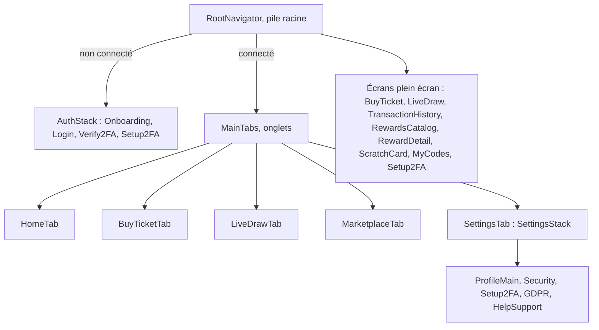

# Ajouter un écran mobile

L'application mobile ([`mobile-app/`](src:mobile-app/)) est une application Expo SDK 58 en React Native, avec React Navigation 7 et RTK Query. Ce guide ajoute un écran « Historique des tirages » qui consomme la route `GET /api/v1/lottery/rounds` créée dans [Ajouter un endpoint](ajouter-endpoint.md), et l'ouvre depuis l'écran « Aide et charte ».

## Fichiers à toucher

| Fichier | Modification |
| --- | --- |
| [`mobile-app/src/types/api.types.ts`](src:mobile-app/src/types/api.types.ts) | Type de la réponse |
| [`mobile-app/src/store/api/lotteryApi.ts`](src:mobile-app/src/store/api/lotteryApi.ts) | Endpoint RTK Query et hook |
| [`mobile-app/src/types/navigation.types.ts`](src:mobile-app/src/types/navigation.types.ts) | Nom et paramètres de la route |
| `mobile-app/src/screens/lottery/RoundHistoryScreen.tsx` | L'écran |
| [`mobile-app/src/navigation/RootNavigator.tsx`](src:mobile-app/src/navigation/RootNavigator.tsx) | Enregistrement de l'écran |
| [`mobile-app/src/screens/settings/HelpSupportScreen.tsx`](src:mobile-app/src/screens/settings/HelpSupportScreen.tsx) | Bouton d'accès |

## Choisir le navigateur

La navigation est imbriquée :



| Type d'écran | Où l'enregistrer | Type de navigation |
| --- | --- | --- |
| Onglet principal | [`MainTabs.tsx`](src:mobile-app/src/navigation/MainTabs.tsx) | `MainTabsParamList` |
| Écran de réglages, avec la barre d'onglets visible | [`RootNavigator.tsx`](src:mobile-app/src/navigation/RootNavigator.tsx) | `RootStackParamList` |
| Écran plein écran, accessible de partout une fois connecté | [`RootNavigator.tsx`](src:mobile-app/src/navigation/RootNavigator.tsx) | `RootStackParamList` |
| Écran avant connexion | [`AuthStack.tsx`](src:mobile-app/src/navigation/AuthStack.tsx) | `AuthStackParamList` |

L'historique des tirages est consultable depuis plusieurs endroits : il va dans la pile racine, comme `TransactionHistory`. Les écrans de la pile racine ne sont montés que si l'utilisateur est connecté (`isAuthenticated` de `useAuth`).

## 1. Typer la réponse et déclarer l'appel

Dans [`api.types.ts`](src:mobile-app/src/types/api.types.ts) :

```typescript
export interface RoundHistoryItem {
  contractRoundId: number;
  winner: string | null;
  winningTicket: number | null;
  prizeEth: number | null;
  ticketsCount: number;
  chainlinkRequestId: string | null;
  drawnAt: string | null;
  prizeClaimedAt: string | null;
}
```

Dans [`lotteryApi.ts`](src:mobile-app/src/store/api/lotteryApi.ts), ajouter l'endpoint et exporter `useGetRoundHistoryQuery` avec les autres hooks :

```typescript
getRoundHistory: builder.query<ApiResponse<{ rounds: RoundHistoryItem[] }>, void>({
  query: () => ({ url: '/lottery/rounds', params: { page: 1, limit: 20 } }),
  providesTags: ['Lottery'],
}),
```

L'URL de base vient de `EXPO_PUBLIC_API_URL` ([`services/api.client.ts`](src:mobile-app/src/services/api.client.ts), `http://localhost:2053/api` par défaut) et le jeton est lu dans le stockage sécurisé à chaque requête ([`baseApi.ts`](src:mobile-app/src/store/api/baseApi.ts)). L'étiquette `Lottery` est invalidée par `useSocket` à chaque `draw:winner` : la liste se rafraîchit après un tirage.

## 2. Déclarer la route

Dans [`navigation.types.ts`](src:mobile-app/src/types/navigation.types.ts), ajouter la route à `RootStackParamList`. `undefined` signifie que l'écran ne prend pas de paramètre :

```typescript
export type RootStackParamList = {
  Auth: undefined;
  Main: undefined;
  TransactionHistory: undefined;
  RoundHistory: undefined;
};
```

Seules les lignes `TransactionHistory` et `RoundHistory` sont montrées ici : les autres routes existantes restent inchangées.

## 3. Écrire l'écran

Fichier `src/screens/lottery/RoundHistoryScreen.tsx`, sur le modèle de [`MyCodesScreen.tsx`](src:mobile-app/src/screens/marketplace/MyCodesScreen.tsx) :

```typescript
import React from 'react';
import { ScrollView, StyleSheet, View } from 'react-native';
import { SafeAreaView } from 'react-native-safe-area-context';
import useAppTheme from '../../hooks/useAppTheme';
import { useGetRoundHistoryQuery } from '../../store/api/lotteryApi';
import AppText from '../../components/ui/AppText';
import BackButton from '../../components/ui/BackButton';
import Loader from '../../components/ui/Loader';
import { formatEth } from '../../utils/formatters.util';

export const RoundHistoryScreen: React.FC<{ navigation: any }> = ({ navigation }) => {
  const { colors, borderRadius, spacing, t } = useAppTheme();
  const { data, isLoading, isError } = useGetRoundHistoryQuery();
  const rounds = data?.data?.rounds ?? [];

  return (
    <SafeAreaView edges={['top', 'left', 'right']} style={[styles.safeArea, { backgroundColor: colors.background }]}>
      <ScrollView contentContainerStyle={{ padding: spacing.lg, paddingBottom: spacing.xxl }}>
        {navigation?.canGoBack?.() ? <BackButton onPress={() => navigation.goBack()} /> : null}
        <AppText variant="title" weight="bold">
          {t('Historique des tirages', 'Draw history')}
        </AppText>
        {isLoading ? <Loader /> : null}
        {isError ? (
          <AppText color={colors.textSecondary}>{t('Historique indisponible.', 'History unavailable.')}</AppText>
        ) : null}
        {rounds.map((round) => (
          <View
            key={round.contractRoundId}
            style={[styles.card, { backgroundColor: colors.surface, borderColor: colors.border, borderRadius: borderRadius.lg }]}
          >
            <AppText variant="subtitle" weight="semibold">
              {t('Tour', 'Round')} #{round.contractRoundId}
            </AppText>
            <AppText variant="caption" color={colors.textSecondary}>
              {t('Gagnant', 'Winner')} : {round.winner ?? '—'}
            </AppText>
            <AppText variant="caption" color={colors.textSecondary}>
              {t('Cagnotte', 'Prize')} : {formatEth(round.prizeEth ?? 0)}
            </AppText>
          </View>
        ))}
      </ScrollView>
    </SafeAreaView>
  );
};

const styles = StyleSheet.create({
  safeArea: { flex: 1 },
  card: { padding: 14, borderWidth: 1, gap: 4, marginTop: 12 },
});

export default RoundHistoryScreen;
```

| Règle | Outil |
| --- | --- |
| Couleurs, espacements, rayons | `colors`, `spacing`, `borderRadius` de [`useAppTheme`](src:mobile-app/src/hooks/useAppTheme.ts), qui suivent le thème clair ou sombre |
| Textes | `AppText` (variantes `hero`, `title`, `subtitle`, `body`, `caption`, `overline`) et `t('français', 'english')` |
| Zones sûres | `SafeAreaView` de `react-native-safe-area-context`, bords `top`, `left`, `right` : la barre d'onglets gère le bas |
| Boutons | [`AppButton`](src:mobile-app/src/components/ui/AppButton.tsx), qui gère le chargement et l'accessibilité |
| Retour | `BackButton` affiché seulement si `navigation.canGoBack()` |

## 4. Enregistrer l'écran

Dans [`RootNavigator.tsx`](src:mobile-app/src/navigation/RootNavigator.tsx), importer l'écran et l'ajouter dans le bloc des écrans connectés, après `TransactionHistory` :

```typescript
import RoundHistoryScreen from '../screens/lottery/RoundHistoryScreen';
```

```typescript
<Stack.Screen name="RoundHistory" component={RoundHistoryScreen} />
```

TypeScript refuse un `name` absent de `RootStackParamList` : l'étape 2 est obligatoire.

## 5. Ouvrir l'écran

Dans [`HelpSupportScreen.tsx`](src:mobile-app/src/screens/settings/HelpSupportScreen.tsx), qui appartient à `SettingsStack`, ajouter un bouton :

```typescript
<AppButton
  title={t("Voir l'historique des tirages", 'See draw history')}
  variant="secondary"
  onPress={() => navigation.navigate('RoundHistory')}
/>
```

`navigate` remonte les navigateurs parents jusqu'à trouver la route : depuis la pile des réglages, imbriquée dans un onglet, il atteint `RoundHistory` dans la pile racine.

## 6. Vérifier

```bash
cd mobile-app
npm run typecheck
npm run lint
npx expo config --type public > /dev/null
```

Ce sont les trois contrôles du job `mobile` de la CI. Le projet n'a pas de script de tests exécutable (voir [Tests et qualité](../contribuer/tests-qualite.md#application-mobile)) : l'écran se vérifie à la main.

```bash
npm start
```

Ouvrir l'application dans Expo Go, se connecter, aller dans Profil, puis Aide, puis « Voir l'historique des tirages ». Sur un téléphone physique, l'API doit être joignable : remplacer `localhost` par l'adresse IP locale du poste dans `mobile-app/.env` (voir [Tester sur un téléphone](../mobile/telephone-physique.md)).

À vérifier sur l'appareil :

| Point | Comment |
| --- | --- |
| Thème sombre | Basculer le thème du système |
| Anglais | Changer la langue dans le profil |
| Lecteur d'écran | VoiceOver ou TalkBack : chaque carte se lit dans l'ordre |
| Petit écran | Le contenu défile, rien n'est coupé par l'encoche ni par la barre d'onglets |
| Hors connexion | Mode avion : l'écran affiche le message d'erreur, sans plantage |

## Écran avec paramètres

Pour un écran qui reçoit un identifiant, sur le modèle de `RewardDetail` :

```typescript
RoundDetail: { contractRoundId: number };
```

```typescript
navigation.navigate('RoundDetail', { contractRoundId: round.contractRoundId });
```

```typescript
export const RoundDetailScreen: React.FC<{ route: { params: { contractRoundId: number } }; navigation: any }> = ({
  route,
  navigation,
}) => {
  const { contractRoundId } = route.params;
  return null;
};
```

## Liste de contrôle

- [ ] Route typée dans `navigation.types.ts`.
- [ ] Écran enregistré dans le bon navigateur.
- [ ] Endpoint RTK Query avec étiquette.
- [ ] Textes bilingues, couleurs du thème, `SafeAreaView`.
- [ ] `typecheck`, `lint` et configuration Expo verts.
- [ ] Testé sur un appareil ou un émulateur, captures jointes à la pull request.
