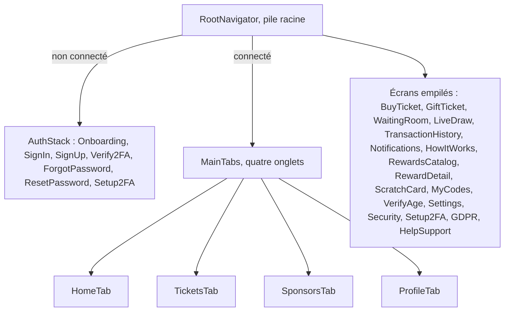

# Ajouter un écran mobile

L'application mobile ([`mobile-app/`](src:mobile-app/)) est une application Expo SDK 58 en React Native, avec React Navigation 7 et RTK Query. Ce guide ajoute un écran « Historique des tirages » qui consomme la route `GET /api/v1/lottery/rounds` créée dans [Ajouter un endpoint](ajouter-endpoint.md), et l'ouvre depuis l'écran « Aide et charte ».

## Fichiers à toucher

| Fichier | Modification |
| --- | --- |
| [`mobile-app/src/types/api.types.ts`](src:mobile-app/src/types/api.types.ts) | Type de la réponse |
| [`mobile-app/src/store/api/lotteryApi.ts`](src:mobile-app/src/store/api/lotteryApi.ts) | Endpoint RTK Query et hook |
| [`mobile-app/src/types/navigation.types.ts`](src:mobile-app/src/types/navigation.types.ts) | Nom et paramètres de la route |
| `mobile-app/src/screens/lottery/RoundHistoryScreen.tsx` | L'écran |
| [`mobile-app/src/navigation/RootNavigator.tsx`](src:mobile-app/src/navigation/RootNavigator.tsx) | Enregistrement de l'écran |
| [`mobile-app/src/screens/settings/HelpSupportScreen.tsx`](src:mobile-app/src/screens/settings/HelpSupportScreen.tsx) | Bouton d'accès |

## Choisir le navigateur

La navigation est imbriquée :



| Type d'écran | Où l'enregistrer | Type de navigation | Hook |
| --- | --- | --- | --- |
| Onglet principal | [`MainTabs.tsx`](src:mobile-app/src/navigation/MainTabs.tsx), avec son icône dans `ICONS` | `MainTabsParamList` | `useRootNavigation` |
| Écran plein écran, accessible de partout une fois connecté | [`RootNavigator.tsx`](src:mobile-app/src/navigation/RootNavigator.tsx) | `RootStackParamList` | `useRootNavigation` |
| Écran avant connexion | [`AuthStack.tsx`](src:mobile-app/src/navigation/AuthStack.tsx) | `AuthStackParamList` | `useAuthNavigation` |

Les réglages n'ont plus de pile propre : `Settings`, `Security`, `GDPR` et `HelpSupport` sont des écrans de la pile racine, sans barre d'onglets. L'historique des tirages va donc aussi dans la pile racine, comme `TransactionHistory`. Les écrans de la pile racine ne sont montés que si l'utilisateur est connecté (`isAuthenticated` de `useAuth`). Les deux hooks viennent de [`navigation/hooks.ts`](src:mobile-app/src/navigation/hooks.ts).

## 1. Typer la réponse et déclarer l'appel

Dans [`api.types.ts`](src:mobile-app/src/types/api.types.ts) :

```typescript
export interface RoundHistoryItem {
  contractRoundId: number;
  winner: string | null;
  winningTicket: number | null;
  prizeEth: number | null;
  ticketsCount: number;
  chainlinkRequestId: string | null;
  drawnAt: string | null;
  prizeClaimedAt: string | null;
}
```

Dans [`lotteryApi.ts`](src:mobile-app/src/store/api/lotteryApi.ts), ajouter l'endpoint et exporter `useGetRoundHistoryQuery` avec les autres hooks :

```typescript
getRoundHistory: builder.query<ApiResponse<{ rounds: RoundHistoryItem[] }>, void>({
  query: () => ({ url: '/lottery/rounds', params: { page: 1, limit: 20 } }),
  providesTags: ['Lottery'],
}),
```

L'URL de base vient de `EXPO_PUBLIC_API_URL` ([`services/api.client.ts`](src:mobile-app/src/services/api.client.ts), `http://localhost:2053/api` par défaut) et le jeton est lu dans le stockage sécurisé à chaque requête ([`baseApi.ts`](src:mobile-app/src/store/api/baseApi.ts)). L'étiquette `Lottery` est invalidée par `useSocket` à chaque `draw:winner` : la liste se rafraîchit après un tirage.

## 2. Déclarer la route

Dans [`navigation.types.ts`](src:mobile-app/src/types/navigation.types.ts), ajouter la route à `RootStackParamList`. `undefined` signifie que l'écran ne prend pas de paramètre :

```typescript
export type RootStackParamList = {
  TransactionHistory: undefined;
  RoundHistory: undefined;
};
```

Seules les lignes `TransactionHistory` et `RoundHistory` sont montrées ici : les autres routes existantes restent inchangées.

## 3. Écrire l'écran

Fichier `src/screens/lottery/RoundHistoryScreen.tsx`, sur le modèle de [`MyCodesScreen.tsx`](src:mobile-app/src/screens/marketplace/MyCodesScreen.tsx) :

```typescript
import React from 'react';
import { StyleSheet } from 'react-native';
import AppText from '../../components/ui/AppText';
import Card from '../../components/ui/Card';
import Loader from '../../components/ui/Loader';
import Screen from '../../components/ui/Screen';
import ScreenHeader from '../../components/ui/ScreenHeader';
import useAppTheme from '../../hooks/useAppTheme';
import { useRootNavigation } from '../../navigation/hooks';
import { useGetRoundHistoryQuery } from '../../store/api/lotteryApi';
import { formatEth } from '../../utils/formatters.util';

const RoundHistoryScreen: React.FC = () => {
  const { colors, t } = useAppTheme();
  const navigation = useRootNavigation();
  const { data, isLoading, isError, isFetching, refetch } = useGetRoundHistoryQuery();
  const rounds = data?.data?.rounds ?? [];

  return (
    <Screen showSecurityFooter refreshing={isFetching && !isLoading} onRefresh={refetch}>
      <ScreenHeader
        title={t('Historique des tirages', 'Draw history')}
        onBack={() => navigation.goBack()}
      />
      {isLoading ? <Loader /> : null}
      {isError ? (
        <AppText color={colors.inkMuted}>{t('Historique indisponible.', 'History unavailable.')}</AppText>
      ) : null}
      {rounds.map((round) => (
        <Card key={round.contractRoundId} style={styles.card}>
          <AppText variant="subtitle">
            {t('Tour', 'Round')} #{round.contractRoundId}
          </AppText>
          <AppText variant="caption" color={colors.inkMuted}>
            {t('Gagnant', 'Winner')} : {round.winner ?? '—'}
          </AppText>
          <AppText variant="caption" color={colors.inkMuted}>
            {t('Cagnotte', 'Prize')} : {formatEth(round.prizeEth ?? 0)}
          </AppText>
        </Card>
      ))}
    </Screen>
  );
};

const styles = StyleSheet.create({
  card: { gap: 4, marginTop: 12 },
});

export default RoundHistoryScreen;
```

| Règle | Outil |
| --- | --- |
| Couleurs, espacements, rayons | `colors`, `spacing`, `borderRadius` de [`useAppTheme`](src:mobile-app/src/hooks/useAppTheme.ts), qui suivent le thème clair ou sombre ; préférer les jetons de la maquette (`ink`, `inkMuted`, `sun`, `surface`) |
| Textes | `AppText` (variantes `display`, `hero`, `title`, `section`, `subtitle`, `body`, `small`, `caption`, `overline`, `label`) et `t('français', 'english')` |
| Mise en page | [`Screen`](src:mobile-app/src/components/ui/Screen.tsx) : zones sûres, clavier, défilement, « tirer pour rafraîchir » et mention de sécurité |
| En-tête et retour | [`ScreenHeader`](src:mobile-app/src/components/ui/ScreenHeader.tsx) avec `onBack` |
| Cartes et listes | [`Card`](src:mobile-app/src/components/ui/Card.tsx), [`ListRow`](src:mobile-app/src/components/ui/ListRow.tsx) |
| Boutons | [`AppButton`](src:mobile-app/src/components/ui/AppButton.tsx), qui gère le chargement et l'accessibilité |
| Icônes | [`Icon`](src:mobile-app/src/components/ui/icons/Icon.tsx) avec un nom de `iconData.ts` |

## 4. Enregistrer l'écran

Dans [`RootNavigator.tsx`](src:mobile-app/src/navigation/RootNavigator.tsx), importer l'écran et l'ajouter dans le bloc des écrans connectés, après `TransactionHistory` :

```typescript
import RoundHistoryScreen from '../screens/lottery/RoundHistoryScreen';
```

```typescript
<Stack.Screen name="RoundHistory" component={RoundHistoryScreen} />
```

TypeScript refuse un `name` absent de `RootStackParamList` : l'étape 2 est obligatoire.

## 5. Ouvrir l'écran

Dans [`HelpSupportScreen.tsx`](src:mobile-app/src/screens/settings/HelpSupportScreen.tsx), écran de la pile racine, ajouter une ligne au groupe existant :

```typescript
<ListRow
  title={t('Historique des tirages', 'Draw history')}
  icon="trophy"
  iconTone="sun"
  onPress={() => navigation.navigate('RoundHistory')}
  divider
/>
```

`navigation` vient de `useRootNavigation()` : la même instance ouvre un écran empilé (`navigate('RoundHistory')`) ou change d'onglet (`navigate('Main', { screen: 'TicketsTab' })`).

## 6. Vérifier

```bash
cd mobile-app
npm run typecheck
npm run lint
npx expo config --type public > /dev/null
```

Ce sont les trois contrôles du job `mobile` de la CI. Le projet n'a pas de script de tests exécutable (voir [Tests et qualité](../contribuer/tests-qualite.md#application-mobile)) : l'écran se vérifie à la main.

```bash
npm start
```

Ouvrir l'application dans Expo Go, se connecter avec un compte du seed, aller dans Profil, puis « Aide et support », puis « Historique des tirages ». Sur un téléphone physique, l'API doit être joignable : remplacer `localhost` par l'adresse IP locale du poste dans `mobile-app/.env` (voir [Tester sur un téléphone](../mobile/telephone-physique.md)).

À vérifier sur l'appareil :

| Point | Comment |
| --- | --- |
| Thème sombre | Activer « Mode sombre » dans Profil, puis Paramètres : l'application ne suit pas le thème du système |
| Anglais | Changer la langue dans Profil, puis Paramètres |
| Lecteur d'écran | VoiceOver ou TalkBack : chaque carte se lit dans l'ordre |
| Petit écran | Le contenu défile, rien n'est coupé par l'encoche ni par la barre d'onglets |
| Hors connexion | Mode avion : l'écran affiche le message d'erreur, sans plantage |

## Écran avec paramètres

Pour un écran qui reçoit un identifiant, sur le modèle de `RewardDetail` :

```typescript
RoundDetail: { contractRoundId: number };
```

```typescript
navigation.navigate('RoundDetail', { contractRoundId: round.contractRoundId });
```

```typescript
import { RouteProp, useRoute } from '@react-navigation/native';
import { RootStackParamList } from '../../types/navigation.types';

const RoundDetailScreen: React.FC = () => {
  const { params } = useRoute<RouteProp<RootStackParamList, 'RoundDetail'>>();
  const { contractRoundId } = params;
  return null;
};
```

TypeScript vérifie le nom de la route et le type des paramètres, à l'appel de `navigate` comme dans l'écran.

## Liste de contrôle

- [ ] Route typée dans `navigation.types.ts`.
- [ ] Écran enregistré dans le bon navigateur.
- [ ] Endpoint RTK Query avec étiquette.
- [ ] Textes bilingues, jetons de couleur du thème, `Screen` et `ScreenHeader`.
- [ ] `typecheck`, `lint` et configuration Expo verts.
- [ ] Testé sur un appareil ou un émulateur, captures jointes à la pull request.
