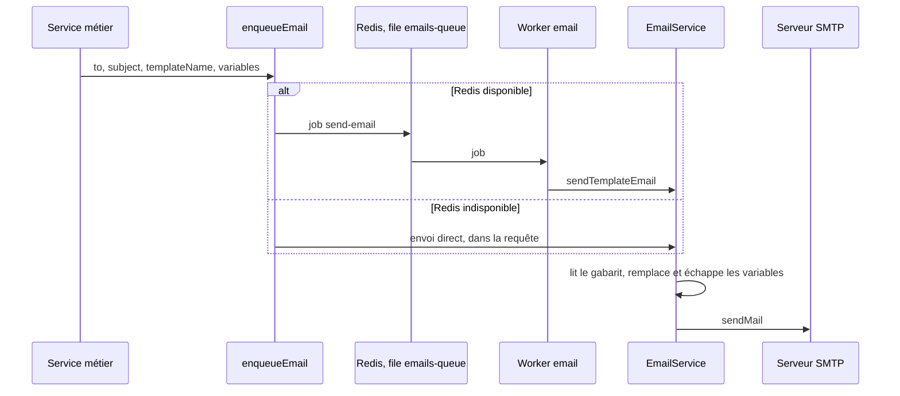

# Ajouter un email

Le backend envoie six emails transactionnels : code de connexion, d'inscription, de réinitialisation du mot de passe ou de 2FA (`otp-code`), alerte de sécurité (`security-alert`), bienvenue (`welcome`), code promo d'une récompense (`reward-claim`), confirmation de suppression RGPD (`gdpr-deletion`) et décision de la Mairie sur la vérification d'âge (`identity-decision`). Ce guide en ajoute un septième, `ticket-gift`, qui prévient le destinataire d'un ticket offert. Aujourd'hui, `POST /api/v1/lottery/gift` crée si besoin le compte du destinataire et achète le ticket pour lui, mais ne lui écrit pas.

## Fichiers à toucher

| Fichier | Modification |
| --- | --- |
| `backend/src/templates/emails/ticket-gift.html` | Gabarit HTML |
| [`backend/src/services/email.service.ts`](src:backend/src/services/email.service.ts) | Nom du gabarit dans le type `EmailTemplateName` |
| [`backend/src/api/lottery/lottery.services.ts`](src:backend/src/api/lottery/lottery.services.ts) | Mise en file de l'envoi après l'achat |
| [`backend/__tests__/api/lottery.test.ts`](src:backend/__tests__/api/lottery.test.ts) | Test |
| [Registre des traitements](../juridique/registre-traitements.md) | Nouvelle finalité d'usage de l'email, si c'est le cas |

## Chemin d'un email



| Élément | Fichier | Comportement |
| --- | --- | --- |
| Mise en file | [`queues/emails.queue.ts`](src:backend/src/queues/emails.queue.ts) | Job `send-email` dans la file BullMQ `emails-queue`. Sans Redis, envoi immédiat dans le processus appelant |
| Options des jobs | [`queues/queue.options.ts`](src:backend/src/queues/queue.options.ts) | 5 tentatives, attente exponentielle à partir d'1 s avec gigue, jobs terminés gardés 24 h, jobs en échec 14 jours |
| Worker | [`workers/email.worker.ts`](src:backend/src/workers/email.worker.ts) | Concurrence `WORKER_CONCURRENCY` (5). Un job sans destinataire ou sans gabarit échoue définitivement (`UnrecoverableError`) |
| Rendu et envoi | [`services/email.service.ts`](src:backend/src/services/email.service.ts) | Lit `templates/emails/<nom>.html`, remplace chaque `{{CLE}}`, envoie avec `SMTP_FROM` |
| Transport | [`config/mailer.config.ts`](src:backend/src/config/mailer.config.ts) | `SMTP_HOST`, `SMTP_PORT` (TLS direct si 465), authentification si `SMTP_USER` est renseigné |

En développement, Mailpit reçoit tous les emails sur le port 1025 et les affiche sur `http://localhost:8025`. En `NODE_ENV=test`, `sendTemplateEmail` renvoie `true` sans rien envoyer.

> [!WARNING]
> `sendTemplateEmail` intercepte une erreur SMTP, la journalise en avertissement et renvoie `false` au lieu de lever une exception. Le worker ne regarde pas cette valeur : un job dont l'envoi a échoué est marqué terminé, et les 5 tentatives prévues par `queue.options.ts` ne servent jamais. Pour qu'un email important soit réessayé, le worker doit lever une erreur quand `sendTemplateEmail` renvoie `false`.

## 1. Écrire le gabarit

Créer `backend/src/templates/emails/ticket-gift.html`, sur le modèle de [`welcome.html`](src:backend/src/templates/emails/welcome.html) :

```text
<!DOCTYPE html>
<html lang="fr">
<head>
  <meta charset="UTF-8" />
  <title>Un ticket vous a été offert - BlockLucky</title>
</head>
<body style="font-family: 'Inter', Arial, sans-serif; background-color: #f4f4f9; margin: 0; padding: 24px;">
  <div style="max-width: 560px; margin: 0 auto; background: #ffffff; border-radius: 12px; padding: 32px;">
    <h2 style="color: #4a154b; margin-top: 0;">Un ticket de la Grande Loterie vous attend</h2>
    <p style="color: #555555; font-size: 15px;">Un habitant d'EtherBay vous a offert un ticket pour le tour n°{{ROUND_ID}}.</p>
    <p style="color: #555555; font-size: 15px;">Il est déjà inscrit sur votre portefeuille BlockLucky <code>{{WALLET_ADDRESS}}</code>.</p>
    <p style="margin: 24px 0;">
      <a href="{{LOGIN_URL}}" style="background-color: #1d2637; color: #ffffff; padding: 12px 24px; text-decoration: none; border-radius: 8px;">Voir mon ticket</a>
    </p>
    <p style="color: #777777; font-size: 13px;">Les ethers utilisés sont fictifs et n'ont aucune valeur. Participation réservée aux personnes majeures.</p>
  </div>
</body>
</html>
```

| Règle | Raison |
| --- | --- |
| Styles en ligne (`style="..."`), pas de feuille de style ni de `<style>` | Beaucoup de clients de messagerie ignorent les feuilles de style |
| Aucune image distante ni script | Les clients les bloquent, et une image distante sert de mouchard d'ouverture |
| Variables en `{{MAJUSCULES}}` | Format reconnu par `loadTemplate` |
| Pas de HTML dans une variable | Chaque valeur est échappée (`&`, `<`, `>`, `"`, `'`) avant insertion : un lien passé en variable s'afficherait en texte |
| Texte en français, sans émoji | Charte du projet |

Une variable fournie mais absente du gabarit est ignorée ; une variable du gabarit non fournie reste affichée telle quelle (`{{ROUND_ID}}`). Si le fichier est introuvable, le service journalise un avertissement et envoie à la place le JSON des variables dans un paragraphe : vérifier le nom du fichier.

> [!NOTE]
> Les gabarits existants utilisent encore un violet `#4a154b` qui n'est pas celui de la charte BlockLucky, commune au web et au mobile (encre `#1D2637`, jaune `#FFDA38`). Un nouveau gabarit peut utiliser l'encre pour ses boutons, comme ci-dessus.

## 2. Déclarer le gabarit

Dans [`email.service.ts`](src:backend/src/services/email.service.ts), ajouter le nom au type union. TypeScript refuse ensuite toute faute de frappe dans `templateName` :

```typescript
export type EmailTemplateName =
  | 'otp-code'
  | 'gdpr-deletion'
  | 'reward-claim'
  | 'welcome'
  | 'security-alert'
  | 'identity-decision'
  | 'ticket-gift';
```

Une méthode dédiée (`sendTicketGiftEmail`) n'est pas nécessaire : les services métier appellent tous `enqueueEmail`, et les méthodes `send*Email` existantes ne sont utilisées par aucun service.

## 3. Mettre l'envoi en file

Dans [`lottery.services.ts`](src:backend/src/api/lottery/lottery.services.ts), à la fin de `giftOnchain`, après l'achat sur la chaîne :

```typescript
await enqueueEmail({
  to: emailLower,
  subject: 'Un ticket de la Grande Loterie vous a été offert - BlockLucky',
  templateName: 'ticket-gift',
  variables: {
    ROUND_ID: String(purchase.contractRoundId),
    WALLET_ADDRESS: recipient.walletAddress,
    LOGIN_URL: `${env.FRONTEND_URL}/connexion`,
  },
});
```

avec les imports correspondants en tête du fichier :

```typescript
import { enqueueEmail } from '../../queues/emails.queue';
import { env } from '../../config/env.config';
```

| Règle | Raison |
| --- | --- |
| Toujours `enqueueEmail`, jamais `transporter.sendMail` dans un service | La requête HTTP ne dépend pas du SMTP, l'envoi est réessayable et compté dans `queue_jobs_total` |
| Mettre en file après l'action réussie | Pas d'email pour un achat qui a échoué |
| URL construites à partir de `FRONTEND_URL` | Le lien suit l'environnement, comme pour l'email RGPD |
| Toutes les variables en chaînes | `variables` est un `Record<string, string>` |
| Sujet en français, sans majuscules abusives ni point d'exclamation multiple | Les filtres anti-indésirables pénalisent ces formes |

## 4. Tester

Les tests d'API tournent en `NODE_ENV=test` : aucun email n'est envoyé, mais le gabarit est tout de même lu. Le test vérifie que la mise en file a lieu avec les bonnes données en espionnant `enqueueEmail` :

```typescript
import * as emailsQueue from '../../src/queues/emails.queue';

it('enqueues a ticket-gift email for the recipient', async () => {
  const spy = jest.spyOn(emailsQueue, 'enqueueEmail').mockResolvedValue({ queued: true });

  await request(app)
    .post('/api/lottery/gift')
    .set('Authorization', `Bearer ${userToken}`)
    .send({ recipientEmail: 'ami@etherbay.fr' });

  expect(spy).toHaveBeenCalledWith(expect.objectContaining({ to: 'ami@etherbay.fr', templateName: 'ticket-gift' }));
  spy.mockRestore();
});
```

Ce test ne passe qu'en mode `onchain`, puisque l'envoi est ajouté à `giftOnchain`. Les tests d'API tournent en mode simulé ([`setup-env.ts`](src:backend/__tests__/setup-env.ts)) : pour les deux modes, ajouter le même appel dans la branche simulée de `giftTicketToFriend`, ou placer l'appel dans `giftTicketToFriend` après les deux branches.

Vérifier ensuite le rendu réel :

1. `docker compose up -d --wait` pour Mailpit et la blockchain locale ;
2. `npm run dev` dans `backend/` ;
3. offrir un ticket depuis le frontend web (Billetterie, « Offrir un ticket ») ;
4. ouvrir `http://localhost:8025` et contrôler l'email, y compris en version texte et sur mobile (onglets de Mailpit).

## 5. Build et déploiement

Les gabarits ne sont pas du TypeScript : `tsc` ne les copie pas. Le script `compile` de [`backend/package.json`](src:backend/package.json) les recopie dans `dist/src/templates` après la compilation, et l'image Docker utilise ce script. Un gabarit placé ailleurs que dans `src/templates/emails/` serait absent en production.

```bash
npm run compile
ls dist/src/templates/emails
```

## 6. Données personnelles

Un email ajouté peut être une nouvelle finalité de traitement de l'adresse du citoyen. Ici, l'adresse du destinataire est fournie par l'expéditeur, sans consentement préalable du destinataire : le message doit rester strictement informatif et lié à l'action. À vérifier avec le [Registre des traitements](../juridique/registre-traitements.md) et la page [RGPD](../juridique/rgpd.md) :

| Question | Réponse attendue |
| --- | --- |
| Finalité | Informer du ticket offert |
| Base légale | Exécution du service demandé par l'expéditeur, intérêt légitime pour le destinataire |
| Contenu | Aucune donnée sur l'expéditeur au-delà du nécessaire |
| Journaux | Adresse masquée par `maskEmail` dans les journaux du service. Le repli sans Redis d'`enqueueEmail` journalise encore l'adresse en clair au niveau `debug` |

## Liste de contrôle

- [ ] Gabarit dans `src/templates/emails/`, styles en ligne, variables en `{{MAJUSCULES}}`.
- [ ] Nom ajouté à `EmailTemplateName`.
- [ ] Envoi par `enqueueEmail` après l'action réussie.
- [ ] Test de mise en file.
- [ ] Rendu vérifié dans Mailpit.
- [ ] `npm run compile` copie bien le gabarit.
- [ ] Registre des traitements à jour si besoin.
