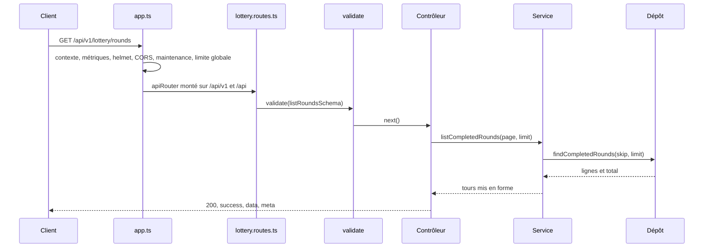

# Ajouter un endpoint

Ce guide ajoute une route à l'API en suivant le découpage de tous les modules de [`backend/src/api/`](src:backend/src/api/) : validateur, dépôt, service, contrôleur, route, test. L'exemple est une route publique qui liste les tours terminés, pour que le jury puisse consulter l'historique des tirages sans compte :

```http
GET /api/v1/lottery/rounds?page=1&limit=10
```

Cette route n'existe pas dans le code actuel : elle sert de fil rouge aux guides [Ajouter une page web](ajouter-page-web.md) et [Ajouter un écran mobile](ajouter-ecran-mobile.md).

## Fichiers à toucher

| Fichier | Modification |
| --- | --- |
| [`backend/src/api/lottery/lottery.validators.ts`](src:backend/src/api/lottery/lottery.validators.ts) | Schéma Zod des paramètres |
| [`backend/src/api/lottery/lottery.repo.ts`](src:backend/src/api/lottery/lottery.repo.ts) | Requête Prisma |
| [`backend/src/api/lottery/lottery.services.ts`](src:backend/src/api/lottery/lottery.services.ts) | Mise en forme métier |
| [`backend/src/api/lottery/lottery.controllers.ts`](src:backend/src/api/lottery/lottery.controllers.ts) | Lecture de la requête et réponse |
| [`backend/src/api/lottery/lottery.routes.ts`](src:backend/src/api/lottery/lottery.routes.ts) | Déclaration de la route, middlewares, bloc `@openapi` |
| [`backend/__tests__/api/lottery.test.ts`](src:backend/__tests__/api/lottery.test.ts) | Test d'API |
| [`backend/__tests__/__mocks__/prisma.mock.ts`](src:backend/__tests__/__mocks__/prisma.mock.ts) | Méthodes Prisma manquantes dans la doublure |

Pour un nouveau domaine, et non une route de plus dans un domaine existant, il faut en plus créer le dossier `backend/src/api/<domaine>/` avec ses cinq fichiers, le monter dans [`backend/src/app.ts`](src:backend/src/app.ts) (`apiRouter.use('/<domaine>', <domaine>Routes)`) et ajouter son libellé dans [`documentation-officielle/content/_data/modules-api.json`](src:documentation-officielle/content/_data/modules-api.json).

## Chemin d'une requête



Les middlewares globaux de [`app.ts`](src:backend/src/app.ts) s'appliquent sans rien faire : identifiant de requête, métriques HTTP, en-têtes `helmet`, CORS, mode maintenance, limite de débit globale. La route est servie sous `/api/v1` et, pour compatibilité, sous `/api`.

## 1. Valider l'entrée

Dans [`lottery.validators.ts`](src:backend/src/api/lottery/lottery.validators.ts), le schéma décrit l'objet `{ body, query, params }` que reçoit `validate` :

```typescript
export const listRoundsSchema = z.object({
  query: z.object({
    page: z.coerce.number().int().min(1).max(10000).optional(),
    limit: z.coerce.number().int().min(1).max(50).optional(),
  }),
});
```

> [!IMPORTANT]
> [`validate.middleware.ts`](src:backend/src/middlewares/validate.middleware.ts) refuse la requête si `query` ou `params` sont invalides, mais ne remplace que `req.body` par la valeur transformée : avec Express 5, `req.query` est en lecture seule. Le contrôleur doit donc convertir lui-même les paramètres de requête, ce que fait `getPaginationParams`.

Toute valeur venant du client passe par un schéma : longueur maximale des chaînes, bornes des nombres, formats (`uuid()`, `email()`, expressions régulières d'adresse `0x...`). Un schéma trop permissif est la première cause de faille d'une API.

## 2. Lire la base

Dans [`lottery.repo.ts`](src:backend/src/api/lottery/lottery.repo.ts), une méthode de la classe `LotteryRepository` :

```typescript
public async findCompletedRounds(skip: number, take: number) {
  const where = { status: 'COMPLETED' as const };
  const [rounds, total] = await Promise.all([
    prisma.lotteryRound.findMany({
      where,
      orderBy: { contractRoundId: 'desc' },
      skip,
      take,
      select: {
        id: true,
        contractRoundId: true,
        winnerWallet: true,
        winningTicket: true,
        prizeWei: true,
        chainlinkRequestId: true,
        drawnAt: true,
        prizeClaimedAt: true,
        _count: { select: { tickets: true } },
      },
    }),
    prisma.lotteryRound.count({ where }),
  ]);
  return { rounds, total };
}
```

| Règle | Raison |
| --- | --- |
| `select` explicite | Ne jamais renvoyer une colonne sensible par accident, et ne lire que le nécessaire |
| `skip` et `take` toujours bornés | Une route sans pagination finit par renvoyer toute une table |
| Tri sur une colonne indexée | `contractRoundId` est unique, donc indexé |

## 3. Mettre en forme

Dans [`lottery.services.ts`](src:backend/src/api/lottery/lottery.services.ts), la méthode transforme les lignes en objets de réponse. L'adresse du gagnant est anonymisée avec `anonymizeWallet`, déjà utilisé par le classement, et les montants en wei sont convertis avec `formatEther` :

```typescript
public async listCompletedRounds(page: number, limit: number) {
  const { rounds, total } = await lotteryRepository.findCompletedRounds((page - 1) * limit, limit);
  return {
    total,
    rounds: rounds.map((round) => ({
      contractRoundId: round.contractRoundId,
      winner: round.winnerWallet ? anonymizeWallet(round.winnerWallet) : null,
      winningTicket: round.winningTicket,
      prizeEth: round.prizeWei ? Number(formatEther(round.prizeWei)) : null,
      ticketsCount: round._count.tickets,
      chainlinkRequestId: round.chainlinkRequestId,
      drawnAt: round.drawnAt,
      prizeClaimedAt: round.prizeClaimedAt,
    })),
  };
}
```

Une règle métier qui échoue lève une `AppError(message, statut)`. Le message est en français et destiné à l'utilisateur final :

```typescript
throw new AppError('Session de loterie introuvable', 404);
```

## 4. Répondre

Dans [`lottery.controllers.ts`](src:backend/src/api/lottery/lottery.controllers.ts), la méthode suit la forme de toutes les autres : `try`, appel du service, `sendSuccess`, et `next(error)` en cas d'échec :

```typescript
public async listRounds(req: Request, res: Response, next: NextFunction): Promise<void> {
  try {
    const { page, limit } = getPaginationParams(req.query as any, 10, 50);
    const { rounds, total } = await lotteryService.listCompletedRounds(page, limit);
    sendSuccess(res, { rounds }, 'Historique des tirages récupéré', 200, buildPaginationMeta(total, page, limit));
  } catch (error) {
    next(error);
  }
}
```

La réponse a la forme commune à toute l'API (voir [Réponses et erreurs](../backend/reponses-erreurs.md)) :

```json
{
  "success": true,
  "message": "Historique des tirages récupéré",
  "data": {
    "rounds": [
      {
        "contractRoundId": 3,
        "winner": "0x8a3f...91c2",
        "winningTicket": 2,
        "prizeEth": 0.036,
        "ticketsCount": 4,
        "chainlinkRequestId": "1",
        "drawnAt": "2026-11-11T14:32:10.000Z",
        "prizeClaimedAt": "2026-11-11T14:32:16.000Z"
      }
    ]
  },
  "meta": { "page": 1, "limit": 10, "total": 1, "totalPages": 1 }
}
```

## 5. Déclarer la route

Dans [`lottery.routes.ts`](src:backend/src/api/lottery/lottery.routes.ts), avec son bloc `@openapi`. Le `summary` est affiché par Swagger sur `/api/docs` et repris par le tableau généré de la [Référence de l'API](../backend/reference-api.md) :

```typescript
/**
 * @openapi
 * /api/lottery/rounds:
 *   get:
 *     tags: [Lottery]
 *     summary: Lister les tours terminés avec leur gagnant anonymisé et la preuve Chainlink VRF
 */
router.get('/rounds', validate(listRoundsSchema), (req, res, next) =>
  lotteryController.listRounds(req, res, next)
);
```

Les middlewares s'empilent dans cet ordre, selon le besoin :

| Middleware | Fichier | Quand l'ajouter |
| --- | --- | --- |
| `authenticate` | [`auth.middleware.ts`](src:backend/src/middlewares/auth.middleware.ts) | Route réservée aux comptes connectés. Remplit `req.user` |
| `optionalAuthenticate` | même fichier | Route publique qui personnalise sa réponse si un jeton est présent |
| `requireRoles('ADMIN')` | [`rbac.middleware.ts`](src:backend/src/middlewares/rbac.middleware.ts) | Route réservée à un rôle. Relit le rôle en base à chaque appel et exige la 2FA des administrateurs |
| `idempotency` | [`idempotency.middleware.ts`](src:backend/src/middlewares/idempotency.middleware.ts) | Toute écriture qui déplace des ethers ou des points : le client envoie `Idempotency-Key` et un rejeu renvoie la première réponse |
| `authRateLimiter` | [`rateLimiter.middleware.ts`](src:backend/src/middlewares/rateLimiter.middleware.ts) | Route sensible aux essais répétés (connexion, codes) |
| `validate(schema)` | [`validate.middleware.ts`](src:backend/src/middlewares/validate.middleware.ts) | Toujours, dès qu'il y a une entrée |

Pour une route d'administration, `router.use(authenticate, requireRoles('ADMIN'))` est déjà posé en tête de [`admin.routes.ts`](src:backend/src/api/admin/admin.routes.ts) : toute route ajoutée dans ce fichier en hérite.

> [!WARNING]
> L'ordre des routes compte. Une route `/rounds` déclarée après une route paramétrée comme `/:id` serait capturée par celle-ci. Déclarer les chemins fixes avant les chemins à paramètres.

## 6. Tester

Ajouter un cas dans [`backend/__tests__/api/lottery.test.ts`](src:backend/__tests__/api/lottery.test.ts). Le fichier simule déjà Prisma et Redis :

```typescript
it('GET /api/lottery/rounds lists completed rounds with pagination', async () => {
  await prismaMock.lotteryRound.create({
    data: { contractRoundId: 7, status: 'COMPLETED', winnerWallet: '0x1234567890abcdef1234567890abcdef12345678' },
  });

  const res = await request(app).get('/api/lottery/rounds?limit=5');

  expect(res.status).toBe(200);
  expect(res.body.meta.limit).toBe(5);
  expect(res.body.data.rounds[0].winner).not.toContain('567890abcdef');
});

it('GET /api/lottery/rounds rejects an out of range limit', async () => {
  const res = await request(app).get('/api/lottery/rounds?limit=500');
  expect(res.status).toBe(400);
});
```

La doublure de [`prisma.mock.ts`](src:backend/__tests__/__mocks__/prisma.mock.ts) n'a pas de `lotteryRound.count`, et son `findMany` ignore les filtres et ne renvoie pas `_count`. Dans l'objet `lotteryRound`, remplacer `findMany` et ajouter `count`. Sans argument, le nouveau `findMany` se comporte comme l'ancien, ce qui préserve les appels existants des modules d'administration et d'analytique :

```typescript
findMany: jest.fn(async ({ where }: any = {}) =>
  Array.from(store.lotteryRounds.values())
    .filter((r) => typeof where?.status !== 'string' || r.status === where.status)
    .map((r) => ({
      ...r,
      _count: { tickets: Array.from(store.tickets.values()).filter((t) => t.lotteryId === r.id).length },
    }))
),
count: jest.fn(async ({ where }: any = {}) =>
  Array.from(store.lotteryRounds.values()).filter(
    (r) => typeof where?.status !== 'string' || r.status === where.status
  ).length
),
```

Lancer les vérifications du backend :

```bash
cd backend
npm run typecheck
npm run lint
npm test
```

Puis appeler la route sur l'API locale :

```bash
curl -s "http://localhost:2053/api/v1/lottery/rounds?limit=5"
```

## 7. Côté clients et documentation

| Étape | Où |
| --- | --- |
| Endpoint RTK Query du frontend web | [Ajouter une page web](ajouter-page-web.md) |
| Endpoint RTK Query du mobile | [Ajouter un écran mobile](ajouter-ecran-mobile.md) |
| Référence de l'API | Rien à écrire : le tableau est régénéré par `npm run build` dans `documentation-officielle/`. Commiter le dossier `site/` régénéré |
| Page du module | Décrire la route et ses règles dans la page du module, ici [Loterie](../backend/modules/loterie.md) |
| Droits | Si la route est protégée, mettre à jour [Autorisations et matrice des droits](../securite/autorisations.md) |

## Liste de contrôle

- [ ] Schéma Zod avec bornes sur chaque champ.
- [ ] `authenticate`, `requireRoles` et `idempotency` posés si nécessaire.
- [ ] Aucune donnée personnelle non nécessaire dans la réponse.
- [ ] Erreurs métier en `AppError` avec un message en français.
- [ ] Bloc `@openapi` avec un `summary`.
- [ ] Test d'API, doublure Prisma étendue si besoin.
- [ ] Documentation régénérée.
