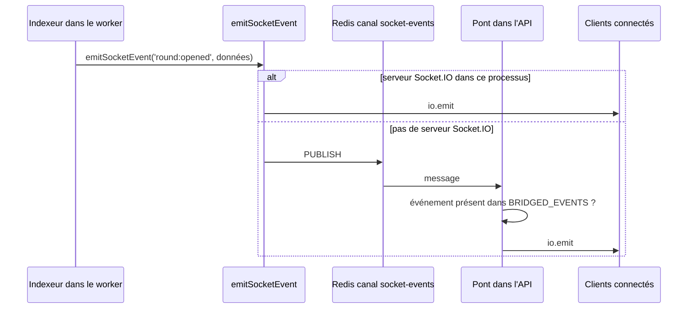

# Ajouter un événement temps réel

Le backend pousse des événements aux clients web et mobile par Socket.IO. Ce guide ajoute un événement serveur vers clients, `round:opened`, émis quand le contrat ouvre un nouveau tour : les écrans de loterie rechargent alors le statut sans attendre une action de l'utilisateur. Il décrit aussi l'ajout d'un événement client vers serveur.

Le fonctionnement général est décrit dans [Temps réel Socket.IO](../backend/socket-io.md) et [Relais temps réel](../integration-blockchain/relais-temps-reel.md).

## Fichiers à toucher

| Fichier | Modification |
| --- | --- |
| [`backend/src/types/socket.types.ts`](src:backend/src/types/socket.types.ts) | Type des données et déclaration de l'événement |
| [`backend/src/blockchain/lottery.indexer.ts`](src:backend/src/blockchain/lottery.indexer.ts) | Émission, ici dans `onRoundOpened` |
| [`backend/src/socket/event-bridge.ts`](src:backend/src/socket/event-bridge.ts) | Autorisation du relais entre processus |
| [`frontend-web/src/hooks/useSocket.ts`](src:frontend-web/src/hooks/useSocket.ts) | Écoute côté web |
| [`mobile-app/src/hooks/useSocket.ts`](src:mobile-app/src/hooks/useSocket.ts) | Écoute côté mobile |
| [`documentation-officielle/content/_data/evenements-socket.json`](src:documentation-officielle/content/_data/evenements-socket.json) | Description de l'événement |

## Comprendre le relais

L'événement peut naître dans deux processus différents. L'indexeur et le keeper tournent dans le worker (`RUN_WORKERS=false` pour l'API dans Compose), qui n'a pas de serveur Socket.IO. `emitSocketEvent` de [`event-bridge.ts`](src:backend/src/socket/event-bridge.ts) choisit le chemin :



Le canal Redis s'appelle `<REDIS_KEY_PREFIX>:<NODE_ENV>:socket-events`. Le pont de l'API ne relaie que les événements de l'ensemble `BRIDGED_EVENTS`, aujourd'hui `draw:winner` et `points:awarded`. Un événement émis par le worker et absent de cet ensemble est publié dans Redis puis ignoré, sans erreur ni journal : c'est l'oubli le plus fréquent.

En développement, avec `npm run dev`, l'API exécute aussi les workers (`RUN_WORKERS=true` par défaut) : l'émission est locale et l'oubli de `BRIDGED_EVENTS` passe inaperçu. Il n'apparaît qu'avec la stack Compose ou en production.

## 1. Déclarer l'événement

Dans [`socket.types.ts`](src:backend/src/types/socket.types.ts), ajouter le type des données et l'entrée dans `ServerToClientEvents` :

```typescript
export interface RoundOpenedEvent {
  contractRoundId: number;
  ticketPriceWei: string;
  endsAt: string;
}
```

```typescript
export interface ServerToClientEvents {
  'draw:winner': (data: LiveDrawWinnerEvent) => void;
  'round:opened': (data: RoundOpenedEvent) => void;
}
```

Seule la nouvelle ligne est à ajouter : les autres événements existants restent en place. Le nom suit la convention `domaine:action` des événements existants (`draw:winner`, `chat:message`, `points:awarded`).

Le typage est vérifié de bout en bout : `emitSocketEvent('round:opened', ...)` refuse des données qui ne correspondent pas à `RoundOpenedEvent`.

## 2. Émettre

Dans [`lottery.indexer.ts`](src:backend/src/blockchain/lottery.indexer.ts), à la fin de `onRoundOpened`, après l'écriture en base :

```typescript
emitSocketEvent('round:opened', {
  contractRoundId,
  ticketPriceWei: event.args.ticketPrice.toString(),
  endsAt: new Date(Number(event.args.endTime) * 1000).toISOString(),
});
```

| Règle | Raison |
| --- | --- |
| Émettre après l'écriture en base | Un client qui recharge l'API en recevant l'événement doit trouver la donnée à jour |
| Données minimales, sérialisables en JSON | Le message transite par Redis ; un `bigint` doit être converti en chaîne |
| Aucune donnée personnelle dans un événement diffusé à tous | `io.emit` atteint tous les clients connectés, y compris les visiteurs non connectés |
| Tolérer la perte | Socket.IO ne rejoue pas un événement manqué pendant une déconnexion : le client doit pouvoir retrouver l'état par l'API |

> [!WARNING]
> `points:awarded` est aujourd'hui diffusé à tous les clients avec l'identifiant du compte crédité ; chaque client filtre ensuite sur son propre `userId`. Pour un événement destiné à un seul utilisateur, préférer une salle par compte (`socket.join('user:<id>')` à la connexion, puis `io.to('user:<id>').emit(...)`). Ce mécanisme n'existe pas encore dans [`socket.handler.ts`](src:backend/src/socket/socket.handler.ts).

## 3. Autoriser le relais

Dans [`event-bridge.ts`](src:backend/src/socket/event-bridge.ts) :

```typescript
const BRIDGED_EVENTS: ReadonlySet<EventName> = new Set<EventName>(['draw:winner', 'points:awarded', 'round:opened']);
```

Un événement émis uniquement depuis une route de l'API, où `getSocketIo()` renvoie le serveur, n'a pas besoin d'y figurer. Dans le doute, l'ajouter.

## 4. Écouter côté web

Dans [`frontend-web/src/hooks/useSocket.ts`](src:frontend-web/src/hooks/useSocket.ts), déclarer le gestionnaire, l'abonner et le désabonner au démontage :

```typescript
const onRoundOpened = () => dispatch(baseApi.util.invalidateTags(['Lottery']));
```

```typescript
socket.on('round:opened', onRoundOpened);
```

```typescript
socket.off('round:opened', onRoundOpened);
```

Invalider l'étiquette RTK Query `Lottery` relance `GET /lottery/status` et les autres requêtes qui la fournissent : c'est le moyen le plus sûr de mettre l'écran à jour, l'événement servant de signal et l'API de source de vérité.

## 5. Écouter côté mobile

Dans [`mobile-app/src/hooks/useSocket.ts`](src:mobile-app/src/hooks/useSocket.ts), dans la fonction `setup`, à côté de `draw:winner` :

```typescript
socket.on('round:opened', () => {
  dispatch(baseApi.util.invalidateTags(['Lottery']));
});
```

> [!NOTE]
> Le hook mobile n'appelle pas `socket.off` au démontage, contrairement au hook web : chaque nouveau montage ajoute un gestionnaire de plus sur le même socket. Pour un événement qui ne fait qu'invalider une étiquette, l'effet reste invisible, mais un gestionnaire qui affiche une notification la montrerait plusieurs fois. Corriger le nettoyage du hook avant d'y ajouter ce type de gestionnaire.

## 6. Documenter

Ajouter la description dans [`evenements-socket.json`](src:documentation-officielle/content/_data/evenements-socket.json), sous le nom de l'événement :

```json
{
  "round:opened": "Émis par l'indexeur quand le contrat ouvre un nouveau tour (événement RoundOpened). Les clients rechargent le statut de la loterie."
}
```

Le tableau de [Temps réel Socket.IO](../backend/socket-io.md) est généré depuis `socket.types.ts` : `npm run build` dans `documentation-officielle/` signale toute entrée sans description.

## 7. Vérifier

```bash
cd backend
npm run typecheck
npm run lint
npm test
```

Pour observer l'événement, lancer la stack locale, ouvrir la page `/tirage` du frontend web avec les outils de développement du navigateur (onglet Réseau, filtre WS, connexion `socket.io`), puis provoquer l'ouverture d'un tour : un tirage terminé ou l'annulation d'un tour expiré ouvre le suivant (voir [Préparer la soutenance](soutenance.md#5-faire-passer-le-temps-sur-la-chaine)). Le message `["round:opened",{...}]` apparaît dans le flux.

Tester ensuite avec la stack Compose (`docker compose --profile app up -d --build --wait`), où l'API et le worker sont séparés, pour vérifier le relais Redis.

## Événement client vers serveur

Le sens inverse suit le même principe, avec trois différences :

1. déclarer l'événement dans `ClientToServerEvents` de [`socket.types.ts`](src:backend/src/types/socket.types.ts) ;
2. écrire le gestionnaire dans un fichier de [`backend/src/socket/events/`](src:backend/src/socket/events/), sur le modèle de [`chat.events.ts`](src:backend/src/socket/events/chat.events.ts), et l'enregistrer dans la fonction `connection` de [`socket.handler.ts`](src:backend/src/socket/socket.handler.ts) ;
3. valider les données reçues dans le gestionnaire : elles viennent du client et ne passent par aucun middleware Zod.

```typescript
socket.on('draw:react', (payload: unknown) => {
  if (typeof payload !== 'string' || payload.length === 0) return;
  io.emit('chat:reaction', {
    emoji: payload.slice(0, 8),
    senderWallet: anonymizeWallet(socket.user?.walletAddress ?? ''),
  });
});
```

Avec, dans `ClientToServerEvents`, la déclaration `'draw:react': (emoji: string) => void;`. Pour viser seulement les participants d'un tour, émettre vers la salle `draw:<roundId>` que rejoignent les clients avec `draw:join` ([`live-draw.events.ts`](src:backend/src/socket/events/live-draw.events.ts)) : `` io.to(`draw:${roundId}`).emit(...) ``.

| Point de sécurité | Détail |
| --- | --- |
| Identité | `socket.user` est rempli par [`socket.middleware.ts`](src:backend/src/socket/socket.middleware.ts) à partir du jeton de session. Sans jeton, la connexion est acceptée comme invité (`guest-<id>`, rôle `USER`) : vérifier `socket.user?.userId.startsWith('guest-')` si l'action exige un compte |
| Type des données | Toujours tester le type avant d'appeler une méthode : `chat:react` appelle aujourd'hui `emoji.slice` sans vérifier que `emoji` est une chaîne |
| Volume | Pas de limitation de débit sur les événements Socket.IO : borner la taille des messages et ne jamais déclencher d'écriture en base ou de transaction à chaque message |
| Droits | Une action d'administration ne passe pas par Socket.IO : elle reste une route REST protégée par `requireRoles` |

## Liste de contrôle

- [ ] Type des données et entrée dans `ServerToClientEvents` ou `ClientToServerEvents`.
- [ ] Émission après l'écriture en base, données sans information personnelle.
- [ ] Nom ajouté à `BRIDGED_EVENTS` si l'émission peut venir du worker.
- [ ] Abonnement et désabonnement côté web, abonnement côté mobile.
- [ ] Description dans `evenements-socket.json`.
- [ ] Vérifié avec la stack Compose, API et worker séparés.
