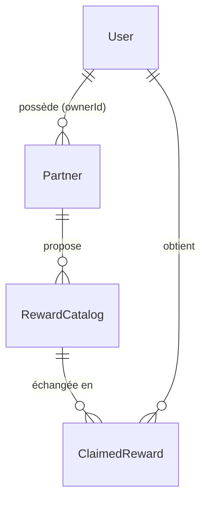
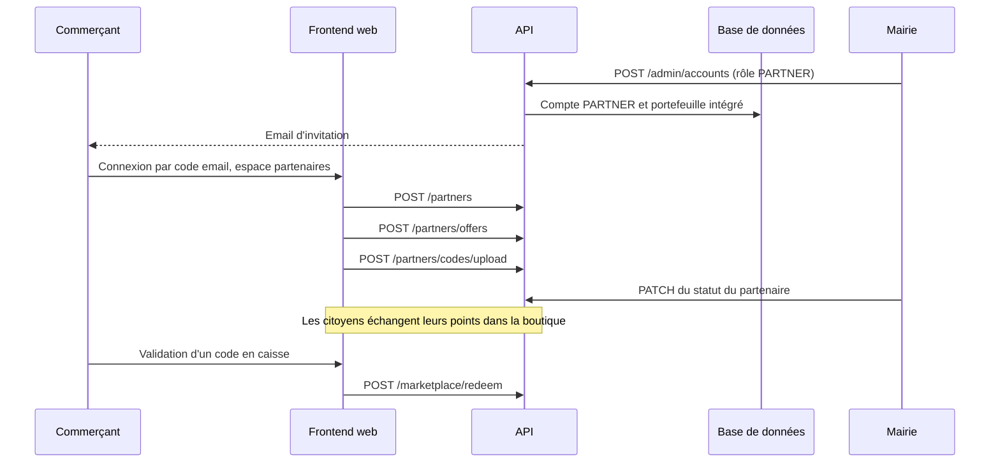

# Ajouter un commerçant partenaire

Un commerçant partenaire propose des offres que les citoyens obtiennent en échange de leurs EtherPoints : réduction, produit offert, place gratuite. Ce guide fait entrer un nouveau commerce, de la création de son compte jusqu'à la validation d'un code en caisse, puis le fait apparaître sur le site de l'Office de Tourisme. L'exemple est la « Librairie du Môle », qui offre 20 % sur les romans contre 120 EtherPoints.

Le fonctionnement du module est décrit dans [Partenaires](../backend/modules/partenaires.md) et [Échange de récompense](../architecture/flux/recompense.md).

## Modèle de données



| Élément | Stockage | Règle |
| --- | --- | --- |
| Compte du commerçant | `User` avec `role = 'PARTNER'` | Seuls les rôles `PARTNER` et `ADMIN` accèdent à l'espace partenaires et aux routes `/api/partners` d'écriture |
| Entreprise | `Partner` : `name`, `logoUrl`, `isActive`, `ownerId` | Un compte `PARTNER` ne gère que les entreprises dont il est propriétaire (`assertPartnerAccess` de [`partners.services.ts`](src:backend/src/api/partners/partners.services.ts)) |
| Offre | `RewardCatalog` : `title`, `costInPoints`, `totalStock`, `remainingStock`, `isActive` | Visible dans la boutique si l'offre **et** l'entreprise sont actives |
| Date d'expiration de l'offre | Redis, clé `partner:offer_expiry:<offre>` | Enregistrée à la création, mais lue nulle part : elle n'est pas appliquée à ce jour |
| Codes promo fournis par le commerçant | Redis, clé `partner:codes:<offre>`, tableau JSON | Distribués un par un à chaque échange ; sans lot, un code est généré |
| Code obtenu par un citoyen | `ClaimedReward` : `uniqueCode`, `isUsed` | Marqué utilisé lors de la validation en caisse |

## Fichiers concernés

| Fichier | Rôle |
| --- | --- |
| [`backend/src/api/partners/`](src:backend/src/api/partners/) | Création d'entreprise, d'offre, import de codes, statistiques |
| [`backend/src/api/admin/admin.routes.ts`](src:backend/src/api/admin/admin.routes.ts) | Activation et suspension d'une entreprise par la Mairie |
| [`backend/src/api/marketplace/`](src:backend/src/api/marketplace/) | Catalogue, échange, validation en caisse |
| [`frontend-web/src/app/partenaire/`](src:frontend-web/src/app/partenaire/) | Espace partenaires : tableau de bord, offres, codes, validation |
| [`frontend-web/src/app/mairie/partenaires/page.tsx`](src:frontend-web/src/app/mairie/partenaires/page.tsx) | Liste des partenaires et activation par la Mairie |
| [`backend/prisma/seed.ts`](src:backend/prisma/seed.ts) | Partenaires de démonstration |
| [`frontend-office-tourisme/assets/js/data/places.js`](src:frontend-office-tourisme/assets/js/data/places.js) | Fiche du commerce sur le site de l'Office de Tourisme |

## Parcours



## 1. Créer le compte du commerçant

Un administrateur ouvre la page `/mairie/comptes` du frontend web ([`frontend-web/src/app/mairie/comptes/page.tsx`](src:frontend-web/src/app/mairie/comptes/page.tsx)), choisit « Créer un compte », saisit l'adresse email du commerçant, éventuellement son prénom et son nom, le rôle « Partenaire » et, si l'entreprise existe déjà sans propriétaire, l'établissement à lui rattacher. La page appelle `POST /api/v1/admin/accounts` ([`admin.services.ts`](src:backend/src/api/admin/admin.services.ts), `createStaffAccount`) :

| Situation | Effet |
|---|---|
| Adresse inconnue | Compte `PARTNER` créé avec un portefeuille intégré, sans mot de passe ; réponse 201 et action `STAFF_ACCOUNT_CREATED` au journal d'audit |
| Compte existant d'un autre rôle | Rôle remplacé par `PARTNER`, sessions du compte révoquées ; réponse 200 et action `STAFF_ROLE_CHANGED` |
| Compte qui a déjà ce rôle, compte supprimé ou son propre compte | Refus 409 ou 403 |
| Établissement déjà rattaché à un autre partenaire | Refus 409 |

Dans les deux premiers cas, le commerçant reçoit l'email `staff-invitation` : sur le web, il se connecte sur `/connexion` avec son adresse et le code reçu par email ; sur le mobile, il définit un mot de passe par « Mot de passe oublié ». En local, les emails arrivent dans Mailpit (`http://localhost:8025`).

## 2. Changer ou retirer le rôle

Sur la même page, le menu d'un compte appelle `PATCH /api/v1/admin/accounts/{id}/role` avec `USER`, `PARTNER` ou `ADMIN`. Repasser un partenaire en `USER` détache ses établissements (`ownerId` remis à vide) et inscrit `STAFF_ROLE_REVOKED` au journal, avec les identifiants détachés. Un administrateur ne peut pas modifier son propre rôle, et le dernier compte Mairie ne peut pas perdre le sien (409).

Chaque changement révoque les sessions du compte. Un jeton émis avant serait de toute façon refusé : `requireRoles` relit le rôle en base à chaque requête et répond 403 « Droits révoqués ou modifiés : reconnectez-vous » tant que le jeton et la base diffèrent.

## 3. Créer l'entreprise et son offre

Depuis l'espace partenaires (`/partenaire/offres`), le commerçant crée son entreprise puis son offre. Les appels équivalents, avec le jeton de session du commerçant :

```bash
curl -s -X POST http://localhost:2053/api/v1/partners \
  -H "Authorization: Bearer $TOKEN" -H "Content-Type: application/json" \
  -d '{"name":"Librairie du Môle","logoUrl":"https://assets.etherbay.fr/partners/librairie.png"}'
```

```bash
curl -s -X POST http://localhost:2053/api/v1/partners/offers \
  -H "Authorization: Bearer $TOKEN" -H "Content-Type: application/json" \
  -d '{"partnerId":"<id renvoyé>","title":"-20% sur tous les romans","costInPoints":120,"totalStock":50}'
```

Règles de validation ([`partners.validators.ts`](src:backend/src/api/partners/partners.validators.ts)) :

| Champ | Contrainte |
| --- | --- |
| `name` | 2 à 100 caractères |
| `logoUrl` | URL en `https://`, 500 caractères au plus ; par défaut `https://assets.etherbay.fr/partners/default.png` |
| `ownerId` | UUID, pris en compte seulement si l'appelant est `ADMIN` ; pour un `PARTNER`, le propriétaire est toujours lui-même |
| `title` | 3 à 120 caractères |
| `costInPoints` | entier de 10 à 100 000 |
| `totalStock` | entier de 1 à 100 000 |
| `expiresAt` | date ISO avec fuseau, facultative (non appliquée, voir plus haut) |

L'entreprise est créée active (`isActive: true`) : elle apparaît tout de suite dans la boutique. Pour un contrôle préalable par la Mairie, la suspendre dès sa création (étape 5).

Un administrateur peut créer l'entreprise pour le compte d'un commerçant en passant `ownerId` : c'est le seul moyen de rattacher une entreprise à un autre compte que le sien.

## 4. Importer les codes promo du commerçant

Si le commerçant a ses propres codes (ceux de sa caisse), il les importe sur `/partenaire/codes`, en fichier CSV ou en liste :

```bash
curl -s -X POST http://localhost:2053/api/v1/partners/codes/upload \
  -H "Authorization: Bearer $TOKEN" -H "Content-Type: application/json" \
  -d '{"rewardId":"<id de l offre>","csvContent":"LIB-0001\nLIB-0002\nLIB-0003"}'
```

| Comportement | Détail |
| --- | --- |
| Séparateurs acceptés | retours à la ligne, virgules, points-virgules |
| Filtrage | codes de moins de 3 caractères et en-tête `code` ignorés, doublons retirés |
| Limites | 5 000 codes par liste, 200 000 caractères de CSV |
| Effet sur le stock | `totalStock` et `remainingStock` augmentent du nombre de codes importés |
| Sans import | chaque échange génère un code à partir des premières lettres du nom du partenaire |

Le stock initial saisi à la création de l'offre s'ajoute donc aux codes importés. Une offre créée avec `totalStock: 50` puis alimentée de 50 codes affiche un stock de 100, dont 50 seulement correspondent à des codes du commerçant ; les 50 autres échanges recevront un code généré. Pour une offre fondée uniquement sur des codes importés, créer l'offre avec un stock de 1, puis importer les codes.

## 5. Activer ou suspendre l'entreprise

Sur `/mairie/partenaires`, un administrateur active ou suspend l'entreprise. L'appel `PATCH /api/v1/admin/partners/{partnerId}/status` avec `{"isActive": false}` est enregistré dans le journal d'audit (`PARTNER_SUSPENDED` ou `PARTNER_APPROVED`). Une entreprise suspendue disparaît du catalogue, ses offres comprises ; les codes déjà obtenus restent valables en caisse.

## 6. Valider un code en caisse

Le citoyen présente son code (ou son QR code) ; le commerçant le saisit sur `/partenaire/validation`, qui appelle `POST /api/v1/marketplace/redeem` avec `{"uniqueCode": "..."}`. Le code est marqué utilisé. Un code d'un autre partenaire répond « Code promo introuvable », comme un code inexistant, pour ne pas révéler l'existence des codes des autres commerces.

Le tableau de bord `/partenaire` affiche les statistiques de consommation (`GET /api/v1/partners/{partnerId}/consumption`) : stock, codes réclamés, codes utilisés en caisse, taux de consommation par offre.

## 7. Ajouter le partenaire aux données de démonstration

Pour qu'un partenaire existe sur chaque poste de développement, l'ajouter à [`backend/prisma/seed.ts`](src:backend/prisma/seed.ts), sur le modèle de la boulangerie et du cinéma :

```typescript
const librairie = await prisma.partner.create({
  data: {
    name: 'Librairie du Môle',
    logoUrl: 'https://assets.etherbay.fr/partners/librairie.png',
    isActive: true,
    ownerId: partnerUser.id,
    rewards: {
      create: [{ title: '-20% sur tous les romans', costInPoints: 120, totalStock: 50, remainingStock: 50, isActive: true }],
    },
  },
});
```

Ajouter aussi `librairie.name` au tableau `partners` du `console.log` final.

> [!WARNING]
> Le seed crée les utilisateurs avec `upsert`, mais les partenaires avec `create` : relancer `npm run prisma:seed` sur une base déjà peuplée duplique tous les partenaires et leurs offres. Pour repartir de zéro en local : `docker compose down -v`, puis `docker compose up -d --wait`, `npm run prisma:deploy` et `npm run prisma:seed`. Le seed ne doit jamais être lancé en production.

## 8. Faire apparaître le commerce sur le site de l'Office de Tourisme

Le site touristique n'interroge pas l'API : le commerce y est ajouté à la main dans [`places.js`](src:frontend-office-tourisme/assets/js/data/places.js), avec le libellé « Partenaire EtherPoints » et le texte de l'offre :

```javascript
place({ id: 'librairie-du-mole', name: 'Librairie du Môle', type: 'Librairie', universe: 'decouvrir', district: 'Le Môle', address: '5, jetée du Môle', access: ['Centre-ville'], days: ['Mardi', 'Mercredi', 'Jeudi', 'Vendredi', 'Samedi'], hours: ['Midi'], public: ['Tout public'], labels: ['Partenaire EtherPoints'], price: 'Entrée libre', partnerOffer: '-20 % sur tous les romans contre 120 EtherPoints', description: 'Exemple de librairie partenaire.' }),
```

Dans `LIEUX`, le commerce apparaît sur la page Découvrir. Dans `RESTAURANTS`, il apparaîtrait sur la page Manger et dans le bon plan « Les partenaires EtherPoints ». Déposer la photo `assets/img/photos/librairie-du-mole.jpg` (voir [Contenus](../office-tourisme/contenus.md#partenaires-etherpoints)). Le texte de l'offre doit être tenu à jour à la main : rien ne le synchronise avec la base.

## Liste de contrôle

- [ ] Compte `PARTNER` créé ou rôle attribué depuis `/mairie/comptes`, invitation reçue.
- [ ] Première connexion du commerçant faite.
- [ ] Entreprise et offre créées, logo en HTTPS.
- [ ] Codes importés si le commerçant en fournit, stock vérifié.
- [ ] Entreprise activée par la Mairie, visible dans la boutique.
- [ ] Un échange et une validation en caisse testés de bout en bout.
- [ ] Seed et site de l'Office de Tourisme mis à jour si le partenaire fait partie de la démonstration.
