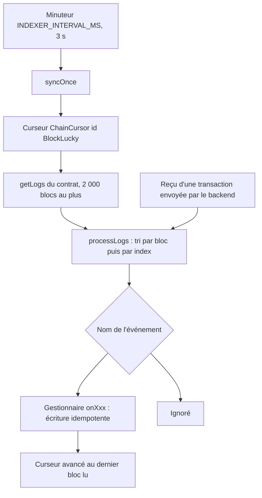

# Indexer un nouvel événement

Le backend ne lit pas l'historique du contrat à chaque requête : l'indexeur ([`backend/src/blockchain/lottery.indexer.ts`](src:backend/src/blockchain/lottery.indexer.ts)) recopie les événements du contrat dans PostgreSQL, et l'API sert ensuite la base. Un événement que l'indexeur ne traite pas n'existe pas pour l'API, les écrans ni les statistiques.

L'indexeur traite aujourd'hui six événements de `BlockLucky` : `RoundOpened`, `TicketsPurchased`, `DrawRequested`, `WinnerPicked`, `PrizeClaimed` et `RoundCancelled`. Cinq autres sont émis par le contrat mais ignorés : `RefundClaimed`, `FeesWithdrawn`, `TreasuryUpdated`, `RoundConfigUpdated` et `VrfConfigUpdated`. Aucun événement de `BlockLuckyPOAP` n'est indexé.

Ce guide indexe `RefundClaimed` dans la table `Refund` créée par le guide [Ajouter une migration](ajouter-migration.md). Après l'annulation d'un tour, la base saura alors qui a été remboursé, de combien et par quelle transaction.

## Fichiers à toucher

| Fichier | Modification |
| --- | --- |
| [`backend/prisma/schema.prisma`](src:backend/prisma/schema.prisma) et une migration | Table de destination, voir [Ajouter une migration](ajouter-migration.md) |
| [`backend/src/blockchain/lottery.indexer.ts`](src:backend/src/blockchain/lottery.indexer.ts) | Gestionnaire de l'événement et entrée dans `processLogs` |
| [`backend/__tests__/chain/onchain-lottery.chain.ts`](src:backend/__tests__/chain/onchain-lottery.chain.ts) | Test sur une vraie chaîne |
| [Indexeur d'événements](../integration-blockchain/indexeur.md) | Tableau des événements traités |

Si l'événement est nouveau dans le contrat, suivre d'abord [Modifier le contrat](modifier-contrat.md) : l'ABI de [`backend/src/blockchain/abi/BlockLucky.json`](src:backend/src/blockchain/abi/BlockLucky.json) doit le contenir, sinon `parseLog` l'ignore.

## Fonctionnement de l'indexeur



| Mécanisme | Détail |
| --- | --- |
| Deux entrées | `syncOnce`, appelé toutes les `INDEXER_INTERVAL_MS` par [`lottery.keeper.ts`](src:backend/src/blockchain/lottery.keeper.ts), et `processReceipt`, appelé par la passerelle juste après chaque transaction du backend pour que l'API réponde avec des données à jour |
| Curseur | Ligne `BlockLucky` de la table `ChainCursor` : dernier bloc traité. Au premier passage, départ à `CHAIN_START_BLOCK` |
| Confirmations | Les `CHAIN_CONFIRMATIONS` derniers blocs ne sont pas lus, pour ne pas indexer un bloc réorganisé |
| Taille des lots | 2 000 blocs au plus par passage (`MAX_BLOCK_RANGE`) |
| Filtre | Seuls les journaux émis par `LOTTERY_CONTRACT_ADDRESS` sont traités |
| Ordre | Tri par numéro de bloc puis par index dans le bloc |
| Erreur | Un gestionnaire qui lève une exception interrompt le passage : le curseur n'avance pas, le lot entier est relu au passage suivant |

> [!IMPORTANT]
> Un même événement est donc presque toujours traité **deux fois** : par `processReceipt` juste après la transaction, puis par `syncOnce` quand le curseur atteint son bloc. Il peut l'être davantage après une erreur ou une réindexation. Chaque gestionnaire doit être idempotent : traiter deux fois le même événement doit laisser la base dans le même état qu'une seule fois.

## 1. Écrire le gestionnaire

Dans la classe `LotteryIndexer`, à côté de `onPrizeClaimed` :

```typescript
private async onRefundClaimed(event: LogDescription, log: Log) {
  const contractRoundId = Number(event.args.roundId);
  const round = await this.ensureRound(contractRoundId, log.blockNumber);
  try {
    await prisma.refund.create({
      data: {
        lotteryId: round.id,
        walletAddress: (event.args.player as string).toLowerCase(),
        amountWei: (event.args.amount as bigint).toString(),
        transactionHash: log.transactionHash,
        logIndex: log.index,
        refundedAt: await this.blockTime(log.blockNumber),
      },
    });
    businessEventsTotal.inc({ event: 'refund_indexed' });
  } catch (error) {
    if (!isUniqueViolation(error)) throw error;
  }
}
```

| Choix | Raison |
| --- | --- |
| Arguments lus par leur nom (`event.args.player`) | Noms de l'ABI : `RefundClaimed(uint256 indexed roundId, address indexed player, uint256 amount)` |
| Adresse en minuscules | Toutes les adresses de la base sont en minuscules ; les comparaisons se font sans conversion |
| Montant en chaîne | Un `uint256` dépasse la précision d'un nombre JavaScript et d'un `BIGINT` |
| `ensureRound` | Crée le tour en base à partir de `getRound` s'il n'a jamais été vu, par exemple après une réindexation partielle |
| `blockTime` | Date du bloc, mise en cache : la date d'un événement est celle de la chaîne, pas celle de l'indexation |
| Unicité `(transactionHash, logIndex)` et `isUniqueViolation` | Un second passage échoue sur la contrainte unique et est ignoré : c'est ce qui rend le gestionnaire idempotent |
| Métrique `business_events_total` | Compte les événements métier indexés, visible sur `/metrics` |

Un gestionnaire qui met à jour une ligne existante plutôt que d'en créer une est idempotent par nature, à condition d'écrire des valeurs absolues tirées de l'événement (`status: 'COMPLETED'`, `prizeWei`) et jamais d'incréments. L'incrément de `prizePool` de `onTicketsPurchased` n'est sûr que parce qu'il est fait dans la même transaction que la création des tickets, elle-même protégée par l'unicité `(lotteryId, ticketIndex)`.

## 2. Brancher l'événement

Dans `processLogs`, ajouter le cas au `switch` :

```typescript
case 'RefundClaimed':
  await this.onRefundClaimed(event, log);
  break;
```

## 3. Effets secondaires

Un gestionnaire peut déclencher une action, à condition qu'elle supporte elle aussi la répétition :

| Effet | Outil | Protection contre la répétition |
| --- | --- | --- |
| Créditer des EtherPoints | `ledgerService.creditPoints` | Ne créditer que si la ligne vient d'être créée, comme `onTicketsPurchased` qui renvoie tôt quand les tickets existent déjà |
| Prévenir les clients | `emitSocketEvent`, voir [Ajouter un événement temps réel](ajouter-evenement-socket.md) | Les clients doivent tolérer un doublon |
| Lancer une transaction | `enqueueChainAction` de [`chain-actions.ts`](src:backend/src/blockchain/chain-actions.ts) | Identifiant de job `<type>-<tour>-<portefeuille>` : BullMQ refuse un second job de même identifiant, et les erreurs « déjà fait » du contrat terminent le job |
| Envoyer un email | `enqueueEmail` | Aucune : n'envoyer qu'à la création de la ligne |

## 4. Tester sur une vraie chaîne

Les tests unitaires du backend simulent Prisma mais pas la chaîne : un gestionnaire d'événement se teste avec `npm run test:chain`, sur le nœud Hardhat local. Ajouter un cas dans [`onchain-lottery.chain.ts`](src:backend/__tests__/chain/onchain-lottery.chain.ts), qui réutilise ses fonctions `login` et `waitFor` :

```typescript
it('rembourse les participants d un tour annulé et indexe chaque remboursement', async () => {
  const dave = await login('dave');
  const buy = await request(app)
    .post('/api/v1/lottery/buy')
    .set('Authorization', `Bearer ${dave.token}`)
    .send({ quantity: 1 });
  expect(buy.status).toBe(201);

  const admin = await prisma.user.create({
    data: { walletAddress: `0xrefund${RUN}`, email: `refund.${RUN}@etherbay.fr`, role: 'ADMIN' },
  });
  const token = sessionService.sign({ userId: admin.id, walletAddress: admin.walletAddress, role: 'ADMIN' });
  const cancel = await request(app).post('/api/v1/lottery/refund').set('Authorization', `Bearer ${token}`).send({});
  expect(cancel.status).toBe(200);

  const refund = await waitFor(async () => {
    await lotteryIndexer.syncOnce();
    return prisma.refund.findFirst({ where: { walletAddress: dave.user.walletAddress } });
  });
  expect(BigInt(refund.amountWei)).toBeGreaterThan(0n);
});
```

Le scénario passe par tout le circuit : l'annulation émet `RoundCancelled`, l'indexeur met en file un `CLAIM_REFUND` par payeur, le worker démarré dans `beforeAll` signe `claimRefund` avec le portefeuille intégré de Dave, le contrat émet `RefundClaimed`, et l'indexeur crée la ligne.

```bash
docker compose up -d --wait
cd backend
npx prisma migrate deploy
npm run test:chain
```

## 5. Réindexer l'historique

Les événements déjà dépassés par le curseur ne repassent pas d'eux-mêmes dans le nouveau gestionnaire. Pour les traiter, ramener le curseur avant le premier bloc concerné, ici le bloc de déploiement :

```sql
UPDATE "ChainCursor" SET "lastBlock" = 41234566 WHERE "id" = 'BlockLucky';
```

Le nombre est le `deploymentBlock` de `deployments/<réseau>.json`, moins un. Supprimer la ligne fait repartir l'indexeur de `CHAIN_START_BLOCK`. Tous les gestionnaires sont rejoués : c'est sans danger parce qu'ils sont idempotents, et c'est la raison pour laquelle ils doivent le rester. La procédure complète est dans [Reconstruire depuis la chaîne](../base-de-donnees/reconstruction.md).

## Indexer un événement du contrat POAP

L'indexeur ne lit que l'adresse `LOTTERY_CONTRACT_ADDRESS`, avec l'interface de `BlockLucky`. Indexer `BadgeMinted` de `BlockLuckyPOAP` demande :

1. une interface construite sur [`abi/BlockLuckyPOAP.json`](src:backend/src/blockchain/abi/BlockLuckyPOAP.json) ;
2. un second appel `getLogs` filtré sur `POAP_CONTRACT_ADDRESS` ;
3. un second curseur, par exemple une ligne `BlockLuckyPOAP` dans `ChainCursor`, pour que les deux contrats avancent indépendamment ;
4. l'adaptation du filtre d'adresse de `processLogs`, qui écarte aujourd'hui tout journal ne venant pas du contrat de loterie.

Aujourd'hui, les badges sont lus directement sur la chaîne à la demande (`badgeOf` de [`lottery.gateway.ts`](src:backend/src/blockchain/lottery.gateway.ts)).

## Liste de contrôle

- [ ] Événement présent dans l'ABI embarquée.
- [ ] Table ou colonnes de destination créées par une migration.
- [ ] Gestionnaire idempotent : contrainte unique ou mise à jour en valeurs absolues.
- [ ] Cas ajouté dans `processLogs`.
- [ ] Effets secondaires déclenchés une seule fois.
- [ ] Test `test:chain` vert.
- [ ] Réindexation prévue si l'historique doit être repris.
- [ ] Page [Indexeur d'événements](../integration-blockchain/indexeur.md) mise à jour.
