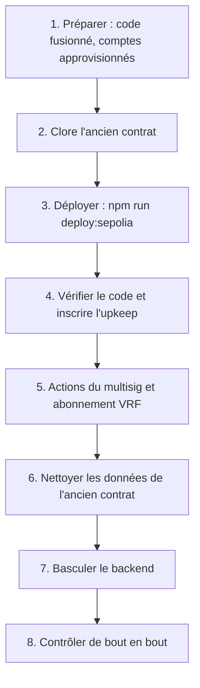

# Redéployer sur Sepolia

Ce guide remplace les contrats déployés sur Sepolia par une nouvelle version et bascule le backend dessus, sans perdre les comptes ni les portefeuilles des citoyens. Le premier déploiement, la création des comptes (déployeur, multisig de la Mairie, trésorerie, opérateur), de l'abonnement Chainlink VRF et des accès RPC sont décrits dans [Déploiement sur Sepolia](../smart-contracts/sepolia.md) ; ils sont supposés faits.

> [!NOTE]
> À la date de rédaction, aucun déploiement Sepolia n'a eu lieu : il demande les clés et les fonds de test de l'équipe, `deployments/sepolia.json` n'existe pas et la démonstration `etherbay.tech` n'est pas raccordée. Ce guide décrit la procédure telle qu'elle découle des scripts ; elle n'a pas encore été exécutée de bout en bout.

## Faut-il redéployer ?

Le contrat est immuable, mais une partie de sa configuration se change sans redéploiement, par l'administrateur (`DEFAULT_ADMIN_ROLE`), c'est-à-dire le multisig `MAIRIE_ADMIN_ADDRESS` :

| Besoin | Sans redéploiement | Fonction |
| --- | --- | --- |
| Prix du ticket, durée, plafonds, commission | oui, à partir du tour suivant | `setRoundConfig` |
| Abonnement VRF, key hash, gas de rappel, délai de relance | oui | `setVrfConfig` |
| Adresse de la trésorerie | oui | `setTreasury` |
| Opérateur du backend | oui | `grantRole` et `revokeRole` |
| Adresse de base des métadonnées POAP | oui | `setBaseUri` du contrat POAP |
| Changement du code Solidity | **non** | redéploiement |
| Clé administrateur compromise ou perdue | **non**, si plus aucun compte n'a `DEFAULT_ADMIN_ROLE` | redéploiement |
| Nouvelle édition de la loterie, repartir de zéro | non obligatoire | redéploiement si l'on veut un historique séparé |

Ces appels sont des transactions du multisig : Transaction Builder du Safe, ou onglet « Write Contract » d'Etherscan sur un contrat vérifié (voir aussi [Utiliser Remix](../smart-contracts/remix.md)). Le déployeur n'a plus aucun rôle après le déploiement et ne peut pas les faire.

## Vue d'ensemble



## 1. Préparer

| Prérequis | Vérification |
| --- | --- |
| Nouvelle version fusionnée dans `main`, CI verte | Tests, couverture à 100 %, Slither, ABI exportées (voir [Modifier le contrat](modifier-contrat.md)) |
| Secrets dans le keystore chiffré de Hardhat | `SEPOLIA_RPC_URL`, `SEPOLIA_PRIVATE_KEY` (compte qui déploie), `ETHERSCAN_API_KEY` |
| Compte qui déploie approvisionné | ETH Sepolia pour deux déploiements et les transactions de rôles ; LINK de test pour l'upkeep Automation (5 par défaut) |
| Adresses des rôles connues | `MAIRIE_ADMIN_ADDRESS` (multisig), `MAIRIE_TREASURY_ADDRESS`, `OPERATOR_ADDRESS`, et si besoin `PAUSER_ADDRESS`, `VRF_OWNER_ADDRESS` |
| Compte opérateur approvisionné | Il paiera les dotations de bienvenue, les badges et le keeper |
| Abonnement VRF financé | `npm run vrf:sepolia` recharge l'abonnement de `deployments/sepolia-vrf.json` en ETH Sepolia ; le script de déploiement refuse un abonnement vide |
| Paramètres des tours validés | `TICKET_PRICE_WEI`, `MAX_TICKETS`, `MIN_TICKETS_TO_DRAW`, `MAX_TICKETS_PER_PLAYER`, `ROUND_DURATION_SECONDS` (48 h par défaut sur Sepolia), `MUNICIPALITY_FEE_BPS` |

Les secrets se saisissent une fois, depuis `smart-contract/` :

```bash
npx hardhat keystore set SEPOLIA_RPC_URL
npx hardhat keystore set SEPOLIA_PRIVATE_KEY
npx hardhat keystore set ETHERSCAN_API_KEY
```

Le compte de `SEPOLIA_PRIVATE_KEY` peut être une nouvelle clé jetable : il perd tout rôle à la fin du déploiement.

## 2. Clore l'ancien contrat

Les fonds de l'ancien contrat n'y restent pas bloqués, mais les citoyens ne les récupèrent que si quelqu'un réclame pour eux. Le backend le fait automatiquement tant qu'il indexe l'ancien contrat : il faut donc finir le travail **avant** la bascule.

1. Passer l'API en maintenance (`MAINTENANCE_MODE=true`) pour arrêter les achats depuis l'application.
2. Attendre la fin du tour en cours et le versement de la cagnotte, ou annuler le tour depuis le dashboard Mairie (« Annuler et rembourser », `POST /api/v1/lottery/refund`) : le worker réclame alors le remboursement de chaque payeur.
3. Vérifier que tout est versé : `prizeClaimed` à `true` pour le dernier tour terminé, plus aucun job en attente dans la file `chain-actions`.
4. Reverser la commission accumulée à la trésorerie (dashboard Mairie, « Retrait vers le portefeuille multi-signatures »), en saisissant l'adresse `MAIRIE_TREASURY_ADDRESS` déjà enregistrée : l'opérateur n'a pas `DEFAULT_ADMIN_ROLE` et ne peut pas appeler `setTreasury` vers une autre adresse.
5. Mettre l'ancien contrat en pause (disjoncteur), pour qu'aucun achat direct ne puisse plus y entrer.

## 3. Déployer

Depuis `smart-contract/`, avec les variables du déploiement (ici sous PowerShell) :

```powershell
$env:MAIRIE_ADMIN_ADDRESS = "0x..."; $env:MAIRIE_TREASURY_ADDRESS = "0x..."; $env:OPERATOR_ADDRESS = "0x..."; $env:POAP_BASE_URI = "https://api.etherbay.tech/api/v1/lottery/poap/"; npm run deploy:sepolia
```

| Variable | Obligatoire | Effet |
| --- | --- | --- |
| `MAIRIE_ADMIN_ADDRESS` | oui | Multisig de la Mairie, `DEFAULT_ADMIN_ROLE` sur les deux contrats |
| `MAIRIE_TREASURY_ADDRESS` | oui | Trésorerie qui reçoit la commission |
| `OPERATOR_ADDRESS` | oui | Compte du backend : `OPERATOR_ROLE` et `MINTER_ROLE` |
| `POAP_BASE_URI` | oui | Préfixe des métadonnées des badges, servies par l'API |
| `PAUSER_ADDRESS`, `VRF_OWNER_ADDRESS` | non | Pauseur (l'opérateur par défaut) et propriétaire VRF (l'administrateur par défaut) |
| `SEPOLIA_VRF_SUBSCRIPTION_ID` | non | Abonnement VRF v2.5, par défaut celui de `deployments/sepolia-vrf.json` |
| `SEPOLIA_VRF_COORDINATOR`, `SEPOLIA_VRF_KEY_HASH` | non | Remplacent le coordinateur `0x9DdfaCa8183c41ad55329BdeeD9F6A8d53168B1B` et la key hash par défaut |

Le script [`deploy-sepolia.ts`](src:smart-contract/scripts/deploy-sepolia.ts) :

1. refuse tout réseau dont le `chainId` n'est pas `11155111`, une adresse de rôle absente, invalide ou nulle, et un administrateur identique à l'opérateur (sauf `ALLOW_SHARED_ROLES=true`) ;
2. vérifie que la key hash est enregistrée sur le coordinateur et que l'abonnement est financé ;
3. déploie `BlockLucky` avec 3 confirmations VRF, un délai de relance du tirage de 24 h et un paiement VRF en ETH natif si l'abonnement a un solde en ETH ;
4. déploie `BlockLuckyPOAP` ;
5. ajoute le contrat comme consommateur de l'abonnement si le compte qui déploie en est propriétaire, sinon affiche l'action à faire ;
6. répartit les rôles avec [`scripts/lib/roles.ts`](src:smart-contract/scripts/lib/roles.ts) : administrateur, opérateur, pauseur, trésorerie, proposition de la propriété VRF, puis retrait de tous ses rôles au déployeur ; il s'arrête si un titulaire manque ;
7. écrit `deployments/sepolia.json` (adresses, bloc de déploiement, rôles, arguments des constructeurs), affiche le tableau des titulaires et les actions restantes.

Archiver `deployments/sepolia.json` hors du dépôt, avec la date : il n'est pas versionné, et chaque redéploiement l'écrase.

## 4. Vérifier le code et inscrire l'upkeep

```bash
npm run verify:sepolia
```

[`verify-sepolia.ts`](src:smart-contract/scripts/verify-sepolia.ts) publie le code source des deux contrats sur Etherscan avec les arguments de constructeur enregistrés dans `deployments/sepolia.json`. La vérification rend lisibles les transactions et l'état du contrat sur l'explorateur. C'est elle qui permet aux citoyens, au jury et au DSI de contrôler que le contrat déployé est bien celui du dépôt.

```bash
npm run automation:sepolia
```

[`register-automation-sepolia.ts`](src:smart-contract/scripts/register-automation-sepolia.ts) inscrit un upkeep Chainlink Automation pour le nouveau contrat et l'ajoute à `deployments/sepolia.json` (voir [Chainlink Automation](../smart-contracts/automation.md#basculer-vers-chainlink-automation)). L'upkeep de l'ancien contrat est à annuler par son administrateur, le multisig, sur `automation.chain.link`, ce qui permet de retirer le LINK restant.

## 5. Actions du multisig et abonnement VRF

Le script affiche les actions restantes. Elles se font depuis le multisig ou le propriétaire de l'abonnement :

| Action | Contrat | Appel |
| --- | --- | --- |
| Accepter la propriété VRF | `BlockLucky` | `acceptOwnership()` par `VRF_OWNER_ADDRESS` |
| Ajouter le consommateur VRF, si le déployeur ne possède pas l'abonnement | Subscription Manager sur `vrf.chain.link` | « Add consumer » avec l'adresse de `BlockLucky` |
| Retirer l'ancien consommateur | Subscription Manager | « Remove consumer » avec l'adresse de l'ancien contrat |

Contrôler ensuite `hasRole` pour `DEFAULT_ADMIN_ROLE` (multisig, sur les deux contrats), `OPERATOR_ROLE`, `PAUSER_ROLE` et `MINTER_ROLE`, et `owner()` après l'acceptation. Les valeurs des rôles se lisent dans l'onglet « Read Contract » d'Etherscan.

## 6. Nettoyer les données de l'ancien contrat

Le nouveau contrat recommence au tour n° 1. La base, elle, contient déjà des tours numérotés à partir de 1, rattachés à l'ancien contrat : `LotteryRound.contractRoundId` est unique, et l'indexeur prendrait le nouveau tour 1 pour l'ancien. Les données de tirage doivent donc être archivées puis retirées, en gardant les comptes, les portefeuilles, les EtherPoints et les récompenses.

1. Sauvegarder la base complète (voir [Sauvegardes et reprise](../infrastructure/sauvegardes.md)).
2. Supprimer les données propres à l'ancien contrat, dans une transaction :

```sql
BEGIN;
DELETE FROM "Ticket";
DELETE FROM "LotteryRound";
DELETE FROM "ChainCursor" WHERE "id" = 'BlockLucky';
COMMIT;
```

Si la table `Refund` du guide [Ajouter une migration](ajouter-migration.md) existe, la vider avant `LotteryRound`.

3. Vider la file BullMQ `chain-actions`. Ses jobs portent un identifiant `<type>-<tour>-<portefeuille>` ; un job terminé est gardé 24 heures, et BullMQ refuse un nouveau job de même identifiant tant que l'ancien existe. Sans ce nettoyage, le versement de la cagnotte du nouveau tour 1 à un gagnant de l'ancien tour 1 serait ignoré.

> [!WARNING]
> Ne jamais repartir d'une base vide pour « simplifier » : la table `User` contient les clés chiffrées des portefeuilles intégrés (`walletEncryptedKey`). Sans elle, les citoyens perdent l'accès à leur portefeuille et aux ethers qu'il contient encore sur Sepolia.

## 7. Basculer le backend

Mettre à jour la configuration de l'API et du worker :

| Variable | Nouvelle valeur |
| --- | --- |
| `LOTTERY_CONTRACT_ADDRESS` | `contracts.lottery` de `deployments/sepolia.json` |
| `POAP_CONTRACT_ADDRESS` | `contracts.poap` |
| `CHAIN_START_BLOCK` | `deploymentBlock` |
| `CHAIN_ID`, `CHAIN_CONFIRMATIONS`, `EXPLORER_URL`, `RPC_URL`, `FALLBACK_RPC_URL` | inchangés |
| `RELAYER_PRIVATE_KEY` | inchangée, si l'opérateur est le même compte |
| `MAINTENANCE_MODE` | `false`, après les contrôles |

Redémarrer le worker puis l'API. Au démarrage, l'indexeur ne trouve pas de curseur et part de `CHAIN_START_BLOCK` : il indexe `RoundOpened` du tour 1 du nouveau contrat.

Les frontends web et mobile n'ont rien à changer : ils lisent l'adresse du contrat et les liens d'explorateur dans la réponse de `GET /api/v1/lottery/status` (bloc `blockchain`).

## 8. Contrôler de bout en bout

| Contrôle | Attendu |
| --- | --- |
| `GET /api/v1/lottery/status` | `round.contractRoundId` vaut 1, `blockchain.lotteryContract` est la nouvelle adresse, `guarantees.paused` vaut `false` |
| Achat d'un ticket avec un compte de test | Transaction visible sur Sepolia Etherscan, ticket dans l'historique, +50 EtherPoints |
| Badge POAP | Frappé par l'opérateur après le premier achat, métadonnées servies sous `POAP_BASE_URI` |
| Journaux du worker | Pas d'erreur `AccessControlUnauthorizedAccount` (rôle manquant) ni d'abonnement VRF invalide |
| Premier tirage | Demandé par le keeper à l'échéance, gagnant désigné par Chainlink VRF après quelques blocs, cagnotte versée |

Mettre enfin à jour la documentation qui cite les adresses ou le bloc de départ (voir [Environnements](../infrastructure/environnements.md)), et noter le redéploiement dans le [Journal des versions](../annexes/journal.md).

## Liste de contrôle

- [ ] Redéploiement nécessaire (pas un simple `setRoundConfig` ou `setVrfConfig`).
- [ ] Ancien contrat clos : cagnotte versée ou remboursements réclamés, commission reversée, contrat en pause.
- [ ] Nouveaux contrats déployés, `deployments/sepolia.json` archivé.
- [ ] Code vérifié sur Etherscan, nouvel upkeep inscrit, ancien upkeep annulé.
- [ ] Propriété VRF acceptée par le multisig, déployeur sans rôle, consommateur VRF ajouté, ancien consommateur retiré.
- [ ] Base sauvegardée, données de tirage de l'ancien contrat retirées, file `chain-actions` vidée.
- [ ] Variables du backend mises à jour, services redémarrés.
- [ ] Achat, badge et tirage contrôlés sur l'explorateur.
