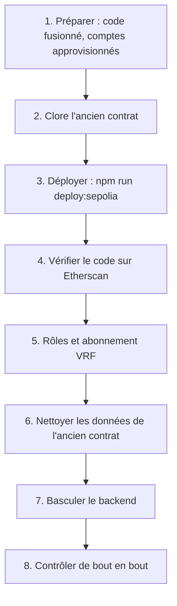

# Redéployer sur Sepolia

Ce guide remplace les contrats déployés sur Sepolia par une nouvelle version et bascule le backend dessus, sans perdre les comptes ni les portefeuilles des citoyens. Le premier déploiement, la création des comptes, de l'abonnement Chainlink VRF et des accès RPC sont décrits dans [Déploiement sur Sepolia](../smart-contracts/sepolia.md) ; ils sont supposés faits.

> [!NOTE]
> À la date de rédaction, aucune adresse Sepolia n'est enregistrée dans le dépôt : `deployments/sepolia.json` n'est pas versionné et la démonstration `etherbay.tech` n'est pas encore raccordée. Ce guide décrit la procédure telle qu'elle découle des scripts ; elle n'a pas encore été exécutée de bout en bout sur une instance en service.

## Faut-il redéployer ?

Le contrat est immuable, mais une partie de sa configuration se change sans redéploiement, par le compte administrateur (`DEFAULT_ADMIN_ROLE`) :

| Besoin | Sans redéploiement | Fonction |
| --- | --- | --- |
| Prix du ticket, durée, plafonds, commission | oui, à partir du tour suivant | `setRoundConfig` |
| Abonnement VRF, key hash, gas de rappel, délai de relance | oui | `setVrfConfig` |
| Adresse de la trésorerie | oui | `setTreasury` |
| Opérateur du backend | oui | `grantRole` et `revokeRole` |
| Adresse de base des métadonnées POAP | oui | `setBaseUri` du contrat POAP |
| Changement du code Solidity | **non** | redéploiement |
| Clé administrateur compromise ou perdue | **non**, si plus aucun compte n'a `DEFAULT_ADMIN_ROLE` | redéploiement |
| Nouvelle édition de la loterie, repartir de zéro | non obligatoire | redéploiement si l'on veut un historique séparé |

Ces appels se font depuis Etherscan (onglet « Write Contract » d'un contrat vérifié, en connectant le portefeuille administrateur) ou depuis Remix (voir [Utiliser Remix](../smart-contracts/remix.md)).

## Vue d'ensemble



## 1. Préparer

| Prérequis | Vérification |
| --- | --- |
| Nouvelle version fusionnée dans `main`, CI verte | Tests, couverture à 100 %, Slither, ABI exportées (voir [Modifier le contrat](modifier-contrat.md)) |
| Secrets dans le keystore chiffré de Hardhat | `SEPOLIA_RPC_URL`, `SEPOLIA_PRIVATE_KEY` (compte qui déploie), `ETHERSCAN_API_KEY` |
| Compte qui déploie approvisionné en ETH Sepolia | Deux déploiements et quelques transactions de configuration |
| Compte opérateur approvisionné | Il paiera les dotations de bienvenue, les badges et le keeper |
| Abonnement VRF financé | En LINK ou en ETH Sepolia ; le script refuse un abonnement vide |
| Paramètres des tours validés | `TICKET_PRICE_WEI`, `MAX_TICKETS`, `MIN_TICKETS_TO_DRAW`, `MAX_TICKETS_PER_PLAYER`, `ROUND_DURATION_SECONDS` (48 h par défaut sur Sepolia), `MUNICIPALITY_FEE_BPS` |

Les secrets se saisissent une fois, depuis `smart-contract/` :

```bash
npx hardhat keystore set SEPOLIA_RPC_URL
npx hardhat keystore set SEPOLIA_PRIVATE_KEY
npx hardhat keystore set ETHERSCAN_API_KEY
```

## 2. Clore l'ancien contrat

Les fonds de l'ancien contrat n'y restent pas bloqués, mais les citoyens ne les récupèrent que si quelqu'un réclame pour eux. Le backend le fait automatiquement tant qu'il indexe l'ancien contrat : il faut donc finir le travail **avant** la bascule.

1. Passer l'API en maintenance (`MAINTENANCE_MODE=true`) pour arrêter les achats depuis l'application.
2. Attendre la fin du tour en cours et le versement de la cagnotte, ou annuler le tour depuis le dashboard Mairie (« Annuler et rembourser », `POST /api/v1/lottery/refund`) : le worker réclame alors le remboursement de chaque payeur.
3. Vérifier que tout est versé : `prizeClaimed` à `true` pour le dernier tour terminé, plus aucun job en attente dans la file `chain-actions`.
4. Reverser la commission accumulée à la trésorerie (dashboard Mairie, « Retrait vers le portefeuille multi-signatures »).
5. Mettre l'ancien contrat en pause (disjoncteur), pour qu'aucun achat direct ne puisse plus y entrer.

## 3. Déployer

Depuis `smart-contract/`, avec les variables du déploiement :

```bash
SEPOLIA_VRF_SUBSCRIPTION_ID=<identifiant> OPERATOR_ADDRESS=0x... POAP_BASE_URI=https://api.etherbay.tech/api/v1/lottery/poap/ npm run deploy:sepolia
```

| Variable | Obligatoire | Effet |
| --- | --- | --- |
| `SEPOLIA_VRF_SUBSCRIPTION_ID` | oui | Abonnement VRF v2.5 utilisé par le contrat |
| `POAP_BASE_URI` | oui | Préfixe des métadonnées des badges, servies par l'API |
| `OPERATOR_ADDRESS` | conseillé | Compte du backend à habiliter |
| `MAIRIE_ADMIN_ADDRESS` | non | Administrateur, par défaut le compte qui déploie |
| `MAIRIE_TREASURY_ADDRESS` | non | Trésorerie, par défaut le compte qui déploie |
| `SEPOLIA_VRF_COORDINATOR`, `SEPOLIA_VRF_KEY_HASH` | non | Remplacent le coordinateur `0x9DdfaCa8183c41ad55329BdeeD9F6A8d53168B1B` et la key hash par défaut |

Le script [`deploy-sepolia.ts`](src:smart-contract/scripts/deploy-sepolia.ts) :

1. refuse tout réseau dont le `chainId` n'est pas `11155111` ;
2. vérifie que la key hash est enregistrée sur le coordinateur et que l'abonnement est financé ;
3. déploie `BlockLucky` avec 3 confirmations VRF, un délai de relance du tirage de 24 h et un paiement VRF en ETH natif si l'abonnement n'a pas de LINK ;
4. déploie `BlockLuckyPOAP` ;
5. ajoute le contrat comme consommateur de l'abonnement si le compte qui déploie en est propriétaire, sinon affiche l'action à faire ;
6. accorde les rôles à l'opérateur si l'administrateur est le compte qui déploie, sinon affiche l'action à faire ;
7. écrit `deployments/sepolia.json` et `deployments/sepolia-blocklucky-args.ts`, puis affiche les commandes de vérification.

Archiver les deux fichiers produits hors du dépôt, avec la date : ils ne sont pas versionnés et contiennent les adresses, le bloc de déploiement et les arguments du constructeur.

## 4. Vérifier le code sur Etherscan

Les deux commandes sont affichées par le script, avec les adresses à jour :

```bash
npx hardhat verify --network sepolia --constructor-args-path deployments/sepolia-blocklucky-args.ts <adresse BlockLucky>
```

```bash
npx hardhat verify --network sepolia <adresse BlockLuckyPOAP> <adresse administrateur> https://api.etherbay.tech/api/v1/lottery/poap/
```

La vérification publie le code source et rend lisibles les transactions et l'état du contrat sur l'explorateur. C'est elle qui permet aux citoyens, au jury et au DSI de contrôler que le contrat déployé est bien celui du dépôt.

## 5. Rôles et abonnement VRF

Quand l'administrateur n'est pas le compte qui déploie, le script affiche les actions restantes. Elles se font depuis le portefeuille administrateur :

| Action | Contrat | Appel |
| --- | --- | --- |
| Habiliter l'opérateur | `BlockLucky` | `grantRole(OPERATOR_ROLE, opérateur)` et `grantRole(PAUSER_ROLE, opérateur)` |
| Habiliter l'opérateur à frapper les badges | `BlockLuckyPOAP` | `grantRole(MINTER_ROLE, opérateur)` |
| Ajouter le consommateur VRF | Subscription Manager sur `vrf.chain.link` | « Add consumer » avec l'adresse de `BlockLucky` |
| Retirer l'ancien consommateur | Subscription Manager | « Remove consumer » avec l'adresse de l'ancien contrat |

Les valeurs de `OPERATOR_ROLE`, `PAUSER_ROLE` et `MINTER_ROLE` se lisent dans l'onglet « Read Contract » d'Etherscan. Contrôler ensuite `hasRole` pour chacun des trois rôles.

## 6. Nettoyer les données de l'ancien contrat

Le nouveau contrat recommence au tour n° 1. La base, elle, contient déjà des tours numérotés à partir de 1, rattachés à l'ancien contrat : `LotteryRound.contractRoundId` est unique, et l'indexeur prendrait le nouveau tour 1 pour l'ancien. Les données de tirage doivent donc être archivées puis retirées, en gardant les comptes, les portefeuilles, les EtherPoints et les récompenses.

1. Sauvegarder la base complète (voir [Sauvegardes et reprise](../infrastructure/sauvegardes.md)).
2. Supprimer les données propres à l'ancien contrat, dans une transaction :

```sql
BEGIN;
DELETE FROM "Ticket";
DELETE FROM "LotteryRound";
DELETE FROM "ChainCursor" WHERE "id" = 'BlockLucky';
COMMIT;
```

Si la table `Refund` du guide [Ajouter une migration](ajouter-migration.md) existe, la vider avant `LotteryRound`.

3. Vider la file BullMQ `chain-actions`. Ses jobs portent un identifiant `<type>-<tour>-<portefeuille>` ; un job terminé est gardé 24 heures, et BullMQ refuse un nouveau job de même identifiant tant que l'ancien existe. Sans ce nettoyage, le versement de la cagnotte du nouveau tour 1 à un gagnant de l'ancien tour 1 serait ignoré.

> [!WARNING]
> Ne jamais repartir d'une base vide pour « simplifier » : la table `User` contient les clés chiffrées des portefeuilles intégrés (`walletEncryptedKey`). Sans elle, les citoyens perdent l'accès à leur portefeuille et aux ethers qu'il contient encore sur Sepolia.

## 7. Basculer le backend

Mettre à jour la configuration de l'API et du worker :

| Variable | Nouvelle valeur |
| --- | --- |
| `LOTTERY_CONTRACT_ADDRESS` | `contracts.lottery` de `deployments/sepolia.json` |
| `POAP_CONTRACT_ADDRESS` | `contracts.poap` |
| `CHAIN_START_BLOCK` | `deploymentBlock` |
| `CHAIN_ID`, `CHAIN_CONFIRMATIONS`, `EXPLORER_URL`, `RPC_URL`, `FALLBACK_RPC_URL` | inchangés |
| `RELAYER_PRIVATE_KEY` | inchangée, si l'opérateur est le même compte |
| `MAINTENANCE_MODE` | `false`, après les contrôles |

Redémarrer le worker puis l'API. Au démarrage, l'indexeur ne trouve pas de curseur et part de `CHAIN_START_BLOCK` : il indexe `RoundOpened` du tour 1 du nouveau contrat.

Les frontends web et mobile n'ont rien à changer : ils lisent l'adresse du contrat et les liens d'explorateur dans la réponse de `GET /api/v1/lottery/status` (bloc `blockchain`).

## 8. Contrôler de bout en bout

| Contrôle | Attendu |
| --- | --- |
| `GET /api/v1/lottery/status` | `round.contractRoundId` vaut 1, `blockchain.lotteryContract` est la nouvelle adresse, `guarantees.paused` vaut `false` |
| Achat d'un ticket avec un compte de test | Transaction visible sur Sepolia Etherscan, ticket dans l'historique, +50 EtherPoints |
| Badge POAP | Frappé par l'opérateur après le premier achat, métadonnées servies sous `POAP_BASE_URI` |
| Journaux du worker | Pas d'erreur `AccessControlUnauthorizedAccount` (rôle manquant) ni d'abonnement VRF invalide |
| Premier tirage | Demandé par le keeper à l'échéance, gagnant désigné par Chainlink VRF après quelques blocs, cagnotte versée |

Mettre enfin à jour la documentation qui cite les adresses ou le bloc de départ (voir [Environnements](../infrastructure/environnements.md)), et noter le redéploiement dans le [Journal des versions](../annexes/journal.md).

## Liste de contrôle

- [ ] Redéploiement nécessaire (pas un simple `setRoundConfig` ou `setVrfConfig`).
- [ ] Ancien contrat clos : cagnotte versée ou remboursements réclamés, commission reversée, contrat en pause.
- [ ] Nouveaux contrats déployés, fichiers de déploiement archivés.
- [ ] Code vérifié sur Etherscan.
- [ ] Rôles accordés, consommateur VRF ajouté, ancien consommateur retiré.
- [ ] Base sauvegardée, données de tirage de l'ancien contrat retirées, file `chain-actions` vidée.
- [ ] Variables du backend mises à jour, services redémarrés.
- [ ] Achat, badge et tirage contrôlés sur l'explorateur.
