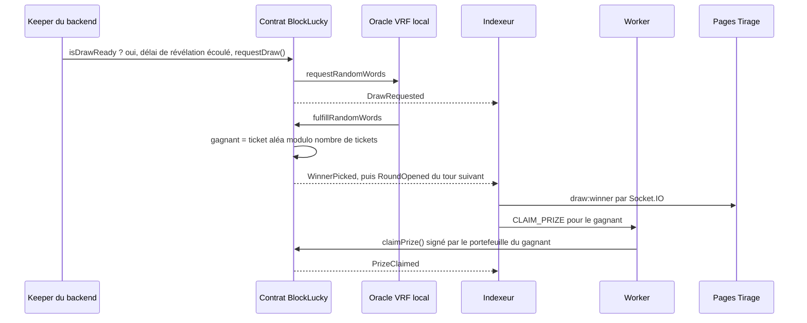

# Préparer la soutenance

Ce guide prépare la démonstration de BlockLucky devant les parties prenantes de la Ville d'EtherBay : le Maire, le responsable événementiel et le DSI, ainsi que le jury. Il donne un scénario complet, minuté, sur la stack locale, avec une vraie blockchain (nœud Hardhat), un vrai smart contract et un oracle VRF local. Il liste les preuves de transparence à montrer, les réponses aux questions probables et le plan de secours.

Les besoins de chaque partie prenante sont rappelés dans [Besoins des parties prenantes](../presentation/besoins.md). Ce qui est réel ou simulé est récapitulé dans [Réel, simulé ou à venir](../presentation/reel-ou-simule.md) : le relire avant la soutenance, pour ne rien affirmer de faux.

## Ce que la démonstration prouve

| Partie prenante | Ce qu'elle doit voir |
| --- | --- |
| Maire | Un citoyen participe sans rien connaître à la blockchain ; le gagnant est désigné sans que la Mairie puisse intervenir ; la Mairie peut tout arrêter en cas de problème |
| Responsable événementiel | Le parcours complet est fluide ; le tirage s'annonce en direct ; les commerçants partenaires sont intégrés ; l'Office de Tourisme fait la promotion |
| DSI | Le code est testé, analysé, conteneurisé ; les secrets et les clés sont protégés ; l'exploitation est documentée ; les limites sont connues |

## La veille

### Installer et vérifier

Prérequis : Docker Desktop, Node.js 22 (voir [Prérequis](../demarrage/prerequis.md)). Installer les dépendances une fois, à l'avance, avec une connexion fiable :

```bash
cd backend && npm ci && cd ..
cd frontend-web && npm ci && cd ..
cd smart-contract && npm ci && cd ..
```

Lancer la suite de tests une dernière fois pour pouvoir montrer qu'elle passe :

```bash
cd smart-contract && npm test
```

```bash
cd backend && npm test
```

### Repartir d'un état propre

Le nœud Hardhat ne garde rien entre deux démarrages : la base doit repartir de zéro en même temps que lui (voir [Blockchain locale](../smart-contracts/blockchain-locale.md)). À faire la veille au soir, puis de nouveau le matin :

```bash
docker compose down -v
docker compose up -d --wait
```

```bash
cd backend
npm run prisma:deploy
npm run prisma:seed
npm run dev
```

```bash
cd frontend-web
npm run dev
```

```bash
cd frontend-office-tourisme
npm run dev
```

`docker compose up -d --wait` démarre PostgreSQL, Redis, Mailpit et le service `blockchain`, qui déploie les contrats aux adresses habituelles et lance l'oracle VRF local. `npm run dev` du backend démarre l'API, les workers, l'indexeur et le keeper dans un seul processus (`RUN_WORKERS=true` par défaut).

> [!IMPORTANT]
> Ne pas redémarrer le conteneur `blockchain` pendant la démonstration : il repartirait d'une chaîne vide, et la base deviendrait incohérente avec elle. Le backend le signale par l'erreur « Le curseur d'indexation (bloc N) dépasse la tête de chaîne ».

### Préparer les comptes

Le seed crée trois comptes, sans portefeuille réel ; le portefeuille intégré est créé au premier achat. Les trois ont le mot de passe `EtherBay2026demo` et un âge déjà vérifié (`VERIFIED`) :

| Compte | Rôle | Usage dans la démonstration |
| --- | --- | --- |
| `maire@etherbay.fr` | `ADMIN` | Dashboard Mairie, vérification d'une pièce d'identité, disjoncteur, tirage manuel |
| `boulangerie@etherbay.fr` | `PARTNER` | Propriétaire de la Boulangerie du Port et du Cinéma Le Phare, validation d'un code |
| `citoyen@etherbay.fr` | `USER` | Citoyen déjà inscrit (250 EtherPoints), qui achète et offre un ticket sur le web |

Sur le web, la connexion se fait par code à 6 chiffres envoyé par email, lu dans Mailpit (`http://localhost:8025`) ; sur mobile, par email et mot de passe. Le compte du Maire doit avoir activé la double authentification avant d'ouvrir le dashboard : `requireRoles` refuse sinon toute route d'administration (« La double authentification est obligatoire pour les comptes d'administration »). La veille, se connecter avec `maire@etherbay.fr`, aller dans Profil, Sécurité, et activer la 2FA par email. En développement, la page affiche le code d'activation (`devOtpPreview`).

Pour la démonstration elle-même, une nouvelle citoyenne, Camille, s'inscrit en direct sur l'application mobile avec une adresse fictive non encore utilisée, par exemple `camille@etherbay.fr`. Un second nouveau citoyen, Dominique (`dominique@etherbay.fr`), reçoit un ticket offert sans s'inscrire.

Deux réglages de la veille :

- placer dans la galerie du téléphone ou du simulateur deux images JPEG ou PNG de spécimen de carte d'identité (jamais une vraie pièce), de 4 Mo au plus, pour le recto et le verso ;
- réduire le délai de révélation à une minute dans `backend/.env` (`DRAW_REVEAL_DELAY_SECONDS=60`), puis redémarrer le backend : la valeur par défaut de 10 minutes est trop longue pour la démonstration.

### Préparer l'écran

| Onglet ou fenêtre | URL | Session |
| --- | --- | --- |
| Office de Tourisme | `http://localhost:4000` | aucune |
| Citoyenne Camille | application mobile (Expo Go ou simulateur, voir [Tester sur un téléphone](../mobile/telephone-physique.md)) | compte créé en direct |
| Citoyen du seed | `http://localhost:3000/connexion` | fenêtre normale |
| Maire | `http://localhost:3000/connexion` | second profil de navigateur |
| Mailpit | `http://localhost:8025` | aucune |
| Swagger de l'API | `http://localhost:2053/api/docs` | aucune |
| Terminal 1 | `docker compose logs -f blockchain` | transactions de la chaîne en direct |
| Terminal 2 | dossier du dépôt, prêt pour les commandes d'avance du temps | - |

Le jeton de session web est gardé dans le `localStorage` du navigateur : chaque personnage web a besoin de son propre profil de navigateur.

### Préparer le secours

Enregistrer la veille une vidéo du scénario complet et une série de captures d'écran (voir [Plan de secours](#plan-de-secours)).

## Scénario

Durée totale : environ 20 minutes, dont 5 de marge. Les étapes marquées « facultative » se sautent si le temps manque.

| Étape | Durée | Personnage | Écran |
| --- | --- | --- | --- |
| 1. L'Office de Tourisme annonce la loterie | 2 min | visiteur | site touristique |
| 2. Inscription, dotation et vérification d'âge | 4 min | Camille, Maire | mobile, Mailpit, dashboard Mairie |
| 3. Achat du ticket | 2 min | Camille | mobile, terminal 1 |
| 4. Ticket offert | 2 min | citoyen du seed | web |
| 5. Le temps passe sur la chaîne | 1 min | présentateur | terminal 2 |
| 6. Salle d'attente, tirage et annonce du gagnant | 3 min | tous | salle d'attente mobile, page Tirage |
| 7. Cagnotte versée et badge POAP | 2 min | gagnant | Historique & POAP |
| 8. EtherPoints chez un commerçant (facultative) | 2 min | Camille, boulangerie | ticket à gratter mobile, espace partenaires |
| 9. Disjoncteur | 2 min | Maire | dashboard Mairie |
| 10. Preuves de transparence | 2 min | présentateur | terminal, page Transparence |

### 1. L'Office de Tourisme annonce la loterie

Sur `http://localhost:4000`, montrer le bandeau « Nouveauté : La Grande Loterie citoyenne », puis la fiche de l'événement (`fiche.html?event=loterie-citoyenne`) : pilote pédagogique, ethers fictifs, participation réservée aux majeurs. Cliquer sur « Accéder à la loterie » : le frontend web s'ouvre.

Message : la Ville communique sur la loterie avec ses canaux habituels ; le site touristique ne touche à aucune donnée de la loterie (voir [Rôle dans le projet](../office-tourisme/role.md)).

### 2. Inscription, dotation et vérification d'âge

Sur l'application mobile, Camille choisit « Créer un compte », saisit `camille@etherbay.fr` et un mot de passe d'au moins 10 caractères avec une lettre et un chiffre, accepte les conditions, puis saisit le code reçu dans Mailpit. En arrière-plan :

1. un portefeuille Ethereum est créé pour elle, sa clé privée chiffrée en AES-256-GCM avec `ENCRYPTION_KEY` ;
2. la Mairie (compte opérateur) lui verse une dotation de bienvenue de 0,5 ether fictif (`WELCOME_GRANT_WEI`) ;
3. elle reçoit 25 EtherPoints de bienvenue et un email de bienvenue, visible dans Mailpit.

L'application ouvre d'elle-même l'écran de vérification d'âge. Camille choisit le recto puis le verso du spécimen dans la galerie et les envoie : son statut passe à « en attente ». Dans le profil du Maire, ouvrir `/mairie/identites`, afficher la demande (le recto et le verso déchiffrés n'apparaissent que tant qu'elle est en attente) et la valider. Les images sont effacées, Camille reçoit l'email de décision dans Mailpit, et `/mairie/audit` trace la consultation et la décision.

Dans le terminal 1, la transaction de dotation apparaît dans les journaux du nœud.

Message : aucun prérequis technique ni financier pour le citoyen, et une majorité vérifiée par la Mairie sans conserver la pièce (voir [Inscription et portefeuille](../architecture/flux/inscription.md) et [Vérification d'âge](../mobile/authentification.md#verification-d-age)).

### 3. Achat du ticket

Camille rouvre l'écran de vérification d'âge depuis son profil, qui relit son statut et affiche maintenant l'âge vérifié, puis achète son ticket depuis l'accueil. La transaction `buyTickets` est signée avec son portefeuille intégré et envoyée au contrat. Montrer :

- la confirmation avec le numéro du ticket sur cinq chiffres ;
- les 50 EtherPoints crédités ;
- le ticket dans l'onglet Mes tickets.

Un second achat est refusé : un seul ticket par participant et par grand tirage (409, `PlayerLimitReached`). Le prix est de 0,01 ether fictif, plus les frais de réseau payés par la dotation.

> [!NOTE]
> Le profil stocké sur le téléphone ne relit pas seul le statut d'âge après la décision de la Mairie. Sans ce passage par l'écran de vérification, l'application continue de considérer l'âge comme en attente.

### 4. Ticket offert

Sur le web, le citoyen du seed se connecte avec `citoyen@etherbay.fr`, puis, dans la Billetterie, choisit « Offrir un ticket » et saisit `dominique@etherbay.fr`. Le contrat enregistre un ticket au nom de Dominique, payé par le citoyen (`buyTicketsFor`) ; le citoyen reçoit 75 EtherPoints et Dominique les 50 points du ticket. Dominique n'a pas encore de compte : il en reçoit un, avec son portefeuille, mais aucun email ne le prévient (voir [Ajouter un email](ajouter-email.md)). Un cadeau à Camille serait refusé, puisqu'elle a déjà son ticket.

Le citoyen achète ensuite son propre ticket ; la billetterie web n'en propose qu'un. Le tour compte alors 3 tickets, un par participant. Le minimum pour lancer un tirage est de 2 tickets (`MIN_TICKETS_TO_DRAW`).

### 5. Faire passer le temps sur la chaîne

Un tour dure 30 minutes sur la blockchain locale ([`deploy-local.ts`](src:smart-contract/scripts/deploy-local.ts)). Plutôt qu'attendre, avancer l'horloge du nœud Hardhat, comme le fait le test d'intégration [`onchain-lottery.chain.ts`](src:backend/__tests__/chain/onchain-lottery.chain.ts). Ouvrir d'abord la page `/tirage` dans la fenêtre du citoyen et l'accueil de l'application de Camille : l'annonce du gagnant arrive par Socket.IO et n'est affichée que par une page déjà ouverte.

Avec Git Bash, macOS ou Linux :

```bash
curl -s -X POST http://127.0.0.1:8545 -H "Content-Type: application/json" -d '{"jsonrpc":"2.0","id":1,"method":"evm_increaseTime","params":[1860]}'
curl -s -X POST http://127.0.0.1:8545 -H "Content-Type: application/json" -d '{"jsonrpc":"2.0","id":2,"method":"evm_mine","params":[]}'
```

Avec PowerShell :

```powershell
Invoke-RestMethod -Uri http://127.0.0.1:8545 -Method Post -ContentType 'application/json' -Body '{"jsonrpc":"2.0","id":1,"method":"evm_increaseTime","params":[1860]}'
Invoke-RestMethod -Uri http://127.0.0.1:8545 -Method Post -ContentType 'application/json' -Body '{"jsonrpc":"2.0","id":2,"method":"evm_mine","params":[]}'
```

`evm_increaseTime` avance l'horloge de 1 860 secondes (31 minutes) pour les prochains blocs ; `evm_mine` produit un bloc avec cette nouvelle heure. La valeur couvre un tour entier, quel que soit le temps déjà écoulé depuis son ouverture.

### 6. Salle d'attente, tirage et annonce du gagnant

Le tour passe en phase `WAITING_ROOM` : les achats sont clos et `GET /lottery/status` publie l'heure de révélation (`revealAt`). Sur mobile, Camille entre dans la salle d'attente, qui affiche le compte à rebours et la discussion en direct. Le keeper attend la fin du délai de révélation (`DRAW_REVEAL_DELAY_SECONDS`, réglé à 60 secondes la veille), puis la chaîne d'automatismes suivante s'exécute en moins de 15 secondes.



| Composant | Fréquence | Fichier |
| --- | --- | --- |
| Keeper | toutes les 10 s (`KEEPER_INTERVAL_MS`) | [`lottery.keeper.ts`](src:backend/src/blockchain/lottery.keeper.ts) |
| Oracle VRF local | toutes les 2 s | [`local-vrf-responder.ts`](src:smart-contract/scripts/local-vrf-responder.ts) |
| Indexeur | toutes les 3 s (`INDEXER_INTERVAL_MS`) | [`lottery.indexer.ts`](src:backend/src/blockchain/lottery.indexer.ts) |

La page `/tirage` passe par « Tirage en cours », puis affiche l'adresse du portefeuille gagnant ; sur mobile, la roue s'arrête sur le numéro du ticket gagnant. Pour une mise en scène plus parlante, le Maire peut déclencher le tirage lui-même depuis `/mairie/securite` (« Lancer le tirage VRF ») juste après l'avance du temps : cet appel n'attend pas le délai de révélation.

Message : personne ne choisit le gagnant. La Mairie peut demander le tirage, comme n'importe qui (`requestDraw` est publique), mais le résultat vient de l'oracle et le calcul est fait par le contrat.

### 7. Cagnotte versée et badge POAP

Le worker réclame la cagnotte au nom du gagnant, sans action de sa part. Sur 3 tickets à 0,01, la collecte est de 0,03 ether fictif : la commission de la Mairie est de 10 % (`MUNICIPALITY_FEE_BPS` = 1000), le gagnant reçoit 0,027. Dans la fenêtre du gagnant :

- le solde du portefeuille a augmenté d'un peu moins de 0,027 : la transaction de retrait est signée par son portefeuille, qui en paie les frais ;
- sur le web, la carte « Félicitations » apparaît sur l'accueil si l'annonce a été reçue dans la session, par exemple sur la page Tirage ; son bouton de retrait répond que la cagnotte a déjà été versée ; sur mobile, l'onglet Mes tickets marque le ticket gagnant ;
- l'onglet POAP de `/historique` montre le badge de participation du tour, frappé par l'opérateur après le premier achat.

Dominique n'a pas de session : s'il gagne, montrer le versement dans le terminal 1 et dans la lecture du contrat de l'étape 10.

Les métadonnées du badge sont servies par l'API : `http://localhost:2053/api/v1/lottery/poap/1.json` et son visuel `http://localhost:2053/api/v1/lottery/poap/1.svg` (remplacer `1` par le numéro du tour).

### 8. EtherPoints chez un commerçant (facultative)

Camille a 75 EtherPoints : 25 de bienvenue et 50 pour son ticket. Sur l'application, elle achète le ticket à gratter violet pour 50 points (`POST /marketplace/scratch`), le gratte et découvre une offre tirée au hasard parmi celles en stock de la Boulangerie du Port et du Cinéma Le Phare, avec un code unique, aussi envoyé par email (Mailpit). Dans le profil du Maire, ou une autre fenêtre, se connecter avec `boulangerie@etherbay.fr`, ouvrir `/partenaire/validation` et saisir le code : il est marqué utilisé. Une seconde saisie est refusée.

Message : l'économie locale profite de la loterie (voir [Échange de récompense](../architecture/flux/recompense.md)).

### 9. Disjoncteur

Le Maire ouvre `/mairie/securite` et clique sur « Mettre le Smart Contract en pause », avec un motif. La transaction `pause()` part du compte opérateur, qui détient `PAUSER_ROLE`. Camille tente d'acheter son ticket du tour suivant, ouvert après le tirage : refus avec le message « Le Smart Contract est temporairement en pause de sécurité par la Mairie. » (statut 503). Le Maire réactive les participations. Montrer l'entrée correspondante dans `/mairie/audit`.

Message : en cas d'incident, la Mairie arrête tout en un clic, et l'action est tracée. La pause bloque les achats et les tirages, mais pas `claimPrize` ni `claimRefund` : même en pause, personne ne peut empêcher un gagnant ou un participant remboursé de récupérer ses fonds. Voir [Disjoncteur](../architecture/flux/disjoncteur.md).

### 10. Preuves de transparence

Lire l'état du tour terminé directement dans le contrat, sans passer par l'API ni par la base. Depuis `backend/`, avec le numéro du tour en argument :

```bash
cd backend
node -e '
const { JsonRpcProvider, Contract, formatEther } = require("ethers");
const abi = require("./src/blockchain/abi/BlockLucky.json");
const lottery = new Contract("0xCf7Ed3AccA5a467e9e704C703E8D87F634fB0Fc9", abi, new JsonRpcProvider("http://127.0.0.1:8545"));
(async () => {
  const id = BigInt(process.argv[1] ?? (await lottery.currentRoundId()));
  const r = await lottery.getRound(id);
  console.log({
    tour: Number(id),
    statut: ["Open", "Drawing", "Completed", "Cancelled"][Number(r.status)],
    tickets: Number(r.ticketCount),
    collecte: formatEther(r.totalCollected),
    gagnant: r.winner,
    ticketGagnant: Number(r.winningTicket),
    cagnotte: formatEther(r.prize),
    versee: r.prizeClaimed,
    requeteVrf: r.vrfRequestId.toString(),
    commission: formatEther(await lottery.accruedFees()),
    pause: await lottery.paused(),
  });
})();
' 1
```

Les valeurs affichées doivent correspondre à celles de l'application : c'est la base qui recopie la chaîne, pas l'inverse.

## Points de transparence à montrer

| Affirmation | Preuve |
| --- | --- |
| Le code du contrat est public | [`BlockLucky.sol`](src:smart-contract/contracts/BlockLucky.sol), 415 lignes ; sur Sepolia, code vérifié sur Etherscan |
| Chaque ticket est inscrit sur la chaîne | `ticketOwner(tour, numéro)` et l'événement `TicketsPurchased` ; l'indexeur les recopie en base, pas l'inverse |
| Personne ne choisit le gagnant | `fulfillRandomWords` : `gagnant = ticketOwners[aléa % nombre de tickets]` ; seul le coordinateur VRF peut appeler la fonction |
| Le tirage ne peut pas être bloqué | `requestDraw` est appelable par tout le monde dès que le tour est complet ou échu ; `retryDraw` relance un oracle muet après `drawTimeout` |
| La commission est plafonnée | 10 % par défaut, refus au-delà de 20 % (`MAX_FEE_BPS = 2000`) ; seule la commission est retirable vers la trésorerie |
| Les fonds ne peuvent pas rester bloqués | cagnotte et remboursements en retrait (`claimPrize`, `claimRefund`), non bloqués par la pause ; un tour échu sans assez de participants est annulé et intégralement remboursable |
| Le jeu est responsable | un seul ticket par participant et par tour (`maxTicketsPerPlayer`, 1 au déploiement, contrôlé aussi par le backend), majorité vérifiée par la Mairie sur pièce d'identité avant tout achat |
| Le code est vérifié | 47 tests de contrat dont 4 de fuzzing, 100 % des lignes couvertes, Slither sans constat Medium, test d'intégration du backend sur un vrai nœud (voir [Tests et qualité](../contribuer/tests-qualite.md)) |
| Les actions de la Mairie sont tracées | journal d'audit `/mairie/audit` : disjoncteur, retraits de trésorerie, partenaires, consultations et décisions sur les pièces d'identité |
| Les règles sont expliquées aux citoyens | page publique `/transparence` |

> [!WARNING]
> Sur la blockchain locale, l'aléa vient du coordinateur simulé `VRFCoordinatorV2_5Mock` : il calcule les nombres aléatoires à partir de l'identifiant de la requête (`keccak256(requestId, i)`), donc de façon prévisible, et l'oracle local est un simple script. C'est suffisant pour démontrer le circuit, pas l'imprévisibilité. Sur Sepolia, le coordinateur est celui de Chainlink VRF v2.5, qui fournit un aléa accompagné d'une preuve cryptographique vérifiée par le contrat du coordinateur. Le dire avant que la question ne soit posée.

## Questions probables

### Le Maire

| Question | Réponse |
| --- | --- |
| Combien cela coûte-t-il aux citoyens ? | Rien. Les ethers sont fictifs, sur un réseau de test, sans valeur monétaire. La dotation de bienvenue paie les tickets et les frais. |
| La Mairie peut-elle truquer le tirage ? | Non. Le gagnant est calculé par le contrat à partir de l'aléa de Chainlink VRF. La Mairie peut déclencher le tirage ou annuler un tour (avec remboursement intégral), pas choisir le gagnant. Chacun peut le vérifier sur l'explorateur. |
| Et si quelque chose tourne mal le jour du tirage ? | Le disjoncteur met le contrat en pause en un clic. Les fonds restent retirables par leurs propriétaires. Un tour peut être annulé et chaque participant remboursé. |
| Est-ce légal ? | Le pilote est pédagogique et sans enjeu financier réel. Le passage à de vrais fonds poserait la question du statut de loterie et de MiCA : c'est documenté dans [Veille juridique](../juridique/veille-juridique.md) et [Points à valider](../juridique/points-a-valider.md). |
| Les mineurs peuvent-ils jouer ? | Non. Un agent de la Mairie vérifie la majorité sur la photo de la pièce d'identité avant tout achat ; les images sont effacées dès la décision. L'authenticité du document n'est pas contrôlée par un service tiers. |
| Que deviennent les données des citoyens ? | Email, portefeuille et statut de vérification d'âge ; la pièce d'identité n'est gardée, chiffrée, que le temps de la décision. Export et suppression RGPD dans le profil. L'adresse du portefeuille reste sur la blockchain, pseudonyme mais publique (voir [Blockchain et données personnelles](../juridique/blockchain-donnees.md)). |

### Le responsable événementiel

| Question | Réponse |
| --- | --- |
| Combien de participants ? | Jusqu'à 10 000 tickets par tour (`MAX_TICKETS`), un par participant, donc 10 000 participants. |
| Comment se passe le tirage public ? | À la fermeture des achats, une salle d'attente réunit les participants pendant 10 minutes (`DRAW_REVEAL_DELAY_SECONDS`) ; la page Tirage et l'application affichent le compte à rebours, le chat et l'annonce en direct, et peuvent être projetées. Le tirage part automatiquement à la fin du délai. |
| Peut-on tenir la charge le soir du tirage ? | Des scénarios de charge k6 existent (charge nominale, pic ×10) avec des objectifs de latence (voir [Tests de charge](../infrastructure/tests-charge.md)). Ils n'ont pas été rejoués sur l'infrastructure finale. |
| Comment un commerçant rejoint-il le programme ? | Création de son compte, rôle partenaire attribué par la Mairie, offre et codes depuis l'espace partenaires (voir [Ajouter un commerçant partenaire](ajouter-partenaire.md)). |
| Y a-t-il une application mobile ? | Oui, Expo pour iOS et Android, avec les fonctions citoyennes. Aucune publication sur les magasins d'applications n'est documentée dans le dépôt (voir [Builds et publication](../mobile/builds-publication.md)). |
| La communication ? | Site de l'Office de Tourisme, parrainage, quêtes, badges POAP (voir [Volet marketing](../presentation/marketing.md)). |

### Le DSI

| Question | Réponse |
| --- | --- |
| Qui détient les clés des portefeuilles ? | Le backend : le modèle est custodial (ADR 0004). Les clés sont chiffrées en AES-256-GCM avec `ENCRYPTION_KEY`, qui doit être sauvegardée à part. Acceptable avec des ethers fictifs, pas avec de vrais fonds. |
| Que se passe-t-il si le compte opérateur est compromis ? | Il peut mettre en pause, annuler un tour, frapper des badges et dépenser son solde, mais pas toucher à la cagnotte d'un gagnant ni à la configuration (réservée à l'administrateur). L'administrateur lui retire ses rôles (`revokeRole`). |
| Comment sont protégés les comptes ? | Connexion par code email sur le web, par mot de passe haché par bcrypt ou par Google et Apple sur mobile, verrouillage après échecs répétés, 2FA par application ou email, 2FA obligatoire pour les administrateurs, droits relus en base à chaque requête (voir [Authentification et 2FA](../securite/authentification.md)). |
| Quelle CI ? | Typecheck, lint, tests, migrations sur base vierge, dérive du schéma, contrats (couverture 100 %, Slither), test sur une vraie chaîne, images Docker avec Trivy, gitleaks, CodeQL, Dependabot. |
| Et si le serveur tombe ? | La blockchain est la source de vérité : la base se reconstruit depuis la chaîne en remettant le curseur de l'indexeur au bloc de déploiement. Sauvegardes PostgreSQL et runbooks documentés. |
| Peut-on mettre à jour le contrat ? | Non, il est immuable : une nouvelle version est un nouveau déploiement (voir [Redéployer sur Sepolia](redeployer-sepolia.md)). La configuration des tours, l'oracle et la trésorerie se modifient sans redéploiement. |
| Quelles sont les limites connues ? | Voir [Dette technique et limites](../annexes/dette-technique.md) et [Limites connues](../smart-contracts/limites.md). Les citer soi-même renforce la crédibilité. |
| Peut-on reprendre le projet ? | Cette documentation, les ADR, les guides pas à pas et la liste de contrôle [Avant une mise en production](../contribuer/mise-en-production.md). |

## Plan de secours

| Incident | Réaction immédiate | Repli |
| --- | --- | --- |
| Le code de connexion n'arrive pas dans Mailpit | Vérifier `docker compose ps` ; le code figure aussi dans la réponse de `POST /api/v1/auth/login` ou `/auth/signup` (champ `devOtpPreview`), visible dans l'onglet Réseau des outils de développement, et l'application mobile l'affiche en développement | Se connecter avec un compte déjà ouvert dans une autre fenêtre |
| L'achat de Camille répond 403 « Vérifiez votre âge pour jouer » | La demande est-elle validée sur `/mairie/identites` ? Rouvrir l'écran de vérification d'âge pour relire le statut | Faire l'achat avec `citoyen@etherbay.fr`, déjà vérifié |
| Le tirage ne part pas après l'avance du temps | Vérifier que le tour a au moins 2 tickets ; relancer `evm_mine` ; déclencher le tirage depuis `/mairie/securite` | Montrer le test `npm run test:chain` ou la vidéo |
| Le tirage reste « en cours » | L'oracle local ne répond plus : `docker compose logs blockchain` ; relancer l'oracle dans le conteneur sans le redémarrer : `docker compose exec -d blockchain npx hardhat run scripts/local-vrf-responder.ts --network localhost` | Vidéo |
| L'achat répond « Ce tour est terminé » | Le tour a dépassé son échéance sans tirage. Avancer le temps et laisser le keeper clore ou tirer le tour, puis racheter dans le nouveau tour | - |
| La page Tirage n'affiche pas le gagnant | Elle n'était pas ouverte au moment de l'annonce. Montrer la carte « Félicitations » de l'accueil, le solde, ou le script de lecture du contrat | Captures |
| Le backend s'arrête | `npm run dev` à nouveau : l'indexeur reprend depuis son curseur, rien n'est perdu | - |
| Le conteneur `blockchain` a redémarré | Base et chaîne sont désynchronisées : reprendre la procédure « Repartir d'un état propre » (2 minutes), refaire les étapes 2 à 4 | Vidéo pendant la remise en état |
| Le service `blockchain` ne démarre pas, PostgreSQL et Redis fonctionnent | `docker compose logs blockchain` | Mode simulé, à annoncer clairement : `BLOCKCHAIN_MODE=simulated` dans `backend/.env`, sur une base réinitialisée. Le web affiche « Mode démonstration » et le mobile n'affiche plus de solde ETH ; aucune transaction réelle, le tirage est simulé par le backend |
| Docker ne démarre pas du tout | - | PostgreSQL et Redis tournent aussi dans Docker : rien ne fonctionne sans lui. Vidéo et captures |
| Pas de vidéoprojecteur ou réseau instable | - | Vidéo hors ligne et captures |

Le mode simulé est un dernier recours : il prouve le parcours, pas le smart contract. Ne pas le présenter comme le fonctionnement réel (voir [Mode onchain ou simulé](../integration-blockchain/modes.md)).

### Après l'avance du temps

L'horloge de la chaîne est désormais en avance d'une trentaine de minutes sur l'horloge réelle. Le tour suivant s'ouvre avec une échéance calculée sur l'heure de la chaîne, et le compte à rebours de l'application, calculé avec l'heure réelle, affiche donc environ 30 minutes de plus que la durée restante réelle. Le dire si quelqu'un le remarque, ou repartir d'un état propre avant une seconde démonstration.

## Liste de contrôle du jour J

- [ ] Base et chaîne réinitialisées le matin, seed lancé.
- [ ] 2FA du compte `maire@etherbay.fr` activée.
- [ ] `DRAW_REVEAL_DELAY_SECONDS=60` dans `backend/.env`, images de spécimen dans la galerie du téléphone.
- [ ] Backend, frontend web, application mobile et Office de Tourisme démarrés, `docker compose ps` sain.
- [ ] Fenêtres et profils de navigateur ouverts, Mailpit vide.
- [ ] Commandes d'avance du temps et de lecture du contrat prêtes dans un terminal.
- [ ] Pages `/tirage` ouvertes avant l'avance du temps.
- [ ] Vidéo et captures de secours disponibles hors ligne.
- [ ] Répartition des rôles entre les membres de l'équipe (présentateur, Camille, citoyen du seed, Maire).
- [ ] Limites et parties simulées prêtes à être énoncées.
