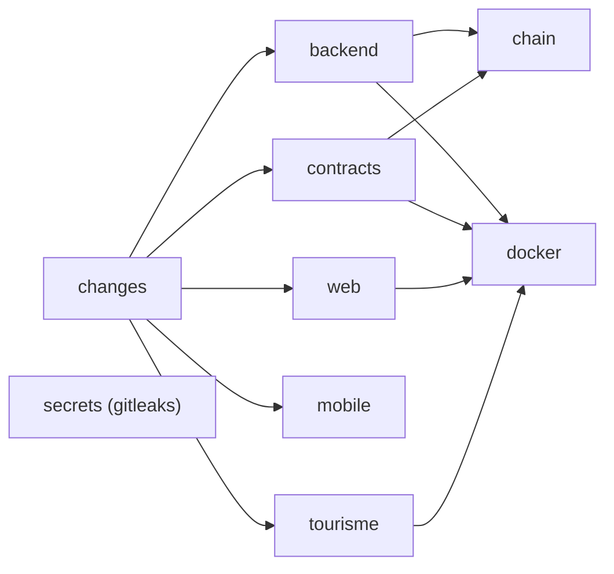

# Intégration continue

L'intégration continue tourne sur GitHub Actions avec deux workflows :

- [`.github/workflows/ci.yml`](src:.github/workflows/ci.yml) : contrôles de chaque projet, intégration sur une vraie blockchain locale, images Docker ;
- [`.github/workflows/codeql.yml`](src:.github/workflows/codeql.yml) : analyse statique de sécurité du JavaScript et du TypeScript.

Les deux se déclenchent à chaque pull request et à chaque push sur `main`. `ci.yml` peut aussi être lancé à la main (`workflow_dispatch`) ; `codeql.yml` tourne en plus chaque lundi à 3 h 17 UTC (`cron: '17 3 * * 1'`), pour détecter les nouvelles règles ou vulnérabilités sur un code qui n'a pas bougé.

## Vue d'ensemble



Le job `secrets` ne dépend de rien et tourne toujours. Les autres ne tournent que si le projet qu'ils contrôlent a changé.

## Principes communs

| Principe | Mise en œuvre |
| --- | --- |
| Moindre privilège | `permissions: contents: read` au niveau du workflow ; seul `changes` ajoute `pull-requests: read`, seul CodeQL ajoute `security-events: write` et `actions: read` |
| Jeton non persistant | chaque `actions/checkout` utilise `persist-credentials: false` : le jeton GitHub n'est pas écrit dans `.git/config`, donc inaccessible aux scripts npm exécutés ensuite |
| Actions épinglées | chaque action est référencée par un SHA de commit complet et non par un tag modifiable |
| Une exécution par branche | `concurrency` groupe par workflow et par référence, avec `cancel-in-progress: true` : un nouveau push annule l'exécution précédente de la même branche |
| Délais | chaque job a un `timeout-minutes` (de 5 à 30 minutes) |
| Version de Node.js | `actions/setup-node` lit [`.nvmrc`](src:.nvmrc) à la racine (Node.js 22), avec le cache npm de chaque `package-lock.json` |
| Installation reproductible | `npm ci` partout |

## Secrets

La CI n'utilise aucun secret de dépôt : aucun `${{ secrets.* }}` n'apparaît dans les workflows. Les bases de données des jobs sont des conteneurs de service éphémères avec des identifiants `ci`/`ci`, et le nœud Hardhat utilise ses comptes de test publics. Les tests du backend ne lisent donc que des valeurs de développement, que le schéma de configuration refuserait en production.

À l'inverse, la CI cherche des secrets dans le code :

- le job `secrets` lance gitleaks sur tout l'historique Git ;
- le job `web` vérifie qu'aucun secret ni source map ne se trouve dans le bundle public.

Le fichier [`.gitleaks.toml`](src:.gitleaks.toml) étend les règles par défaut de gitleaks et n'autorise que deux valeurs : la clé de développement `ENCRYPTION_KEY` (`0123…cdef`) et la clé privée du compte Hardhat n° 0. Toutes deux sont publiques et refusées par le backend en production.

## Détection des projets modifiés

Le job `changes` utilise `dorny/paths-filter`. Sur une pull request, il compare la branche à sa base ; sur un push, au commit précédent. Il expose une sortie booléenne par filtre :

| Sortie | Chemins surveillés |
| --- | --- |
| `backend` | `backend/**` |
| `contracts` | `smart-contract/**` |
| `web` | `frontend-web/**` |
| `mobile` | `mobile-app/**` |
| `tourisme` | `frontend-office-tourisme/**` |
| `infra` | `docker-compose.yml`, `docker/**`, `**/Dockerfile` |

Chaque filtre inclut aussi `.github/workflows/ci.yml` : une modification du workflow relance tous les jobs. La documentation (`documentation-officielle/`, `docs/`) et `load-tests/` ne déclenchent aucun job de contrôle, seulement `secrets` et CodeQL.

## Les jobs de ci.yml

### backend

Conteneurs de service `postgres:15-alpine` et `redis:7.4-alpine`, avec sondes de santé. Étapes, depuis `backend/` :

1. `npm ci` ;
2. `npm audit --omit=dev --audit-level=high` : échec sur une vulnérabilité haute ou critique d'une dépendance de production ;
3. `npx prisma generate` ;
4. `npm run env:check` : [`check-env-example.mjs`](src:backend/scripts/check-env-example.mjs) vérifie que `.env.example` contient exactement les variables du schéma ;
5. `npm run typecheck` et `npm run lint` ;
6. `npx prisma migrate deploy` sur une base vierge : chaque migration doit s'appliquer depuis zéro ;
7. `npx prisma migrate diff --from-config-datasource --to-schema prisma/schema.prisma --exit-code` : échec si `schema.prisma` a changé sans migration correspondante ;
8. `npm test -- --ci` ;
9. `npm run compile` : le build de production réussit.

### contracts

Lancé si `smart-contract/` ou `backend/` a changé, car le backend embarque les ABI des contrats. Depuis `smart-contract/` :

1. `npm audit --omit=dev --audit-level=critical` : seuil critique seulement, justifié dans l'[ADR 0004](../architecture/adr/0004-smart-contract-portefeuille-integre.md). Les alertes hautes viennent des dépendances transitives de `@chainlink/contracts` (sources OpenZeppelin 4.x non importées, outillage JavaScript), qui ne sont ni dans le bytecode déployé, ni exécutées par le backend ;
2. `npm run typecheck` (compilation Hardhat puis `tsc --noEmit`) ;
3. `npm run lint` : solhint avec zéro avertissement toléré ;
4. `npm run test:coverage` : tests unitaires et fuzzing avec couverture ;
5. `npm run coverage:check` : 100 % des lignes des contrats de production ;
6. `node scripts/export-abi.mjs --check` : les ABI copiées dans `backend/src/blockchain/abi/` correspondent aux contrats compilés ;
7. `npm run slither` : analyse statique Slither, échec dès le niveau Medium.

Le détail de ces contrôles est dans [Tests, fuzzing et couverture](../smart-contracts/tests.md).

### chain

Intégration du backend contre une vraie blockchain. Il dépend de `changes`, `contracts` et `backend`, avec la condition :

```yaml
if: >-
  always() && !failure() && !cancelled() &&
  (needs.changes.outputs.contracts == 'true' || needs.changes.outputs.backend == 'true')
```

`always()` force l'évaluation même si un job requis a été sauté (par exemple `backend` quand seuls les contrats changent) ; `!failure()` l'empêche de tourner si l'un d'eux a échoué.

1. Construction de l'image `smart-contract` et démarrage du conteneur `blocklucky-chain` sur le port 8545 ;
2. attente de l'état `healthy` (60 essais espacés de 3 secondes, journaux du nœud affichés en cas d'échec) ;
3. `npm ci`, `npx prisma generate`, `npx prisma migrate deploy` dans `backend/` ;
4. `npm run test:chain -- --ci` : la configuration [`jest.chain.config.json`](src:backend/jest.chain.config.json) lance les scénarios d'achat, de cadeau, de tirage VRF, de versement de la cagnotte et de disjoncteur sur la chaîne ;
5. en cas d'échec, `docker logs blocklucky-chain`.

Voir [Tests sur une vraie chaîne](../integration-blockchain/tests.md).

### web

Depuis `frontend-web/` : `npm audit --omit=dev --audit-level=high`, `npm run lint`, `npm run typecheck`, `npm test` (Vitest), puis `npm run build` avec le cache `.next/cache` restauré par `actions/cache`. Le build est suivi de deux contrôles sur `.next/static`, le dossier servi aux navigateurs :

- aucune chaîne ne ressemble à une clé Stripe live (`sk_live_`), à une clé d'accès AWS (`AKIA…`), à un bloc `PRIVATE KEY` ou à la clé privée du compte Hardhat n° 0 ;
- aucun fichier `.map` n'est présent.

### mobile

Depuis `mobile-app/` : `npm audit --omit=dev --audit-level=high`, `npm run typecheck`, `npm run lint` et `npx expo config --type public`, qui échoue si la configuration Expo est invalide. Aucun build natif n'est lancé en CI.

### tourisme

Le site n'a pas de dépendances npm. Le job vérifie la syntaxe de chaque module de `assets/js` avec `node --check`, puis lance [`check-static-links.mjs`](src:.github/scripts/check-static-links.mjs), qui contrôle que chaque ressource locale référencée par les pages HTML existe.

### docker

Il dépend de `changes`, `backend`, `contracts`, `web` et `tourisme`, avec la même logique `always() && !failure() && !cancelled()`, et tourne dès qu'un des projets conteneurisés ou l'infrastructure a changé.

1. `docker compose --profile app config -q` : validation du fichier Compose ;
2. construction avec Buildx des images backend (cible `runtime`), web, blockchain et Office de Tourisme, chargées localement (`load: true`, `push: false`) avec un cache GitHub Actions par image (`type=gha`, un `scope` par image) ;
3. analyse Trivy des images backend, web et tourisme (vulnérabilités `CRITICAL` et `HIGH` corrigeables).

Aucune image n'est publiée dans un registre. Voir [Images Docker](images.md#analyse-de-vulnerabilites).

### secrets

`gitleaks` en version `v8.30.1`, lancé dans Docker sur le dépôt cloné avec tout son historique (`fetch-depth: 0`), en mode `--redact` : un secret trouvé n'est pas recopié en clair dans les journaux de la CI.

## CodeQL

Le workflow `codeql.yml` analyse le code JavaScript et TypeScript de tout le dépôt avec la suite de requêtes `security-extended`, qui ajoute à la suite par défaut des requêtes de sécurité de précision moindre. Il ignore `node_modules`, les dossiers `__tests__` et les bibliothèques tierces de `frontend-office-tourisme/assets/js/vendor/`. Les résultats apparaissent dans l'onglet Security du dépôt GitHub (droit `security-events: write`).

Le Solidity n'est pas couvert par CodeQL : il l'est par solhint et Slither dans le job `contracts`.

## Référence générée

La liste ci-dessous est produite depuis les fichiers de workflow à chaque construction de la documentation.

{{generated:jobs-ci}}

## Lire un échec

| Job en échec | Où chercher |
| --- | --- |
| `backend`, étape `env:check` | variable ajoutée au schéma sans `.env.example`, ou l'inverse (voir [Ajouter une variable d'environnement](../guides/ajouter-variable.md)) |
| `backend`, dérive Prisma | modèle modifié sans `npx prisma migrate dev` (voir [Ajouter une migration](../guides/ajouter-migration.md)) |
| `contracts`, ABI | contrat modifié sans `npm run export:abi` |
| `contracts`, couverture | ligne de contrat non couverte par un test |
| `chain` | lire l'étape « Journaux du nœud en cas d'échec », puis rejouer en local avec `docker compose up -d --wait blockchain` et `npm run test:chain` |
| `docker`, Trivy | mettre à jour l'image de base ou la dépendance signalée ; une PR Dependabot existe souvent déjà |
| `secrets` | supprimer le secret de l'historique et le révoquer : le retirer du dernier commit ne suffit pas |
| `audit` | `npm audit` en local, puis mise à jour ciblée de la dépendance |

Les règles de branche et de revue qui s'appuient sur ces jobs sont décrites dans [Workflow Git](../contribuer/workflow-git.md).
