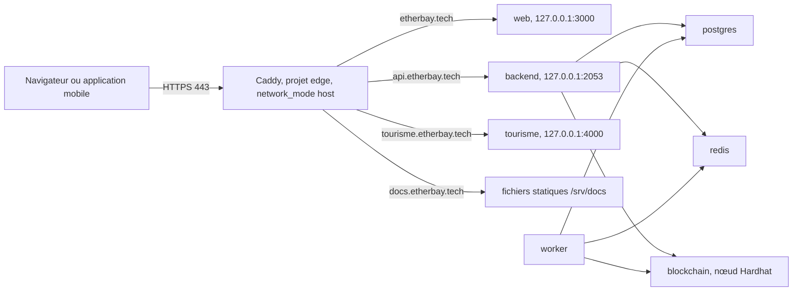

# Déploiement sur etherbay.tech

La démonstration publique de BlockLucky est hébergée sous le domaine `etherbay.tech`, sur une machine virtuelle Azure. Cette page décrit ce qui est en place, la procédure prévue pour déployer l'application et ce qui reste à faire.

> [!IMPORTANT]
> À la date de rédaction (novembre 2026), la machine virtuelle, le pare-feu et le proxy Caddy sont opérationnels, et la documentation est publiée sur `docs.etherbay.tech`. L'application elle-même n'est **pas encore déployée** : `etherbay.tech`, `api.etherbay.tech` et `tourisme.etherbay.tech` renvoient une page « Bientôt en ligne » avec le statut 503. Les étapes marquées « à faire » ci-dessous n'ont pas été exécutées.

## Ressources

| Ressource | Valeur |
| --- | --- |
| Domaine | `etherbay.tech`, acheté chez get.tech avec le GitHub Student Pack |
| Validité du domaine | jusqu'au 11 novembre 2027, renouvellement automatique désactivé |
| Abonnement | Azure for Students |
| Groupe de ressources | `rg-etherbay` |
| Machine virtuelle | `vm-etherbay`, région Denmark East |
| Taille | Standard_B4as_v2 : 4 vCPU, 16 Go de mémoire |
| Système | Ubuntu 24.04 |
| Compte | `etherbay`, connexion SSH par clé uniquement |
| Fin de vie prévue | suppression de la VM après la soutenance, vers le 18 novembre 2026 |

L'adresse IP publique et la clé SSH ne sont pas consignées dans la documentation. La connexion se fait par le nom de domaine :

```bash
ssh etherbay@etherbay.tech
```

## Architecture cible



Deux projets Compose cohabitent sur la VM :

- `edge`, dans `/opt/edge` : Caddy seul, en `network_mode: host`, qui écoute sur les ports 80 et 443 de l'hôte et obtient les certificats Let's Encrypt ;
- `blocklucky` : la stack du dépôt avec le profil `app`, dont les ports applicatifs sont publiés sur `127.0.0.1`.

Le nœud Hardhat tourne sur la VM, dans le service `blockchain` de la stack. La démonstration n'utilise pas Sepolia : elle reste indépendante des robinets et du financement d'un abonnement Chainlink.

## Ce qui est en place

### Préparation de la machine

| Élément | État |
| --- | --- |
| Docker Engine et le plugin Compose | installés |
| Pare-feu `ufw` | ouvert sur 22 (SSH), 80 et 443 uniquement |
| `fail2ban` | installé, protège SSH contre la force brute |
| Swap | 4 Go |
| DNS de la machine | serveurs DNS publics ajoutés, car le résolveur Azure renvoyait `SERVFAIL` pour `archive.ubuntu.com` et bloquait `apt` |

### Proxy Caddy

Caddy route chaque nom vers sa cible et gère HTTPS de bout en bout :

| Nom | Comportement actuel | Comportement cible |
| --- | --- | --- |
| `etherbay.tech` | page « Bientôt en ligne », statut 503 | proxy vers le web, port 3000 |
| `www.etherbay.tech` | redirection vers `etherbay.tech` | inchangé |
| `api.etherbay.tech` | page « Bientôt en ligne », statut 503 | proxy vers `127.0.0.1:2053` (REST et Socket.IO) |
| `tourisme.etherbay.tech` | page « Bientôt en ligne », statut 503 | proxy vers le port 4000 |
| `docs.etherbay.tech` | documentation statique | inchangé, voir [Publier la documentation](publier-documentation.md) |

Le statut 503 signale aux robots d'indexation une indisponibilité temporaire et non une page définitive.

Le Caddyfile de `/opt/edge` n'est pas versionné dans le dépôt, à l'exception du bloc de la documentation ([`documentation-officielle/deploiement/Caddyfile`](src:documentation-officielle/deploiement/Caddyfile)).

## Procédure de déploiement prévue

Les commandes s'exécutent sur la VM, sous le compte `etherbay`, depuis la racine d'un clone du dépôt.

### 1. Récupérer le code

Cloner le dépôt `MarceauTDML/BlockLucky` et se placer sur la branche ou le commit à présenter. Noter le SHA du commit déployé : c'est la référence pour un retour arrière.

### 2. Créer les secrets

Créer un fichier `.env` à la racine du clone, lisible par le seul compte `etherbay` :

```bash
umask 077
cat > .env <<EOF
JWT_SECRET=$(openssl rand -hex 32)
ENCRYPTION_KEY=$(openssl rand -hex 32)
RELAYER_PRIVATE_KEY=0x$(openssl rand -hex 32)
WEBHOOK_SECRET=$(openssl rand -hex 24)
METRICS_TOKEN=$(openssl rand -hex 24)
EOF
```

Ces cinq variables sont exigées par le schéma de [`env.config.ts`](src:backend/src/config/env.config.ts) dès que `NODE_ENV=production` (voir [Docker Compose](docker-compose.md#secrets-obligatoires)). Une clé `RELAYER_PRIVATE_KEY` aléatoire convient : le service `blockchain` habilite et approvisionne automatiquement le compte qui en dérive. Conserver une copie de `ENCRYPTION_KEY` hors de la VM tant que la démonstration dure : sans elle, les portefeuilles intégrés ne peuvent plus être déchiffrés.

### 3. Adapter la configuration aux URL publiques (à faire)

Le fichier `docker-compose.yml` vise `localhost`. Plusieurs valeurs y sont écrites en dur et doivent être remplacées. La solution prévue est un fichier de surcharge propre à la VM, par exemple `docker-compose.etherbay.yml`, non commité, chargé après le fichier principal.

| Variable ou réglage | Valeur actuelle | Valeur pour etherbay.tech | Où elle est lue |
| --- | --- | --- | --- |
| `FRONTEND_URL` | `http://localhost:3000` | `https://etherbay.tech` | liens des emails RGPD, lien de parrainage, `external_url` des métadonnées POAP, origine CORS |
| `CORS_ORIGINS` | `http://localhost:3000,http://localhost:8081` | `https://etherbay.tech` | [`app.ts`](src:backend/src/app.ts) et [`socket.handler.ts`](src:backend/src/socket/socket.handler.ts), via `corsOrigins` |
| `TRUST_PROXY` | absente, donc `false` | `1` | `app.set('trust proxy', …)` dans `app.ts` |
| argument `NEXT_PUBLIC_API_URL` du service `web` | `http://localhost:2053/api` | `https://api.etherbay.tech/api` | figé dans le bundle et dans la CSP au build |
| argument `NEXT_PUBLIC_WS_URL` du service `web` | `http://localhost:2053` | `https://api.etherbay.tech` | client Socket.IO, figé au build |
| `POAP_BASE_URI` du service `blockchain` | `http://localhost:2053/api/v1/lottery/poap/` | `https://api.etherbay.tech/api/v1/lottery/poap/` | `tokenURI` des badges, fixé au déploiement du contrat |
| ports `2053`, `3000`, `4000` | toutes les interfaces | `127.0.0.1` seulement | Docker contourne `ufw` |
| `lotteryAppUrl` du site de l'Office de Tourisme | `http://localhost:3000` | `https://etherbay.tech` | [`site.js`](src:frontend-office-tourisme/assets/js/data/site.js), copié dans l'image : modifier le fichier avant la construction |

Pourquoi chaque point compte :

- **`TRUST_PROXY`.** Derrière Caddy, toutes les requêtes arrivent au conteneur depuis la même adresse interne. Sans `TRUST_PROXY=1`, Express ignore l'en-tête `X-Forwarded-For` posé par Caddy : tous les visiteurs partagent alors le même compteur du rate limiter global (300 requêtes par 15 minutes) et du limiteur d'authentification (30 tentatives par 10 minutes), et la démonstration se bloque en quelques minutes. La valeur `1` fait confiance à un seul saut, Caddy. La lecture de la variable est faite dans `trustProxy` de `env.config.ts`, qui convertit un entier en nombre de sauts.
- **`NEXT_PUBLIC_*`.** Ces valeurs sont des arguments de build. Après modification, l'image `web` doit être reconstruite (`--build`), sinon le navigateur continue d'appeler `localhost` et la CSP bloque les appels vers `api.etherbay.tech`.
- **`POAP_BASE_URI`.** Le préfixe est passé au constructeur de `BlockLuckyPOAP` par `deploy-local.ts`. Il ne change qu'au prochain démarrage du service `blockchain`, qui redéploie les contrats, ou par un appel à `setBaseUri` signé par un détenteur de `DEFAULT_ADMIN_ROLE` (le compte Hardhat n° 0 en local).
- **Ports.** Docker écrit ses propres règles iptables pour les ports publiés, en amont de `ufw`. Un port publié sur toutes les interfaces est joignable depuis Internet malgré le pare-feu, sauf si le groupe de sécurité réseau Azure le bloque. Lier les ports à `127.0.0.1` laisse Caddy seul exposé.

Exemple de fichier de surcharge :

```yaml
services:
  backend:
    environment:
      FRONTEND_URL: https://etherbay.tech
      CORS_ORIGINS: https://etherbay.tech
      TRUST_PROXY: "1"
    ports: !override
      - "127.0.0.1:2053:2053"
  worker:
    environment:
      FRONTEND_URL: https://etherbay.tech
      CORS_ORIGINS: https://etherbay.tech
      TRUST_PROXY: "1"
  web:
    build:
      args:
        NEXT_PUBLIC_API_URL: https://api.etherbay.tech/api
        NEXT_PUBLIC_WS_URL: https://api.etherbay.tech
    ports: !override
      - "127.0.0.1:3000:3000"
  tourisme:
    ports: !override
      - "127.0.0.1:4000:8080"
  blockchain:
    environment:
      POAP_BASE_URI: https://api.etherbay.tech/api/v1/lottery/poap/
```

Les clés `environment` et `build.args` se fusionnent clé par clé avec le fichier principal. Les listes `ports`, elles, s'additionnent : la balise `!override` de Compose remplace la liste au lieu de la compléter. Avant tout démarrage, contrôler le résultat :

```bash
docker compose -f docker-compose.yml -f docker-compose.etherbay.yml --profile app config
```

Vérifier dans la sortie que chaque port applicatif commence par `127.0.0.1` et que les URL sont en `https://`.

### 4. Construire et démarrer (à faire)

```bash
docker compose -f docker-compose.yml -f docker-compose.etherbay.yml --profile app up -d --build --wait
```

L'ordre de démarrage est géré par Compose : PostgreSQL, Redis et la blockchain, puis les migrations, puis l'API et le worker, puis le web (voir [Docker Compose](docker-compose.md#ordre-de-demarrage)). Le premier démarrage de `blockchain` compile et déploie les contrats, ce qui peut prendre une minute.

### 5. Basculer Caddy vers l'application (à faire)

Dans le Caddyfile de `/opt/edge`, remplacer la réponse 503 de chaque nom par un proxy :

```caddyfile
etherbay.tech {
	reverse_proxy 127.0.0.1:3000
}

api.etherbay.tech {
	reverse_proxy 127.0.0.1:2053
}

tourisme.etherbay.tech {
	reverse_proxy 127.0.0.1:4000
}
```

`reverse_proxy` relaie aussi les connexions WebSocket de Socket.IO, sans réglage supplémentaire. Caddy ajoute `X-Forwarded-For`, `X-Forwarded-Proto` et `X-Forwarded-Host`. Le frontend web et le site de l'Office de Tourisme envoient déjà leurs propres en-têtes de sécurité. Recharger Caddy depuis `/opt/edge` après modification.

Il est recommandé de ne pas exposer `/metrics` publiquement, même s'il est protégé par `METRICS_TOKEN`, par exemple avec un bloc `respond /metrics 404` dans le site `api.etherbay.tech`.

### 6. Décider du contenu de démonstration (à faire)

Le service `migrate` applique les migrations mais ne lance aucun seed : la base démarre vide, sans compte administrateur, sans partenaire ni récompense. Pour présenter l'espace Mairie et la boutique, il faut charger les données de [`prisma/seed.ts`](src:backend/prisma/seed.ts). L'image `runtime` ne contient pas `tsx` ; l'image `migrator` contient toutes les dépendances de développement et le dossier `prisma/`. Le chargement depuis cette image, et la façon dont l'administrateur obtient ensuite sa double authentification, restent à valider sur la stack Docker locale avant la VM. Voir [Seed](../base-de-donnees/seed.md) et [Comptes de démonstration et connexion](../demarrage/comptes-et-connexion.md).

### 7. Décider de l'envoi des emails (à faire)

En production, la connexion exige un code envoyé par email (`LOGIN_EMAIL_CODE_REQUIRED` ne peut pas être désactivé quand `NODE_ENV=production`). Dans la stack, `SMTP_HOST` vaut `mailpit` : les codes sont capturés par Mailpit et n'atteignent pas les boîtes des visiteurs. Deux options :

- **Démonstration encadrée** : garder Mailpit et lire les codes dans son interface, liée à `127.0.0.1:8025` sur la VM, par un tunnel SSH :

  ```bash
  ssh -L 8025:127.0.0.1:8025 etherbay@etherbay.tech
  ```

  puis ouvrir `http://localhost:8025` sur le poste. Seules les personnes ayant la clé SSH peuvent se connecter.
- **Démonstration ouverte** : configurer un vrai relais SMTP. `SMTP_HOST` et `SMTP_PORT` sont écrits en dur dans `x-backend-env` et `SMTP_USER`, `SMTP_PASS`, `SMTP_FROM` n'y figurent pas : il faut les ajouter dans la surcharge pour `backend` et `worker`. Le port 465 active TLS (`secure` dans [`mailer.config.ts`](src:backend/src/config/mailer.config.ts)). Le domaine d'expédition doit alors être autorisé par le relais (SPF, DKIM).

### 8. Vérifier

```bash
curl -fsS https://api.etherbay.tech/health/ready
```

```bash
curl -fsS https://api.etherbay.tech/api/config
```

```bash
curl -fsS -H "Authorization: Bearer $METRICS_TOKEN" https://api.etherbay.tech/health/deep
```

Puis, dans un navigateur : ouverture de `https://etherbay.tech`, absence d'erreur CSP dans la console, inscription, réception du code, achat d'un ticket et apparition du tirage en direct. Le scénario complet de démonstration est dans [Préparer la soutenance](../guides/soutenance.md). Un test de fumée k6 peut compléter (voir [Tests de charge](tests-charge.md)).

### 9. Application mobile (à faire)

Pour qu'un téléphone utilise la démonstration, construire l'application avec `EXPO_PUBLIC_API_URL=https://api.etherbay.tech/api` et `EXPO_PUBLIC_WS_URL=https://api.etherbay.tech`. Ces variables sont lues par [`api.client.ts`](src:mobile-app/src/services/api.client.ts) et [`socket.client.ts`](src:mobile-app/src/services/socket.client.ts). Les applications natives n'envoient pas d'en-tête `Origin` et ne sont donc pas concernées par `CORS_ORIGINS`.

## Exploitation pendant la démonstration

| Sujet | Point d'attention | Référence |
| --- | --- | --- |
| Redémarrage de la VM ou du conteneur `blockchain` | la chaîne Hardhat repart de zéro, la base garde l'ancien état | [Runbooks blockchain](runbooks-blockchain.md#chaine-locale-reinitialisee) |
| Tirage bloqué | l'oracle VRF local est un processus du conteneur `blockchain` | [Runbooks blockchain](runbooks-blockchain.md#oracle-vrf-muet) |
| Incident applicatif | sondes, journaux, files | [Runbooks](runbooks.md) |
| Sauvegarde avant soutenance | `pg_dump` de la base | [Sauvegardes et reprise](sauvegardes.md) |
| Mise à jour du code | `git pull` puis la commande de l'étape 4 ; les migrations s'appliquent seules | [Runbooks](runbooks.md#revenir-a-la-version-precedente) |
| Swagger | `/api/docs` annonce `http://localhost:2053` comme serveur, le bouton d'essai ne vise pas la démonstration | [Dette technique et limites](../annexes/dette-technique.md) |

Les journaux se lisent depuis le clone :

```bash
docker compose --profile app logs -f --since 10m backend worker
```

## Fin de vie

Après la soutenance, vers le 18 novembre 2026 :

1. sauvegarder ce qui doit l'être (aucune donnée réelle n'est traitée, une sauvegarde n'est utile que pour rejouer la démonstration) ;
2. supprimer le groupe de ressources, ce qui supprime la VM, son disque, son adresse IP et son groupe de sécurité réseau :

   ```bash
   az group delete --name rg-etherbay
   ```

3. retirer ou rediriger les enregistrements DNS chez get.tech, pour qu'aucun sous-domaine ne pointe vers une adresse IP réattribuée à un tiers.

Le domaine reste enregistré jusqu'au 11 novembre 2027 et ne sera pas renouvelé automatiquement.

## Récapitulatif de ce qui reste à faire

| Étape | État |
| --- | --- |
| VM, Docker, `ufw`, `fail2ban`, swap, DNS de la machine | fait |
| Caddy et certificats Let's Encrypt pour tous les noms | fait |
| Documentation sur `docs.etherbay.tech` | fait |
| Clone du dépôt et fichier `.env` | à faire |
| Fichier de surcharge (URL publiques, `TRUST_PROXY`, ports locaux, `POAP_BASE_URI`) | à faire |
| Lien `lotteryAppUrl` du site de l'Office de Tourisme vers `https://etherbay.tech` | à faire |
| Construction et démarrage de la stack avec le profil `app` | à faire |
| Bascule des blocs Caddy de 503 vers `reverse_proxy` | à faire |
| Données de démonstration (seed) | à décider puis à faire |
| Envoi des emails (Mailpit par tunnel ou relais SMTP) | à décider |
| Build mobile pointé vers `api.etherbay.tech` | à faire si une démonstration mobile est prévue |
| Suppression du groupe `rg-etherbay` | après la soutenance |
