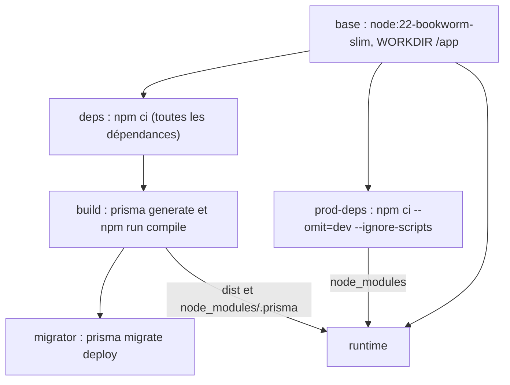

# Images Docker

Le dépôt contient quatre Dockerfile, un par projet déployable. L'application mobile n'en a pas : elle est construite par Expo et EAS (voir [Builds et publication](../mobile/builds-publication.md)).

| Dockerfile | Image de base | Cibles | Utilisateur | Port | Sonde |
| --- | --- | --- | --- | --- | --- |
| [`backend/Dockerfile`](src:backend/Dockerfile) | `node:22-bookworm-slim` | `migrator`, `runtime` (et les étapes `deps`, `build`, `prod-deps`) | `node` (uid 1000) | 2053 | `/health/live` |
| [`frontend-web/Dockerfile`](src:frontend-web/Dockerfile) | `node:22-bookworm-slim` | `runtime` (finale) | `node` (uid 1000) | 3000 | `GET /` |
| [`frontend-office-tourisme/Dockerfile`](src:frontend-office-tourisme/Dockerfile) | `nginxinc/nginx-unprivileged:1.30-alpine` | une seule étape | `101` (nginx) | 8080 | `/health` |
| [`smart-contract/Dockerfile`](src:smart-contract/Dockerfile) | `node:22-bookworm-slim` | une seule étape | `node` (uid 1000) | 8545 | fichier `/tmp/blockchain-ready` |

Les trois images Node.js déclarent `ARG NODE_IMAGE=node:22-bookworm-slim`. On peut donc changer d'image de base sans modifier le fichier, par exemple pour épingler un digest :

```bash
docker build --build-arg NODE_IMAGE=node:22-bookworm-slim@sha256:<digest> -t blocklucky-backend backend
```

Toutes utilisent `RUN --mount=type=cache,target=/root/.npm` : le cache npm est conservé par BuildKit entre deux constructions, sans entrer dans l'image. Les variables `NPM_CONFIG_UPDATE_NOTIFIER=false`, `NPM_CONFIG_FUND=false` et `NPM_CONFIG_AUDIT=false` coupent les appels réseau superflus de npm pendant le build (l'audit est fait par la CI, voir [Intégration continue](ci.md)).

## Backend

Le Dockerfile du backend est le seul à plusieurs cibles utiles. Ses étapes se construisent ainsi :



### Étape `build`

Elle copie `tsconfig.json`, `tsconfig.build.json`, `prisma.config.ts`, le dossier `prisma/` et `src/`, puis lance `npx prisma generate` (client Prisma dans `node_modules/.prisma`) et `npm run compile`. Ce script compile avec `tsconfig.build.json` vers `dist/` et copie `src/templates` dans `dist/src/templates`, car les modèles d'emails HTML ne sont pas du TypeScript.

### Cible `migrator`

Elle part de `build`, donc avec toutes les dépendances de développement (dont la CLI `prisma`), et lance `npx prisma migrate deploy` sous l'utilisateur `node`. Le service Compose `migrate` l'utilise. Cette image n'est jamais exposée : elle applique les migrations et s'arrête.

### Cible `runtime`

C'est l'image de l'API et du worker. Elle ne contient que :

- les dépendances de production (`npm ci --omit=dev --ignore-scripts` : aucun script d'installation n'est exécuté) ;
- le client Prisma généré, copié depuis `build` ;
- le code compilé `dist/` et `package.json`.

Ni le code source TypeScript, ni les tests, ni la CLI de développement n'y sont. Tous les fichiers appartiennent à `node:node` (`COPY --chown`), le processus tourne sous `USER node`.

| Réglage | Valeur | Raison |
| --- | --- | --- |
| `ARG APP_VERSION` | `1.0.0` | Exposée par `/health/deep` et dans chaque ligne de log |
| `ENV NODE_ENV` | `production` | Active les contrôles de configuration de production |
| `CMD` | `node --max-old-space-size=384 --enable-source-maps dist/src/server.js` | Tas V8 limité à 384 Mo, piles d'erreurs lisibles grâce aux source maps du build |
| `STOPSIGNAL` | `SIGTERM` | Déclenche l'arrêt propre |
| `HEALTHCHECK` | `fetch` sur `/health/live`, toutes les 15 s | Utilisé par Compose pour `service_healthy` |

Le worker réutilise la même image avec une autre commande (`dist/src/worker.js`, voir [Docker Compose](docker-compose.md)).

Le fichier [`backend/.dockerignore`](src:backend/.dockerignore) exclut `node_modules`, `dist`, `coverage`, `__tests__`, les fichiers `.env` (sauf `.env.example`), les journaux et `.git`. Aucun secret local n'entre donc dans le contexte de build.

## Frontend web

Trois étapes : `deps` (`npm ci`), `build` et `runtime`.

L'étape `build` reçoit deux arguments, transformés en variables d'environnement avant `npm run build` :

| Argument | Valeur par défaut | Usage |
| --- | --- | --- |
| `NEXT_PUBLIC_API_URL` | `http://localhost:2053/api` | URL de l'API REST, lue par [`frontend-web/src/lib/config.ts`](src:frontend-web/src/lib/config.ts) |
| `NEXT_PUBLIC_WS_URL` | `http://localhost:2053` | URL du serveur Socket.IO |

Elle fixe aussi `NEXT_OUTPUT=standalone`, que [`next.config.mjs`](src:frontend-web/next.config.mjs) traduit en `output: 'standalone'` : Next.js produit dans `.next/standalone` un serveur Node.js minimal avec les seules dépendances réellement importées.

> [!IMPORTANT]
> Les variables `NEXT_PUBLIC_*` sont recopiées dans le JavaScript envoyé au navigateur au moment du build. Elles servent aussi à calculer la directive `connect-src` de la Content-Security-Policy dans `next.config.mjs`. Changer l'adresse de l'API impose donc de reconstruire l'image ; modifier une variable d'environnement du conteneur ne suffit pas.

L'étape `runtime` copie `.next/standalone`, `.next/static` et `public/` (propriétaire `node`), fixe `PORT=3000` et `HOSTNAME=0.0.0.0`, et lance `node server.js`. La télémétrie Next.js est coupée par `NEXT_TELEMETRY_DISABLED=1`. Les source maps navigateur sont désactivées (`productionBrowserSourceMaps: false`), ce que la CI contrôle.

À l'exécution, le serveur écrit dans `.next/cache` (optimisation des images). Le service Compose y monte un tmpfs, puisque le système de fichiers racine est en lecture seule.

## Office de Tourisme

L'image part de `nginxinc/nginx-unprivileged:1.30-alpine`, une variante officielle de nginx qui tourne sans root et écoute sur 8080. Le Dockerfile repasse root le temps d'un `apk upgrade --no-cache` (correctifs Alpine publiés après l'image de base), puis revient à l'utilisateur `101`.

Il copie :

- [`docker/nginx.conf`](src:frontend-office-tourisme/docker/nginx.conf) dans `/etc/nginx/conf.d/default.conf` ;
- [`docker/security-headers.conf`](src:frontend-office-tourisme/docker/security-headers.conf) dans `/etc/nginx/snippets/` ;
- les pages `*.html`, le dossier `assets/` et `.well-known/` (dont `security.txt`).

La configuration nginx :

- refuse toute méthode autre que `GET` et `HEAD` (405) ;
- limite le corps des requêtes à 16 Ko ;
- masque la version (`server_tokens off`) ;
- renvoie 404 pour tout fichier caché, sauf `.well-known` ;
- répond `ok` sur `/health` sans journaliser ;
- applique un cache d'un jour (CSS et JavaScript), de 30 jours (images et polices) ou `no-cache` (HTML) ;
- compresse en gzip les ressources textuelles de plus de 1 Ko.

Les en-têtes de sécurité sont inclus dans chaque bloc `location`, car nginx n'hérite pas des `add_header` du niveau supérieur dès qu'un bloc en définit un. Le détail du site est dans [Servir et déployer](../office-tourisme/deploiement.md).

## Blockchain locale

L'image `smart-contract` sert uniquement au développement, à la CI et à la démonstration : elle embarque un nœud Hardhat et les comptes de test publics de Hardhat.

1. `npm ci` (toutes les dépendances, Hardhat compris) ;
2. copie de `hardhat.config.ts`, `tsconfig.json`, `contracts/`, `scripts/` et du script de démarrage ;
3. `npx hardhat build` : les contrats sont compilés au build de l'image, pas au démarrage ;
4. création de `deployments/` et `chown -R node:node /app`, puis `USER node`.

`HARDHAT_DISABLE_TELEMETRY=true` coupe la télémétrie. La sonde `test -f /tmp/blockchain-ready` a une grâce de 60 secondes et 20 essais toutes les 5 secondes, ce qui laisse le temps au déploiement des contrats. Le déroulé de [`start-local-chain.sh`](src:smart-contract/docker/start-local-chain.sh) est expliqué dans [Docker Compose](docker-compose.md#service-blockchain-et-compte-operateur) et dans [Blockchain locale](../smart-contracts/blockchain-locale.md).

> [!CAUTION]
> Cette image ne doit jamais servir à un réseau public : les clés privées des comptes Hardhat sont connues de tous. Sur Sepolia, les contrats sont déployés par `npm run deploy:sepolia` et le backend pointe vers un RPC Sepolia (voir [Déploiement sur Sepolia](../smart-contracts/sepolia.md)).

## Utilisateur non root

| Image | Utilisateur | Fichiers de l'application |
| --- | --- | --- |
| backend `runtime` et `migrator` | `node` | `node:node` |
| web `runtime` | `node` | `node:node` |
| tourisme | `101` | `nginx:nginx` |
| smart-contract | `node` | `node:node` |

Combiné avec `read_only`, `cap_drop: [ALL]` et `no-new-privileges` dans Compose, un processus compromis ne peut ni écrire hors de `/tmp`, ni obtenir de privilège.

## Tailles des images

Les tailles n'ont pas été mesurées pour cette documentation et dépendent de la version des images de base. Pour les obtenir après une construction :

```bash
docker image ls --format "table {{.Repository}}\t{{.Tag}}\t{{.Size}}" | grep blocklucky
```

Les choix qui réduisent la taille sont connus : base `bookworm-slim` plutôt que l'image Node.js complète, dépendances de production seules dans le backend, sortie `standalone` pour Next.js, Alpine pour nginx. L'image `smart-contract` est la plus lourde, car elle garde toute la chaîne Hardhat ; elle n'est jamais déployée en production.

## Analyse de vulnérabilités

Le job `docker` de la CI construit les quatre images (sans les publier) puis analyse trois d'entre elles avec Trivy :

```bash
docker run --rm -v /var/run/docker.sock:/var/run/docker.sock aquasec/trivy:0.76.2 image \
  --quiet --exit-code 1 --ignore-unfixed --severity CRITICAL,HIGH "blocklucky-backend:<sha>"
```

| Option | Effet |
| --- | --- |
| `--severity CRITICAL,HIGH` | Seules les vulnérabilités critiques et hautes comptent |
| `--ignore-unfixed` | Une vulnérabilité sans correctif publié n'échoue pas le job |
| `--exit-code 1` | Le job échoue dès qu'une vulnérabilité retenue est trouvée |

Les images analysées sont `blocklucky-backend`, `blocklucky-web` et `blocklucky-tourisme`. L'image de la blockchain locale n'est pas analysée : elle contient toutes les dépendances de développement de Hardhat et ne sort jamais de l'environnement de développement. Le même contrôle peut être lancé en local après `docker build`, en remplaçant `<sha>` par le tag construit.

Dependabot propose chaque semaine la mise à jour des images de base des quatre Dockerfile et des images du fichier Compose (voir [Dépendances](../contribuer/dependances.md)).
