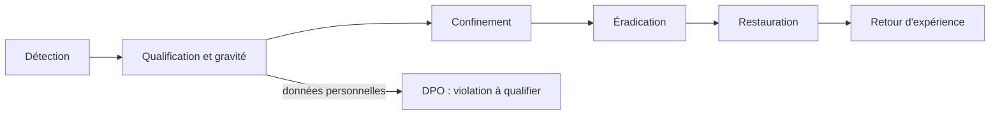

# Réponse aux incidents

Cette page décrit la conduite d'un incident, de la détection au retour d'expérience : niveaux de gravité, rôles, étapes, mesures de confinement disponibles dans le code et obligations en cas de violation de données personnelles. Les gestes techniques sont dans [Runbooks](runbooks.md) et [Runbooks blockchain](runbooks-blockchain.md). Le signalement d'une vulnérabilité par un tiers est décrit dans [Signaler une vulnérabilité](../securite/signalement.md).

## Niveaux de gravité

| Niveau | Exemples | Prise en charge |
| --- | --- | --- |
| P1 | fuite de données personnelles, compte administrateur compromis, secret de production exposé, faille du contrat exploitée ou exploitable | immédiate |
| P2 | vulnérabilité exploitable sans fuite constatée, indisponibilité du service, tirage bloqué pendant la période de la loterie | 4 heures |
| P3 | vulnérabilité difficile à exploiter, comportement anormal isolé, dégradation partielle (Redis absent, emails en retard) | 2 jours ouvrés |
| P4 | amélioration de durcissement | prochain sprint |

En cas de doute entre deux niveaux, retenir le plus grave : il est toujours possible de déclasser un incident.

## Rôles

| Rôle | Responsabilité | Contact |
| --- | --- | --- |
| Responsable de l'incident | coordonne, décide du confinement, tient la chronologie | DSI d'EtherBay, `dsi@etherbay.fr` |
| Référent technique | diagnostic, correctif, restauration | équipe BlockLucky |
| Délégué à la protection des données (DPO) | qualification d'une violation de données, notification à la CNIL | `dpo@etherbay.fr` |
| Communication | information des citoyens et des commerçants partenaires | service communication de la Ville |

Les adresses sont celles de la Ville fictive d'EtherBay, reprises de l'ancienne documentation. Les signalements de vulnérabilité arrivent sur `securite@etherbay.fr`, publié dans [`SECURITY.md`](src:SECURITY.md) et dans les fichiers `/.well-known/security.txt` du frontend web et de l'Office de Tourisme.

## Déroulé



### 1. Détection

Sources possibles :

- signalement externe (`securite@etherbay.fr`) ;
- journaux de l'API et du worker : réponses 5xx, erreurs `error`, identifiant `requestId` d'une requête suspecte ;
- métriques `/metrics` : hausse des 5xx ou de la latence par route, compteurs métier anormaux (`business_events_total`) ;
- sondes `/health/ready` et `/health/deep` ;
- journal d'administration (`GET /api/admin/audit-logs`) : action Mairie inattendue ;
- emails `security-alert` reçus par un citoyen qu'il n'a pas initiés : activation ou désactivation de la double authentification, utilisation d'un code de secours ;
- explorateur de blocs sur Sepolia : transaction inattendue du contrat ou du compte opérateur.

Aucune alerte automatique n'est branchée sur ces sources (voir [Objectifs de service et métriques](slo-metriques.md)).

### 2. Qualification

Ouvrir la chronologie (voir plus bas), attribuer un niveau de gravité, nommer le responsable de l'incident. Si des données personnelles sont concernées, prévenir le DPO dès ce stade : le délai de 72 heures court à partir de la découverte.

### 3. Confinement

Choisir la mesure la plus ciblée qui arrête le dommage.

| Situation | Mesure | Effet |
| --- | --- | --- |
| Compte citoyen ou partenaire compromis | révocation de toutes ses sessions : bouton « Déconnecter tous mes appareils » de la page Sécurité du profil web, ou `POST /api/auth/logout` avec `{"allDevices": true}` | tous les JWT émis avant l'instant de la révocation sont refusés (clé Redis `auth:revoked-before:<id>`, conservée 30 jours) ; reconfigurer ensuite la 2FA |
| Compte dont le titulaire ne peut plus agir | changement de son rôle en base | les routes protégées par rôle relisent le rôle en base à chaque requête ([`rbac.middleware.ts`](src:backend/src/middlewares/rbac.middleware.ts)) : un jeton dont le rôle ne correspond plus est refusé immédiatement |
| Compte administrateur compromis | changement de rôle en base, puis rotation de `JWT_SECRET` si plusieurs comptes sont touchés | la rotation invalide toutes les sessions de tous les comptes |
| Fonctionnalité de l'API vulnérable | `MAINTENANCE_MODE=true` | toutes les routes `/api/*` sauf `/api/admin` répondent 503 ([Runbooks](runbooks.md#mode-maintenance)) |
| Faille du contrat ou anomalie de la loterie | disjoncteur, `POST /api/admin/circuit-breaker` | achats et tirages bloqués sur la chaîne, retraits de gains et remboursements toujours possibles ([Runbooks blockchain](runbooks-blockchain.md#pause-d-urgence)) |
| Webhook falsifié | rotation de `WEBHOOK_SECRET` | les signatures HMAC anciennes sont refusées ; le webhook est de toute façon désactivé en mode `onchain` |

> [!WARNING]
> La révocation des sessions repose sur Redis. Si Redis est indisponible, la liste est tenue en mémoire par chaque processus et n'est pas partagée ; si le volume Redis est perdu, les révocations disparaissent et les jetons révoqués redeviennent valides jusqu'à leur expiration (`JWT_EXPIRES_IN`, 12 heures par défaut). En cas de doute, la rotation de `JWT_SECRET` est la seule mesure sûre.

### Rotation des secrets

| Secret | Conséquence de la rotation | Précautions |
| --- | --- | --- |
| `JWT_SECRET` | toutes les sessions sont invalidées, tout le monde se reconnecte | aucune |
| `WEBHOOK_SECRET` | les émetteurs du webhook doivent signer avec la nouvelle valeur | aucune en mode `onchain` |
| `METRICS_TOKEN` | la collecte des métriques doit être reconfigurée | aucune |
| `ENCRYPTION_KEY` | les clés privées des portefeuilles intégrés et les secrets TOTP, chiffrés en AES-256-GCM avec cette clé, deviennent illisibles | **le dépôt ne fournit pas d'outil de rechiffrement** : il faut déchiffrer chaque valeur avec l'ancienne clé et la rechiffrer avec la nouvelle, dans une même opération, avant de changer la configuration. Voir [Cryptographie et secrets](../securite/cryptographie-secrets.md) |
| `RELAYER_PRIVATE_KEY` | le backend signe avec un nouveau compte opérateur | le nouveau compte doit recevoir `OPERATOR_ROLE`, `PAUSER_ROLE` et `MINTER_ROLE` d'un détenteur de `DEFAULT_ADMIN_ROLE` (la Mairie), l'ancien doit les perdre (`revokeRole`), et les fonds de l'ancien compte doivent être transférés. En local, un redémarrage du service `blockchain` habilite le nouveau compte, mais réinitialise la chaîne |

Après chaque rotation, recréer l'API et le worker pour qu'ils relisent la configuration :

```bash
docker compose --profile app up -d backend worker
```

### 4. Éradication

Corriger la cause, ajouter un test de non-régression qui reproduit l'attaque ou la panne, faire relire la correction et la déployer par le circuit normal (pull request, CI verte). Sur le contrat, un correctif impose un redéploiement : un contrat déployé n'est pas modifiable (voir [Modifier le contrat](../guides/modifier-contrat.md)).

### 5. Restauration

- `/health/ready` répond 200 et `/health/deep` `pass` ;
- le taux de réponses 5xx est revenu à son niveau habituel dans `/metrics` ;
- le journal d'administration ne montre aucune action inattendue depuis le confinement ;
- le disjoncteur est relâché (`"paused": false`) et `MAINTENANCE_MODE` retiré, s'ils avaient été utilisés ;
- les données éventuellement restaurées sont cohérentes (voir [Sauvegardes et reprise](sauvegardes.md)).

### 6. Retour d'expérience

Un post-mortem écrit est produit sous 10 jours ouvrés, sans recherche de coupable. Il contient :

- la chronologie ;
- la cause racine et les facteurs aggravants ;
- l'impact (personnes, données, durée, fonds de test) ;
- les actions correctives, chacune avec un responsable et une échéance ;
- la mise à jour des runbooks qui ont servi.

## Violation de données personnelles

Une violation est une destruction, une perte, une altération, une divulgation ou un accès non autorisé à des données personnelles, qu'il soit accidentel ou illicite (article 4 du RGPD).

- Le DPO qualifie la violation et l'inscrit au registre des violations, même si elle n'est pas notifiée.
- Si elle présente un risque pour les droits et libertés des personnes : notification à la CNIL dans les 72 heures suivant sa découverte, par son téléservice (article 33). Une notification incomplète peut être complétée ensuite.
- Si le risque est élevé : information des personnes concernées dans les meilleurs délais, en termes clairs, avec la nature de la violation, ses conséquences probables, les mesures prises et les précautions à prendre (article 34).

Les données traitées par BlockLucky sont listées dans le [registre des traitements](../juridique/registre-traitements.md). Les plus sensibles en cas de fuite :

| Donnée | Risque |
| --- | --- |
| clés privées chiffrées des portefeuilles, avec `ENCRYPTION_KEY` | prise de contrôle des portefeuilles et de leurs fonds |
| adresses email | hameçonnage ciblé des citoyens |
| secrets TOTP chiffrés, codes de secours hachés | contournement de la double authentification si la clé de chiffrement fuit aussi |
| adresses de portefeuille associées aux comptes | lien entre une identité et une activité publique sur la chaîne |

Une adresse de portefeuille et ses transactions restent publiques sur la chaîne même après la suppression du compte : voir [Blockchain et données personnelles](../juridique/blockchain-donnees.md).

## Journal de l'incident

Chaque incident tient une chronologie horodatée en UTC : détection, décisions, actions, personnes impliquées, communications. Elle sert de base au post-mortem et à une éventuelle notification. Modèle :

```text
2026-11-18T09:42Z  Détection    Hausse des 5xx sur POST /api/v1/lottery/buy (metrics)
2026-11-18T09:45Z  Qualification P2, responsable : DSI
2026-11-18T09:47Z  Diagnostic   Journaux du worker : Indexation blockchain interrompue, RPC injoignable
2026-11-18T09:55Z  Action       RPC_URL basculé vers le fournisseur de secours, backend et worker recréés
2026-11-18T10:02Z  Restauration Taux de 5xx revenu à 0, indexeur à jour
2026-11-18T10:10Z  Communication Message aux citoyens sur la page d'accueil
```

Les identifiants techniques utiles à conserver : `requestId` des requêtes concernées, hachages de transaction, identifiants des comptes, SHA du commit déployé.
