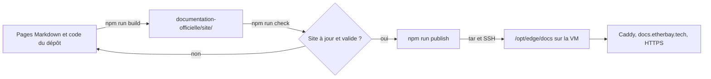

# Publier la documentation

La documentation est servie sur `https://docs.etherbay.tech` par le serveur web Caddy de la machine virtuelle de démonstration, le même qui sert l'application (voir [Déploiement sur etherbay.tech](deploiement-etherbay.md)). Le site est entièrement statique : le publier revient à copier le dossier `documentation-officielle/site/` sur le serveur.



## Mise en place, une seule fois

### 1. Enregistrement DNS

Chez le registraire du domaine (get.tech), ajouter un enregistrement de type `A` pour le sous-domaine `docs`. Il doit pointer vers la même adresse IP publique que `etherbay.tech`. Vérifier ensuite la résolution :

```bash
nslookup docs.etherbay.tech
```

Caddy obtient le certificat Let's Encrypt automatiquement à la première requête, dès que le nom résout vers la machine.

### 2. Bloc Caddy

Le bloc à ajouter au Caddyfile du projet Compose `edge` (dossier `/opt/edge`) est versionné dans [`documentation-officielle/deploiement/Caddyfile`](src:documentation-officielle/deploiement/Caddyfile) :

```caddyfile
docs.etherbay.tech {
	root * /srv/docs
	encode zstd gzip
	file_server

	header {
		Content-Security-Policy "default-src 'none'; script-src 'self'; style-src 'self' 'unsafe-inline'; img-src 'self' data:; font-src 'self'; connect-src 'self'; base-uri 'none'; form-action 'none'; frame-ancestors 'none'"
		Strict-Transport-Security "max-age=31536000"
		X-Content-Type-Options "nosniff"
		X-Frame-Options "DENY"
		Referrer-Policy "strict-origin-when-cross-origin"
		Permissions-Policy "camera=(), microphone=(), geolocation=(), payment=()"
		Cross-Origin-Opener-Policy "same-origin"
		-Server
	}

	@static path /assets/*
	header @static Cache-Control "public, max-age=86400"

	@documents path / *.html /search-index.json
	header @documents Cache-Control "no-cache"

	handle_errors {
		rewrite * /404.html
		file_server
	}
}
```

Le conteneur Caddy doit voir les fichiers publiés. Il faut donc monter le dossier de l'hôte `/opt/edge/docs` en lecture seule sur `/srv/docs`, dans la définition du service Caddy du fichier Compose de `/opt/edge` :

```yaml
volumes:
  - /opt/edge/docs:/srv/docs:ro
```

Recharger ensuite Caddy depuis `/opt/edge`. Le changement de volume demande de recréer le conteneur :

```bash
sudo docker compose up -d
```

### Pourquoi ces en-têtes

| En-tête | Effet |
| --- | --- |
| `Content-Security-Policy` | N'autorise que les scripts, styles, polices et images du domaine. `style-src 'unsafe-inline'` est nécessaire aux styles que Mermaid insère dans ses diagrammes SVG ; aucun script en ligne n'est autorisé. `frame-ancestors 'none'` interdit l'affichage du site dans un cadre. |
| `Strict-Transport-Security` | Force HTTPS pendant un an. |
| `X-Content-Type-Options`, `X-Frame-Options`, `Referrer-Policy`, `Permissions-Policy`, `Cross-Origin-Opener-Policy` | Durcissement standard du navigateur, aligné sur le frontend web et le site de l'Office de Tourisme. |
| `Cache-Control` | Les pages et l'index de recherche sont revalidés à chaque visite, ce qui rend une publication visible aussitôt ; les ressources de `assets/` restent en cache un jour. |

La page `404.html` est servie avec le code 404 pour toute adresse inconnue. Elle utilise des chemins absolus pour rester correcte quelle que soit la profondeur de l'URL demandée.

## Publier une nouvelle version

Depuis `documentation-officielle/`, sur un poste qui a accès à la VM en SSH :

```bash
npm run build
```

```bash
npm run publish -- --key ~/.ssh/<clé de la VM>
```

Le script [`scripts/publish.mjs`](src:documentation-officielle/scripts/publish.mjs) procède en quatre étapes :

1. Il lance `npm run check` et s'arrête si le site n'est pas à jour, si un lien est cassé ou si une description manque. Une documentation fausse n'est donc jamais publiée.
2. Il compresse `site/` avec `tar` et l'envoie par SSH, sans fichier intermédiaire.
3. Sur la VM, il décompresse dans `/opt/edge/docs.new`, puis remplace `/opt/edge/docs` en une seule opération. L'ancienne version est gardée dans `/opt/edge/docs.old`, ce qui permet un retour arrière immédiat.
4. Il rend les fichiers lisibles par le conteneur Caddy, puis redémarre ce conteneur s'il s'appelle `caddy`. Docker monte un dossier de l'hôte par son inode au démarrage du conteneur : après le remplacement de `/opt/edge/docs`, Caddy continuerait sinon de servir l'ancien dossier, vide après la première publication, et toutes les pages répondraient 404. Le redémarrage coupe tous les sites de la VM pendant environ une seconde.

| Option | Variable d'environnement équivalente | Valeur par défaut |
| --- | --- | --- |
| `--host` | `DOCS_HOST` | `etherbay@etherbay.tech` |
| `--key` | `DOCS_KEY` | aucune, la configuration SSH du poste s'applique |
| `--remote-dir` | `DOCS_REMOTE_DIR` | `/opt/edge/docs` |

`tar` et `ssh` sont fournis par Windows 10 et 11, macOS et les distributions Linux. Le compte distant doit pouvoir utiliser `sudo` sans mot de passe, comme le compte administrateur créé par Azure.

> [!TIP]
> Pour revenir à la version précédente, se connecter à la VM et échanger les dossiers : `sudo mv /opt/edge/docs /opt/edge/docs.bad && sudo mv /opt/edge/docs.old /opt/edge/docs`.

## Vérifier la publication

```bash
curl -sI https://docs.etherbay.tech/ | findstr /i "HTTP content-security strict-transport"
```

Sur macOS ou Linux, remplacer `findstr /i` par `grep -i`. Vérifier ensuite dans un navigateur que la recherche (`Ctrl K`) répond, qu'une page avec diagramme les affiche, et qu'une adresse inventée renvoie la page 404.

## Après la soutenance

La VM de démonstration doit être supprimée après la soutenance. `docs.etherbay.tech` cessera alors de répondre. La documentation reste disponible :

- dans le dépôt, en Markdown dans `content/`, lisible directement sur GitHub ;
- en local, avec `npm run serve` ;
- sur n'importe quel autre serveur web, en copiant le contenu de `site/` et en reprenant les en-têtes du bloc Caddy ci-dessus.
