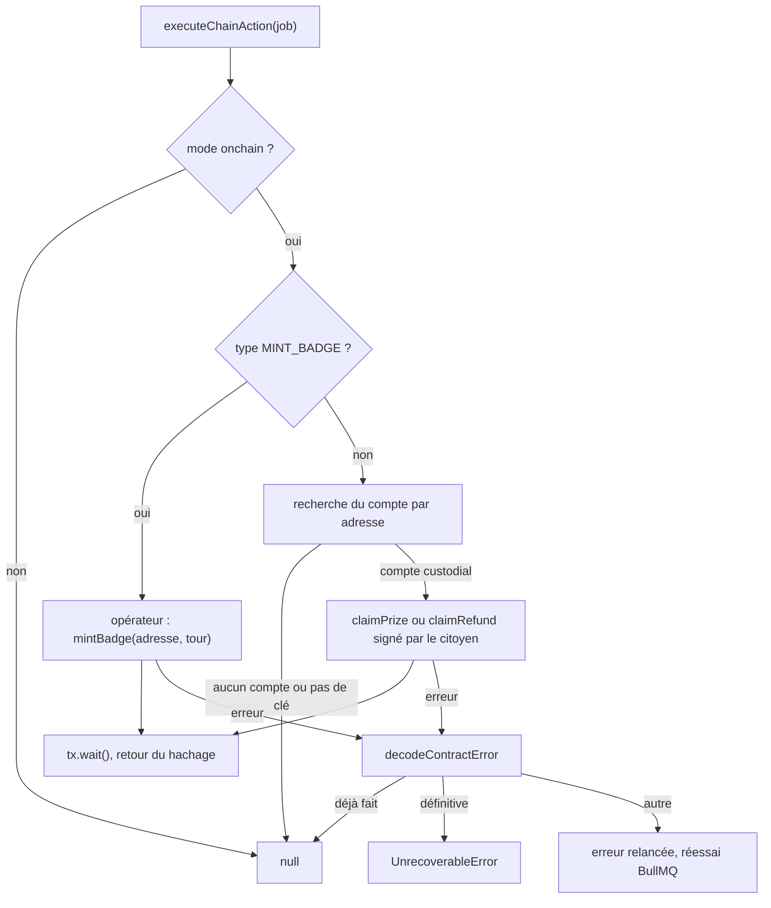

# File d'actions on-chain

Certaines transactions doivent être envoyées après un événement du contrat, sans qu'une requête HTTP les attende : frapper le badge POAP d'un participant, verser la cagnotte au gagnant, réclamer les remboursements d'un tour annulé. [`backend/src/blockchain/chain-actions.ts`](src:backend/src/blockchain/chain-actions.ts) les place dans une file BullMQ nommée `chain-actions` et les exécute dans un worker, avec réessais.

Le même fichier exporte `decodeContractError`, utilisé dans tout le dossier `src/blockchain/`.

## Types de jobs

```typescript
export type ChainActionJob =
  | { type: 'CLAIM_PRIZE'; contractRoundId: number; walletAddress: string }
  | { type: 'CLAIM_REFUND'; contractRoundId: number; walletAddress: string }
  | { type: 'MINT_BADGE'; contractRoundId: number; walletAddress: string };
```

| Type | Mis en file par | Signataire | Appel du contrat |
|---|---|---|---|
| `MINT_BADGE` | Indexeur, événement `TicketsPurchased`, pour le bénéficiaire | Compte opérateur (rôle `MINTER_ROLE`) | `BlockLuckyPOAP.mintBadge(adresse, tour)` |
| `CLAIM_PRIZE` | Indexeur, événement `WinnerPicked`, pour le gagnant | Portefeuille intégré du gagnant | `BlockLucky.claimPrize(tour)` |
| `CLAIM_REFUND` | Indexeur, événement `RoundCancelled`, pour chaque payeur distinct | Portefeuille intégré du payeur | `BlockLucky.claimRefund(tour)` |

Le contrat interdit à quiconque d'autre que le gagnant de retirer la cagnotte, et rembourse `msg.sender`. C'est pourquoi `CLAIM_PRIZE` et `CLAIM_REFUND` sont signés par le portefeuille du citoyen, dont le backend détient la clé, et non par l'opérateur. Le versement et le remboursement sont donc automatiques pour les portefeuilles intégrés uniquement.

## Mise en file : enqueueChainAction

`enqueueChainAction(job)` ne fait rien en mode simulé. En mode onchain :

1. il calcule le `jobId` `<type>-<tour>-<adresse en minuscules>`, par exemple `MINT_BADGE-3-0xabc…` ;
2. il ajoute le job à la file `chain-actions`, avec pour nom le type du job ;
3. si la file n'existe pas (pas de client Redis) ou si l'ajout échoue, il exécute le job directement, sans l'attendre, et journalise l'éventuel échec.

### Dédoublonnage par jobId

BullMQ refuse silencieusement d'ajouter un job dont l'identifiant existe déjà dans la file. Le `jobId` déterministe garantit donc un seul badge par participant et par tour, un seul versement par gagnant et un seul remboursement par payeur, même si l'indexeur traite l'événement plusieurs fois.

Ce dédoublonnage dure tant que BullMQ conserve le job : 24 h ou 1 000 jobs terminés, 14 jours pour un job en échec (voir les options plus bas). Au-delà, un nouvel ajout est accepté, mais l'exécution se termine sans effet grâce aux erreurs « déjà fait » du contrat.

Un participant qui achète plusieurs fois dans le même tour produit plusieurs ajouts `MINT_BADGE` avec le même `jobId` : un seul badge est frappé.

## Exécution : executeChainAction



La fonction renvoie le hachage de la transaction, ou `null` quand il n'y avait rien à faire.

### Erreurs déjà faites, définitives et réessais

| Catégorie | Erreurs du contrat | Traitement |
|---|---|---|
| Déjà fait (`ALREADY_DONE_ERRORS`) | `PrizeAlreadyClaimed`, `NothingToRefund`, `BadgeAlreadyMinted` | Le job se termine en succès avec `null` |
| Définitive (`PERMANENT_ERRORS`) | `NotWinner`, `RoundNotCompleted`, `RoundNotCancelled`, `ZeroAddressNotAllowed` | `UnrecoverableError` : BullMQ marque le job en échec sans réessai |
| Autre | Erreurs réseau, `INSUFFICIENT_FUNDS`, `TransferFailed`, `NONCE_EXPIRED`, `EnforcedPause`… | Erreur relancée : BullMQ réessaie selon les options de la file |

Le cas `EnforcedPause` mérite une mention : `claimPrize` et `claimRefund` ne sont pas soumis à la pause dans le contrat (pas de modificateur `whenNotPaused`), mais une erreur de ce type serait réessayée.

Un `CLAIM_PRIZE` ou `CLAIM_REFUND` pour une adresse sans compte ou sans clé chiffrée renvoie `null` : il se termine en succès sans transaction. C'est le cas d'un achat fait depuis un portefeuille externe, ou d'un compte effacé au titre du RGPD.

### Options de la file

Les options par défaut viennent de [`backend/src/queues/queue.options.ts`](src:backend/src/queues/queue.options.ts), communes aux trois files du backend :

| Option | Valeur |
|---|---|
| `attempts` | 5 tentatives au total |
| `backoff` | Exponentiel, délai initial 1 000 ms, `jitter` 0,5 |
| `removeOnComplete` | Après 24 h ou au-delà de 1 000 jobs |
| `removeOnFail` | Après 14 jours |

Avec ce réglage, les tentatives sont espacées d'environ 1 s, 2 s, 4 s puis 8 s, réduites aléatoirement jusqu'à moitié par le jitter. Un job encore en échec après la cinquième tentative reste visible 14 jours dans l'ensemble `bull:chain-actions:failed`.

## Worker : startChainActionsWorker

`startChainActionsWorker()` crée le worker BullMQ de la file, avec une **concurrence de 1**. Il renvoie `null` sans client Redis ou en mode simulé.

La concurrence de 1 est voulue : les jobs `MINT_BADGE` sont tous signés par le compte opérateur. En les exécutant un par un, chacun attend le minage du précédent (`tx.wait()`), ce qui évite les conflits de nonce dans un même process.

Le worker est démarré par `startWorkers()` de [`backend/src/workers/index.ts`](src:backend/src/workers/index.ts), avec les workers emails et ledger, donc dans le process worker et dans l'API si `RUN_WORKERS` vaut `true`. Ses événements alimentent la métrique `queue_jobs_total{queue="chain-actions", status="completed"|"failed"}` ; un échec est aussi journalisé avec le nombre de tentatives.

`closeChainActionsQueue()` ferme l'instance `Queue` à l'arrêt ; elle est appelée par l'étape de fermeture des files de [`backend/src/observability/shutdown.ts`](src:backend/src/observability/shutdown.ts).

## Repli sans Redis

| Situation | Comportement |
|---|---|
| `NODE_ENV=test` | `redis.getRawClient()` renvoie `null` : pas de file ni de worker. Sans effet en pratique, les tests unitaires étant en mode simulé |
| Client Redis présent, ajout réussi | Job exécuté par un worker, avec réessais |
| Client Redis présent, ajout en échec (Redis tombé) | `executeChainAction` lancé directement dans le process qui a indexé l'événement, sans attendre, **sans réessai** |

Dans le dernier cas, un échec n'est que journalisé (« Action MINT_BADGE en échec pour le tour #… »). Le badge, le versement ou le remboursement doivent alors être relancés à la main. Le versement de la cagnotte reste aussi possible par `POST /api/v1/lottery/claim-prize`.

Le client Redis du backend est créé avec `maxRetriesPerRequest: null` et une stratégie de reconnexion qui abandonne après trois tentatives. Tant que la reconnexion est en cours, ioredis garde les commandes en attente : l'ajout peut donc rester en suspens quelques secondes avant d'échouer et de basculer sur l'exécution directe.

## Décodage des erreurs du contrat

`decodeContractError(erreur)` cherche les données de retour d'un `revert` dans trois emplacements possibles de l'objet d'erreur ethers : `error.data`, `error.info.error.data` et `error.error.data`. Si une chaîne d'au moins 10 caractères (sélecteur de 4 octets) est trouvée, elle est décodée avec l'interface de la loterie, puis avec celle du POAP. La fonction renvoie le nom de l'erreur personnalisée Solidity (par exemple `RoundSoldOut`) ou `null`.

Les erreurs héritées d'OpenZeppelin présentes dans les ABI, comme `EnforcedPause` et `AccessControlUnauthorizedAccount`, sont décodées de la même façon. Les arguments de l'erreur sont ignorés : seul le nom est utilisé.

## Surveiller la file

Depuis l'hôte, avec la pile Docker Compose :

```bash
docker compose exec redis redis-cli ZCARD bull:chain-actions:failed
docker compose exec redis redis-cli LLEN bull:chain-actions:wait
```

Les clés BullMQ ne portent pas le préfixe `REDIS_KEY_PREFIX` : BullMQ utilise son propre préfixe `bull`. Voir [Données Redis](../base-de-donnees/redis.md#files-bullmq).
