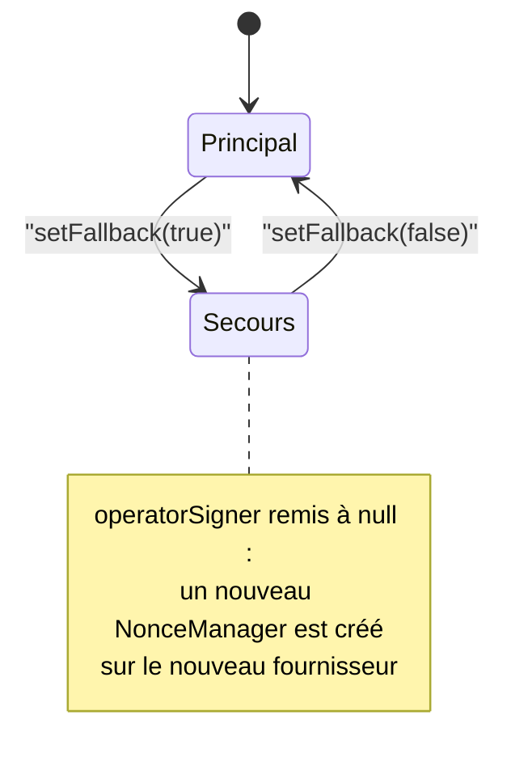

# Client RPC et compte opérateur

[`backend/src/blockchain/chain.client.ts`](src:backend/src/blockchain/chain.client.ts) exporte un singleton `chainClient`. C'est le seul endroit du backend qui ouvre une connexion JSON-RPC vers un nœud Ethereum en mode onchain. Il fournit :

- le fournisseur (`provider`), principal ou de secours ;
- le compte opérateur (`operator`), qui signe les transactions de la Mairie ;
- les instances des contrats `lottery()` et `poap()` ;
- les signataires des portefeuilles citoyens (`walletSigner`) ;
- les liens vers l'explorateur de blocs.

## Fournisseur

La fonction `createProvider(url)` construit chaque fournisseur de la même façon :

```typescript
const request = new FetchRequest(url);
request.timeout = RPC_TIMEOUT_MS;
return new JsonRpcProvider(request, env.CHAIN_ID, { staticNetwork: true, cacheTimeout: -1 });
```

| Réglage | Valeur | Effet |
|---|---|---|
| `request.timeout` | `RPC_TIMEOUT_MS`, 15 000 ms | Une requête JSON-RPC sans réponse au bout de 15 s échoue avec le code ethers `TIMEOUT`, que la passerelle traduit en HTTP 503 |
| Réseau | `env.CHAIN_ID` (31337 par défaut) | Le fournisseur est lié à ce réseau |
| `staticNetwork: true` | | Le fournisseur considère le réseau comme connu et ne lance pas de détection (`eth_chainId`) au démarrage ni avant les requêtes. Sans cette option, ethers relance la détection en boucle tant que le nœud est injoignable, ce qui remplit les journaux et retarde le démarrage |
| `cacheTimeout: -1` | | Désactive le cache des requêtes identiques d'ethers (250 ms par défaut) |

Le fournisseur est créé à la première utilisation (`??=`), pas à l'import du module. En mode simulé, il n'est donc jamais créé.

### Pourquoi cacheTimeout vaut -1

Par défaut, ethers v6 renvoie le même résultat pour des requêtes identiques envoyées à moins de 250 ms d'intervalle. Pour une lecture d'état, c'est sans danger. Pour le nonce, c'est un problème : quand un même portefeuille envoie deux transactions coup sur coup (deux achats rapides, un achat puis un cadeau, ou un job `CLAIM_REFUND` juste après un achat), le second `eth_getTransactionCount(adresse, "pending")` peut recevoir la réponse mise en cache du premier. Les deux transactions portent alors le même nonce et la seconde est rejetée par le nœud (`NONCE_EXPIRED` ou « replacement transaction underpriced »).

Les portefeuilles citoyens sont des `Wallet` ethers simples : ils redemandent leur nonce au nœud à chaque transaction. Désactiver le cache garantit que cette demande atteint réellement le nœud. Le coût est quelques requêtes RPC supplémentaires, négligeable au volume du projet.

### Choix du nœud

`RPC_URL` (par défaut `http://127.0.0.1:8545`) désigne le nœud principal. Dans [`docker-compose.yml`](src:docker-compose.yml), les services `backend` et `worker` utilisent `http://blockchain:8545`, le nœud Hardhat du service `blockchain`. Pour Sepolia, `RPC_URL` pointe vers un fournisseur public ou privé et `CHAIN_ID` vaut `11155111` ; voir [Déploiement sur Sepolia](../smart-contracts/sepolia.md).

## RPC de secours

Le client garde deux fournisseurs possibles. `setFallback(active)` bascule de l'un à l'autre :



À chaque bascule, `operatorSigner` est remis à `null` pour que le compte opérateur soit reconstruit sur le nouveau fournisseur, avec un nonce relu sur ce nœud. Les contrats et les signataires citoyens étant reconstruits à chaque appel, ils suivent la bascule sans autre action.

La valeur par défaut de `FALLBACK_RPC_URL` est `https://ethereum-sepolia-rpc.publicnode.com`.

> [!WARNING]
> La bascule n'est pas exploitable en l'état. Le seul appelant de `chainClient.setFallback` est `switchToFallback` de [`backend/src/services/blockchain.service.ts`](src:backend/src/services/blockchain.service.ts), lui-même appelé uniquement par l'événement `RPC_FALLBACK_SWITCH` du webhook [`backend/src/api/webhooks/blockchain.webhook.ts`](src:backend/src/api/webhooks/blockchain.webhook.ts). Or ce webhook répond 409 dès que le mode est onchain, avant de lire l'événement. En mode onchain, aucun chemin ne déclenche donc la bascule. Par ailleurs, la valeur par défaut désigne Sepolia alors que `CHAIN_ID` vaut 31337 par défaut : un secours utile doit servir le même réseau et héberger les mêmes contrats que le nœud principal. Aucune bascule automatique sur erreur n'existe.

L'état de bascule est exposé par `GET /health` (`network.isFallback`), qui lit la variable de `blockchain.service.ts`, et non `chainClient.isUsingFallback`.

## Compte opérateur

Le compte opérateur est le compte de la Mairie qui détient les rôles d'exploitation du contrat (opérateur, pause, frappe des POAP) et paie les dotations de bienvenue. Sa clé est `RELAYER_PRIVATE_KEY`. La valeur par défaut est la clé publique du compte n° 0 de Hardhat, refusée en production. Il n'est pas l'administrateur du contrat : `DEFAULT_ADMIN_ROLE` revient au compte n° 2 en local (l'opérateur le garde en plus, sauf `LOCAL_STRICT_ROLES=true`) et au multisig `MAIRIE_ADMIN_ADDRESS` sur Sepolia (voir [Exploitation du contrat](../smart-contracts/exploitation.md#roles)).

```typescript
this.operatorSigner ??= new NonceManager(new Wallet(env.RELAYER_PRIVATE_KEY, this.provider));
```

`NonceManager` d'ethers enveloppe le `Wallet`. Il lit le nonce `pending` une seule fois, puis l'incrémente localement à chaque transaction envoyée. Ce mécanisme permet à l'opérateur d'envoyer plusieurs transactions sans attendre que chacune soit minée : un job `MINT_BADGE`, une dotation et un tirage du keeper peuvent partir à la suite.

Transactions signées par l'opérateur :

| Appelant | Fonctions du contrat |
|---|---|
| [Passerelle](passerelle.md) | `requestDraw`, `cancelRound`, `pause`, `unpause`, `setTreasury`, `withdrawFees` |
| [Keeper](keeper.md) | `requestDraw`, `closeExpiredRound` |
| [File d'actions](actions.md) | `mintBadge` sur le contrat POAP |
| [Portefeuilles](portefeuilles.md#dotation-de-bienvenue) | Transfert d'ethers de la dotation |

Le compte doit disposer d'ethers pour le gaz et pour les dotations. Sur le nœud Hardhat local, le compte n° 0 en a 10 000 ; un opérateur distinct en reçoit 1 000 du déploiement. Sur Sepolia, il faut l'alimenter.

### resetOperatorNonce et reprise sur NONCE_EXPIRED

Le compteur local de `NonceManager` se désynchronise quand une transaction est comptée mais n'atteint jamais le nœud, ou quand un autre process signe avec la même clé (l'API et le worker ont chacun leur propre `NonceManager` sur le même compte). Le nœud répond alors par une erreur de code ethers `NONCE_EXPIRED`.

`resetOperatorNonce()` appelle `reset()` du `NonceManager`, qui oublie le compteur local : la prochaine transaction relit le nonce sur le nœud.

`sendAndIndex` de la passerelle exploite ce mécanisme : si l'envoi échoue avec `NONCE_EXPIRED`, il appelle `resetOperatorNonce()` puis renvoie la transaction **une seule fois**. Toute autre erreur, ou un second échec, remonte comme erreur HTTP.

Ce que la reprise ne couvre pas :

- le keeper, la file d'actions et la dotation de bienvenue appellent l'opérateur sans reprise. Un `NONCE_EXPIRED` y fait échouer l'opération ; le keeper réessaie au tour suivant et BullMQ réessaie le job, mais le compteur n'est pas remis à zéro par ces chemins ;
- pour un achat ou un versement signé par un portefeuille citoyen, la reprise renvoie la transaction, mais `resetOperatorNonce` est sans effet sur ce portefeuille, qui relit de toute façon son nonce au nœud.

## Contrats

`lottery(runner)` et `poap(runner)` renvoient une instance `Contract` construite avec l'ABI de `abi/BlockLucky.json` ou `abi/BlockLuckyPOAP.json` et l'adresse `LOTTERY_CONTRACT_ADDRESS` ou `POAP_CONTRACT_ADDRESS`. Le `runner` par défaut est le fournisseur, pour les lectures. Pour écrire, l'appelant passe `chainClient.operator` ou un signataire citoyen.

Les adresses par défaut (`0xCf7E…0Fc9` et `0x5FC8…5707`) sont celles produites par le déploiement local déterministe ; elles sont reprises dans `smart-contract/deployments/localhost.json`.

`isContractDeployed()` vérifie qu'un code existe à l'adresse de la loterie (`getCode` différent de `0x`). Elle n'est appelée nulle part dans le backend actuellement.

## Explorateur

| Méthode | Résultat |
|---|---|
| `explorerTxUrl(hash)` | `EXPLORER_URL/tx/<hash>` si `EXPLORER_URL` est défini et que le hachage a la forme `0x` suivi de 64 caractères hexadécimaux, sinon `null` |
| `explorerAddressUrl(adresse)` | `EXPLORER_URL/address/<adresse>` si `EXPLORER_URL` et l'adresse sont définis, sinon `null` |

`EXPLORER_URL` est vide par défaut (le nœud local n'a pas d'explorateur) et doit commencer par `https://`. Sur Sepolia, la valeur attendue est `https://sepolia.etherscan.io`. La barre finale éventuelle est retirée avant concaténation. Ces liens alimentent les champs `etherscanUrl` et `explorerUrl` des réponses de l'API.

## Arrêt

`destroy()` détruit les deux fournisseurs et oublie le compte opérateur. Il est appelé par l'étape `blockchain` de [`backend/src/observability/shutdown.ts`](src:backend/src/observability/shutdown.ts) à l'arrêt du process, et par le test d'intégration en fin de suite.
