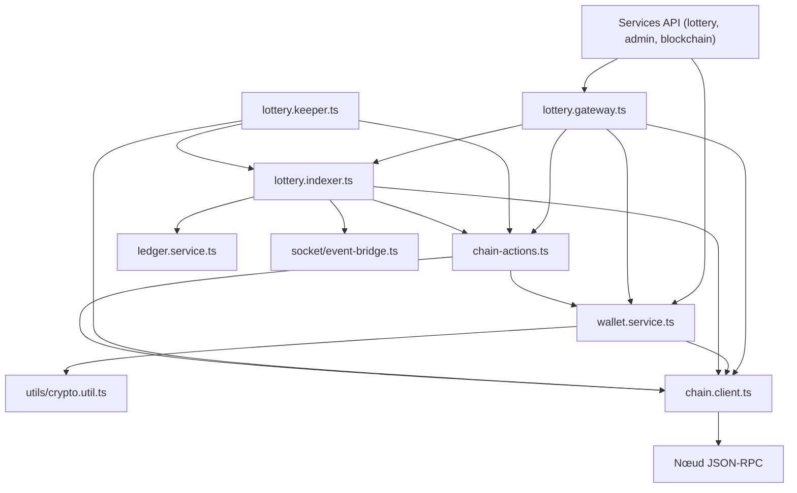
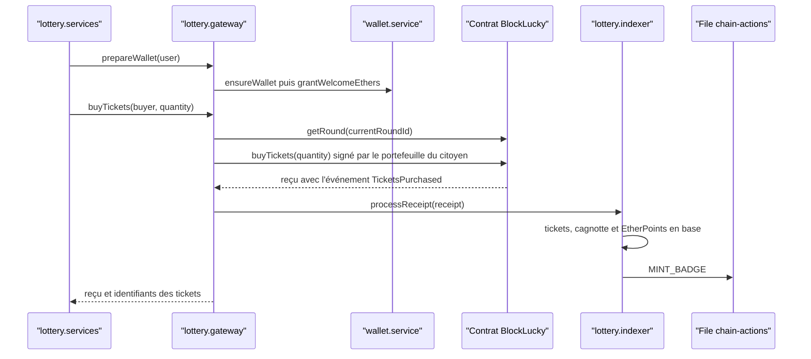

# Vue d'ensemble

Le dossier [`backend/src/blockchain/`](src:backend/src/blockchain/chain.client.ts) contient tout le code qui relie le backend Express aux deux contrats Solidity `BlockLucky` (loterie) et `BlockLuckyPOAP` (badges de participation). Il ne contient aucune route HTTP : les routes de [`backend/src/api/lottery/lottery.services.ts`](src:backend/src/api/lottery/lottery.services.ts), [`backend/src/api/admin/admin.services.ts`](src:backend/src/api/admin/admin.services.ts) et [`backend/src/services/blockchain.service.ts`](src:backend/src/services/blockchain.service.ts) appellent ces modules quand `BLOCKCHAIN_MODE=onchain`.

Le principe directeur est simple : **la chaîne fait foi**. Le backend signe et envoie les transactions, puis il lit les événements émis par le contrat pour mettre à jour PostgreSQL. La base est une projection de la chaîne, enrichie de données qui n'existent pas sur la chaîne (comptes, EtherPoints, récompenses).

## Fichiers du dossier

| Fichier | Rôle | Page détaillée |
|---|---|---|
| [`chain.client.ts`](src:backend/src/blockchain/chain.client.ts) | Fournisseur JSON-RPC unique, RPC de secours, compte opérateur avec gestion des nonces, instances des contrats, liens vers l'explorateur | [Client RPC et compte opérateur](client-rpc.md) |
| [`wallet.service.ts`](src:backend/src/blockchain/wallet.service.ts) | Création et chiffrement des portefeuilles intégrés, signataires, dotation de bienvenue, lecture des soldes | [Portefeuilles intégrés](portefeuilles.md) |
| [`lottery.gateway.ts`](src:backend/src/blockchain/lottery.gateway.ts) | Lecture des tours, achat, tirage, annulation, versement, pause, reversement de la commission, badges ; traduction des erreurs du contrat en erreurs HTTP | [Passerelle du contrat et erreurs](passerelle.md) |
| [`lottery.indexer.ts`](src:backend/src/blockchain/lottery.indexer.ts) | Lecture des journaux du contrat bloc par bloc et projection en base (tours, tickets, points) | [Indexeur d'événements](indexeur.md) |
| [`lottery.keeper.ts`](src:backend/src/blockchain/lottery.keeper.ts) | Automate qui lance le tirage ou clôture un tour expiré, et démarrage périodique de l'indexeur et du keeper | [Keeper du tirage](keeper.md) |
| [`chain-actions.ts`](src:backend/src/blockchain/chain-actions.ts) | File BullMQ `chain-actions` : frappe des POAP, versement de la cagnotte, remboursements ; décodage des erreurs personnalisées Solidity | [File d'actions on-chain](actions.md) |
| [`poap.metadata.ts`](src:backend/src/blockchain/poap.metadata.ts) | Métadonnées ERC-721 et visuel SVG des badges servis par l'API | [Métadonnées POAP](metadonnees-poap.md) |
| `abi/BlockLucky.json`, `abi/BlockLuckyPOAP.json` | ABI des contrats, exportées depuis `smart-contract/` par `scripts/export-abi.mjs` et vérifiées en CI (`node scripts/export-abi.mjs --check`) | [Smart contracts](../smart-contracts/index.md) |

Deux fichiers hors du dossier complètent l'ensemble : [`backend/src/socket/event-bridge.ts`](src:backend/src/socket/event-bridge.ts), qui relaie vers Socket.IO les événements produits par le process worker ([Relais temps réel](relais-temps-reel.md)), et [`backend/src/utils/crypto.util.ts`](src:backend/src/utils/crypto.util.ts), qui chiffre les clés privées.

## Composants et dépendances

Le diagramme suivant montre qui importe qui. Les flèches vont de l'appelant vers le module appelé.

Points notables :

- `chain.client.ts` est le seul module qui crée un `JsonRpcProvider`. Tous les autres passent par le singleton `chainClient`.
- `chain-actions.ts` exporte aussi `decodeContractError`, utilisé par la passerelle et le keeper. C'est pour cette raison que la passerelle importe `chain-actions.ts`.
- Le module historique [`backend/src/services/blockchain.service.ts`](src:backend/src/services/blockchain.service.ts) crée encore ses propres fournisseurs RPC qui ne servent à rien en mode onchain. En mode simulé, il produit des hachages de transaction aléatoires. Voir [Mode onchain ou simulé](modes.md).

## Où s'exécute chaque composant

Le backend peut tourner en un seul process ou en deux (API et worker). Les composants ne démarrent pas au même endroit.

| Composant | Process API (`src/server.ts`) | Process worker (`src/worker.ts`) |
|---|---|---|
| Passerelle, portefeuilles (appelés par les requêtes HTTP) | oui | non |
| Indexeur périodique et keeper (`startChainServices`) | seulement si `RUN_WORKERS=true` | oui |
| Worker BullMQ `chain-actions` (`startWorkers`) | seulement si `RUN_WORKERS=true` | oui |
| Abonné du relais Socket.IO (`startSocketEventBridge`) | oui | non |

Dans [`docker-compose.yml`](src:docker-compose.yml), le service `backend` tourne avec `RUN_WORKERS: "false"` et le service `worker` lance `dist/src/worker.js` : l'indexeur, le keeper et la file tournent donc dans le worker. En développement (`npm run dev`), `RUN_WORKERS` vaut `true` par défaut et tout tourne dans le même process.

`startChainServices` renvoie `null` en mode simulé : aucun minuteur n'est créé.

## Flux d'un achat de ticket

Ce flux résume l'enchaînement des modules pour `POST /api/v1/lottery/buy` en mode onchain.

L'achat est donc indexé immédiatement à partir du reçu, sans attendre le passage de l'indexeur périodique. Quand l'indexeur périodique relit plus tard le même bloc, il retrouve les tickets déjà présents et ne crée rien (voir [Idempotence](indexeur.md#idempotence)).

## Événements produits par la chaîne et suites données

| Événement du contrat | Effet en base | Suite automatique |
|---|---|---|
| `RoundOpened` | Création ou mise à jour du tour | aucune |
| `TicketsPurchased` | Tickets, cagnotte, EtherPoints | Job `MINT_BADGE`, événement Socket.IO `points:awarded` |
| `DrawRequested` | Tour `LOCKED`, identifiant de requête VRF | aucune (l'oracle répond) |
| `WinnerPicked` | Tour `COMPLETED`, gagnant, cagnotte nette | Événement `draw:winner`, job `CLAIM_PRIZE` |
| `PrizeClaimed` | Date de versement | aucune |
| `RoundCancelled` | Tour `CANCELLED` | Un job `CLAIM_REFUND` par payeur distinct |

Les autres événements (`RefundClaimed`, `FeesWithdrawn`, `TreasuryUpdated`, `RoundConfigUpdated`, `VrfConfigUpdated`, ceux du contrat POAP) sont ignorés par l'indexeur.

## Ce qui n'est pas couvert

- Aucun test unitaire ne cible directement les modules de `src/blockchain/`. Ils sont exercés par le test d'intégration sur un nœud Hardhat (voir [Tests sur une vraie chaîne](tests.md)).
- L'indexeur n'a pas de verrou entre process : si l'API et le worker exécutent tous deux `startChainServices`, les deux indexent en parallèle. L'idempotence protège les tickets, mais les événements Socket.IO de `WinnerPicked` peuvent être émis deux fois.
- La bascule vers le RPC de secours n'est pas atteignable en mode onchain (voir [RPC de secours](client-rpc.md#rpc-de-secours)).
