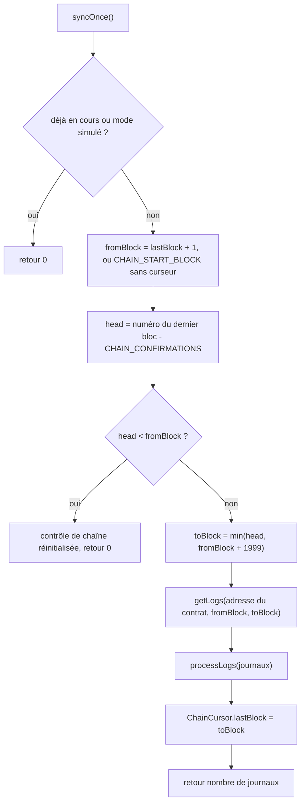

# Indexeur d'événements

[`backend/src/blockchain/lottery.indexer.ts`](src:backend/src/blockchain/lottery.indexer.ts) exporte le singleton `lotteryIndexer`. Il lit les journaux (logs) émis par le contrat `BlockLucky` et les projette dans PostgreSQL : tours (`LotteryRound`), tickets (`Ticket`) et EtherPoints (`PointTransaction`). Il déclenche aussi les suites automatiques : frappe des POAP, versement de la cagnotte, remboursements et événements temps réel.

L'indexeur a deux points d'entrée :

| Méthode | Appelant | Source des journaux |
|---|---|---|
| `processReceipt(reçu)` | `sendAndIndex` de la [passerelle](passerelle.md#sendandindex), le [keeper](keeper.md) | Journaux d'un reçu de transaction que le backend vient d'envoyer |
| `syncOnce()` | Minuteur de `startChainServices`, toutes les `INDEXER_INTERVAL_MS` (3 000 ms par défaut, 500 ms minimum) | Journaux d'une plage de blocs lue par `eth_getLogs` |

Les deux chemins aboutissent à `processLogs(journaux)`, qui fait le même traitement. Une transaction envoyée par le backend est donc traitée deux fois : une fois depuis son reçu, une fois par la synchronisation périodique. Le traitement est conçu pour que la seconde passe ne change rien.

## Curseur ChainCursor

La progression est enregistrée dans la table `ChainCursor`, sur une seule ligne d'identifiant `BlockLucky` (constante `CURSOR_ID`). La colonne `lastBlock` contient le dernier bloc entièrement traité.

## Synchronisation périodique

`syncOnce()` suit cet algorithme :



### Plage maximale

Une passe lit au plus 2 000 blocs (`MAX_BLOCK_RANGE`). Beaucoup de fournisseurs RPC publics refusent les requêtes `eth_getLogs` sur des plages plus larges. Après un long arrêt, l'indexeur rattrape son retard par tranches de 2 000 blocs, une tranche par passe, soit 2 000 blocs toutes les 3 s avec les réglages par défaut.

### Confirmations

`CHAIN_CONFIRMATIONS` (0 par défaut, 64 maximum) retire autant de blocs de la tête de chaîne. Avec 0, un bloc est indexé dès qu'il existe, ce qui convient au nœud Hardhat qui ne connaît pas de réorganisation. Sur Sepolia, une valeur de quelques blocs évite d'indexer un bloc qui serait ensuite abandonné. L'indexeur ne sait pas défaire un bloc déjà indexé : les confirmations sont la seule protection contre les réorganisations.

Les confirmations ne s'appliquent pas à `processReceipt` : un achat est indexé dès que son reçu est disponible.

### Point de départ

Sans ligne de curseur, l'indexeur part de `CHAIN_START_BLOCK` (0 par défaut). Sur un réseau public, il faut y mettre le bloc de déploiement du contrat, pour ne pas parcourir toute l'histoire de la chaîne. Le champ `deploymentBlock` de `smart-contract/deployments/<réseau>.json` en donne une valeur approchée ; la page [Reconstruire depuis la chaîne](../base-de-donnees/reconstruction.md#bloc-de-deploiement) explique comment choisir la valeur exacte. Une fois le curseur créé, `CHAIN_START_BLOCK` n'est plus lu.

### Gestion des erreurs

Toute exception pendant une passe est journalisée en avertissement (« Indexation blockchain interrompue : … ») et la passe renvoie 0. Le curseur n'avance pas : la même plage sera relue à la passe suivante. Les événements de la plage traités avant l'erreur le seront une seconde fois, d'où l'importance de l'idempotence.

Le drapeau `syncing` empêche deux passes simultanées dans un même process, si une passe dure plus longtemps que l'intervalle. Il n'y a pas de verrou entre process.

### Détection d'une chaîne réinitialisée

Le nœud Hardhat local perd tout son état à chaque redémarrage et recommence au bloc 0. La base, elle, garde ses tours, ses tickets et son curseur. L'indexeur détecte ce cas : si la tête réelle de la chaîne (`head + CHAIN_CONFIRMATIONS`) est inférieure à `lastBlock`, il journalise une erreur, une seule fois tant que la situation dure :

```text
Le curseur d'indexation (bloc 152) dépasse la tête de chaîne (bloc 3). La chaîne a été réinitialisée : réinitialisez aussi la base de données.
```

Il n'indexe alors plus rien jusqu'à ce que la chaîne dépasse à nouveau l'ancien curseur, ce qui produirait une base incohérente. Il faut réinitialiser la base (`npm run prisma:reset` dans `backend/`), ou plus finement supprimer les données issues de la chaîne et le curseur ; voir [Reconstruire depuis la chaîne](../base-de-donnees/reconstruction.md).

## Traitement des journaux

`processLogs` garde les journaux dont l'adresse est celle de `LOTTERY_CONTRACT_ADDRESS`, les trie par numéro de bloc puis par index dans le bloc, et les décode avec l'ABI de la loterie. Un journal indécodable est ignoré. Les événements sont traités un par un, dans l'ordre, chaque traitement attendant le précédent.

Deux fonctions utilitaires servent à plusieurs événements :

- `ensureRound(id, bloc)` renvoie le tour en base. S'il n'existe pas, il lit `getRound(id)` dans le contrat et crée le tour avec son statut, sa cagnotte, son prix et ses dates **à l'instant de la lecture**, pas à l'instant du bloc ;
- `userForWallet(adresse)` renvoie le compte de cette adresse en minuscules, ou crée un compte sans email ni clé si l'adresse est inconnue.

L'horodatage des enregistrements vient du bloc (`getBlock(numéro).timestamp`), mis en cache dans une table de 500 entrées au plus, vidée quand elle déborde.

### RoundOpened

Arguments : `roundId`, `ticketPrice`, `maxTickets`, `endTime`.

`upsert` sur `contractRoundId` :

- création : statut `OPEN`, `prizePool` à 0, `ticketPriceWei`, `startedAt` à l'heure du bloc, `endsAt` ;
- mise à jour : `ticketPriceWei` et `endsAt` seulement.

### TicketsPurchased

Arguments : `roundId`, `player` (bénéficiaire), `payer` (signataire de la transaction), `quantity`, `firstTicketIndex`, `totalTickets`, `amount`.

1. `ensureRound` et `userForWallet(player)`.
2. Calcul des numéros de tickets `firstTicketIndex` à `firstTicketIndex + quantity - 1`.
3. Si au moins un de ces numéros existe déjà pour ce tour, rien n'est écrit et la fonction renvoie les tickets existants avec `created: false`.
4. Sinon, dans une transaction Prisma : un `Ticket` par numéro (`userId` du bénéficiaire, `ticketIndex`, `transactionHash`, `blockNumber`, `payerWallet`, `purchasedAt` à l'heure du bloc), et incrément de `prizePool` du montant `amount` converti en ETH.
5. Crédit des EtherPoints (voir plus bas).
6. Émission de `points:awarded` vers Socket.IO, incrément de la métrique `business_events_total{event="ticket_indexed"}`.
7. Job `MINT_BADGE` pour le bénéficiaire et ce tour.

### DrawRequested

Arguments : `roundId`, `requestId`, `ticketCount`.

Mise à jour du tour : statut `LOCKED`, `chainlinkRequestId`, `drawRequestedAt` à l'heure du bloc.

### WinnerPicked

Arguments : `roundId`, `winner`, `winningTicket`, `prize`, `fee`, `requestId`.

1. Mise à jour du tour : statut `COMPLETED`, `winnerWallet`, `winningTicket`, `prizeWei` (cagnotte nette, après commission), `chainlinkRequestId`, `drawnAt` à l'heure du bloc.
2. Émission de `draw:winner` avec `prizePool` (la cagnotte nette en ETH) et `vrfProofHash`, qui contient en réalité le hachage de la transaction de réponse de l'oracle.
3. Job `CLAIM_PRIZE` pour le gagnant.

### PrizeClaimed

Arguments : `roundId`, `winner`, `amount`.

`prizeClaimedAt` à l'heure du bloc. La mise à jour passe par `updateMany`, sans erreur si le tour est inconnu.

### RoundCancelled

Arguments : `roundId`, `ticketCount`, `totalCollected`.

1. Statut `CANCELLED`.
2. Liste des valeurs distinctes de `payerWallet` parmi les tickets du tour.
3. Un job `CLAIM_REFUND` par payeur. Le contrat rembourse le **payeur** et non le bénéficiaire : pour un ticket offert, c'est l'expéditeur qui récupère sa mise.

### Effets en base

| Événement | `LotteryRound` | `Ticket` | `User` | `PointTransaction` |
|---|---|---|---|---|
| `RoundOpened` | création ou mise à jour | | | |
| `TicketsPurchased` | `prizePool` incrémenté, création si absent | une ligne par ticket | création si adresse inconnue, `pointsBalance` | une ou deux lignes |
| `DrawRequested` | `LOCKED`, `chainlinkRequestId`, `drawRequestedAt` | | | |
| `WinnerPicked` | `COMPLETED`, gagnant, `prizeWei`, `drawnAt` | | | |
| `PrizeClaimed` | `prizeClaimedAt` | | | |
| `RoundCancelled` | `CANCELLED` | | | |

## Idempotence

Le même événement peut arriver plusieurs fois : par le reçu puis par la synchronisation, après une passe interrompue, lors d'une reconstruction, ou depuis deux process qui indexent en parallèle.

| Événement | Mécanisme | Effet d'un second passage |
|---|---|---|
| `RoundOpened` | `upsert` sur `contractRoundId` | Aucun changement |
| `TicketsPurchased` | Comptage préalable sur `(lotteryId, ticketIndex)`, puis contrainte unique `Ticket_lotteryId_ticketIndex_key` | Aucun ticket, aucun point, aucun job |
| `DrawRequested`, `PrizeClaimed`, `RoundCancelled` (statut) | Mise à jour avec les mêmes valeurs | Aucun changement en base |
| `WinnerPicked` | Mise à jour avec les mêmes valeurs | `draw:winner` émis à nouveau ; job `CLAIM_PRIZE` dédoublonné par son `jobId` ou terminé par `PrizeAlreadyClaimed` |
| `RoundCancelled` (jobs) | `jobId` déterministe | Jobs dédoublonnés ou terminés par `NothingToRefund` |

Pour les tickets, deux passages simultanés peuvent tous deux trouver zéro ticket au comptage. Le second à écrire viole alors la contrainte unique. `isUniqueViolation` reconnaît cette erreur, soit par le code Prisma `P2002`, soit par le code PostgreSQL `23505` remonté par l'adaptateur `@prisma/adapter-pg`, et renvoie les tickets existants. Seul le passage qui a réellement écrit crédite les points.

Le comptage préalable vérifie « au moins un ticket existant », pas « tous » : un achat dont les tickets seraient partiellement présents ne serait pas complété. Ce cas ne peut pas se produire puisque les tickets d'un achat sont écrits dans une seule transaction.

## Points attribués

| Constante | Valeur | Bénéficiaire | Type de mouvement |
|---|---|---|---|
| `POINTS_PER_TICKET` | 50 par ticket | Bénéficiaire du ticket (`player`) | `TICKET_PURCHASE` |
| `POINTS_PER_GIFTED_TICKET` | 75 par ticket | Payeur, si différent du bénéficiaire et s'il a un compte | `GIFT_TICKET` |

Les points sont crédités par `ledgerService.creditPoints` de [`backend/src/services/ledger.service.ts`](src:backend/src/services/ledger.service.ts), qui incrémente `User.pointsBalance` et écrit une ligne `PointTransaction` dans une même transaction. Les libellés sont « Achat de N ticket(s) sur le tour #X » et « N ticket(s) offert(s) sur le tour #X ».

> [!WARNING]
> Le crédit des points a lieu **après** la transaction qui crée les tickets, pas dans la même. Si le process s'arrête entre les deux, les tickets existent sans les points, et aucun passage ultérieur ne les créditera puisque les tickets sont déjà présents. Les points ne sont pas non plus reconstructibles depuis la chaîne ; voir [Reconstruire depuis la chaîne](../base-de-donnees/reconstruction.md#limites).

`POINTS_PER_TICKET` est importé par `lottery.services.ts` pour calculer `pointsAwarded` dans la réponse de l'achat.

## Achats faits hors du backend

Le contrat accepte les achats de n'importe quelle adresse, par exemple depuis Remix ou un portefeuille externe. L'indexeur les traite comme les autres : il crée un compte sans email pour l'adresse inconnue et lui crédite ses points. Ce compte n'a pas de clé chiffrée : le job `CLAIM_PRIZE` ou `CLAIM_REFUND` qui le concerne se termine sans rien faire, et le citoyen doit appeler lui-même `claimPrize` ou `claimRefund` depuis son portefeuille.
