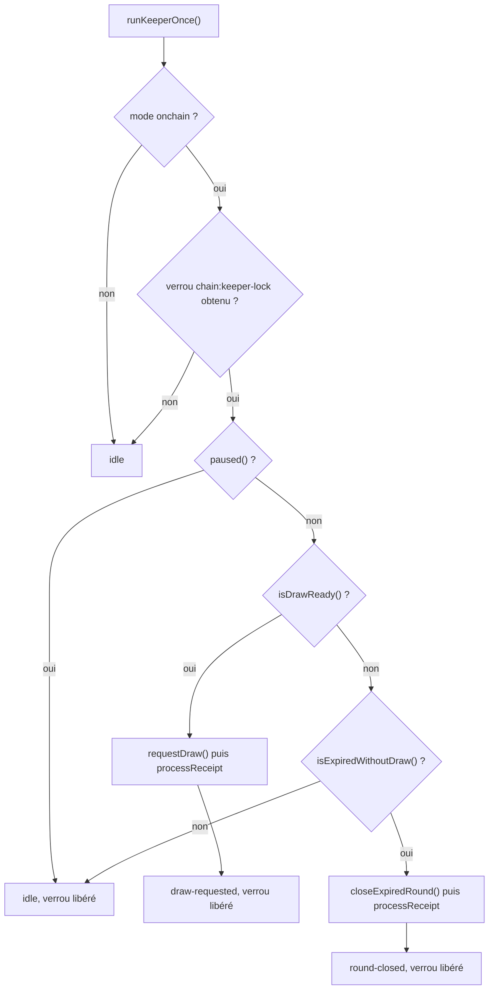

# Keeper du tirage

Un tour de loterie ne se termine pas tout seul : le contrat `BlockLucky` attend qu'un compte appelle `requestDraw()` quand le tour est prêt, ou `closeExpiredRound()` quand il a expiré sans assez de participants. Sur un réseau public, Chainlink Automation peut jouer ce rôle grâce à `checkUpkeep` et `performUpkeep` (voir [Chainlink Automation](../smart-contracts/automation.md)). Le backend embarque son propre automate, le keeper, pour que le cycle tourne aussi sur le nœud local et sans abonnement Automation.

Le code est dans [`backend/src/blockchain/lottery.keeper.ts`](src:backend/src/blockchain/lottery.keeper.ts). Le même fichier démarre l'indexeur périodique.

## runKeeperOnce

`runKeeperOnce()` exécute une passe et renvoie l'action réalisée :

| Valeur renvoyée | Signification |
|---|---|
| `draw-requested` | Le keeper a appelé `requestDraw()` |
| `round-closed` | Le keeper a appelé `closeExpiredRound()` |
| `idle` | Rien à faire, verrou déjà pris, contrat en pause, mode simulé ou erreur |

### Déroulé d'une passe



Les deux conditions sont des fonctions `view` du contrat, ce qui évite de dupliquer la règle dans le backend :

| Fonction | Vraie quand |
|---|---|
| `isDrawReady()` | Tour `Open`, au moins `minTicketsToDraw` tickets, et soit tous les tickets vendus, soit `endTime` atteint |
| `isExpiredWithoutDraw()` | Tour `Open`, `endTime` atteint et moins de `minTicketsToDraw` tickets |

Avec la configuration du déploiement local (`smart-contract/deployments/localhost.json`), un tour dure 1 800 s, se tire à partir de 2 tickets et s'arrête à 10 000 tickets.

Les deux transactions sont signées par le [compte opérateur](client-rpc.md#compte-operateur). Leur reçu est passé à `lotteryIndexer.processReceipt` : le statut `LOCKED` (événement `DrawRequested`) ou `CANCELLED` (événement `RoundCancelled`) est en base dès la fin de la passe, et les jobs de remboursement sont mis en file. Le tour suivant est ouvert par le contrat dans la même transaction pour une annulation (`RoundOpened` du tour suivant dans le même reçu) et dans la transaction de réponse de l'oracle pour un tirage.

### Après requestDraw

Le keeper ne désigne pas le gagnant. `requestDraw` envoie une requête à Chainlink VRF ; l'oracle répond dans une transaction ultérieure qui appelle `fulfillRandomWords` et émet `WinnerPicked`. C'est l'[indexeur](indexeur.md#winnerpicked) qui projette ce résultat, émet `draw:winner` et met en file le versement de la cagnotte. Sur le nœud local, la réponse est fournie par le script `smart-contract/scripts/local-vrf-responder.ts`, lancé par l'image Docker de la blockchain.

Le contrat prévoit `retryDraw()` pour relancer une requête VRF restée sans réponse au-delà de `drawTimeout`. Le keeper ne l'appelle pas : un tour bloqué en `Drawing` demande une intervention, décrite dans les [runbooks blockchain](../infrastructure/runbooks-blockchain.md).

### Verrou

Plusieurs process peuvent exécuter le keeper (l'API avec `RUN_WORKERS=true` et le worker, ou plusieurs workers). Pour qu'un seul envoie la transaction, chaque passe pose d'abord le verrou Redis `chain:keeper-lock` avec `setIfAbsent` :

| Paramètre | Valeur |
|---|---|
| Clé | `chain:keeper-lock`, préfixée comme toutes les clés (`blocklucky:<NODE_ENV>:chain:keeper-lock`) |
| Durée de vie | `max(5, ceil(KEEPER_INTERVAL_MS / 1000))` secondes, soit 10 s par défaut |
| Libération | Dans le bloc `finally`, après la passe, qu'elle réussisse ou non |

La durée de vie sert de filet si le process meurt pendant la passe. Une passe qui attend un minage plus long que la durée de vie (cas possible sur Sepolia) peut laisser un second process prendre le verrou ; il trouve alors en général `isDrawReady()` faux, car le tour est déjà en `Drawing`, ou reçoit `DrawNotReady`, ignoré.

Sans Redis, le verrou est tenu en mémoire par process ; il ne protège plus contre deux process.

### Erreurs

Toute erreur est absorbée et la passe renvoie `idle`. L'erreur est décodée avec `decodeContractError`. `DrawNotReady` et `RoundNotCancellable` sont attendues lors d'une course entre deux keepers ou avec Chainlink Automation, et ne sont pas journalisées. Les autres sont journalisées en avertissement (« Automate du tirage : … »). Le keeper réessaie à la passe suivante.

## startChainServices

`startChainServices()` démarre les deux boucles du mode onchain et renvoie un objet `{ stop }`, ou `null` en mode simulé.

| Boucle | Intervalle | Variable | Minimum |
|---|---|---|---|
| `lotteryIndexer.syncOnce()` | 3 000 ms | `INDEXER_INTERVAL_MS` | 500 ms |
| `runKeeperOnce()` | 10 000 ms | `KEEPER_INTERVAL_MS` | 1 000 ms |

Une première synchronisation de l'indexeur est lancée immédiatement, sans attendre le premier intervalle. Les boucles utilisent `setInterval` sans attendre la fin de la passe précédente ; l'indexeur se protège par son drapeau `syncing` et le keeper par son verrou.

`stop()` arrête les deux minuteurs. Il est enregistré comme étape `chain` de l'arrêt propre, dans [`backend/src/server.ts`](src:backend/src/server.ts) et [`backend/src/worker.ts`](src:backend/src/worker.ts). Une passe en cours n'est pas interrompue.

Lieux d'exécution :

- [`backend/src/worker.ts`](src:backend/src/worker.ts) appelle toujours `startChainServices()` ;
- [`backend/src/server.ts`](src:backend/src/server.ts) l'appelle seulement si `RUN_WORKERS` vaut `true` (valeur par défaut).

En Docker Compose, l'API a `RUN_WORKERS: "false"` : seul le worker fait tourner le keeper.

## Tirage manuel

Un administrateur peut forcer le tirage par `POST /api/v1/lottery/draw`, qui appelle `requestDraw` de la [passerelle](passerelle.md). La transaction est la même que celle du keeper ; elle échoue avec `DrawNotReady` (409) si `isDrawReady()` est faux. `POST /api/v1/lottery/refund` appelle `cancelRound`, réservé au rôle opérateur, qui annule le tour courant sans condition de durée.

## Tester le keeper

Le test d'intégration avance l'horloge du nœud Hardhat au-delà de `endTime`, puis appelle directement `runKeeperOnce()` et vérifie qu'il renvoie `draw-requested` :

```typescript
await chainClient.provider.send('evm_increaseTime', [Number(round.endTime) - Math.floor(Date.now() / 1000) + 60]);
await chainClient.provider.send('evm_mine', []);
expect(await runKeeperOnce()).toBe('draw-requested');
```

Voir [Tests sur une vraie chaîne](tests.md).
