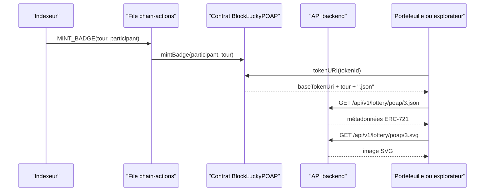

# Métadonnées POAP

Chaque participant à un tour reçoit un badge POAP (Proof of Attendance Protocol) : un jeton ERC-721 non transférable frappé par le contrat `BlockLuckyPOAP`. Le contrat ne stocke pas l'image ni la description du badge. Comme tout ERC-721, il expose une fonction `tokenURI(tokenId)` qui renvoie l'URL d'un document JSON de métadonnées. Le backend sert ce document et l'image correspondante.

Le contrat est décrit sur la page [Badges POAP](../smart-contracts/poap.md). Cette page couvre la partie servie par l'API : [`backend/src/blockchain/poap.metadata.ts`](src:backend/src/blockchain/poap.metadata.ts) et la méthode `getPoapMetadata` de [`backend/src/api/lottery/lottery.controllers.ts`](src:backend/src/api/lottery/lottery.controllers.ts).

## Chaîne complète



`tokenURI` concatène l'URI de base du contrat, le numéro du **tour** (et non l'identifiant du jeton) et `.json`. Tous les badges d'un même tour partagent donc les mêmes métadonnées et la même image. L'URI de base est fixée au déploiement par `POAP_BASE_URI` :

| Déploiement | Valeur |
|---|---|
| Local, service `blockchain` de [`docker-compose.yml`](src:docker-compose.yml) | `http://localhost:2053/api/v1/lottery/poap/` |
| Local, script `deploy-local.ts` sans variable | `http://localhost:2053/api/v1/lottery/poap/` |
| Sepolia, script `deploy-sepolia.ts` | Obligatoire, à fournir |

Elle peut être changée ensuite par `setBaseUri` (rôle administrateur du contrat). Pour un déploiement public, elle doit pointer vers l'URL publique de l'API, sinon les portefeuilles et explorateurs ne trouveront pas les métadonnées.

## Routes

```http
GET /api/v1/lottery/poap/:file
```

La route est aussi servie sous `/api/lottery/poap/:file`. Elle est publique (pas d'authentification) : les portefeuilles et explorateurs l'appellent sans jeton. Elle reste soumise au limiteur de débit global de l'API.

`parsePoapFile(fichier, extension)` valide le paramètre avec l'expression `^(\d{1,9})\.(json|svg)$` et exige un numéro strictement positif.

| Paramètre `file` | Réponse |
|---|---|
| `3.json` | 200, `application/json`, métadonnées du tour 3 |
| `3.svg` | 200, `image/svg+xml`, visuel du tour 3 |
| `0.json`, `abc`, `3.png`, `1234567890.json` | 404 « Badge POAP introuvable » |

Les réponses portent l'en-tête `Cache-Control: public, max-age=86400, immutable`. Le contenu ne dépend que du numéro de tour et de la configuration ; il peut être mis en cache un jour par les navigateurs et les intermédiaires.

La route ne vérifie pas que le tour existe sur la chaîne ou en base : `/poap/999.json` renvoie des métadonnées valides pour un tour qui n'a jamais eu lieu. C'est sans conséquence, puisque seul le contrat décide quels jetons existent.

## Format des métadonnées

`poapMetadata(tour, urlDeBase)` produit un objet conforme au format de métadonnées ERC-721 courant (champs `name`, `description`, `image`) avec les extensions usuelles `external_url` et `attributes`. Pour le tour 3, avec une API appelée sur `localhost:2053` :

```json
{
  "name": "POAP BlockLucky EtherBay, tour n°3",
  "description": "Badge de participation non transférable délivré par la Ville d'EtherBay à chaque citoyen ayant participé à ce tour de la loterie solidaire BlockLucky.",
  "image": "http://localhost:2053/api/v1/lottery/poap/3.svg",
  "external_url": "http://localhost:3000",
  "attributes": [
    { "trait_type": "Tour", "value": 3, "display_type": "number" },
    { "trait_type": "Émetteur", "value": "Mairie d'EtherBay" },
    { "trait_type": "Transférable", "value": "Non" }
  ]
}
```

| Champ | Origine |
|---|---|
| `name` | Texte fixe et numéro du tour |
| `description` | Texte fixe |
| `image` | URL de base de la requête suivie de `/<tour>.svg` |
| `external_url` | `FRONTEND_URL` |
| `attributes` | Trois attributs fixes, le premier numérique |

L'URL de base de `image` est reconstruite à partir de la requête : `req.protocol`, l'en-tête `Host` et `req.baseUrl`, suivis de `/poap`. Une requête reçue sur `/api/lottery/poap/3.json` produit donc une image sous `/api/lottery/poap/`, et une requête sur `/api/v1/…` une image sous `/api/v1/…`. Derrière un proxy inverse en HTTPS, `req.protocol` ne vaut `https` que si `TRUST_PROXY` est configuré ; sinon l'image est annoncée en `http`.

## Visuel SVG

`poapImage(tour)` renvoie une image SVG de 400 × 400 pixels, construite par concaténation de chaînes :

- un disque dégradé du bleu `#1e3a8a` au vert `#0f766e` ;
- un anneau doré `#fbbf24` ;
- les textes « BlockLucky », « Ville d'EtherBay », le numéro `#<tour>` en grand et « Badge de participation », en Arial.

Le numéro de tour inséré dans le SVG est un entier validé par `parsePoapFile` : aucune donnée libre de l'utilisateur n'est injectée dans l'image.

## Côté application

`GET /api/v1/lottery/my-tickets` renvoie la galerie des badges du citoyen. En mode onchain, `onchainBadges` de [`backend/src/api/lottery/lottery.services.ts`](src:backend/src/api/lottery/lottery.services.ts) :

1. prend les tours distincts des tickets de la page demandée, 20 au plus ;
2. lit `badgeOf(tour, adresse)` sur le contrat POAP pour chacun, et ignore les tours sans badge ;
3. lit `tokenURI` du badge, et en déduit l'URL de l'image en remplaçant `.json` par `.svg`.

Chaque badge renvoyé contient `tokenId`, `roundId`, `contractAddress`, `metadataUrl`, `imageUrl` et `explorerUrl` (adresse du contrat POAP sur l'explorateur). Le champ `image3dUrl` reprend l'URL du SVG, et `mintedAt` vaut `null` : la date de frappe n'est pas lue.

Après un achat, la réponse indique `poapBadge.status: "MINT_PENDING"` : le badge est frappé de façon asynchrone par la [file d'actions](actions.md), et apparaît dans la galerie quelques secondes plus tard.

En mode simulé, aucun badge n'existe sur une chaîne : la galerie est construite à partir des tickets, avec un identifiant dérivé du numéro de bloc fictif et une URL `https://assets.etherbay.fr/poap/badge-3d-2026.glb` qui ne correspond à aucun fichier du dépôt.
