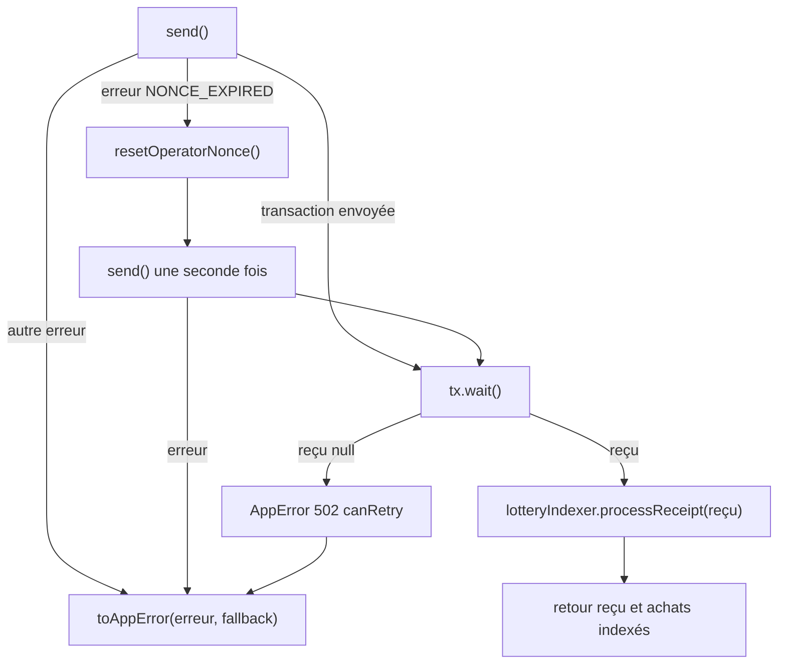

# Passerelle du contrat et erreurs

[`backend/src/blockchain/lottery.gateway.ts`](src:backend/src/blockchain/lottery.gateway.ts) exporte le singleton `lotteryGateway`. C'est l'interface entre les services HTTP et le contrat `BlockLucky`. Il fait trois choses :

1. il lit l'état du contrat et le convertit en types TypeScript simples ;
2. il envoie les transactions et indexe immédiatement leur reçu ;
3. il traduit toute erreur (contrat, réseau, solde) en `AppError` avec un statut HTTP et un message en français destiné au citoyen.

Les services appelants sont [`backend/src/api/lottery/lottery.services.ts`](src:backend/src/api/lottery/lottery.services.ts), [`backend/src/api/admin/admin.services.ts`](src:backend/src/api/admin/admin.services.ts) et [`backend/src/services/blockchain.service.ts`](src:backend/src/services/blockchain.service.ts). La description du contrat lui-même est sur la page [Référence du contrat BlockLucky](../smart-contracts/reference-blocklucky.md).

## Lectures

| Méthode | Appel du contrat | Résultat |
|---|---|---|
| `readCurrentRound()` | `currentRoundId()` puis `getRound(id)` | `OnchainRound` du tour courant |
| `readRound(id)` | `getRound(id)` | `OnchainRound` |
| `isPaused()` | `paused()` | booléen du disjoncteur |
| `ticketsOf(id, adresse)` | `ticketsOf(id, adresse)` | nombre de tickets du joueur |
| `accruedFeesEth()` | `accruedFees()` | commission accumulée, en ETH |
| `badgeOf(id, adresse)` | `badgeOf(id, adresse)` sur le contrat POAP | identifiant du badge, `null` si `0` |
| `badgeTokenUri(tokenId)` | `tokenURI(tokenId)` sur le contrat POAP | URL des métadonnées, `null` en cas d'erreur |
| `describe()` | aucun | `mode`, `chainId`, adresses des contrats, lien explorateur du contrat |

`readRound` convertit la structure Solidity `Round` :

| Champ de `OnchainRound` | Conversion |
|---|---|
| `status` | Indice de l'énumération Solidity vers `OPEN`, `LOCKED`, `COMPLETED`, `CANCELLED` (`Drawing` devient `LOCKED`) ; `OPEN` si l'indice est inconnu |
| `ticketPriceWei`, `totalCollectedWei`, `prizeWei` | `bigint` en wei, sans conversion |
| `ticketCount`, `maxTickets`, `minTicketsToDraw`, `maxTicketsPerPlayer` | `number` |
| `winner`, `winningTicket` | `null` si le gagnant est l'adresse nulle ; adresse en minuscules sinon |
| `startTime`, `endTime` | `Date` (secondes Unix multipliées par 1 000) |
| `vrfRequestId` | Chaîne décimale, `null` si `0` |
| `prizeClaimed` | booléen |

Les montants restent en `bigint` dans la passerelle. Les services les convertissent en ETH avec `formatEther` seulement pour l'affichage et pour la colonne `prizePool`.

## Écritures

| Méthode | Signataire | Fonction du contrat | Message d'échec par défaut |
|---|---|---|---|
| `buyTickets(acheteur, quantité)` | Portefeuille du citoyen | `buyTickets(quantité)` | « L'achat n'a pas pu être enregistré sur la blockchain. » |
| `buyTickets(payeur, quantité, bénéficiaire)` | Portefeuille de l'expéditeur | `buyTicketsFor(bénéficiaire, quantité)` | idem |
| `requestDraw()` | Opérateur | `requestDraw()` | « La demande de tirage Chainlink VRF a échoué. » |
| `cancelRound()` | Opérateur | `cancelRound()` | « L'annulation du tour a échoué. » |
| `claimPrize(gagnant, id)` | Portefeuille du gagnant | `claimPrize(id)` | « Le versement de la cagnotte a échoué. » |
| `setPaused(booléen)` | Opérateur | `pause()` ou `unpause()` | « Le changement d'état du disjoncteur a échoué. » |
| `withdrawFees(trésorerie)` | Opérateur | `setTreasury` si besoin, puis `withdrawFees()` | « Le reversement de la commission à la trésorerie a échoué. » |

La lecture `ticketsOf(tour, adresse)` renvoie le nombre de tickets d'une adresse sur un tour. Le service de loterie l'appelle avant chaque achat et chaque cadeau pour refuser un second ticket avant d'envoyer la transaction.

### Achat

`buyTickets` lit d'abord le tour courant. Si son statut n'est pas `OPEN`, il refuse l'achat avec une 409 sans envoyer de transaction. Sinon, il calcule la valeur exacte à payer, `ticketPriceWei × quantité`, car le contrat rejette tout montant différent (`IncorrectPayment`). Il envoie la transaction, attend le reçu, et renvoie la première entrée de `purchases` produite par l'indexeur. Si le reçu ne contient aucun événement `TicketsPurchased`, il lève une 502 « L'achat a été envoyé mais aucun ticket n'a été émis par le contrat. ».

`prepareWallet(user)` doit être appelé avant `buyTickets` pour que le portefeuille existe et soit approvisionné ; voir [Portefeuilles intégrés](portefeuilles.md#creation-a-la-demande-ensurewallet).

### Reversement de la commission

`withdrawFees(trésorerie)` compare la trésorerie enregistrée dans le contrat à celle demandée. Si elles diffèrent, il appelle `setTreasury`, qui exige le rôle `DEFAULT_ADMIN_ROLE`. Il lit ensuite `accruedFees`, appelle `withdrawFees` et renvoie le hachage, le montant en ETH et la trésorerie. Le montant demandé par l'administrateur (`amountEth`) n'est pas utilisé en mode onchain : c'est toujours la totalité de la commission accumulée qui est reversée.

> [!NOTE]
> En local, [`deploy-local.ts`](src:smart-contract/scripts/deploy-local.ts) laisse `DEFAULT_ADMIN_ROLE` à l'opérateur en plus de ses rôles opérateur, pause et frappe, pour que ce reversement fonctionne quelle que soit l'adresse saisie ; avec `LOCAL_STRICT_ROLES=true`, il ne l'a plus. Sur Sepolia, [`deploy-sepolia.ts`](src:smart-contract/scripts/deploy-sepolia.ts) réserve `DEFAULT_ADMIN_ROLE` au multisig de la Mairie (`MAIRIE_ADMIN_ADDRESS`) : il faut saisir l'adresse `MAIRIE_TREASURY_ADDRESS` déjà enregistrée, sinon `setTreasury` échoue avec `AccessControlUnauthorizedAccount` (403). Changer de trésorerie passe alors par le multisig.

`withdrawFees` n'utilise pas `sendAndIndex` : il n'y a rien à indexer, et il n'y a pas de reprise sur `NONCE_EXPIRED`.

## sendAndIndex

Toutes les écritures sauf `withdrawFees` passent par la méthode privée `sendAndIndex(send, fallback)` :



Trois propriétés en découlent :

- **Synchronisme** : la réponse HTTP n'est envoyée qu'une fois la transaction minée. Sur le nœud Hardhat local, le minage est instantané ; sur Sepolia, il faut compter environ 12 s par bloc, sous la limite `HTTP_REQUEST_TIMEOUT_MS` de 30 s.
- **Indexation immédiate** : les événements du reçu sont projetés en base avant la réponse. L'API peut donc renvoyer les identifiants des tickets créés. L'[indexeur](indexeur.md) périodique repassera sur le même bloc sans rien dupliquer.
- **Erreurs homogènes** : toute exception, y compris celles de l'indexation, passe par `toAppError`.

Le paramètre `send` est une fonction et non une promesse, pour pouvoir renvoyer la transaction lors de la reprise sur `NONCE_EXPIRED` (voir [Client RPC](client-rpc.md#resetoperatornonce-et-reprise-sur-nonce-expired)).

## Traduction des erreurs

### toAppError

`toAppError(erreur, messageParDéfaut)` applique les règles suivantes, dans l'ordre :

1. une `AppError` est renvoyée telle quelle ;
2. l'erreur personnalisée Solidity est décodée par `decodeContractError` (voir [File d'actions](actions.md#decodage-des-erreurs-du-contrat)) ; si son nom figure dans la table `CONTRACT_ERRORS`, l'`AppError` correspondante est créée, avec `contractError` dans les détails ;
3. le code ethers `INSUFFICIENT_FUNDS` donne une 402 ;
4. les codes ethers `NETWORK_ERROR`, `TIMEOUT` et `SERVER_ERROR` donnent une 503 avec `canRetry: true` ;
5. tout le reste est journalisé en erreur (avec le code et le nom de l'erreur du contrat s'il existe) et donne une 502 avec le message par défaut et `canRetry: true`.

Les détails sont renvoyés au client dans le champ `errors` de la réponse d'erreur. Par exemple, un achat pendant une pause du contrat renvoie :

```json
{
  "success": false,
  "message": "Le Smart Contract est temporairement en pause de sécurité par la Mairie.",
  "errors": { "contractError": "EnforcedPause", "canRetry": false, "circuitBreaker": true }
}
```

Le test d'intégration vérifie exactement ce cas (`blocked.status` 503 et `blocked.body.errors.circuitBreaker` à `true`).

### Table des erreurs du contrat

| Erreur Solidity | HTTP | Message renvoyé | Détails ajoutés |
|---|---|---|---|
| `EnforcedPause` | 503 | Le Smart Contract est temporairement en pause de sécurité par la Mairie. | `canRetry: false`, `circuitBreaker: true` |
| `RoundNotOpen` | 409 | Le tirage de ce tour est en cours, les achats reprendront au tour suivant. | |
| `RoundExpired` | 409 | Ce tour est terminé, le tirage va être lancé. | |
| `RoundSoldOut` | 409 | Tous les tickets de ce tour ont été vendus. | |
| `PlayerLimitReached` | 409 | Vous avez déjà votre ticket pour ce grand tirage. | Pour un cadeau, le service remplace le message par « Cette personne a déjà son ticket pour ce grand tirage. » |
| `InvalidQuantity` | 400 | Quantité de tickets invalide. | |
| `IncorrectPayment` | 400 | Montant incorrect pour cet achat. | |
| `DrawNotReady` | 409 | Le tirage ne peut pas encore être lancé (participants ou durée insuffisants). | |
| `RoundNotCancellable` | 409 | Ce tour ne peut pas être annulé. | |
| `NotWinner` | 403 | Ce compte n'est pas le gagnant de ce tour. | |
| `PrizeAlreadyClaimed` | 409 | La cagnotte de ce tour a déjà été versée. | |
| `RoundNotCompleted` | 409 | Le tirage de ce tour n'est pas terminé. | |
| `NothingToWithdraw` | 409 | Aucune commission à reverser à la trésorerie. | |
| `AccessControlUnauthorizedAccount` | 403 | Le compte opérateur du backend n'a pas le rôle requis sur le Smart Contract. | |

Chaque réponse porte en plus `contractError` avec le nom de l'erreur.

### Erreurs hors contrat

| Cause | Code ethers | HTTP | Message |
|---|---|---|---|
| Portefeuille sans assez d'ethers pour la valeur et le gaz | `INSUFFICIENT_FUNDS` | 402 | Solde d'ethers fictifs insuffisant sur votre portefeuille BlockLucky. (`contractError: "InsufficientFunds"`) |
| Nœud injoignable, délai de 15 s dépassé, erreur serveur du nœud | `NETWORK_ERROR`, `TIMEOUT`, `SERVER_ERROR` | 503 | Réseau blockchain injoignable. Veuillez réessayer dans un instant. (`canRetry: true`) |
| Reçu absent après `wait()` | | 502 | Message par défaut de l'opération (`canRetry: true`) |
| Toute autre erreur, y compris une erreur Solidity absente de la table | | 502 | Message par défaut de l'opération (`canRetry: true`) |

Les erreurs du contrat absentes de la table (`ZeroAddressNotAllowed`, `TransferFailed`, `NothingToRefund`, `RoundNotCancelled`, `DrawNotStale`, `InvalidConfiguration`) tombent dans le dernier cas : elles sont journalisées avec leur nom et renvoyées en 502.

### Vérifications faites avant le contrat

Certaines erreurs sont produites par la passerelle ou les services avant tout appel au contrat :

| Condition | HTTP | Origine |
|---|---|---|
| Tour courant non `OPEN` au moment de l'achat | 409 | `buyTickets` de la passerelle |
| Compte sans clé chiffrée | 409 | `signerFor` de `wallet.service.ts` |
| Ticket déjà détenu sur le tour courant, compté en base | 409 | `buyOnchain` de `lottery.services.ts` |
| Cadeau à sa propre adresse email | 400 | `giftOnchain` de `lottery.services.ts` |
| `claim-prize` en mode simulé | 409 | `claimPrize` de `lottery.services.ts` |

Le format général des réponses d'erreur de l'API est décrit sur la page [Réponses et erreurs](../backend/reponses-erreurs.md).
