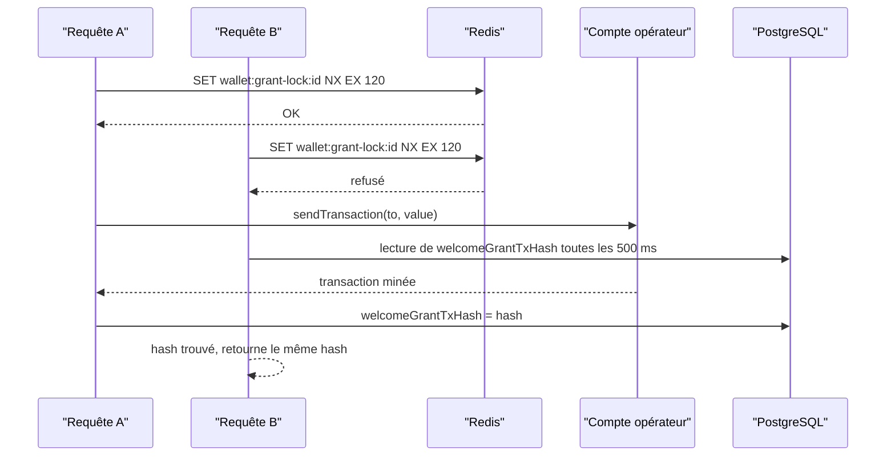

# Portefeuilles intégrés

Chaque citoyen dispose d'un portefeuille Ethereum créé, chiffré et conservé par le backend. Le citoyen n'installe aucune extension et ne voit jamais sa clé privée : c'est un portefeuille dit custodial, dont la Ville est dépositaire. Le code est dans [`backend/src/blockchain/wallet.service.ts`](src:backend/src/blockchain/wallet.service.ts) et le chiffrement dans [`backend/src/utils/crypto.util.ts`](src:backend/src/utils/crypto.util.ts). Les choix de sécurité et leurs limites sont discutés sur la page [Clés des portefeuilles](../securite/cles-portefeuilles.md).

## Création

`createCustodialWallet()` appelle `Wallet.createRandom()` d'ethers v6, puis renvoie :

| Champ | Contenu |
|---|---|
| `address` | Adresse du portefeuille, **en minuscules** (`wallet.address.toLowerCase()`) |
| `encryptedKey` | Clé privée chiffrée par `encryptText(wallet.privateKey)` |

L'adresse est toujours stockée en minuscules dans `User.walletAddress`. Tout le code qui compare des adresses (indexeur, file d'actions) met lui aussi les adresses en minuscules avant de chercher en base.

Trois endroits créent un portefeuille :

| Appelant | Moment |
|---|---|
| `createVerifiedUser` de [`backend/src/api/auth/auth.services.ts`](src:backend/src/api/auth/auth.services.ts) | Inscription d'un citoyen, après vérification du code reçu par email |
| `giftOnchain` de [`backend/src/api/lottery/lottery.services.ts`](src:backend/src/api/lottery/lottery.services.ts) | Cadeau à une adresse email qui n'a pas encore de compte : le compte du destinataire est créé avec son portefeuille |
| `ensureWallet` (voir plus bas) | Compte existant sans clé chiffrée |

L'adresse envoyée par le client à la connexion (`walletAddress` du corps de `POST /auth/login`) n'est pas utilisée comme portefeuille. Le test d'intégration le vérifie : après connexion avec `0x1234…7890`, l'adresse du compte est différente.

## Chiffrement AES-256-GCM

La clé de chiffrement est `ENCRYPTION_KEY` : 64 caractères hexadécimaux, soit 32 octets, chargés une fois par `Buffer.from(env.ENCRYPTION_KEY, 'hex')`. La valeur par défaut de développement est refusée en production.

`encryptText(text)` procède ainsi :

1. tire un vecteur d'initialisation aléatoire de 12 octets (`crypto.randomBytes(12)`) ;
2. chiffre le texte en UTF-8 avec `aes-256-gcm` ;
3. récupère l'étiquette d'authentification de 16 octets (`getAuthTag()`) ;
4. assemble quatre parties séparées par `:`.

```text
v2:<iv en base64url>:<étiquette en base64url>:<texte chiffré en base64url>
```

Le préfixe `v2` identifie le format. `isEncrypted(payload)` teste simplement ce préfixe. GCM authentifie le contenu : une clé chiffrée modifiée en base, ou déchiffrée avec une autre `ENCRYPTION_KEY`, fait échouer `decipher.final()` au lieu de produire une clé fausse.

`decryptText(payload)` accepte deux formats :

| Format | Reconnu par | Algorithme |
|---|---|---|
| `v2:iv:tag:données` | 4 parties, la première vaut `v2` | AES-256-GCM |
| `iv:données` en hexadécimal | 2 parties | AES-256-CBC (ancien format, lecture seule) |

Tout autre format lève `Invalid encrypted payload format`. Le format CBC n'est plus jamais écrit ; il n'est conservé que pour relire d'anciennes valeurs. Les clés de portefeuille sont toutes écrites par `encryptText`, donc au format `v2`.

> [!CAUTION]
> Perdre `ENCRYPTION_KEY` rend toutes les clés privées illisibles et les ethers fictifs des portefeuilles définitivement inaccessibles. La changer sans réchiffrer les clés a le même effet. Aucun script de rotation de clé n'existe dans le dépôt.

## Stockage

| Colonne de `User` | Contenu |
|---|---|
| `walletAddress` | Adresse publique en minuscules, unique |
| `walletEncryptedKey` | Clé privée au format `v2:…`, ou `NULL` pour un compte sans portefeuille intégré |
| `welcomeGrantTxHash` | Hachage de la transaction de dotation de bienvenue, ou `NULL` tant qu'elle n'a pas été versée |

`GET /api/v1/lottery/wallet` renvoie `custodial: true` quand `walletEncryptedKey` est renseigné. La clé chiffrée n'est jamais renvoyée par l'API.

Un compte peut exister sans clé chiffrée dans trois cas : comptes créés par le [seed](../base-de-donnees/seed.md), comptes créés par l'indexeur pour une adresse inconnue qui a acheté directement sur le contrat, et comptes créés en mode simulé.

## Signataire

`signerFor(owner)` déchiffre `walletEncryptedKey` et renvoie un `Wallet` ethers connecté au fournisseur courant (`chainClient.walletSigner`). Si la clé est absente, il lève une `AppError` 409 « Ce compte n'a pas encore de portefeuille BlockLucky ».

La clé déchiffrée n'existe qu'en mémoire, le temps de signer. Elle n'est ni journalisée ni mise en cache. Les appelants sont :

- `buyTickets` et `claimPrize` de la [passerelle](passerelle.md) ;
- `executeChainAction` de la [file d'actions](actions.md) pour `CLAIM_PRIZE` et `CLAIM_REFUND`.

Les transactions du citoyen paient leur gaz depuis son propre portefeuille. Ce gaz est prélevé sur la dotation de bienvenue.

## Création à la demande : ensureWallet

`ensureWallet(owner)` renvoie le compte inchangé s'il a déjà une clé chiffrée. Sinon, il crée un portefeuille et met à jour **à la fois** `walletAddress` et `walletEncryptedKey`.

> [!WARNING]
> `ensureWallet` remplace l'adresse existante du compte. Un compte du seed comme `citoyen@etherbay.fr`, dont l'adresse de démonstration n'est pas une adresse Ethereum valide, reçoit ainsi une nouvelle adresse au premier achat ou à la première consultation du portefeuille en mode onchain. Les tickets anciens restent rattachés au compte par `userId`, mais l'ancienne adresse ne correspond plus à rien.

`prepareWallet` de la passerelle enchaîne `ensureWallet` puis la dotation. Il est appelé avant chaque achat, avant chaque cadeau (pour l'expéditeur) et par `GET /lottery/wallet`.

## Dotation de bienvenue

`grantWelcomeEthers(owner)` envoie au portefeuille du citoyen `WELCOME_GRANT_WEI` wei depuis le compte opérateur. La valeur par défaut est `500000000000000000`, soit 0,5 ETH fictif ; avec le prix de ticket du déploiement local (0,01 ETH), elle couvre quelques tickets et le gaz.

La fonction ne fait rien et renvoie la valeur existante dans ces cas :

- le mode n'est pas onchain ;
- `welcomeGrantTxHash` est déjà renseigné ;
- `WELCOME_GRANT_WEI` vaut `0` (renvoie `null`).

Sinon, elle suit ce déroulé :



### Verrou Redis

Le verrou `wallet:grant-lock:<userId>` est posé par `redis.setIfAbsent` avec une durée de vie de 120 secondes (`GRANT_LOCK_TTL_SECONDS`). Il empêche deux requêtes simultanées (par exemple l'inscription, qui lance la dotation sans l'attendre, puis l'ouverture immédiate de l'écran portefeuille) de verser deux dotations.

En cas de succès, le verrou n'est pas supprimé : il expire seul, et `welcomeGrantTxHash` empêche ensuite toute nouvelle dotation. En cas d'échec de la transaction, le verrou est supprimé, l'erreur est journalisée et la fonction renvoie `null`. La dotation sera retentée au prochain `prepareWallet`.

### Attente waitForPendingGrant

La requête qui n'obtient pas le verrou appelle `waitForPendingGrant`. Elle relit `welcomeGrantTxHash` en base toutes les 500 ms (`GRANT_POLL_MS`) pendant au plus 30 secondes (`GRANT_WAIT_MS`) :

| Situation | Résultat |
|---|---|
| Le hachage apparaît en base | Le hachage est renvoyé |
| Le verrou a disparu sans hachage (échec de l'autre requête) | `null` |
| 30 secondes écoulées | `null` |

Un résultat `null` n'interrompt pas l'achat : la passerelle tente quand même la transaction, qui échoue avec une erreur 402 si le portefeuille n'a pas de quoi payer (voir [Passerelle](passerelle.md#traduction-des-erreurs)).

### Limites connues

- Sans Redis, le verrou est tenu dans la mémoire du process (voir [Données Redis](../base-de-donnees/redis.md#repli-en-memoire)). Deux instances de l'API pourraient alors verser chacune une dotation.
- Si la transaction est minée mais que l'écriture de `welcomeGrantTxHash` échoue, le bloc `catch` supprime le verrou : une seconde dotation peut être versée plus tard.
- L'envoi par le compte opérateur ne bénéficie pas de la reprise sur `NONCE_EXPIRED` de `sendAndIndex`.

## Solde

`balanceOf(address)` renvoie le solde en wei lu par `provider.getBalance`, ou `null` en mode simulé ou si le nœud ne répond pas. Les réponses d'achat et de portefeuille le convertissent en ETH (`walletBalanceEth`, `balanceEth`).

## Effacement RGPD

`anonymizeUserAccount` de [`backend/src/api/user/user.repo.ts`](src:backend/src/api/user/user.repo.ts), appelé à la confirmation d'une demande de suppression, écrit dans la même transaction :

| Colonne | Nouvelle valeur |
|---|---|
| `walletAddress` | `0xdeleted_gdpr_` suivi des 8 premiers caractères de l'identifiant |
| `walletEncryptedKey` | `NULL` |
| `welcomeGrantTxHash` | `NULL` |
| `email`, `twoFactorSecret`, `twoFactorMethod` | `NULL` |
| `twoFactorBackupCodes` | tableau vide |
| `isTwoFactorEnabled` | `false` |
| `deletedAt` | date courante |

Effacer `walletEncryptedKey` détruit la seule copie de la clé privée. Les ethers fictifs restant sur le portefeuille deviennent inaccessibles, ce qui est sans conséquence financière puisqu'ils n'ont aucune valeur.

Ce que l'effacement ne peut pas faire :

- les transactions passées restent sur la chaîne, avec l'adresse d'origine. L'adresse effacée en base n'est plus reliée à une personne, mais la chaîne est publique et immuable. La page [Blockchain et données personnelles](../juridique/blockchain-donnees.md) traite ce point ;
- si l'indexeur relit plus tard un événement qui mentionne l'adresse d'origine (reconstruction, par exemple), il ne la retrouve plus en base et crée un nouveau compte anonyme pour cette adresse (`userForWallet`) ;
- un job `CLAIM_PRIZE` ou `CLAIM_REFUND` en attente pour cette adresse ne trouve plus de clé et se termine sans rien faire.
